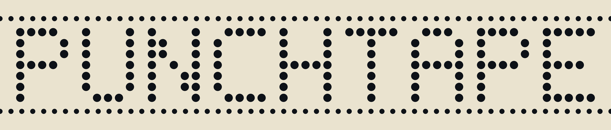
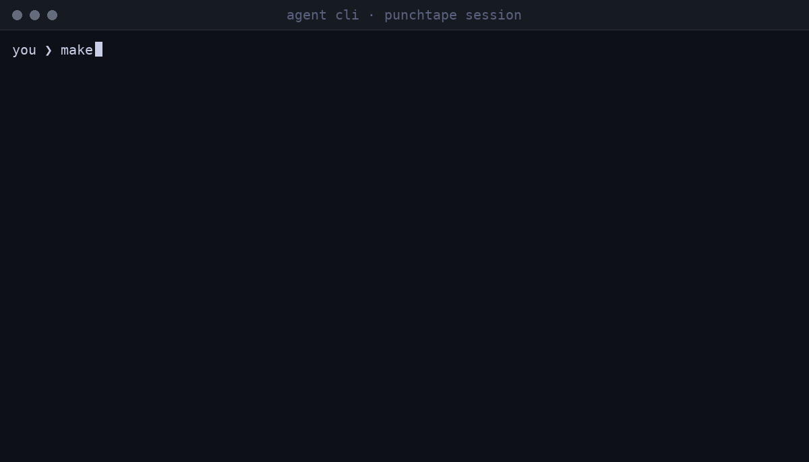

[](https://github.com/neurophant/punchtape/actions/workflows/ci.yml)
[](https://github.com/neurophant/punchtape/releases/latest)
[](LICENSE)
[](https://doi.org/10.2139/ssrn.7566638)

# 
**English** · [Русский](README.ru.md) · [中文](README.zh.md)

**Your AI writes the code. punchtape makes it get the entire job
done — start to finish, with every claim proven.**



*Your words are taken down word for word. The machine runs every
check itself. The agent cannot declare done — it can only make
done true.*

punchtape is a small state machine for your computer. Your AI
assistant runs it while working. The machine runs real checks of
the AI's work, tells the AI what to fix, and records the finish
when every check passes. You read the result — you do not check
anything yourself.

Whether you use Cursor, Claude Code, Windsurf, Aider, GLM or Kimi
— any agent that can run a shell — this is for you, and your
setup stays exactly as it is. punchtape is not another harness and not a plugin
inside the agent: it stands beside your project as the outside
party. It keeps the whole record of the task and drives the agent
through the work until the job is actually done. In precise terms, it is an
external transactional state machine: the arbiter stands outside
the conversation, and that outside position is the whole point.

Free. MIT license. Linux and macOS. Works offline. No account.

## Try it

You need two things — your AI assistant and Linux or macOS.
Nothing else. Prefer to look first? The [demos](demos/) below
open without installing anything.

Ready to run? Three steps:

1. Open the folder the work will live in — a new empty one, or
   your existing project.
2. Paste this line to your assistant. It installs the machine and
   sets everything up by itself:

```text
Read https://github.com/neurophant/punchtape/blob/main/docs/BOOTSTRAP.md and act by it.
```

3. Describe what you want in ordinary words. A new task, for
   example:

```text
Make a notes utility: notes add <text> saves a note and prints its number;
notes list prints the notes one per line, oldest first; notes show <number>
prints one note; state lives in notes.json and survives a restart.
```

Or a project that already exists:

```text
Bring this repo under punchtape: read the code, write checks for the behavior that already exists, make them all pass.
```

That's it. The assistant and the machine do the work; you read
the result.

Installing by hand instead: one command in a terminal —

```bash
curl -fsSL https://github.com/neurophant/punchtape/releases/latest/download/get-punchtape.sh | bash
```

It downloads one small binary, verifies its checksum, and puts
one command — `punchtape` — into `~/.local/bin`. No admin rights,
no account; once per computer.

Every scenario — a new project, a standing repo, a feature, a bug,
a new model, a handover — is walked in **[docs/USAGE.md](docs/USAGE.md)**,
with a ready prompt for each and the team cookbook.

## The problem it solves

This is what normally happens:

1. You give a task to your AI.
2. The AI answers: "Done! All tested!"
3. The first check against your own words shows otherwise: bugs,
   missing pieces, half of the ask quietly dropped.
4. You send it back. "Done! All tested!" — still not. And again.
   And again.
5. The loop is yours: check, send back, re-check — until the
   result comes close to what you actually asked for.

That is not bad luck. An AI left alone grades its own homework:
it writes, declares success, and moves on — the claim "done"
costs it nothing. Proving the claim has always been your job.
punchtape takes that job away: your words become the law of the
task, each claim is measured by running it, and the work cannot
end until it is genuinely finished.

## The solution

- You write your task in normal words. Your assistant puts your
  words — unchanged, one line each — into `.punchtape/demands.md`;
  the machine takes them from the file itself and verifies the
  recorded words on every run: editing any recorded word stops
  the machine.
- Next to the code, the assistant writes a document describing the
  work: what each line of your task means, which requirements the
  words become, and for each behavior, a check: a real command,
  the exact output it must print, and the exact code lines it
  stands behind.
- The machine runs the checks itself, in your project folder, and
  compares bytes. A check passes or fails — the machine sees the
  real result and never asks the AI.
- A failed check lands in `.punchtape/report.md` — what was
  expected, what actually happened. The assistant reads it, fixes
  the code or the checks. Repeat.
- When everything passes, the assistant sends one line —
  `done: true` — and the machine re-checks everything and records
  the finish with a checksum, in files inside your project.
- Words, checks, results, finishes — all of it is written into
  `.punchtape/`, the zone: the machine's own folder inside your
  project. Nothing is stored in any cloud. Copy the folder — the
  whole history moves with it, byte-identical.

You never learn commands. The AI runs the machine; you write
prompts as always.

## The numbers, measured

Three rounds of field tests — real tasks, one group working with
the machine, one without, independent blind judges — published as
a paper (a preprint, not peer-reviewed; the methodology and the
raw campaign data are open):

> **"Closing the Verification Loop in Generative Development: An
> External Transactional State Machine and a Field Evaluation of Its
> Economics and Convergence"**
> — [SSRN](https://doi.org/10.2139/ssrn.7566638) ·
> [Preprints.org](https://doi.org/10.20944/preprints202610.0325.v1) ·
> [Research Square](https://doi.org/10.21203/rs.3.rs-11271483/v1)

| per 25 tasks | without punchtape | with punchtape |
|---|---|---|
| times you had to verify and accept the work | 32 | 2 |
| your verifying time (est.) | 4.4–7.3 h | 0.8–1.3 h |
| total task cost | 5–19× higher | baseline |
| tasks accepted on first submission | — | 25 of 25 |

Blind judges checked 1720 points across both groups and found
nothing missing in either group. All numbers, series by series:
**[docs/METRICS.md](docs/METRICS.md)**; how the tests were run:
**[docs/RESEARCH.md](docs/RESEARCH.md)**.

## Demos — read a session without installing anything

Four recorded cases, each a real run of this version. The full
session record — the whole `.punchtape/` folder — sits in the
repository, and each case's `replay.sh` replays it from scratch
on your machine:

| case | stack | what happens | verdict |
|---|---|---|---|
| [notes](demos/notes/) | Node.js | a new project from zero: a broken build caught red, fixed, every file accounted for, the finish sealed | #1 · 2cb5bbe8a1f6 |
| [gouija](demos/gouija/) | Go | an existing repo brought under the machine: 1 of 25 files claimed, the rest openly excluded | #1 · 9adf209abb37 |
| [enimda](demos/enimda/) | Python | a new feature on finished work: the library untouched, a CLI added, a second finish sealed | #2 · c987b51fd4ce |
| [rjq](demos/rjq/) | Rust | a bug caught and fixed: a silent failure pinned down, guarded forever | #1 · d9c1f6eb10c7 |

## What you get

- **The work runs start to finish — with proofs.** The machine
  hands the agent its next step, measures each claim by running
  it, and records the finish only when every gate is green —
  sealed with a checksum over exactly what passed.
- **You get your time back.** The machine runs the checks — every
  task, every change — and the table above counts what it hands
  back to you.
- **It works with everything.** Project, language, framework,
  workflow, harness, agent — the machine is agnostic to all of
  it. It sees files, commands and bytes.
- **Nothing from your task gets silently dropped.** Every line of
  your words must be given an outcome, and every line of your
  project must be either covered by a check's claim or crossed
  out openly, with a reason. Otherwise: no finish.
- **The machine remembers — mechanically.** Steps, failures,
  fixes — all of it lands in plain files as pure data, no model
  in between. New session, new AI model, next month — the work
  continues exactly where it stopped. The past cannot be edited,
  and the record is yours — no account, no cloud.
- **Strictly deterministic.** Same task, same code, same
  conditions — the same answer, on your laptop, on the server,
  next year.
- **Nothing for you to operate.** No commands, no config, no
  setup: your words are the whole interface, and the agent runs
  the machine.
- **Edits are cheap.** Change one file → only the checks claiming
  lines of that file run again. Everything that still holds is
  not re-run.
- **If something breaks after the finish, you see it.** The
  machine records which run broke it and which run healed it.

Full list with every detail: **[docs/FEATURES.md](docs/FEATURES.md)**

## Works with everything

The machine is agnostic to all of it: project, language, stack,
workflow, preferences, harness, agent. None of that matters to
it — it sees files, commands and bytes, nothing else. That is
the design, not a gap: a checker that knew your stack would be
one more thing to break when the stack changes. Use whatever you
want, however you usually work.

## Requirements

- Linux and macOS on amd64 or arm64. Windows is not supported.
- A unix shell — Linux and macOS have it built in. A command sees
  only `PATH`, `HOME` and the values your project itself sets.
- One binary, one command. No background processes — the machine runs
  only when called, and whatever a command left running dies with
  it. The code contains no network calls at all: no login, no
  account, no telemetry. Your code stays on your machine.
- You need an AI assistant — the machine never writes code
  itself.
- For a one-time throwaway script this is too much; for anything
  you will edit again, this is where it pays.
- Building from source instead of a release needs Go 1.26+
  (`git clone https://github.com/neurophant/punchtape && cd punchtape && ./install.sh`).

## Honest limits

The machine compares real output byte by byte — it never reads
meaning. A recorded finish proves the checks passed exactly as
written: your words resolved, every check green, the whole tree
accounted for. It does not prove the code does what
you meant — that last look stays yours (the spec pages put the
claim and the check side by side for exactly this).

- The machine never sees your chat. It takes your words from
  `.punchtape/demands.md` and checks the record on every run —
  but it cannot know a word that was never written down.
- The agent's submission is YAML, and YAML has sharp edges:
  quoting rules, no tabs. In the latest field rehearsal this was
  the most common refusal — each one names its exact place, and
  nothing is lost.
- One zone, one machine: a zone born on another version of
  punchtape is refused — archive it and start fresh.
- Never edit the files inside `.punchtape/journal/` by hand —
  the machine checks every record and rejects any mismatch.
- Several agents may work one zone: runs take turns
  automatically, one at a time. But the machine does not split
  the work between agents — who does what is the task owner's
  call. punchtape is an arbiter, not a coordinator.

## Documentation

- **[docs/BOOTSTRAP.md](docs/BOOTSTRAP.md)** — the one-line start
  for your AI assistant: it bootstraps itself from this page.
- **[docs/USAGE.md](docs/USAGE.md)** — every scenario walked, with
  ready prompts; the team cookbook: the zone in the repo or
  outside it, conflicts and their recipes.
- **[docs/FEATURES.md](docs/FEATURES.md)** — every feature and
  what it gives you.
- **[docs/ARCHITECTURE.md](docs/ARCHITECTURE.md)** — how the
  machine works inside, every process in detail, over generated
  code maps.
- **[docs/METRICS.md](docs/METRICS.md)** — the measured numbers.
  **[docs/RESEARCH.md](docs/RESEARCH.md)** — the study behind
  them.
- **[docs/GLOSSARY.md](docs/GLOSSARY.md)** — every term explained.
- **[docs/FAQ.md](docs/FAQ.md)** — every question, asked and
  answered with links to the facts.
- **[demos/](demos/)** — four recorded sessions on four stacks.
- **[CHANGELOG.md](CHANGELOG.md)** — the history of releases, what
  each version changed.

## FAQ

**How is this different from CI or pytest?**
CI checks code after you push it, and the verdict is read by a
human. punchtape works inside the task loop: it owns the task's
coverage (every line of your words declared, every line of the
tree claimed or openly crossed out), runs the checks itself,
feeds failures back to the agent, and records the finish with a
checksum. pytest is one kind of check a row can run — fuel, not a
competitor. Your CI stays; punchtape closes the loop before it.

**How is this different from a harness?**
A harness runs your assistant's conversation and lives inside the
agent's environment — it is one of the parties. punchtape is the
external party that owns the task's truth: the state, the proofs,
the verdict. Your harness stays exactly what it is; the arbiter is
added beside it.

**Can the agent cheat it?**
It can refuse to play — that is your call as the task owner (one
line in your assistant's standing instructions). While it plays,
it cannot declare "done": the act is one bare line the machine
re-checks, the verdict comes from commands the machine runs
itself, and any hole — an unclaimed line, an unresolved word, an
unpinned check — holds it. What the machine cannot do is read
meaning; see Honest limits above.

**Where do the numbers come from?**
Three rounds of field tests with blind judges, published as a
preprint (not peer-reviewed) — the methodology and the raw
campaign data are open in the repository.

Every question, each answer grounded in a link, is
**[docs/FAQ.md](docs/FAQ.md)**.

## Why the name

Punched tape — a nod to the punched card, the paper tape, and
Turing's machine all at once. A hole, once punched, cannot be
unpunched.
Same here: every recorded fact stays as it was. Everything
changes — **the tape remains.**
