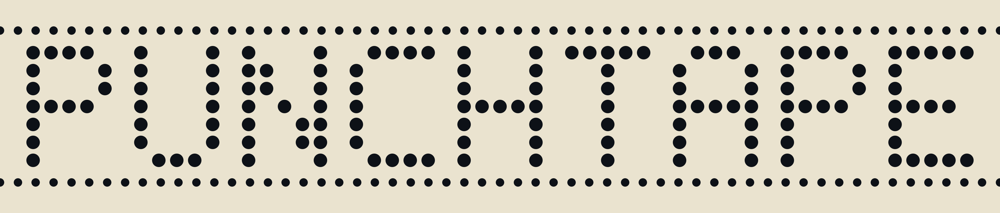
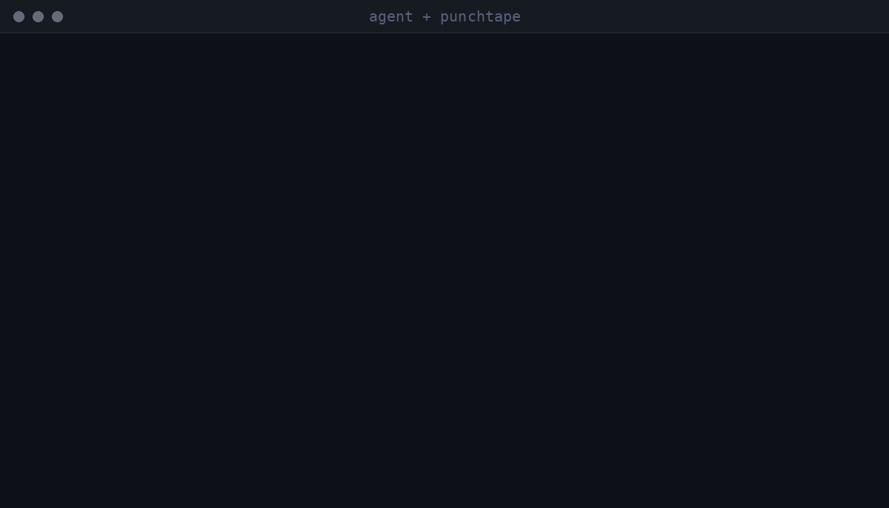

[](https://github.com/neurophant/punchtape/actions/workflows/ci.yml)
[](https://github.com/neurophant/punchtape/releases/latest)
[](LICENSE)
[](https://doi.org/10.2139/ssrn.7566638)
[](https://github.com/neurophant/punchtape)

# 
[English](README.md) · **Русский** · [中文](README.zh.md)

**Ваш ИИ пишет код. punchtape заставляет его доделать всю работу —
от начала и до конца, с доказательством каждого заявления.**

punchtape — маленькая машина состояний для вашего компьютера. Ваш
ИИ-ассистент запускает её, пока работает. Машина исполняет реальные
проверки работы ИИ, говорит ИИ, что чинить, и записывает финиш, когда
каждая проверка проходит. Вы читаете результат. Вы ничего не
проверяете сами.

Работаете ли вы в IDE (Cursor, GitHub Copilot) или в терминале
(Claude Code, Codex CLI), не важно: punchtape работает с любым
агентом, у которого есть шелл, и ему всё равно, какая frontier-модель
стоит за агентом. Ваша среда остаётся ровно такой,
какой была. punchtape — не ещё один
харнесс и не плагин внутри агента: он стоит рядом с вашим
проектом как внешняя сторона. Он держит всю запись задачи и ведёт
агента по работе, пока та не сделана по-настоящему. Строго говоря,
это внешняя транзакционная машина состояний: арбитр судит не по
словам, а по сделанной работе — и мимо его вердикта агент
не пройдёт.

Бесплатно. Лицензия MIT. Linux и macOS. Работает офлайн. Без
аккаунта.

## Одна задача, дважды

<p align="center"><a href="docs/img/demo-without-punchtape.gif"></a></p>

***Без punchtape.** Агент говорит: готово. Сервис отдаёт 500 там, где задача просила 503, и проверять приходится вам: **два раунда**.*

<br>

---

<p align="center"><a href="docs/img/demo-with-punchtape.gif"></a></p>

***С punchtape.** Та же задача, написанная один раз. Машина заставляет агента доказать каждую строку задачи, и баг всплывает до сдачи: **один раунд**.*

## Результаты измерений

Три раунда полевых тестов (реальные задачи, одна группа работала с
машиной, другая без, независимые слепые судьи), опубликованы статьёй
(препринт, без рецензирования; методология и сырые данные кампаний открыты):

> **"Closing the Verification Loop in Generative Development: An
> External Transactional State Machine and a Field Evaluation of Its
> Economics and Convergence"**
> — [SSRN](https://doi.org/10.2139/ssrn.7566638) ·
> [Preprints.org](https://doi.org/10.20944/preprints202610.0325.v1) ·
> [Research Square](https://doi.org/10.21203/rs.3.rs-11271483/v1)

| на 25 задач | без punchtape | с punchtape |
|---|---|---|
| сколько раз вам приходилось проверять и принимать работу | 32 | 2 |
| ваше время проверки (оценка) | 4.4–7.3 ч | 0.8–1.3 ч |
| полная стоимость задачи | в 5–19× дороже | базовая |
| задач принято с первой подачи | — | 25 из 25 |

Слепые судьи проверили 1720 пунктов по обеим группам и не нашли
ни одного пропуска. Все числа, серия за серией:
**[docs/METRICS.ru.md](docs/METRICS.ru.md)**; как проводились тесты:
**[docs/RESEARCH.md](docs/RESEARCH.md)**.

## Попробуйте

Вам нужны две вещи: ваш ИИ-ассистент и Linux или macOS. Больше
ничего. Хотите сначала посмотреть? [Демо](demos/) ниже открываются без всякой
установки.

Готовы запустить? Три шага:

1. Откройте папку, в которой будет жить работа: новую пустую или
   ваш существующий проект.
2. Вставьте ассистенту эту строку. Он установит машину и всё
   настроит сам:

```text
Прочитай https://github.com/neurophant/punchtape/blob/main/docs/BOOTSTRAP.ru.md и действуй по нему.
```

3. Опишите обычными словами, чего хотите. Новая задача, например:

```text
Сделай утилиту заметок: notes add <текст> сохраняет заметку и печатает
её номер; notes list печатает заметки по одной на строку, от старых
к новым; notes show <номер> печатает одну заметку; состояние живёт
в notes.json и переживает перезапуск.
```

Или проект, который уже существует:

```text
Переведи этот репозиторий под punchtape: прочитай код, напиши проверки для поведения, которое уже есть, и сделай так, чтобы все они проходили.
```

Вот и всё. Работу делают ассистент и машина; вы читаете результат.

### Как скилл

Старт из шага 2 есть и в виде скилла,
[skills/punchtape/SKILL.md](skills/punchtape/SKILL.md), он входит в
каталог [agentic-awesome-skills](https://github.com/sickn33/agentic-awesome-skills).
Установите его один раз, и скилл сам подскажет ассистенту, когда
браться за дело: в проекте есть папка `.punchtape/` или вы упомянули
punchtape.

```bash
npx skills add neurophant/punchtape
```

Ставит его утилита `skills` от Vercel (нужен Node.js 22.20 или новее).
Она находит агентов на вашей машине и спрашивает, кому из них отдать
скилл: в текущий проект или, с `-g`, во все проекты. Утилита собирает
анонимную статистику использования, `DISABLE_TELEMETRY=1` её
отключает. Можно обойтись и без неё: скопируйте файл в папку скиллов
вашего агента вручную.

### Ручная установка

**Homebrew** (macOS и Linux):

```bash
brew install neurophant/tap/punchtape
```

**Debian и Ubuntu**. `.deb` под вашу архитектуру лежит на
[странице релизов](https://github.com/neurophant/punchtape/releases/latest):

```bash
sudo dpkg -i punchtape_0.6.0_amd64.deb
```

**Любой unix, ничего не установлено**. Одна команда в терминале:

```bash
curl -fsSL https://github.com/neurophant/punchtape/releases/latest/download/get-punchtape.sh | bash
```

Скрипт скачает один маленький бинарник, сверит контрольную сумму
и положит одну команду, `punchtape`, в `~/.local/bin`. Без прав
администратора, без аккаунта; один раз на компьютер.

Каждый сценарий (новый проект, действующий репозиторий, фича, баг,
новая модель, передача) разобран по шагам в **[docs/USAGE.ru.md](docs/USAGE.ru.md)**,
с готовым промптом на каждый и командным руководством.

## Какую проблему решает

Обычно происходит так:

1. Вы даёте задачу своему ИИ.
2. ИИ отвечает: «Готово! Всё протестировано!»
3. Первая же проверка против ваших же слов показывает другое: баги,
   недостающие куски, половина просьбы молча выброшена.
4. Вы отправляете на доработку. «Готово! Всё протестировано!»
   Опять не то. И снова. И снова.
5. Цикл — ваш: проверить, отправить, перепроверить, пока результат
   хотя бы приблизится к тому, что вы просили на самом деле.

Это не невезение. Оставленный наедине с собой, ИИ оценивает
собственную домашнюю работу: написал, объявил успех, пошёл дальше.
Заявление «готово» ничего ему не стоит. Доказывать это заявление
всегда были обязаны вы. punchtape забирает эту работу: ваши слова
становятся законом задачи, каждое заявление измеряется реальным
запуском, и работа не может закончиться, пока она не окончена
по-настоящему.

## Решение

- Вы пишете задачу обычными словами. Ассистент кладёт ваши слова
  (без изменений, по строке на каждую) в `.punchtape/demands.md`;
  машина берёт их из самого файла и сверяет записанные слова на
  каждом прогоне: правка любого записанного слова останавливает
  машину.
- Рядом с кодом ассистент пишет документ о работе: что значит каждая
  строка вашей задачи, какими требованиями становятся слова, и для
  каждого куска поведения проверку: реальная команда, точный вывод,
  который она обязана напечатать, и точные строки кода, за которые
  она ручается.
- Машина исполняет проверки сама, в папке вашего проекта, и
  сравнивает байты. Проверка проходит или падает. Машина видит
  реальный результат и никогда не спрашивает ИИ.
- Упавшая проверка попадает в `.punchtape/report.md`: что
  ожидалось, что произошло на самом деле. Ассистент читает и чинит
  код или проверки. Повтор.
- Когда всё проходит, ассистент отправляет одну строку,
  `done: true`, и машина заново проходит все ворота и записывает финиш:
  с контрольной суммой, в файлах внутри вашего проекта.
- Слова, проверки, результаты, финиши. Всё это пишется в
  `.punchtape/`, в зону: собственную папку машины внутри вашего
  проекта. Ничего не хранится в облаке. Скопируйте папку. Вся
  история переезжает с ней, байт-в-байт.

Вы не учите команды. ИИ запускает машину; вы пишете промпты как
всегда.

## Демо без установки

Четыре записанных кейса, каждый — реальный прогон этой версии. Полная
запись сессии (вся папка `.punchtape/`) лежит в репозитории, и
`replay.sh` каждого кейса пересобирает её с нуля на вашей машине:

| кейс | стек | что происходит | вердикт |
|---|---|---|---|
| [notes](demos/notes/) | Node.js | новый проект с нуля: сломанная сборка поймана с поличным, починена, каждый файл учтён, финиш запечатан | #1 · a5faaa6aabe3 |
| [tapsum](demos/tapsum/) | Go | действующий репозиторий под машиной: заявлен 1 файл из 7, остальное исключено открыто | #1 · cd00c6fb84cc |
| [enimda](demos/enimda/) | Python | новая фича на готовой работе: библиотека не тронута, добавлен CLI, запечатан второй финиш | #2 · aaf8f4bcb332 |
| [rjq](demos/rjq/) | Rust | баг пойман и починен: тихий сбой прижат и навсегда прикрыт проверкой | #1 · 6045010d2a45 |

## Что вы получаете

- **Работа идёт от начала и до конца — с пруфами.** Машина выдаёт
  агенту следующий шаг, измеряет каждое заявление реальным запуском
  и записывает финиш, только когда каждый гейт зелёный, запечатанный
  контрольной суммой ровно того, что прошло.
- **Вы возвращаете себе время.** Машина исполняет проверки (каждая
  задача, каждое изменение), а таблица выше считает, что она вам
  возвращает.
- **Работает со всем.** Проект, язык, фреймворк, workflow, харнесс,
  агент: машине всё это безразлично. Она видит файлы,
  команды и байты.
- **Из вашей задачи ничего не выбрасывается молча.** Для каждой
  строки ваших слов должен быть заявлен результат, а каждая строка
  вашего проекта либо заявлена проверкой, либо открыто вычеркнута
  с причиной. Иначе: финиша нет.
- **Машина помнит, механически.** Шаги, провалы, фиксы. Всё ложится
  в простые файлы как чистые данные, без модели между вами. Новая
  сессия, новая модель ИИ, следующий месяц. Работа продолжается
  ровно с места остановки. Повреждённая запись прошлого отвергается
  с именем, и запись ваша.
  Без аккаунта, без облака.
- **Строго детерминированная.** Та же задача, тот же код, те же
  условия: тот же ответ, на вашем ноутбуке, на сервере, через год.
- **Управлять вам нечем.** Ни команд, ни конфигов, ни настройки:
  ваши слова — весь интерфейс, а машину запускает агент.
- **Правки дёшевы.** Изменили один файл → перезапускаются только
  проверки, заявляющие строки этого файла. Всё, что всё ещё держится,
  не перезапускается.
- **Если что-то ломается после финиша, вы это видите.** Машина
  записывает, какой прогон его сломал и какой починил.

Полный список со всеми деталями: **[docs/FEATURES.ru.md](docs/FEATURES.ru.md)**

## Работает со всем

Машине безразлично всё это: проект, язык, стек, порядок работы,
предпочтения, харнесс, агент. Ничто из этого не имеет для неё
значения: она видит файлы, команды и байты, ничего больше. Это
дизайн, а не пробел: проверяльщик, знавший ваш стек, стал бы ещё
одной вещью, ломающейся при смене стека. Используйте что хотите, как
вы обычно работаете.

## Требования

- Linux и macOS на amd64 или arm64. Windows пока не поддерживается.
- Unix-шелл (в Linux и macOS он встроен). Команда видит только
  `PATH`, `HOME` и значения, которые задаёт сам ваш проект.
- Один бинарник, одна команда. Без фоновых процессов. Машина
  работает только по вызову, и всё, что команда оставила живым,
  умирает вместе с ней. В коде нет ни одного сетевого вызова: без
  логина, без аккаунта, без телеметрии. Ваш код остаётся на вашей
  машине.
- Нужен ИИ-ассистент. Машина сама никогда не пишет код.
- Для одноразового скрипта это слишком; для всего, что
  вы будете править снова, здесь оно окупается.
- Сборка из исходников вместо релиза требует Go 1.26+
  (`git clone https://github.com/neurophant/punchtape && cd punchtape && ./install.sh`).

## Честные ограничения

Машина сравнивает реальный вывод байт за байтом. Смысл она никогда
не читает. Записанный финиш доказывает, что проверки прошли ровно
как написаны: ваши слова разобраны, каждая проверка зелёная, всё
дерево учтено. Он не доказывает, что код делает то, что вы имели в
виду; этот последний взгляд остаётся вашим (страницы спецификации
кладут заявление и проверку рядом ровно для этого).

- Машина никогда не видит ваш чат. Она берёт ваши слова из
  `.punchtape/demands.md` и сверяет запись на каждом прогоне, но
  она не может узнать слово, которое так и не записали.
- Зона находится в досягаемости вашего агента. Машина проверяет, что
  журнал согласуется сам с собой, а не то, кто его написал. Вердикт,
  которого вы не видели заработанным, перепроверяется командой
  `punchtape --verify` там, где агент не может писать: в CI или на
  другой машине каждый ряд исполняется заново.
- Подача агента — это YAML, и у YAML острые углы: правила кавычек,
  никаких табов. В последней полевой репетиции это был самый частый
  отказ. Каждый называет своё точное место, и ничего не теряется.
- Одна зона, одна машина: зона, рождённая другой версией punchtape,
  отвергается. Архивируйте её и начните заново.
- Никогда не правьте файлы внутри `.punchtape/journal/` руками.
  Машина сверяет каждую запись и отвергает любое несовпадение.
- Несколько агентов могут работать на одной зоне: прогоны идут по
  очереди, автоматически, по одному за раз. Но машина не делит работу
  между агентами. Кто что делает, решает владелец задачи. punchtape
  — арбитр, а не координатор.

## Если агент сжульничает

Отказаться играть он может. Это решает владелец задачи. Но играя,
он не может объявить работу сделанной. Акт завершения — это одна
голая строка, которую машина перепроверяет. Вердикт выносят
команды, которые запускает сама машина. Любая дыра (незаявленная
строка, неразрешённое слово, незакреплённая проверка) держит
финиш.

А жульничество, которое пытается спрятаться, видно лучше всего.
Вся жизнь задачи лежит в обычных файлах внутри `.punchtape/`.
Откройте их в любом редакторе:

- **спек-страницы**: ваши слова и заявляющие их проверки, бок о
  бок.
- **отчёт**: каждый провал, что ожидалось и что произошло на деле.
- **журнал дыр**: каждая строка, вычеркнутая громко, с причиной.
- **страница состояния**: где задача стоит прямо сейчас.

Проследите любой смысл от промпта до кода. Ваша строка стоит в
`demands.md`. Её требования разворачиваются на спек-странице. У
каждого требования есть проверка, которая его доказывает. И
каждая проверка заявляет точные строки кода, за которыми стоит.
Одна неразрывная цепочка из обычных файлов.

Финиш запечатан контрольной суммой ровно того, что прошло. Журнал
под ним машина сверяет на каждом прогоне, и повреждённая запись
отбрасывается, а не принимается. Эта проверка доказывает, что
журнал согласуется сам с собой, а не то, кто его написал: агент,
пересчитавший каждый хэш, может переписать его согласованно.
Вердикт, которого вы не видели заработанным, перепроверяется там,
где агент не может писать, — в CI или на другой машине: там каждый
ряд исполняется заново. Что там стоит, то стоит.

## Документация

- **[docs/BOOTSTRAP.ru.md](docs/BOOTSTRAP.ru.md)**: старт одной
  строкой для вашего ИИ-ассистента: он бутстрапится сам с этой
  страницы.
- **[docs/USAGE.ru.md](docs/USAGE.ru.md)**: каждый сценарий по
  шагам, с готовыми промптами; командное руководство: зона в репо или вне
  его, конфликты и их рецепты.
- **[docs/FEATURES.ru.md](docs/FEATURES.ru.md)**: каждая
  возможность и что она вам даёт.
- **[docs/ARCHITECTURE.ru.md](docs/ARCHITECTURE.ru.md)**: как машина
  работает внутри, каждый процесс в деталях, поверх сгенерированных
  карт кода.
- **[docs/METRICS.ru.md](docs/METRICS.ru.md)**: измеренные числа.
  **[docs/RESEARCH.md](docs/RESEARCH.md)**: исследование за ними
  (на английском).
- **[docs/GLOSSARY.ru.md](docs/GLOSSARY.ru.md)**: каждый термин
  объяснён.
- **[docs/FAQ.ru.md](docs/FAQ.ru.md)**: каждый вопрос задан
  и раскрыт со ссылками на факты.
- **[demos/](demos/)**: четыре записанных сессии на четырёх стеках.
- **[CHANGELOG.md](CHANGELOG.md)**: история релизов: что меняла
  каждая версия (на английском).

## FAQ

**Чем это отличается от CI или pytest?**
CI проверяет код после пуша, и вердикт читает человек. punchtape
работает внутри цикла задачи: он владеет покрытием задачи (каждая
строка ваших слов объявлена, каждая строка дерева заявлена или
открыто вычеркнута), сам исполняет проверки, возвращает провалы
агенту и записывает финиш с контрольной суммой. pytest — один из
видов проверок, которые может прогнать машина. Топливо, не
конкурент. Ваш CI остаётся; punchtape замыкает петлю до него.

**Чем это отличается от харнесса?**
Харнесс ведёт беседу вашего ассистента и живёт внутри
его среды. Это одна из сторон. punchtape — внешняя сторона, которой
принадлежит правда задачи: состояние, пруфы, вердикт. Ваш харнесс
остаётся ровно таким, как есть; арбитр добавляется рядом.

**Может ли агент обмануть машину?**
Он может отказаться играть. Это ваш выбор как владельца задачи
(одна строка в постоянных инструкциях ассистента). Пока он играет,
он не может объявить «готово»: акт — одна голая строка, которую
машина перепроверяет; вердикт выходит из команд, которые машина
исполняет сама; и любая дыра (незаявленная строка, неразобранное
слово, незакреплённая проверка) его держит. Чего машина не умеет,
так это читать смысл; и она не отличит свой журнал от согласованной
перезаписи — запустите `punchtape --verify`, прежде чем принять
вердикт, которого вы не видели заработанным. См. «Честные
ограничения» выше.

**Откуда числа?**
Три раунда полевых тестов со слепыми судьями, опубликованные
препринтом (без рецензирования). Методология и сырые данные кампаний
открыты в репозитории.

Каждый вопрос, с ответом, привязанным к ссылке, — это
**[docs/FAQ.ru.md](docs/FAQ.ru.md)**.

## Почему такое название

Punched tape — перфорированная лента: отсылка сразу к перфокарте,
перфоленте и машине Тьюринга. Отверстие, однажды пробитое, уже
не зарастёт. Здесь так же: каждый записанный факт остаётся таким,
как был. Всё меняется. **Лента остаётся.**

## Поддержите проект

Если punchtape сэкономил вам время, поставьте репозиторию **звезду** на GitHub.
