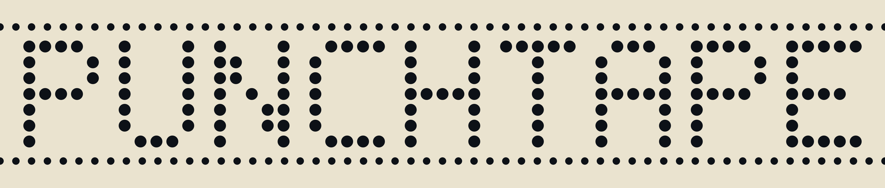
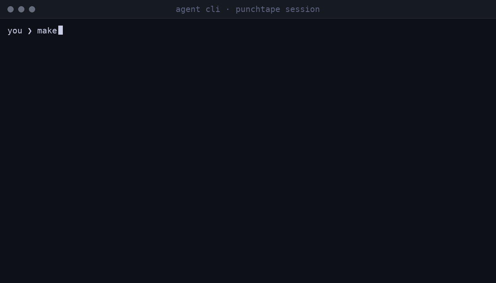

[](https://github.com/neurophant/punchtape/actions/workflows/ci.yml)
[](https://github.com/neurophant/punchtape/releases/latest)
[](LICENSE)
[](https://doi.org/10.2139/ssrn.7566638)

# 
[English](README.md) · **Русский** · [中文](README.zh.md)

**Ваш ИИ пишет код. punchtape заставляет его доделать всю работу —
от начала и до конца, с доказательством каждого заявления.**



*Ваши слова записываются слово в слово. Машина сама прогоняет
каждую проверку. Агент не может объявить работу готовой — он
может только сделать её готовой.*

punchtape — маленькая машина состояний для вашего компьютера. Ваш
ИИ-ассистент запускает её, пока работает. Машина исполняет реальные
проверки работы ИИ, говорит ИИ, что чинить, и записывает финиш, когда
каждая проверка проходит. Вы читаете результат — вы ничего не
проверяете сами.

Работаете ли вы в Cursor, Claude Code, Windsurf, Aider, GLM или Kimi —
годится любой агент, умеющий запустить команду в шелле: это для вас,
и ваша среда остаётся ровно такой, какая есть. punchtape — не ещё одно
агентное окружение и не плагин внутри агента: он стоит рядом с вашим
проектом как внешняя сторона. Он держит всю запись задачи и ведёт
агента по работе, пока та не сделана по-настоящему. Если точно:
это внешняя транзакционная машина состояний — арбитр стоит снаружи
разговора, и эта внешняя позиция и есть весь смысл.

Бесплатно. Лицензия MIT. Linux и macOS. Работает офлайн. Без
аккаунта.

## Попробуйте

Вам нужны две вещи — ваш ИИ-ассистент и Linux или macOS. Больше
ничего. Хотите сначала посмотреть? Демо ниже открываются без всякой
установки.

Готовы запустить? Три шага:

1. Откройте папку, в которой будет жить работа, — новую пустую или
   ваш существующий проект.
2. Вставьте ассистенту эту строку. Он установит машину и всё
   настроит сам:

```text
Прочитай https://github.com/neurophant/punchtape/blob/main/docs/BOOTSTRAP.ru.md и действуй по нему.
```

3. Опишите обычными словами, чего хотите. Новая задача, например:

```text
Сделай утилиту заметок: notes add <текст> сохраняет заметку и печатает
её номер; notes list печатает заметки по одной на строку, от старых
к новым; notes show <номер> печатает одну заметку; состояние живёт
в notes.json и переживает перезапуск.
```

Или проект, который уже существует:

```text
Переведи этот репозиторий под punchtape: прочитай код, напиши проверки для поведения, которое уже есть, и сделай так, чтобы все они проходили.
```

Вот и всё. Работу делают ассистент и машина; вы читаете результат.

Установка руками вместо этого: одна команда в терминале —

```bash
curl -fsSL https://github.com/neurophant/punchtape/releases/latest/download/get-punchtape.sh | bash
```

Она скачивает один маленький бинарник, сверяет его контрольную сумму
и кладёт одну команду — `punchtape` — в `~/.local/bin`. Без прав
администратора, без аккаунта; один раз на компьютер.

Каждый сценарий — новый проект, действующий репозиторий, фича, баг,
новая модель, передача — разобран по шагам в **[docs/USAGE.ru.md](docs/USAGE.ru.md)**,
с готовым промптом на каждый и командным руководством.

## Проблема, которую это решает

Обычно происходит так:

1. Вы даёте задачу своему ИИ.
2. ИИ отвечает: «Готово! Всё протестировано!»
3. Первая же проверка против ваших же слов показывает другое: баги,
   недостающие куски, половина просьбы молча выброшена.
4. Вы отправляете на доработку. «Готово! Всё протестировано!» —
   опять не то. И снова. И снова.
5. Цикл — ваш: проверить, отправить, перепроверить — пока результат
   хотя бы приблизится к тому, что вы просили на самом деле.

Это не невезение. Оставленный наедине с собой, ИИ оценивает
собственную домашнюю работу: написал, объявил успех, пошёл дальше —
заявление «готово» ничего ему не стоит. Доказывать это заявление
всегда были обязаны вы. punchtape забирает эту работу: ваши слова
становятся законом задачи, каждое заявление измеряется реальным
запуском, и работа не может закончиться, пока она не окончена
по-настоящему.

## Решение

- Вы пишете задачу обычными словами. Ассистент кладёт ваши слова —
  без изменений, по строке на каждую — в `.punchtape/demands.md`;
  машина берёт их из самого файла и сверяет записанные слова на
  каждом прогоне: правка любого записанного слова останавливает
  машину.
- Рядом с кодом ассистент пишет документ о работе: что значит каждая
  строка вашей задачи, какими требованиями становятся слова, и для
  каждого куска поведения — проверку: реальная команда, точный вывод,
  который она обязана напечатать, и точные строки кода, за которые
  она ручается.
- Машина исполняет проверки сама, в папке вашего проекта, и
  сравнивает байты. Проверка проходит или падает — машина видит
  реальный результат и никогда не спрашивает ИИ.
- Упавшая проверка попадает в `.punchtape/report.md` — что
  ожидалось, что произошло на самом деле. Ассистент читает и чинит
  код или проверки. Повтор.
- Когда всё проходит, ассистент отправляет одну строку —
  `done: true` — и машина всё перепроверяет и записывает финиш:
  с контрольной суммой, в файлах внутри вашего проекта.
- Слова, проверки, результаты, финиши — всё это пишется в
  `.punchtape/`, зону: собственную папку машины внутри вашего
  проекта. Ничего не хранится в облаке. Скопируйте папку — вся
  история переезжает с ней, байт-в-байт.

Вы не учите команды. ИИ запускает машину; вы пишете промпты как
всегда.

## Числа — измеренные

Три раунда полевых тестов — реальные задачи, одна группа работала с
машиной, другая без, независимые слепые судьи — опубликованы статьёй
(препринт, не рецензия; методология и сырые данные кампаний открыты):

> **"Closing the Verification Loop in Generative Development: An
> External Transactional State Machine and a Field Evaluation of Its
> Economics and Convergence"**
> — [SSRN](https://doi.org/10.2139/ssrn.7566638) ·
> [Preprints.org](https://doi.org/10.20944/preprints202610.0325.v1) ·
> [Research Square](https://doi.org/10.21203/rs.3.rs-11271483/v1)

| на 25 задач | без punchtape | с punchtape |
|---|---|---|
| сколько раз вам приходилось проверять и принимать работу | 32 | 2 |
| ваше время проверки (оценка) | 4.4–7.3 ч | 0.8–1.3 ч |
| полная стоимость задачи | в 5–19× дороже | базовая |
| задач принято с первой подачи | — | 25 из 25 |

Слепые судьи проверили 1720 пунктов по обеим группам и не нашли
ни одного пропуска. Все числа, серия за серией:
**[docs/METRICS.ru.md](docs/METRICS.ru.md)**; как проводились тесты:
**[docs/RESEARCH.md](docs/RESEARCH.md)**.

## Демо — сессия читается без установки

Четыре записанных кейса, каждый — реальный прогон этой версии. Полная
запись сессии — вся папка `.punchtape/` — лежит в репозитории, и
`replay.sh` каждого кейса пересобирает её с нуля на вашей машине:

| кейс | стек | что происходит | вердикт |
|---|---|---|---|
| [notes](demos/notes/) | Node.js | новый проект с нуля: сломанная сборка поймана с поличным, починена, каждый файл учтён, финиш запечатан | #1 · 2cb5bbe8a1f6 |
| [gouija](demos/gouija/) | Go | действующий репозиторий под машиной: заявлен 1 файл из 25, остальное исключено открыто | #1 · 9adf209abb37 |
| [enimda](demos/enimda/) | Python | новая фича на готовой работе: библиотека не тронута, добавлен CLI, запечатан второй финиш | #2 · c987b51fd4ce |
| [rjq](demos/rjq/) | Rust | баг пойман и починен: тихий сбой прижат и навсегда прикрыт проверкой | #1 · d9c1f6eb10c7 |

## Что вы получаете

- **Работа идёт от начала и до конца — с пруфами.** Машина выдаёт
  агенту следующий шаг, измеряет каждое заявление реальным запуском
  и записывает финиш, только когда каждый гейт зелёный, — запечатан
  контрольной суммой ровно того, что прошло.
- **Вы возвращаете себе время.** Машина исполняет проверки — каждая
  задача, каждое изменение — а таблица выше считает, что она вам
  возвращает.
- **Работает со всем.** Проект, язык, фреймворк, workflow, агентная
  среда, агент — машине всё это безразлично. Она видит файлы,
  команды и байты.
- **Из вашей задачи ничего не выбрасывается молча.** Для каждой
  строки ваших слов должен быть заявлен результат, а каждая строка
  вашего проекта — либо заявлена проверкой, либо открыто вычеркнута
  с причиной. Иначе: финиша нет.
- **Машина помнит — механически.** Шаги, провалы, фиксы — всё ложится
  в простые файлы как чистые данные, без модели между вами. Новая
  сессия, новая модель ИИ, следующий месяц — работа продолжается
  ровно с места остановки. Прошлое нельзя править, и запись ваша —
  без аккаунта, без облака.
- **Строго детерминированная.** Та же задача, тот же код, те же
  условия — тот же ответ, на вашем ноутбуке, на сервере, через год.
- **Управлять вам нечем.** Ни команд, ни конфигов, ни настройки:
  ваши слова — весь интерфейс, а машину запускает агент.
- **Правки дёшевы.** Изменили один файл → перезапускаются только
  проверки, заявляющие строки этого файла. Всё, что всё ещё держится,
  не перезапускается.
- **Если что-то ломается после финиша, вы это видите.** Машина
  записывает, какой прогон его сломал и какой починил.

Полный список со всеми деталями: **[docs/FEATURES.ru.md](docs/FEATURES.ru.md)**

## Работает со всем

Машине безразлично всё это: проект, язык, стек, порядок работы,
предпочтения, агентная среда, агент. Ничто из этого не имеет для неё
значения: она видит файлы, команды и байты — ничего больше. Это
дизайн, а не пробел: проверяльщик, знавший ваш стек, стал бы ещё
одной вещью, ломающейся при смене стека. Используйте что хотите, как
вы обычно работаете.

## Требования

- Linux и macOS на amd64 или arm64. Windows не поддерживается.
- Unix-шелл — в Linux и macOS он встроен. Команда видит только
  `PATH`, `HOME` и значения, которые задаёт сам ваш проект.
- Один бинарник, одна команда. Без фоновых процессов — машина
  работает только по вызову, и всё, что команда оставила живым,
  умирает вместе с ней. В коде нет ни одного сетевого вызова: без
  логина, без аккаунта, без телеметрии. Ваш код остаётся на вашей
  машине.
- Нужен ИИ-ассистент — машина сама никогда не пишет код.
- Для одноразового выбрасываемого скрипта это слишком; для всего, что
  вы будете править снова, здесь оно окупается.
- Сборка из исходников вместо релиза требует Go 1.26+
  (`git clone https://github.com/neurophant/punchtape && cd punchtape && ./install.sh`).

## Честные ограничения

Машина сравнивает реальный вывод байт за байтом — смысл она никогда
не читает. Записанный финиш доказывает, что проверки прошли ровно
как написаны: ваши слова разобраны, каждая проверка зелёная, всё
дерево учтено. Он не доказывает, что код делает то, что вы имели в
виду; этот последний взгляд остаётся вашим (страницы спецификации
кладут клейм и проверку рядом ровно для этого).

- Машина никогда не видит ваш чат. Она берёт ваши слова из
  `.punchtape/demands.md` и сверяет запись на каждом прогоне — но
  она не может узнать слово, которое так и не записали.
- Подача агента — это YAML, и у YAML острые углы: правила кавычек,
  никаких табов. В последней полевой репетиции это был самый частый
  отказ — каждый называет своё точное место, и ничего не теряется.
- Одна зона, одна машина: зона, рождённая другой версией punchtape,
  отвергается — архивируйте её и начните заново.
- Никогда не правьте файлы внутри `.punchtape/journal/` руками —
  машина сверяет каждую запись и отвергает любое несовпадение.
- Несколько агентов могут работать на одной зоне: прогоны идут по
  очереди, автоматически, по одному за раз. Но машина не делит работу
  между агентами — кто что делает, решает владелец задачи. punchtape
  — арбитр, а не координатор.

## Документация

- **[docs/BOOTSTRAP.ru.md](docs/BOOTSTRAP.ru.md)** — старт одной
  строкой для вашего ИИ-ассистента: он бутстрапится сам с этой
  страницы.
- **[docs/USAGE.ru.md](docs/USAGE.ru.md)** — каждый сценарий по
  шагам, с готовыми промптами; командное руководство: зона в репо или вне
  его, конфликты и их рецепты.
- **[docs/FEATURES.ru.md](docs/FEATURES.ru.md)** — каждая
  возможность и что она вам даёт.
- **[docs/ARCHITECTURE.ru.md](docs/ARCHITECTURE.ru.md)** — как машина
  работает внутри, каждый процесс в деталях, поверх сгенерированных
  карт кода.
- **[docs/METRICS.ru.md](docs/METRICS.ru.md)** — измеренные числа.
  **[docs/RESEARCH.md](docs/RESEARCH.md)** — исследование за ними
  (на английском).
- **[docs/GLOSSARY.ru.md](docs/GLOSSARY.ru.md)** — каждый термин
  объяснён.
- **[docs/FAQ.ru.md](docs/FAQ.ru.md)** — каждый вопрос задан
  и отвечен со ссылками на факты.
- **[demos/](demos/)** — четыре записанных сессии на четырёх стеках.
- **[CHANGELOG.md](CHANGELOG.md)** — история релизов: что меняла
  каждая версия (на английском).

## FAQ

**Чем это отличается от CI или pytest?**
CI проверяет код после пуша, и вердикт читает человек. punchtape
работает внутри цикла задачи: он владеет покрытием задачи (каждая
строка ваших слов объявлена, каждая строка дерева заявлена или
открыто вычеркнута), сам исполняет проверки, возвращает провалы
агенту и записывает финиш с контрольной суммой. pytest — один из
видов проверок, которые может исполнять ряд, — топливо, не
конкурент. Ваш CI остаётся; punchtape замыкает петлю до него.

**Чем это отличается от агентного окружения?**
Агентное окружение ведёт беседу вашего ассистента и живёт внутри
его среды — оно одна из сторон. punchtape — внешняя сторона, которой
принадлежит правда задачи: состояние, пруфы, вердикт. Ваша среда
остаётся ровно такой, какая есть; арбитр добавляется рядом.

**Может ли агент обмануть машину?**
Он может отказаться играть — это ваш выбор как владельца задачи
(одна строка в постоянных инструкциях ассистента). Пока он играет,
он не может объявить «готово»: акт — одна голая строка, которую
машина перепроверяет; вердикт выходит из команд, которые машина
исполняет сама; и любая дыра — незаявленная строка, неразобранное
слово, незакреплённая проверка — его держит. Чего машина не умеет,
так это читать смысл; см. «Честные ограничения» выше.

**Откуда числа?**
Три раунда полевых тестов со слепыми судьями, опубликованные
препринтом (не рецензия) — методология и сырые данные кампаний
открыты в репозитории.

Каждый вопрос, с ответом, привязанным к ссылке, — это
**[docs/FAQ.ru.md](docs/FAQ.ru.md)**.

## Почему такое имя

Punched tape — перфорированная лента: отсылка сразу к перфокарте,
перфоленте и машине Тьюринга. Отверстие, однажды пробитое, уже
не зарастёт. Здесь так же: каждый записанный факт остаётся таким,
как был. Всё меняется — **лента остаётся.**
