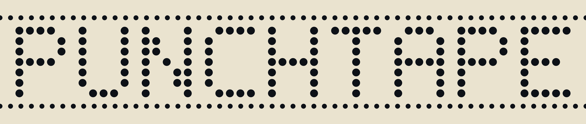
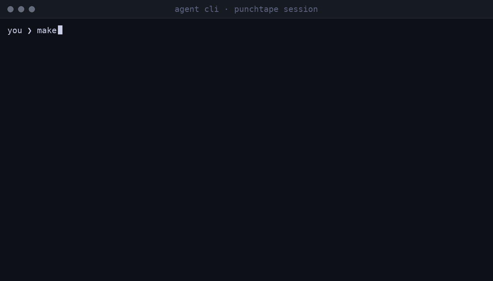

[](https://github.com/neurophant/punchtape/actions/workflows/ci.yml)
[](https://github.com/neurophant/punchtape/releases/latest)
[](LICENSE)
[](https://doi.org/10.2139/ssrn.7566638)

# 
[English](README.md) · [Русский](README.ru.md) · **中文**

**你的 AI 写代码。punchtape 逼它把整份工作做到底——从头到尾，
每一句 claim 都有实证。**



*你的原话一字不改地被记下。机器自己运行每一项检查。代理无法宣布
完成——它只能让工作真正完成。*

punchtape 是你电脑上的一台小型状态机。你的 AI 助手在工作中
运行它。机器对 AI 的工作执行真实的检查，告诉 AI 该修什么，
并在每条检查都通过时记录完成。你只管读结果——任何东西都不必
亲自检查。

无论你用 Cursor、Claude Code、Windsurf、Aider、GLM 还是
Kimi，只要 agent 能运行 shell 命令，这里就有你的位置，
你的环境原封不动。punchtape 不是又一个 harness，也不是
agent 体内的插件：它作为外部一方站在你项目旁边。它持有
任务的完整记录，驱使 agent 把工作做到真正做完。说准确些：
它是一台外部事务状态机，仲裁者站在会话之外，而这个外部
位置就是全部的意义。

免费。MIT 许可证。Linux 与 macOS。可离线工作。无账户。

## 试一试

你需要两样东西：你的 AI 助手，和 Linux 或 macOS。仅此而已。
想先看看？下面的演示无需安装任何东西即可打开。

准备动手了？三步：

1. 打开工作所在的文件夹：一个新的空文件夹，或你已有的
   项目。
2. 把这一行贴给你的助手。它会装好机器、把一切设置妥当：

```text
阅读 https://github.com/neurophant/punchtape/blob/main/docs/BOOTSTRAP.zh.md 并照它行动。
```

3. 用平常的话描述你要什么。比如一个新任务：

```text
做一个笔记工具：notes add <文本> 保存一条笔记并打印它的编号；
notes list 每行一条、从旧到新打印全部笔记；notes show <编号>
打印一条笔记；状态存在 notes.json 里，重启之后依然存在。
```

或者一个已经存在的项目：

```text
把这个仓库纳入 punchtape：读代码，为已经存在的行为写检查，让它们全部通过。
```

就这样。干活的是助手和机器；你读结果。

改为手动安装，只需在终端里运行：

```bash
curl -fsSL https://github.com/neurophant/punchtape/releases/latest/download/get-punchtape.sh | bash
```

它下载一个小二进制，校验其校验和，把一条命令 `punchtape`
放进 `~/.local/bin`。不要管理员权限，不要
账户；每台电脑一次。

每个场景（新项目、现存仓库、一个功能、一个 bug、新模型、
交接）都在 **[docs/USAGE.zh.md](docs/USAGE.zh.md)** 里逐步
走一遍，每个场景带一条现成提示，还有团队手册。

## 它解决的问题

平常是这样：

1. 你把任务交给你的 AI。
2. AI 回答：「做完了！都测过了！」
3. 第一场对照你原话的检查就露出真相：bug、缺失的部分、
   一半的要求被悄悄丢掉。
4. 你打回去。「做完了！都测过了！」——还是不行。再来。
   再来。
5. 循环是你的：检查、打回、再检查，直到结果勉强接近你
   真正要的东西。

这不是运气差。放任自流的 AI 给自己的作业打分：写完、宣布
成功、继续前进——一句「做完了」对它毫无成本。证明这句话
向来是你的活。punchtape 把这活拿走：你的原话成为任务的
法则，每个 claim 靠真实运行来测量，而在工作真正完成之前，
它不许结束。

## 解决方案

- 你用平常的话写下任务。助手把你的原话——一字不改、一行
  一句——放进 `.punchtape/demands.md`；机器亲自从文件里取走
  它们，并在每次运行时核对已记录的言语：改动任何已记录的词
  都会让机器停下。
- 在代码旁边，助手写一份关于这份工作的文档：你任务的每一行
  意味着什么，言语成为哪些要求，以及每块行为的检查——一条
  真实命令、它必须打印的精确输出，以及它为之担保的确切
  代码行。
- 机器亲自运行检查，就在你的项目文件夹里，并逐字节比较。
  检查通过还是失败——机器看到的是真实结果，它从不问 AI。
- 失败的检查进入 `.punchtape/report.md`——期望什么、实际发生
  了什么。助手读了，修代码或修检查。再来。
- 全部通过后，助手发回一行——`done: true`——机器重新检查
  一切并记录完成：带校验和，写进你项目内的文件。
- 言语、检查、结果、完成——全部写进 `.punchtape/`，也就是
  区：机器在你项目里的自有文件夹。任何东西都不存到云上。
  复制文件夹——全部历史随之而行，字节相同。

你永远不用学命令。AI 运行机器；你照常写提示。

## 数字——实测的

三轮实地测试——真实任务，一组用机器工作，一组不用，独立
盲评裁判——已发表为论文（预印本，未经同行评审；方法论与
campaigns 的原始数据全部公开）：

> **"Closing the Verification Loop in Generative Development: An
> External Transactional State Machine and a Field Evaluation of Its
> Economics and Convergence"**
> — [SSRN](https://doi.org/10.2139/ssrn.7566638) ·
> [Preprints.org](https://doi.org/10.20944/preprints202610.0325.v1) ·
> [Research Square](https://doi.org/10.21203/rs.3.rs-11271483/v1)

| 每 25 个任务 | 不用 punchtape | 用 punchtape |
|---|---|---|
| 你验收和接受工作的次数 | 32 | 2 |
| 你的验收时间（估算） | 4.4–7.3 小时 | 0.8–1.3 小时 |
| 任务总成本 | 贵 5–19× | 基准 |
| 首次提交即获验收的任务 | — | 25 个中的 25 个 |

盲评裁判在两组共检查了 1720 个点，两组均无缺失。全部数字、
一个系列接一个系列：**[docs/METRICS.zh.md](docs/METRICS.zh.md)**；
测试是怎么跑的：**[docs/RESEARCH.md](docs/RESEARCH.md)**（英文）。

## 演示——无需安装即可阅读一场会话

四个录制的案例，每一个都是这一版本的真实运行。完整的会话
记录——整个 `.punchtape/` 文件夹——就在仓库里，每个案例的
`replay.sh` 都能在你的机器上从零重放它：

| 案例 | 技术栈 | 发生了什么 | 裁决 |
|---|---|---|---|
| [notes](demos/notes/) | Node.js | 从零开始的新项目：坏掉的构建被当场抓住、修好、每个文件都有交代、完成封存 | #1 · 2cb5bbe8a1f6 |
| [gouija](demos/gouija/) | Go | 现存仓库纳入机器：25 个文件中 claim 了 1 个，其余被公开豁免 | #1 · 9adf209abb37 |
| [enimda](demos/enimda/) | Python | 已完成工作上的新功能：库未动、加了一个 CLI、第二个完成封存 | #2 · c987b51fd4ce |
| [rjq](demos/rjq/) | Rust | 一个 bug 被抓住并修好：无声的失败被钉死、永世看守 | #1 · d9c1f6eb10c7 |

## 你得到什么

- **工作从头跑到尾——带着证明。** 机器把下一步交给 agent，
  用真实运行测量每个 claim，只在每一道闸都绿了才记录完成
  ——用对恰好通过的内容的校验和封存。
- **你的时间回来了。** 机器运行检查——每个任务、每次改动
  ——上面那张表数的就是它还给你的东西。
- **和一切协同。** 项目、语言、框架、工作流、harness、
  agent——机器对这一切不可知。它看到的是文件、命令和字节。
- **你的任务里不会有任何东西被悄悄丢掉。** 你言语的每一行
  都必须得到申报的结果，你项目的每一行都必须被某条检查的
  claim 覆盖，或者被公开划掉并附理由。否则：不记录完成。
- **机器记得——机械地记。** 步骤、失败、修复——全部落进
  纯文本文件，成为纯粹的数据，中间没有模型。新会话、新 AI
  模型、下个月——工作从停下的地方继续。过去无法编辑，记录
  是你的——无账户，无云端。
- **严格确定性。** 同样的任务、同样的代码、同样的条件——
  同样的答案，在你的笔记本上、在服务器上、在明年。
- **没有要你操作的东西。** 没有命令、没有配置、没有安装：
  你的原话就是全部界面，机器由 agent 运行。
- **改动是便宜的。** 改一个文件 → 只有 claim 了该文件各行
  的检查重新运行。仍然成立的一切都不重跑。
- **完成之后有东西坏了，你会看到。** 机器写下哪个 run
  弄坏了它、哪个 run 治好了它。

完整清单、每个细节：**[docs/FEATURES.zh.md](docs/FEATURES.zh.md)**

## 与一切协同工作

机器对这一切不可知：项目、语言、技术栈、工作流、偏好、
harness、agent。这些对它都无关紧要——它看到的是文件、命令
和字节，仅此而已。这是设计，不是缺陷：一个认识你的技术栈的
检查器，只会成为技术栈变化时又一件坏掉的东西。想用什么就
用什么，按你平常的方式工作。

## 系统要求

- Linux 与 macOS，amd64 或 arm64。不支持 Windows。
- 一个 unix shell——Linux 和 macOS 自带。命令只看得见
  `PATH`、`HOME` 和你的项目自己设置的值。
- 一个二进制，一条命令。没有后台进程——机器只在被调用时
  运行，命令留下的一切活物随它一同死去。代码里完全没有
  网络调用：无登录、无账户、无遥测。你的代码留在你的
  机器上。
- 你得有一个 AI 助手——机器自己从不写代码。
- 一次性用完即弃的脚本——犯不上；任何你还会再改的东西
  ——这正是它回本的地方。
- 从源码构建代替下载发布版需要 Go 1.26+
  （`git clone https://github.com/neurophant/punchtape && cd punchtape && ./install.sh`）。

## 诚实的限制

机器逐字节比较真实输出——它从不读含义。一份记录在案的完成
证明的是：检查恰好按写下的样子通过了——你的言语被分解、
每条检查绿色、整棵树有交代。它不证明代码做的是你心里想的
那件事——最后那一眼仍然是你的（spec 页面把 claim 和检查
并排放在一起，正是为了这一眼）。

- 机器从看不见你的聊天。它从 `.punchtape/demands.md` 取走
  你的言语，并在每次运行时核对记录——但它无法知道一句从未
  被写下来的话。
- agent 的提交是 YAML，而 YAML 有锋利的边角：引号规则、
  不许制表符。在最近一次实地演练中这是最常见的拒绝——每
  一条都点名自己的确切位置，没有任何东西丢失。
- 一个区、一台机器：由另一个 punchtape 版本诞生的区会被拒绝
  ——归档它，从头再来。
- 永远不要手改 `.punchtape/journal/` 里的文件——机器核对
  每条记录，拒绝任何不吻合。
- 多个 agent 可以在同一个区上工作：运行自动排队，一次一个。
  但机器不在 agent 之间分配工作——谁做什么，由任务主人决定。
  punchtape 是仲裁者，不是协调者。

## 文档

- **[docs/BOOTSTRAP.zh.md](docs/BOOTSTRAP.zh.md)**——给你的
  AI 助手的一行式起点：它按这一页自行完成引导。
- **[docs/USAGE.zh.md](docs/USAGE.zh.md)**——每个场景逐步
  走一遍，带现成提示；团队手册：区在仓库里或在仓库外、冲突
  及其处方。
- **[docs/FEATURES.zh.md](docs/FEATURES.zh.md)**——每个功能，
  以及它给你什么。
- **[docs/ARCHITECTURE.zh.md](docs/ARCHITECTURE.zh.md)**——
  机器内部如何运作，每个过程的细节，铺在生成的代码地图
  之上。
- **[docs/METRICS.zh.md](docs/METRICS.zh.md)**——实测的数字。
  **[docs/RESEARCH.md](docs/RESEARCH.md)**——数字背后的研究
  （英文）。
- **[docs/GLOSSARY.zh.md](docs/GLOSSARY.zh.md)**——每个术语的
  解释。
- **[docs/FAQ.zh.md](docs/FAQ.zh.md)**——每个问题都带着指向
  事实的链接被问过和答过。
- **[demos/](demos/)**——四个录制会话，四种技术栈。
- **[CHANGELOG.md](CHANGELOG.md)**——各版本发布的历史，每个
  版本改了什么（英文）。

## FAQ

**这和 CI 或 pytest 有什么不同？**
CI 在你 push 之后检查代码，裁决由人来读。punchtape 工作在
任务循环之内：它持有任务的覆盖（你言语的每一行都被申报、
树的每一行都被 claim 或被公开划掉），亲自运行检查，把失败
回喂给 agent，并用校验和记录完成。pytest 只是 row 可以运行
的一种检查——是燃料，不是对手。你的 CI 照旧；punchtape 在
它之前把环闭合。

**这和 harness 有什么不同？**
harness 运行你助手的会话、活在 agent 的环境里——它就是当事
一方。punchtape 是持有任务真相的外部一方：状态、证据、裁决。
你的 harness 原封不动；仲裁者加在旁边。

**agent 能骗过它吗？**
它可以拒绝玩——那是你作为任务主人的决定（在助手常驻指令里
加一行）。只要它在玩，它就无法宣布「done」：这个动作是机器
亲自复核的一行裸文；裁决出自机器亲自运行的命令；而任何洞
——一行未被 claim 的代码、一句未分解的言语、一条未钉住的
检查——都会拦住它。机器做不到的是读含义；见上面的「诚实的
限制」。

**数字从哪来？**
三轮带盲评裁判的实地测试，以预印本发表（未经同行评审）——
方法论与 campaigns 的原始数据在仓库里公开。

每个问题、每个答案都有链接佐证——见
**[docs/FAQ.zh.md](docs/FAQ.zh.md)**。

## 为什么叫这个名字

穿孔纸带——同时致敬穿孔卡片、纸带与图灵机。一个孔，
一旦打上，就再也无法抹去。这里也一样：每条记录在案的事实
都保持原样。一切都在变——**带子还在。**
