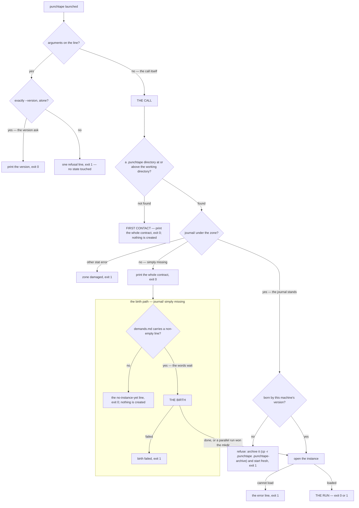
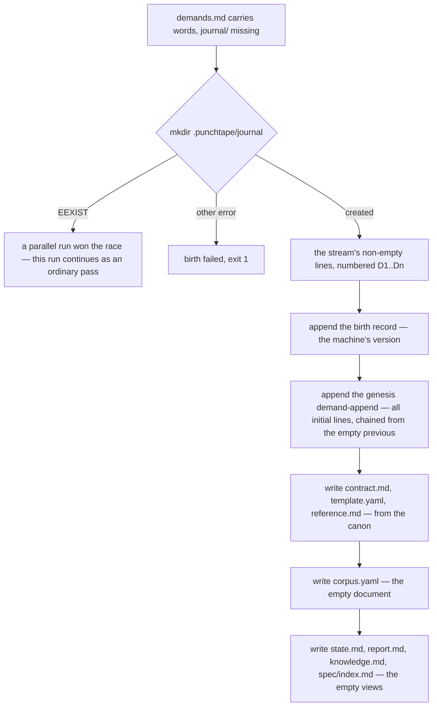
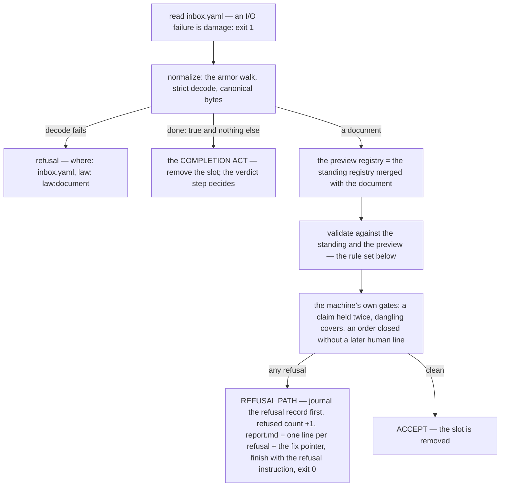
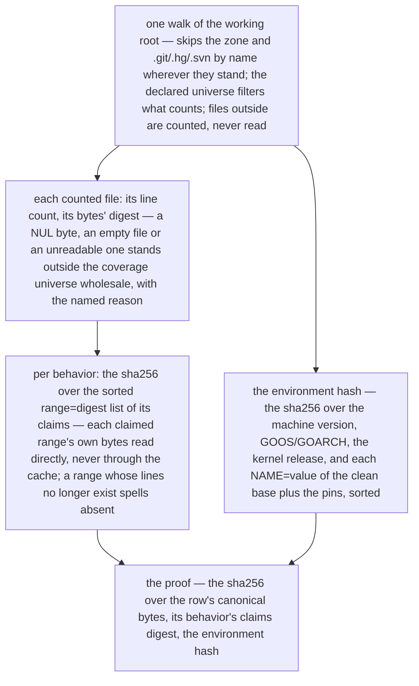
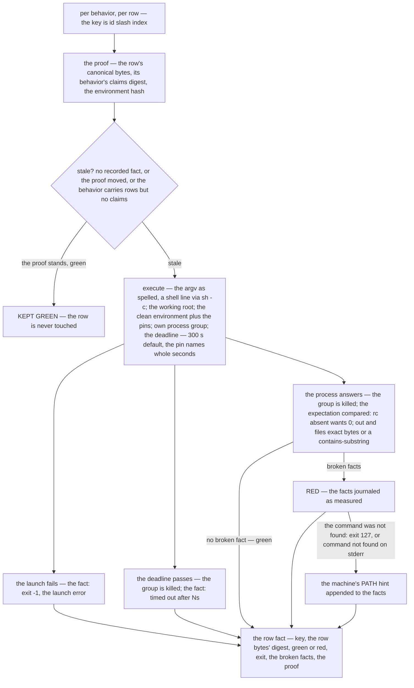
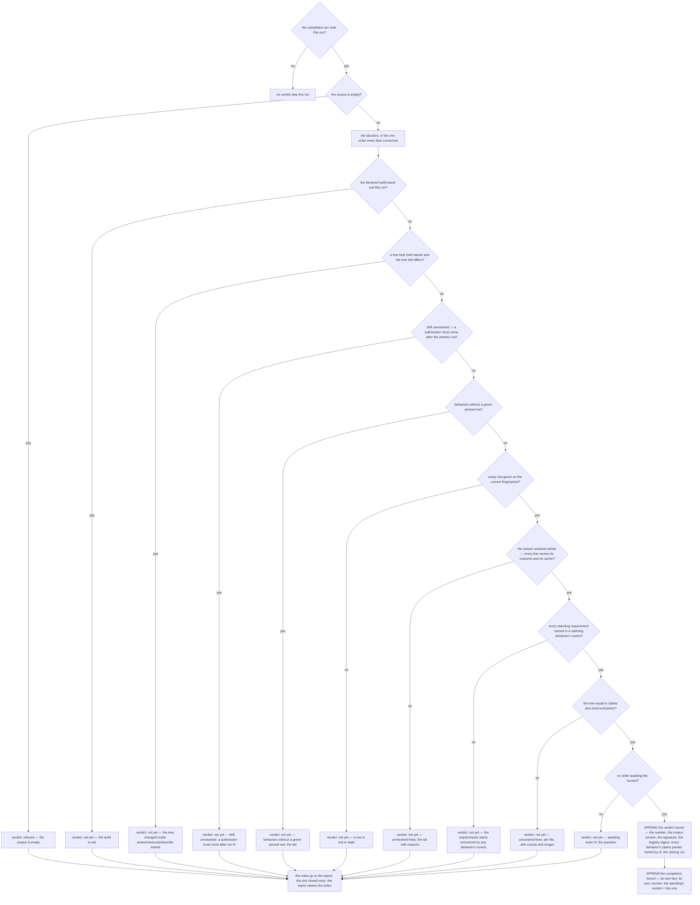
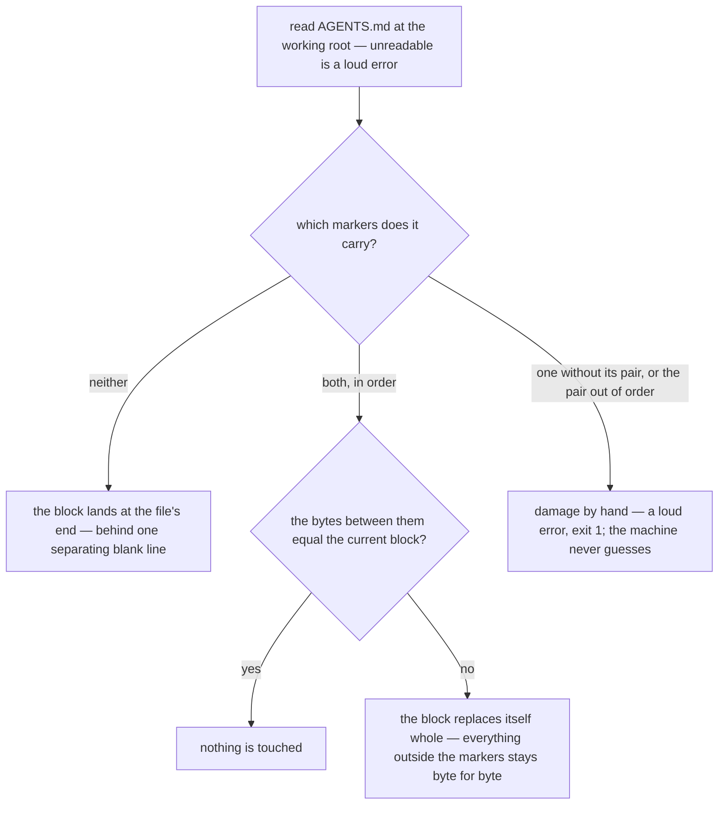
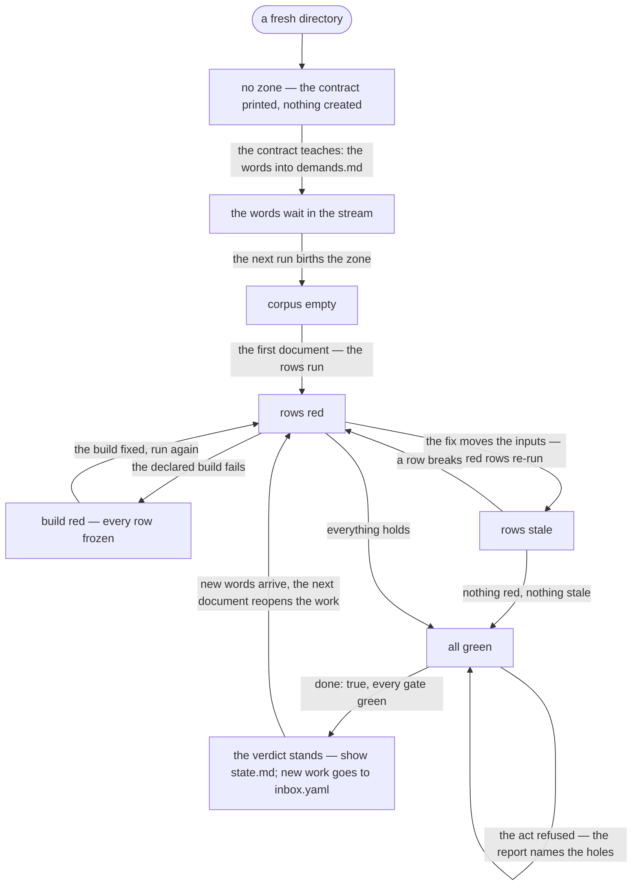

# Architecture
**English** · [Русский](ARCHITECTURE.ru.md) · [中文](ARCHITECTURE.zh.md)

## Contents

- [What the machine is](#what-the-machine-is)
- [The surfaces](#the-surfaces)
- [The call, from launch to exit](#the-call-from-launch-to-exit)
- [Opening the instance](#opening-the-instance)
- [The run](#the-run)
- [The demand stream](#the-demand-stream)
- [The submission slot](#the-submission-slot)
- [The document — the one input format](#the-document--the-one-input-format)
- [Validation — the whole rule set](#validation--the-whole-rule-set)
- [The merge laws](#the-merge-laws)
- [The tree lock](#the-tree-lock)
- [The executions](#the-executions)
- [The build](#the-build)
- [The fingerprints](#the-fingerprints)
- [Staleness and execution](#staleness-and-execution)
- [The run record and the lessons](#the-run-record-and-the-lessons)
- [The verdict](#the-verdict)
- [The report](#the-report)
- [The render pass](#the-render-pass)
- [The next instruction — the instance's state machine](#the-next-instruction--the-instances-state-machine)
- [The journal — the one source of truth](#the-journal--the-one-source-of-truth)
- [The object store](#the-object-store)
- [The execution environment](#the-execution-environment)
- [The code map](#the-code-map)
- [The canon](#the-canon)
- [Determinism and integrity](#determinism-and-integrity)
- [The build-time gates](#the-build-time-gates)

punchtape is an external state machine that stands beside an agent
working in a tree and owns the task's truth for good. The agent
never talks to a protocol, an API or a socket: the machine is ONE
CALL with no arguments, and the whole conversation — the human's
words, the agent's documents, the machine's answers — rides files
of one hidden directory, the zone. This document describes the
machine exactly as the code implements it: every process, every
structure, every logical branch. It is self-contained; nothing
outside it is needed to understand the machine.

## What the machine is

A single Go binary. Launched anywhere at or below a working root,
it finds its zone, folds the journal into the standing, acts on
the current state — a birth, a submission, a completion act, or
nothing but measurement — runs the build and the stale rows,
records the facts, regenerates the views that moved, and answers
the terminal with exactly one line: the next action, naming the
file to touch. Red results are data, not errors: the machine's
job is to measure and record, never to negotiate. The state
outlives every session and every model, because every fact that
matters lives in an append-only journal of records that carry no
wall clock: order is a record's place in the stream, identity is
its bytes.

Two laws hold the whole construction up. **Proof**: nothing
observes anything — no watcher of files or processes exists
anywhere; instead every green row carries a proof fingerprint
over its own canonical bytes, its behavior's claimed lines and
the execution environment, and a proof that still stands is never
re-executed. **Verdict**: the machine records a task done only on
measured grounds — every row green on the current fingerprints,
the words resolved whole, every requirement covered, the tree
equal to its claims plus loud exclusions, no order awaiting the
human — and the record is a journaled, signed fact that survives
as long as the journal does.

## The surfaces

Everything an agent or a human can ever meet:

- **The call.** `punchtape`, no arguments, anywhere at or below
  the working root. Exit 0 — the machine worked. Exit 1 — the
  call did not happen (a zone damaged, a write that could not
  land, a journal that could not load).
- **The version flag.** `punchtape --version` — exactly this
  spelling, alone on the line — prints `punchtape <version>` and
  exits 0 before any state is touched. It is a human affordance;
  the contract never mentions it and no machine path reads it.
- **The argument refusal.** Any other arguments produce one line —
  ``punchtape: the call takes no arguments — run `punchtape` alone;
  this refusal is the whole action of this launch`` — and exit 1,
  before any state is touched.
- **The terminal line.** Exactly one line per successful run:
  `punchtape: run <N> — <instruction>`. The instruction is the
  same text the state page's `next:` line carries — never two
  truths; the paths it names are spelled from the caller's
  working directory.
- **The zone** — `.punchtape/`, the only directory the machine
  owns:

  | file | meaning |
  |------|---------|
  | `contract.md` | the contract: the machine's whole law (eight laws), generated from the canon |
  | `template.yaml` | the document's shape with teaching comments, generated from the canon |
  | `reference.md` | every door of the machine on one page, generated from the canon |
  | `demands.md` | the human's words, verbatim, one non-empty line each — open forever |
  | `inbox.yaml` | the submission slot: a document, or the bare completion act |
  | `env` | optional pin file: extra KEY=VALUE lines for every command |
  | `universe` | optional declaration: which roots of the tree count |
  | `corpus.yaml` | the standing corpus as a document — a generated image, healed every run |
  | `state.md` | the standing: the demand accounting, counters, verdict with drift marks and history, per-behavior rows, uncovered and excluded lines, `next:` |
  | `report.md` | the last fact-changing run's picture, or a refusal's list |
  | `knowledge.md` | the notes and the machine-measured lessons |
  | `trace.md` | the stream's showcase: every word with its outcome and carriers |
  | `holes.md` | the whole uncapped ledger of uncovered lines |
  | `exclusions-proposal.yaml` | the machine's own draft of the exclusion list for the standing holes |
  | `spec/` | one small page per behavior; retired behaviors' pages are removed |
  | `journal/` | the record stream: epoch files, one accepted submission's records per epoch |
  | `journal/objects/` | the content-addressed object store |
  | `cache/` | the verified walk cache — an accelerator, deletable, never truth |
  | `tmp/` | scratch, cleared at the end of every run |
  | `run.lock` | the zone's run lock — one pass at a time, kernel-released |

- **The AGENTS block** — the one record outside the zone: a marked
  block in the working root's `AGENTS.md`, ensured idempotently on
  every run. Bytes outside the markers are never touched.
- **The working tree** — everything else in the working root: the
  agent's free territory. The machine never reads its content as
  code; it walks it for line counts and digests, executes the
  corpus's commands in it, and reads the files a row's
  expectations name.

## The call, from launch to exit

The composition root (`cmd/punchtape`) mounts the production
ports — the filesystem binding and the process binding — takes
the current working directory, and hands both to the machine's
one entry point. Everything below is that entry point's
algorithm. Every internal call, caller → callee, is listed in
[calls.md](maps/calls.md).



### First contact

No `.punchtape` at or above the starting directory means no
channel exists yet: the machine prints the whole contract — the
embedded English text, the same bytes the birth later writes to
`contract.md` — and exits 0. Nothing is created; the contract
itself teaches the first move (put the human's words into
`demands.md`). The same contract page prints whenever a zone
directory stands without a journal — whatever else the zone
carries — so the law reaches the agent before anything else does.

### The no-instance line

A zone without a journal is a zone whose instance was never born.
If `demands.md` carries no non-empty line, the machine prints
`punchtape: no instance yet — put the human's words verbatim into
.punchtape/demands.md and run again` and exits 0 — still nothing
is created. Any other stat error on the journal directory is zone
damage: one line, exit 1.

### The birth



The mkdir is the birth's atomicity: among parallel runs exactly one
wins, the losers see a living journal and run as ordinary passes.
The birth record carries the creating machine's version — the
instance's own origin fact, shown on the state page; a zone born
by any other version is refused before a single record folds.
`demands.md` survives the birth, open forever: the human's words
keep entering it at any moment of the instance's life.

## Opening the instance

Every run past the birth opens the instance the same way:

1. **The stream.** The journal directory is listed for epoch files
   named `epoch-NNNNN.yaml` (five digits), loaded in number
   order. The first record alone is read once more before the
   fold: a zone born by another machine version is refused by
   name, before any later record is asked to parse.
2. **The fold.** All records, oldest to newest, fold into the
   standing — the present rebuilt from the past (the full fold
   laws are given with the journal below). A behavior object the
   journal names but the store cannot answer is an honest error:
   the call exits 1.
3. **The pins.** The zone's optional `env` file is parsed once; a
   line of any shape other than `KEY=VALUE` (with the key law and
   the value law below) is a loud refusal naming the file, the
   line number, the line and the law — exit 1, before any state
   moves. The row-deadline pin (`PUNCHTAPE_ROW_TIMEOUT`) is
   parsed in the same breath: whole positive seconds or a loud
   refusal.
4. **The universe.** The zone's optional `universe` file is read —
   one root-relative path a line, comments and blank lines
   passing — and every declared root is proven to carry at least
   one file of the tree; a phantom root is a loud refusal naming
   its line.
5. **The cache.** The verified walk cache (`cache/tree`) loads
   with the run's scope; a record that does not parse is a miss
   for its path — the walk recomputes and rewrites it.

## The run

One open instance, one run. The steps below are the machine's
whole algorithm past the birth; the sections after this one give
each step's laws in full.

```mermaid
flowchart TD
    CH["0 — the chain check: the stream's past recomputes from the current bytes, or the zone is damaged"] --> IN["1 — the submission slot: inbox.yaml present?"]
    IN -- "absent" --> EXE
    IN -- "present" --> N["read and normalize once: armor, strict decode, canonical bytes"]
    N -- "decode fails, or validation refuses" --> RREF["REFUSAL — journal the refusal record first, report.md = one line per refusal, state.md = the queue fact, finish with the refusal instruction, exit 0"]
    N -- "done: true, exactly" --> ACT["the COMPLETION ACT — consume the slot, the run continues"]
    N -- "a valid document" --> LOCK{"does the submission arm the tree lock — intents stand, none is work, no build stands or is declared?"}
    LOCK -- "yes" --> DIG["walk the tree, keep the digest as treeBefore"]
    LOCK -- "no" --> ACC["ACCEPT — objects, epoch rotation, submission record, the standing moves, the words taken by the machine itself, the slot consumed"]
    DIG --> ACC
    ACC --> EXE["2 — the execute intents run between the submission and the rows"]
    ACT --> EXE
    EXE --> B["3 — the build, when declared: runs first"]
    B -- "red or hung" --> FRZ["every row frozen this run"]
    B -- "green or none declared" --> F["4 — the fingerprints: per-behavior claims digests over the claimed lines, the environment hash"]
    FRZ --> TL
    F --> ST["5 — staleness by proof; stale rows execute; standing proofs stay green"]
    ST --> TL{"the lock was armed? walk again"}
    TL -- "digest moved" --> TLF["journaled tree-lock fact — the hold arms"]
    TL --> REC{"facts changed? a build ran, a row executed, an execution landed"}
    REC -- "yes" --> JR["6 — the run record: number, build fact, row facts, lessons"]
    REC -- "no" --> V
    JR --> V{"7 — the completion act rode this run?"}
    V -- "yes" --> VER["the verdict gates — a verdict record plus a completion record, or not-yet notes"]
    V -- "no" --> REP{"facts changed, or the verdict spoke, or warnings stand?"}
    VER --> REP
    REP -- "yes" --> RW["8 — report.md, the run's whole picture, rewritten whole"]
    REP -- "no" --> REN
    RW --> REN["9 — the render: fingerprints measured again on the tree as the run left it; state, trace, holes, proposal, knowledge, spec — each only on byte change"]
    REN --> FIN["10 — finish: corpus.yaml healed, the walk cache written, the AGENTS block ensured, the teaching pages refreshed, tmp/ cleared, the terminal line, exit 0"]
    RREF --> FINX["finish with the refusal instruction, exit 0"]
```



Every machine-owned write that cannot land (a journal append, a
view, the corpus heal, the AGENTS block, the tmp clear) is a loud
failure: the run prints the error and exits 1 — the machine never
quietly leaves an old page standing.

## The demand stream

The stream is one file: `.punchtape/demands.md`. Its bytes are
the machine's one source of the human's words; every non-empty
trimmed line numbers D1..Dn in file order, derived anew from the
bytes on every run. Blank lines carry nothing.

**The chain.** The journal holds the past as links: each
demand-append record carries how many lines it consumed and the
sha256 over the previous link's bytes joined with those lines.
Every run recomputes the whole chain from the genesis over the
current bytes: a missing stream file on a born instance, a
shrunken past, or a link that does not recompose is the same
damage — `punchtape: zone damaged: the demand stream's past
changed`, exit 1, the run never starts. The past is immutable;
the tail is open.

**The tail.** The lines past the chain's journaled past are the
unjournaled tail. Only an accepted submission chains them: the
machine itself appends the demand-append record beside its
submission — the submitting agent never transcribes the words. A
submission that brings no tail signs `no-new-demands` (the line
count and the run number) — a signature over words that did come
stands journaled forever: the one point where the guard is
visibility, not a gate.

## The submission slot

The slot is one file: `.punchtape/inbox.yaml`. Its absence is an
ordinary state — the run proceeds to the build. Its presence is
read once, and the read itself failing on I/O is damage (exit 1,
not a refusal — the machine does not judge bytes it never saw).



The refusal is the machine's own journaled fact: the record lands
in the journal before the report view is written, so a screen
that cannot land never eats the fact. The submission's bytes
write nothing — the document stays in the slot, the author fixes
the named place in the same file and runs again.

### The completion act

An `inbox.yaml` carrying exactly `done: true` — the bare flag and
not one other field — is the completion act: the deliberate door
to the verdict. The slot is consumed and the run continues
through its ordinary steps (the
build still runs, stale rows still execute); the verdict step at
the end decides whether the act closes a verdict or names the
holes. The act is counted as its own journaled fact, separate
from submissions: one counter counts documents the slot took,
another counts the acts that finished the work.

### The document's decode and canonical bytes

The decode is strict, and an armor pass walks the parsed tree
before anything else reads it: exactly one YAML document, no
anchors, no aliases, no tags, no merge keys, no tab in
indentation, no duplicate or unknown fields. Anything the machine
does not itself write or mean is refused at the slot — a trap
cannot ride in through the format. The marshal is canonical:
two-space indent, map keys sorted, struct fields in declaration
order, the command's author's spelling (shell line or argv list)
preserved verbatim. Comparison happens after normalization
(decode → canonical bytes), so reformatting a document changes
nothing: two spellings of one content are one content.

## The document — the one input format

One YAML document, strictly decoded:

```
work:            the narrative of this submission — what broke,
                 what was fixed, what was decided
intents:         [{lines: [D ranges], outcome, prose, text?, run?}] —
                 every new demand line declares its outcome here
build:           one command; absent = keep the standing one
mandate:         [{line, target}] — the permission to replace
                 standing work, replaced by this same submission
remove:          standing keys to retire (five spellings)
requirements:    [{id: R…, lines: [D ranges], prose, refines?}]
not-a-requirement: [{lines: [D ranges], reason}] — the markers
uncovered-lines: [{range: "path:first-last", reason, refs}] —
                 the loud exclusions
open:            [{demand, question, state, reason?}] — the orders
behaviors:       [{id, name, prose, claims: [ranges],
                 covers: [R ids], rows: [{run, expect}]}]
notes:           [{kind, text, refs}] — five kinds, refs resolve
done: true       the completion act, alone
run:             one command — a shell line (string) or an argv
                 (list of strings, non-empty)
expect:          at least one of —
                    rc:    the exact exit code (absent = 0)
                    out:   stdout — exact bytes, or a substring
                           behind the "contains: " prefix
                    files: {path: text} — read after the run,
                           the same two match spellings per file
```

The six outcomes — the protocol's own vocabulary: `answer`
(carries its answering text), `execute` (carries its command),
`work` and `describe` (carried by a requirement's lines), `mark`
(carried by a not-a-requirement marker), `ask` (carried by an
awaiting order). The carrier must stand in the same submission
that declares the outcome; text rides an answer intent only, run
rides an execute intent only.

The grammars everything rides:

- **Behavior id**: `[a-z0-9-]` segments joined by single `/` — no
  leading or trailing slash, no empty segment.
- **Requirement id**: `R` followed by letters, digits and dots.
- **D range**: `D<n>` or `D<a>..D<b>` ascending, comma-joined —
  the stream's numbered lines. No leading zeros, no sign.
- **Root-relative path**: slash-separated, no drive, no scheme, no
  leading slash, no backslash, no NUL, no empty/`.`/`..` segment —
  what cannot be spelled cannot point outside the tree.
- **Line range** (the claim and the exclusion): `path:first-last`,
  first ≤ last, the file's own lines.
- **YAML, the four rules of cooking**: a scalar holding ": " or a
  comma takes quotes; a flow list's element holding ":" takes
  quotes; a longer prose continues on the next line, indented
  deeper than its key; a multi-line pin stays one line
  (`out: "first\nlast\n"`).

## Validation — the whole rule set

Every refusal is `{where, law, fact}`: the exact field, the law id
the contract prints, the measured fact. No advice, no
interpretation. The enforced rules, each bound to its law:

| rule | law |
|------|-----|
| the document decodes against the template's shape — unknown fields are refused | law:document |
| the submission merges by id — requirements and behaviors by id, markers by their lines, exclusions by range, orders by demand and question; rows merge by run | law:document |
| behavior ids are `[a-z0-9-]` segments joined by /, requirement ids are R then letters, digits and dots — each unique in a submission | law:document |
| D ranges parse in the D grammar and name the stream's own numbered lines | law:document |
| claims are line ranges the tree carries — path:first-last, root-relative | law:claims |
| one range names one behavior — a claim already held is refused at its second holder | law:claims |
| every new intent carries one of the six outcomes with non-empty prose and its carrier in the same document — answer its text, execute its run, work and describe a requirement's span, mark a marker, ask an awaiting order | law:demand |
| every new stream line is declared by exactly one intent of the submission that meets it — a declared line is not redeclared | law:demand |
| requirement prose is non-empty | law:demand |
| refines names a requirement that stands | law:candor |
| a marker never stands on a requirement's line — a line is either a demand or not | law:demand |
| exclusions name real holes, a reason that cites a demand line or a law, references that resolve | law:candor |
| behaviors carry a name, covers that stand after the merge, at least one row whose expect names rc, out or files, and runs unique in their rows | law:document |
| every behavior carries at least one pinned row — out or files with exact bytes; rc alone pins nothing | law:proof |
| one run proves one behavior — a run held by another behavior is refused as its proof | law:proof |
| a mandate names the line that ordered the change and the standing thing it permits to replace | law:candor |
| notes carry one of the five kinds, text, and references that resolve | law:candor |
| a done document is exactly done: true | law:document |
| the work narrative and every behavior's prose are non-empty | law:candor |
| the build command is non-empty when present | law:document |
| open orders ride standing demand lines with a real state | law:candor |
| an awaiting order closes only over a later human line, cited by a decision note | law:candor |
| remove keys of the five spellings name standing things | law:document |
| a marker carries its reason | law:document |
| expect file paths are root-relative | law:paths |
| the tree does not move under answer, execute or describe intents — the digests hold the verdict | law:demand |
| the universe names the counted roots; a line no claim and no loud exclusion names holds the verdict | law:claims |
| the verdict needs the stream whole, claims mutual, pinned proofs green, no awaiting order — and waits out unresolved lines, unnamed drift, a moved tree | law:done |

On top of the table, the machine adds three gates of its own:
**the dangling covers** — a behavior that survives the submission
unlisted must not cover a requirement the submission retired;
retiring a requirement demands the same submission clear every
cover of it. **The duplicate claim** — a range a standing behavior
or an earlier behavior of the same submission holds is refused at
its second holder, the holder named. **The ask-close law** — an
awaiting order that leaves its awaiting state may do so only over
a later human line, occupied by a carrier, cited by a decision
note; otherwise the refusal names the law and the recipe.

## The merge laws

What a document does not list, it does not change.

- **Behaviors merge by id.** A listed id that stands has its head
  replaced whole (name, prose, claims, covers) and its rows
  merged; a new id is added; an id in `remove` is retired. A
  remove-and-re-add in one submission starts fresh.
- **Rows merge by run** — the command's canonical bytes. A run
  that stands replaces its whole row in place; a new run is
  appended after the standing rows; unlisted rows stand untouched.
  A re-spelled command is a new row — the standing one stands. A
  row retires only with its behavior whole: remove the id under
  its mandate and re-add it in one document.
- **Requirements merge by id** the same way. **Markers merge by
  their lines' fold, exclusions by range, orders by the
  demand-and-question pair** — a repeated key replaces the
  standing part whole, a new key appends, an unlisted part stands.
- **Removals retire first**: the D-grammar key retires the marker
  standing on the line (or the order riding it), the range key
  retires the exclusion, the ids retire their parts.
- **Build** replaces the standing command only when declared — an
  absent field changes nothing.

## The tree lock

A submission that carries intents, none of them `work`, with no
standing or declared build, locks the tree for its run: ahead of
its handling the machine walks the tree and keeps the digest. The
same walk happens again after the executions — a moved digest is
a journaled tree-lock fact, and the hold arms: the verdict is held
(`the tree moved under answer/execute/describe intents`) until the
bytes return or the change is submitted as declared work. A work
intent lifts a standing hold and arms none — work is the legal way
to move the tree. A declared build's artifacts are work as well:
the first-declared build as much as the standing one.

## The executions

The execute intents run between the submission and the rows: each
declared command is run by the machine itself, under the whole row
law — working root, clean environment plus pins, own process
group, the row deadline. The fact rides the journal: the lines it
answers, the command, the exit code, the stdout's digest — the
stdout whole up to 4096 bytes, the object store's address beyond.
The last execution shows on the state page and the report; the
tree must come back unchanged (the lock above).

## The build

The corpus's declared build command (a shell line or an argv) runs
FIRST on every launch that declares one, before any row — in the
working root, in the clean environment, as one process group under
the same discipline as a row. The fact journaled is the exit code,
the timeout mark, or the launch failure's own words. A build that
exits non-zero, hangs past the deadline, or never starts is red
for this run: **every row is frozen** — nothing executes, no row
fact moves, the run's record carries the build's fact alone, and
the terminal line says `build red — read .punchtape/report.md,
fix the build, run again`. The submission that rode the same run
still lands: the corpus moves, the rows wait.

## The fingerprints



The claims are measured once ahead of the execution and once
again after it: the second map is what the state page shows, so
the page describes the tree as the run left it, not as the run
found it. The verdict's own record keeps the pointers the proofs
were measured against. The walk cache (`cache/tree`) maps each
path's size-and-mtime to its line count and digest; a file whose
size and mtime stand as the cache last saw them reuses the cached
facts instead of its bytes. The proofs never ask the cache —
claimed lines are read directly, always. The cache is written
once, at the run's end, only when the walk moved it; delete it and
the next run recomputes the same numbers — it is an accelerator,
never a source of truth.

## Staleness and execution



The staleness law in one sentence: a row re-runs when its bytes
changed, its behavior's claimed lines changed, the environment
changed, it never ran — or its behavior declares no claims at all
(a behavior with rows and no claims stands on nothing it names,
so its rows are honestly always stale). Unchanged claims and
environment — the row never runs again. The skip law is
color-blind: a standing red whose proof still stands is not
re-executed either — it re-runs exactly when its inputs move. A
standing red never passes for green: the verdict reads the fact's
status, never the proofs alone. Broken facts quote both sides —
the wanted spelling and the measured one; a measured side longer
than eighty characters is clipped with an ellipsis.

## The run record and the lessons

A run that changed facts — the build ran, or at least one row
executed, or an execution landed — appends one run record: the
number (previous + 1), the build's fact, the executed rows' facts
(`key`, the row bytes' digest, green/red, exit, the broken facts,
the proof it stands on), and the lessons. The counter starts at
zero: before the first fact-changing run the terminal line and
the page headers all say run 0.

A **lesson** is a red→green transition of this run, fixed as pure
data: the previous fact's first broken reason, all its broken
facts, the row's bytes before and after (answered by the journal's
own row-bytes index, by digest), and the two run numbers. The
lessons land on the knowledge page, grouped by reason.

## The verdict



The blockers speak in one priority order, and every face consumes
the same table: the report lists the notes whole; the terminal and
the state page's `next:` line speak the first blocker's
instruction. The proof arithmetic rides the before-map (the
digests the proofs were measured against); the drift question
rides the after-map (the tree as the run left it) — two maps on
purpose: a row may lawfully edit its own claimed file, and the
maps then differ.

The **signature** is the sha256 over the corpus's canonical bytes
followed, per behavior in the corpus's own order, by `\0 id \0
claims digest` — the corpus and the exact tree state it was
pronounced on, in one digest. The **registry digest** is the
sha256 over the canonical bytes of the requirements, markers,
exclusions and orders together — the words' whole account
attested with the same seal. Verdicts are append-only: a new one
never rewrites an old one; the standing keeps the latest.

### Drift and healing

Nothing watches the tree. The verdict's record carries each
certified behavior's claims pointer; the run compares it with the
claims digest of the tree as it stands. A moved pointer means
drift: the state page's verdict line says `open (drift since run
N)` — the first run past the verdict that saw the move, named by
the journal's own row facts — and the drift is resolved only by a
submission landing after that witness run. The verdict history
tells the whole story: every recorded verdict, every run that
caught drift (red rows under a standing verdict, with the row
keys), every heal (the first later run with no red row) — and a
closing report that heals a drift adds its own line: which run
caught it, which run went green again.

## The report

`report.md` is the last fact-changing event's whole picture,
written whole when it moves (a run that changed nothing and closed
nothing leaves the previous report standing — no old word
outlives its event unnecessarily, and no word of a new event is
hidden). For a run: the header with the run number; the build's
line when one ran (`build: RED — <reason>` for a launch failure
or timeout, `build: RED — exit <N>` for a bad code, `build: exit
<N>` for a good one); the executions' lines when any ran (the
lines answered, the command, the exit, the stdout — whole, or the
object address beyond the limit); `no stale rows` when nothing
executed and the verdict did not speak; the green count; every
red row grouped by its broken reason — each reason once, the row
keys under it; the verdict's notes and the machine's warnings when
they stand. For a refusal: one line per refusal — `where: fact
(law)` — and the pointer: the submission stays in `inbox.yaml`,
fix it there and run again.

## The render pass

After the facts, the views — generated images of the journal,
rewritten whole when their content changes, never touched when it
does not (byte-compare first, atomic write only on difference).

**`state.md`** — the standing on one page, in this order:

- the header with the run number;
- the demands accounting — `demands: X/Y lines; requirements N
  standing, K covered; markers: M` — and the unresolved lines
  with their reasons when any;
- the queue as a fact of the files (`queue: submission waiting` /
  `queue: empty`);
- the last no-new-demands signature while it stands;
- `corpus: v<n>, <b> behaviors`;
- the last execution;
- `submissions: <a> accepted, <r> refused, <c> completed`;
- `machine at birth: <version>`;
- the verdict line — `verdict: #<n> on v<c>, run <r>, signature
  <12 hex>` with `— open (drift since run N)`, `— standing over
  N uncovered lines` or `— standing`;
- the verdict history (the recent ten, the elision counting the
  rest);
- the deferred orders with their questions and reasons;
- one line per behavior — `- <id>: <n> rows (claims F files /
  L lines; proof <12 hex>) — <g> green, <s> stale[, <r> RED]`;
- the uncovered lines (the first ten files, the elision pointing
  to the holes ledger);
- the excluded files with their reasons; `excluded lines: N
  ranges (P % of tree)`;
- the outside and inside counts when a universe stands declared;
- the knowledge counts;
- `next:` — the one instruction, the same text as the terminal
  line.

**`holes.md`** — the tree's whole hole ledger, uncapped: every
open range per file, the list the state page points to when it
runs out of room.

**`exclusions-proposal.yaml`** — the holes as a ready draft:
every open range in the submission's own form, the reasons and
references the author's own to fill. With no hole standing, a
stale draft leaves — the proposal never outlives its own
arithmetic.

**`trace.md`** — the stream's showcase: every line D1..Dn with
its own text, its declared outcome and the agent's retelling
beside each other, then the carriers below it — the requirements
with their spans, the behaviors with their claims and proof rows,
the markers, the answers, the last executions, the orders with
their states. Nothing is judged here; everything is placed for
the eye — the one page built for the human's audit glance.

**`knowledge.md`** — the notes and the lessons. Each note of every
accepted submission appears exactly once, numbered `n1…`, with
its kind and its references; the lessons are grouped by reason,
each with the row key, the two run numbers, and the row's bytes
before and after as one-line clippings (clipped at a hundred
characters).

**`spec/`** — one small page per living behavior at `spec/<id>.md`
(nested ids create their directories): the header `# <id> —
<name>`, the run number, the Story (the prose verbatim), the
Demands (each covered requirement with its lines and prose), the
Claims (each range with its own 12-hex digest, the behavior's
token below), the Rows (each row's index — the PROOF rows marked
— the command as a human reads it, the expectation in human
lines, the proof standing with its recorded short digest, `none`
for a row that never ran), and the Verify list (the commands that
re-run them). `spec/index.md`
lists every behavior with its one-word status (`green`, `not
green`, `no rows`). The pages of retired behaviors are removed —
the tree is an image of the standing corpus, nothing else; a page
that cannot land or leave is a loud failure.

**The corpus heal** — `corpus.yaml` is rewritten whenever its
bytes differ from the standing corpus's canonical bytes: the
standing document as the machine sees it, ready for the agent to
read.

**The AGENTS block** — the working root's `AGENTS.md`:



The block's fixed content, between `<!-- punchtape -->` and
`<!-- /punchtape -->`: run `punchtape` (no arguments) and read
`.punchtape/state.md` for the standing and the next step; the laws
in `.punchtape/contract.md`; the document's shape in
`.punchtape/template.yaml`; submissions to `.punchtape/inbox.yaml`;
the last run's facts in `.punchtape/report.md`. Outside the
markers not one byte belongs to the machine and not one byte is
ever touched.

**The teaching refresh** — `contract.md`, `template.yaml` and
`reference.md` are rewritten only when the canon's own bytes
change.

**The finish** — the scratch directory `tmp/` is removed whole,
and the terminal receives its one line: `punchtape: run <N> —
<instruction>`. Exit 0.

## The next instruction — the instance's state machine

The instruction is a pure function of the standing; every state
the machine can stand in has exactly one instruction, and it names
the file to touch:

| state | the one instruction |
|-------|---------------------|
| a submission was refused this run | `submission refused — read .punchtape/report.md, fix inbox.yaml in place, run again` |
| build red this run | `build red — read .punchtape/report.md, fix the build, run again` |
| corpus empty (no registry part, no build) | `corpus empty — submit the first document as .punchtape/inbox.yaml (copy .punchtape/template.yaml)` |
| registry stands, no behaviors | `no behaviors stand — submit to .punchtape/inbox.yaml a behavior with a pinned row` |
| any verdict blocker | the first blocker's instruction, in the order above |
| a verdict stands on the current corpus version | `verdict #<N> standing — show .punchtape/state.md to the human; new work goes to .punchtape/inbox.yaml as a document` |
| all green, no standing verdict on this version | `all green — write done: true to .punchtape/inbox.yaml and run to record the verdict` |



The instance's whole life as one static picture:
[lifecycle.svg](maps/lifecycle.svg).

The instance's life in words: a directory gains an instance when
the first non-empty line lands in the stream and the next run
births it; the corpus is built by documents; rows go red and stale
and green by measurement; the completion act closes a verdict when
every gate stands; after a verdict the work reopens the same way
it began — the next words, the next document — and the verdict
remains a recorded fact with its drift history on the state page.
An instance never dies; a genuinely new task is a new stream in a
fresh directory.

## The journal — the one source of truth

Every fact the machine keeps is an append-only record. Ten
kinds exist, exactly one payload each:

| kind | payload | the fact |
|------|---------|----------|
| birth | the machine version | the instance's origin, fixed once |
| submission | corpus version, build, intents, notes, the registry parts listed, per-behavior object addresses, removed ids, the document's own address | one accepted document |
| demand-append | the line count, the chain value | the words the machine took itself |
| no-new-demands | the line count, the run | the signed statement that no words came |
| run | number, build fact, row facts, lessons | one run that changed facts |
| execution-fact | the run, the lines, the command, the exit, the stdout's digest — the stdout whole to 4096 bytes, the object address beyond | one execution the machine ran |
| tree-lock | the tree's digest before and after | the tree moved under a locked submission |
| verdict | number, corpus version, signature, registry digest, claims pointers, run | one pronouncement of done |
| refusal | the refusal list | one refused submission — the machine's own fact |
| completion | the run number | one completion act |

The record codec is strict both ways: a record decodes only if it
marshals back byte-exact — a hand edit or a torn write is refused
by name, never silently absorbed. Records carry no wall clock.

**Epochs.** The stream lives as numbered files `epoch-NNNNN.yaml`;
each record is one YAML document behind a line-start `---`
separator. An accepted submission rotates the stream before its
records land — every submission's records live in an epoch of
their own; rotation never stacks empty files. Appends are single
actions with an fsync.

**The torn tail.** A record cut mid-write does not blind the
machine: the complete records load, the torn bytes quarantine to a
sidecar (`<epoch>.torn`, with a header line), and the epoch file
is rebuilt byte-for-byte from its intact records. A chunk that
does not parse outside the final position is damage by hand — an
honest error, the call exits 1.

**The fold.** The standing is rebuilt from the records, oldest to
newest:

| record | the fold's move |
|--------|-----------------|
| birth | born; the birth version |
| demand-append | the chain grows; the journaled past grows; a standing no-new-demands signature clears |
| no-new-demands | the signature's run is remembered for the state page |
| submission | corpus version; build when declared; the registry merged by the merge laws; the carriers applied — line outcomes, answers, executions, the work lift of a tree-lock hold; removed behaviors deleted; every listed behavior decoded from its object and stored; the row-bytes index grows; the order keeps the living, each once, first-seen |
| run | the run number is the maximum seen; every row fact replaces its key's standing; the lessons accumulate |
| execution-fact | the last execution |
| tree-lock | the standing hold |
| verdict | the standing verdict is the record (the latest wins) |
| refusal | the refused count +1 |
| completion | the completions count +1 |

The standing's whole shape: the birth flag and version; the chain
links and the journaled past; the last signature; the corpus
version and build; the registry (requirements by id with their
order, markers, exclusions, orders); the behaviors by id and their
order; the row facts by key; the row-bytes index; the line
outcomes, answers and executions of the stream; the asked lines;
the run number; the verdict; the accepted, refused and completed
counts; the lessons; the standing tree-lock hold; the last
submission's record place. Everything the machine decides, it
decides on the standing — and the standing is always derivable
from the records alone.

## The object store

`journal/objects/` — the content-addressed store. An object's
name is the sha256 of its bytes in hex; its file is `<first two
hex>/<other sixty-two>` under the store root. Identical bytes are
stored once — dedup and idempotence by construction; a repeated
put touches nothing. Every write lands through a temp file and a
rename and is re-read and re-verified before it answers; every
read verifies the digest against the address and refuses loudly
on mismatch. No compression — the objects are kilobyte-sized,
stable raw bytes are worth more than the bytes saved. Every
accepted document's canonical bytes and every merged behavior's
canonical bytes live here — immutable, named by their own content.

## The execution environment

Every command of the machine — the build, every row, every
execute intent — launches the same way: the argv exactly as
spelled (an argv list runs as is; a shell line runs through
`sh -c`), the working directory is the working root, the
environment is the **clean base plus the pins**, and the process
runs in its own process group. The clean base is exactly the
names the canon declares — `PATH` and `HOME` — taken from the
shell that runs the machine, nothing else. The pins are the zone's
`env` file: one `KEY=VALUE` a line, the key
`[A-Za-z_][A-Za-z0-9_]*`, a name pinned once, no `export`, no
quotes, no absolute paths (a pin travels with the tree, so
nothing in it may point at one machine's disk); comments and
blank lines pass, a trailing carriage return is tolerated; a line
of any other shape is a loud refusal naming the file, the line
and the law. A pin wins on a name over the base. The one special
pin, `PUNCHTAPE_ROW_TIMEOUT`, names the machine's own ceiling —
whole positive seconds, the deadline of every command the machine
runs; it rides the proofs' hash and never reaches the commands
themselves. The environment's identity — the machine version,
`GOOS/GOARCH`, the kernel release, and the sorted `NAME=value`
set actually passed, the pins included — is the environment hash
inside every proof: a session that changes what the commands see
moves the proofs, and rows go stale, never falsely green.

The process discipline: whatever a command leaves alive dies with
its group — a kill signal to the group and the process, then a
bounded wait for actual death (a dying member still holds what it
held). A wait that cannot be answered is an error the machine
records, never a clean exit. The default deadline of one command
is 300 seconds — a hang-killer, never a judge of slow work.

The scratch law: temporary files go to `.punchtape/tmp` — cleared
at each run's end, so a writer creates the directory itself
first; version-control bookkeeping stays out of the tree; anything
left in the tree wants a claim or a loud exclusion.

## The code map

The shape of the code is mapped, not retold. `make maps` rebuilds
docs/maps straight from the sources: [calls.md](maps/calls.md)
holds the complete internal call list, caller → callee;
[types.md](maps/types.md) holds every type as goplantuml reads it
from the code; [packages.svg](maps/packages.svg) shows the call
edges between the packages, layer by layer; and
[deps.svg](maps/deps.svg) shows the import graph. One map is
written by hand and rendered by the same command:
[lifecycle.svg](maps/lifecycle.svg), the protocol's life cycle on
one page. The list below says what each part owns.

- `cmd/punchtape` — the composition root: mount the production
  ports, one call, the version flag, the argument refusal.
- `internal/ports` — the port contracts (`FS`, `Exec`) and the
  bindings' slots: the application rides the ports, the
  infrastructure implements them, the battery substitutes fakes
  through them. An unwired port call is a named panic — never a
  silent default.
- `internal/domain` — the pure laws: `digest` (sha256, the one
  digest law of everything); `zone` (the layout constants and the
  path law); `doc` (the document: model, strict codec, canonical
  bytes, validation, merge, the D-range grammar, the expectation
  comparison); `journal` (the record kinds, the strict record
  codec, the fold); `fprint` (the line-range digests, the coverage
  arithmetic, the proof, the environment hash, the tree digest).
- `internal/application` — the machine itself: the call's
  algorithm, the birth, the demand stream and its chain, the tree
  walk with the universe and the cache, the environment law, the
  execution, the views, the AGENTS block, the version, and
  `canon` — the embedded source of everything printed.
- `internal/infrastructure` — `fsys` (the OS filesystem, atomic
  writes with fsync), `process` (the OS launches, process groups;
  an honest refusal where the platform carries no
  implementation), `store` (the epoch naming, the
  append/rotate/quarantine stream) and `store/cas` (the object
  store).

One standing dependency outside the standard library: the YAML
codec — the machine's single third-party import, used by the
canon, the document codec and the journal codec.

## The canon

One embedded source holds everything the machine prints as law:
the English contract (the base and the ruler) with its Russian and
Chinese mirrors (data for the humans who read those languages),
the document template, the reference page with its own mirrors,
the example, the map of validation rules to contract laws, and
the environment rule (`PATH`, `HOME`). The zone's `contract.md`,
`template.yaml` and `reference.md` are generated from it at the
birth and refreshed when it changes. The canon cannot lie about
the machine: the example must decode, validate, run green against
the real machine in a fresh fixture and close its verdict whole —
checked in the build's test battery, so a lying canon fails the
build. The law map binds every enforced rule to a law the
contract prints and every cited law to one the contract prints —
what is enforced is printed, what is printed is enforced.

## Determinism and integrity

Canonical YAML bytes everywhere (the same document marshals to the
same bytes in every session); sha256 over sorted structures as
every fingerprint; one walk order of the tree; views written only
on byte change; every whole-file write atomic (temp file, fsync,
rename — a reader at any moment sees the whole old or the whole
new content); every append an fsynced single action; records that
must round-trip byte-exact; objects verified on write and on read;
no wall clock in any record. The shipped binaries are built
`-trimpath -buildvcs=false` — byte-identical regardless of the
build machine's paths and git state, for four targets: linux and
darwin, amd64 and arm64. The same zone, the same tree and the same
environment produce the same bytes on any machine — and a journal
copied between machines stays byte-identical.

## The build-time gates

Three laws hold the code itself, all enforced by the build's test
battery and check target:

- **The agnosticity gate.** The machine carries no knowledge of
  any world outside its own contract — no tasks, stacks, domains,
  roles, campaigns or experiments may live in its code, canon or
  error lines. A word-boundary scan over the machine's own
  sources fails the build the moment a witness word lands; the
  scanner's own vocabulary is the one named exception, so nowhere
  else has to carry it. The same battery refuses plan references
  in comments and names.
- **The canon's honesty.** The example's full round trip (above)
  and the mirrors' structural parity — every law of the base and
  every zone file named by the base appears in each mirror.
- **The battery.** gofmt, vet, staticcheck, golint, unparam, gopls
  and duplicate-code checks over the sources; the Python tooling
  law (ruff and mypy, strict, from the repository-local venv); the
  docs' mirror parity gate; the full test suite under a speed
  ceiling; and complete function coverage — the test binaries'
  profile merged with the profile of the instrumented binary
  launched itself (the entry points a unit test cannot reach),
  every function at 100% or the build fails.
