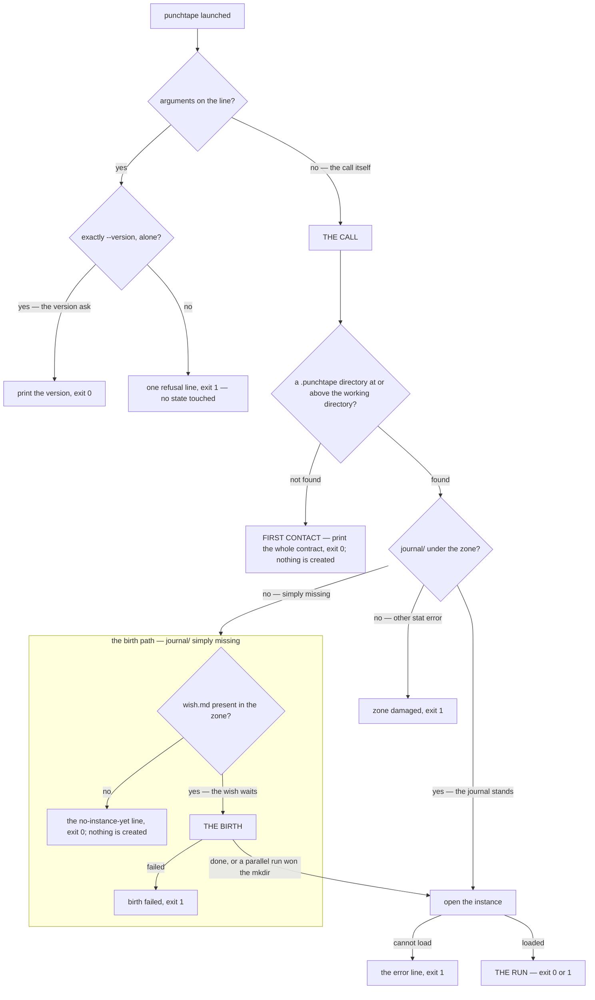
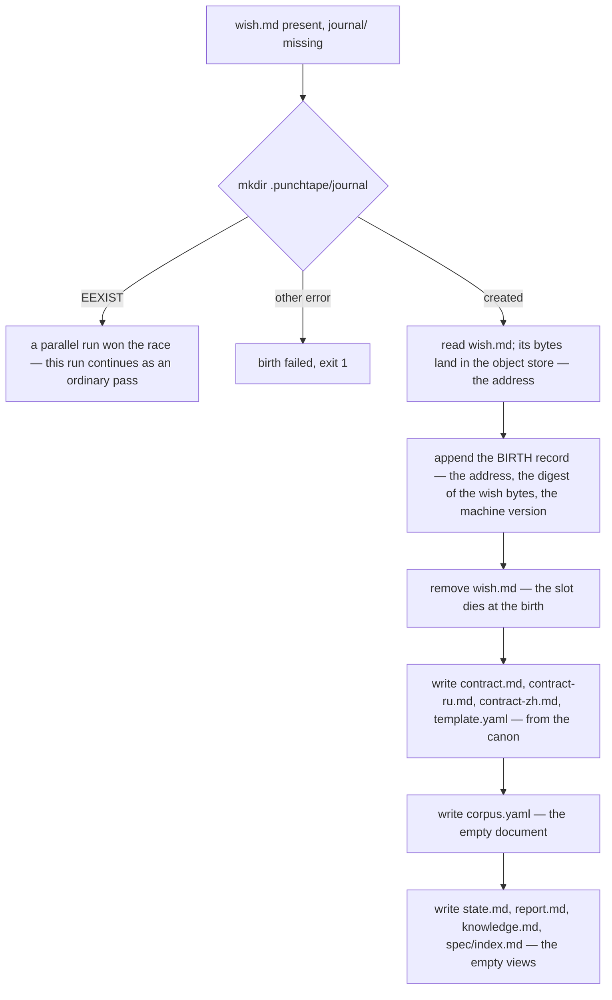
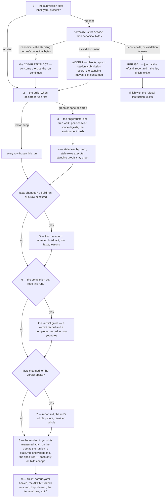
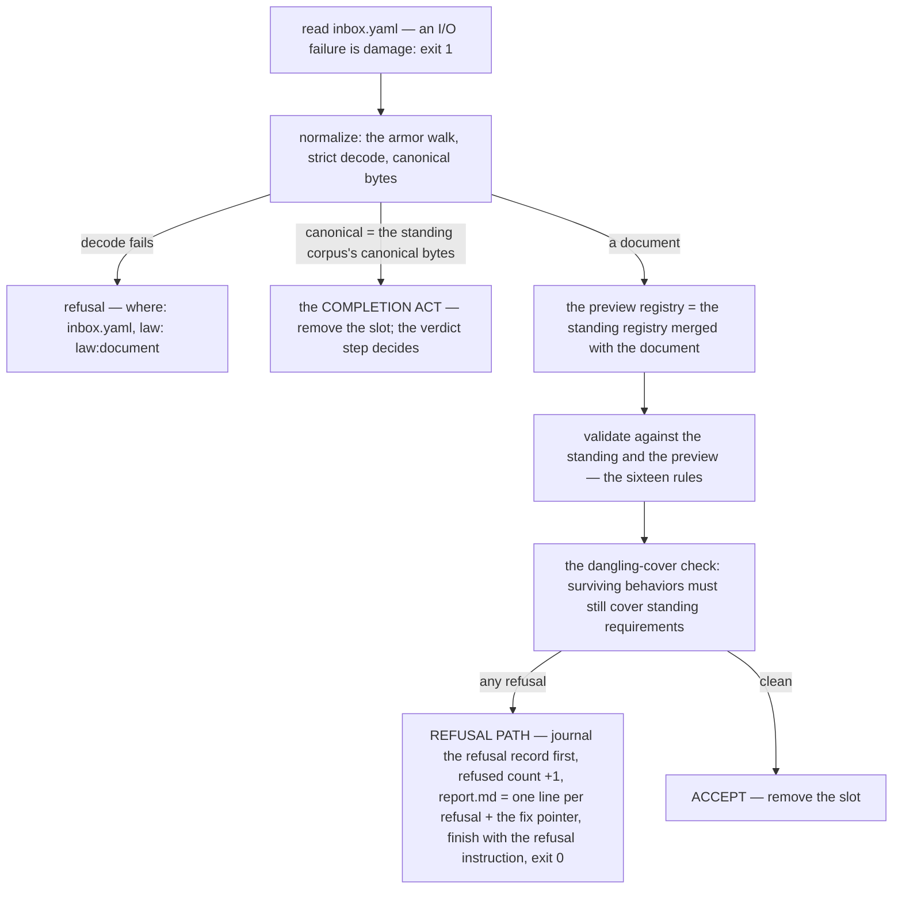
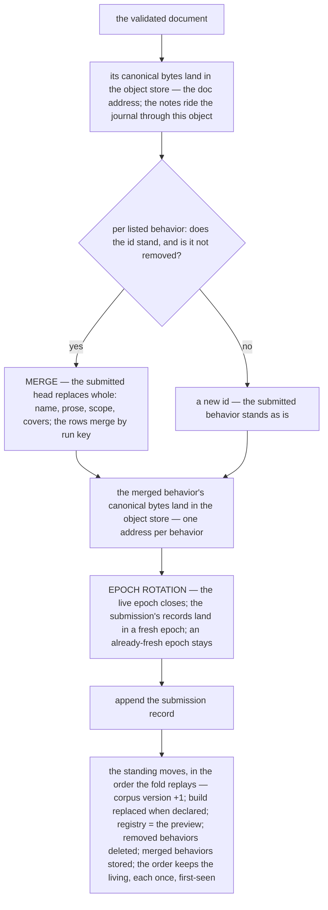
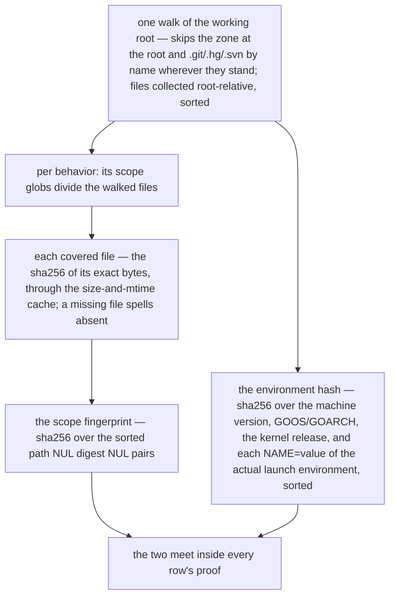
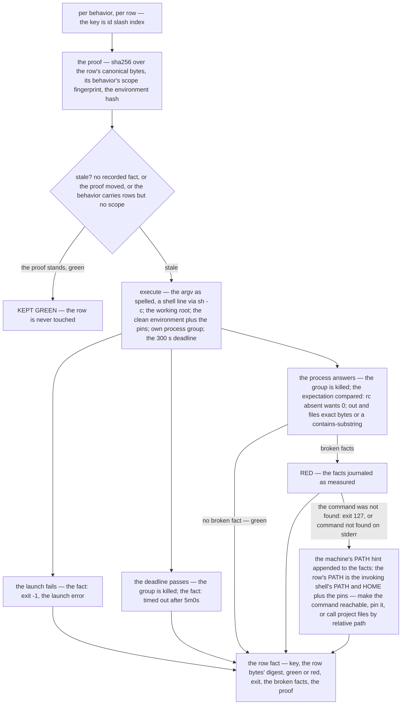
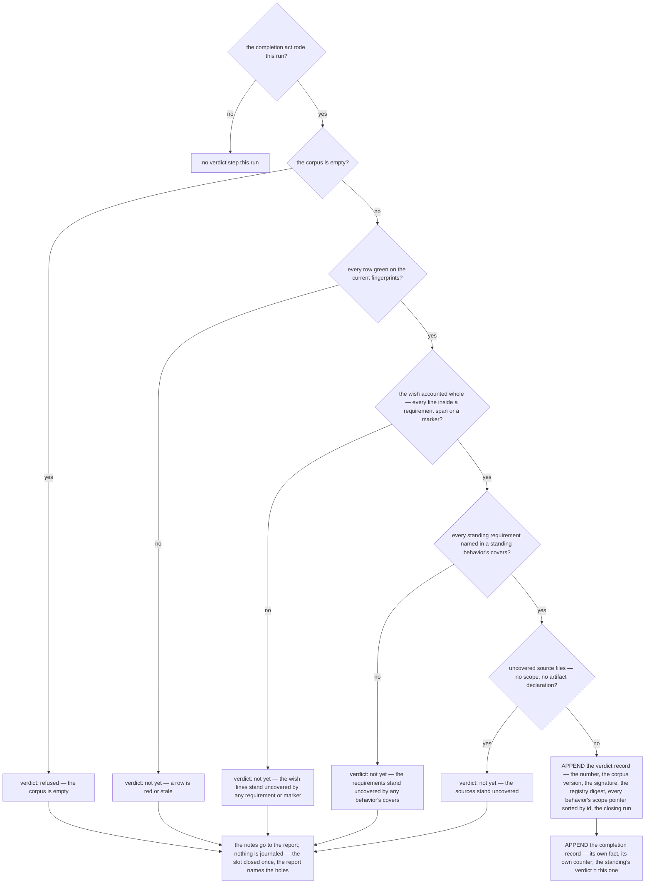
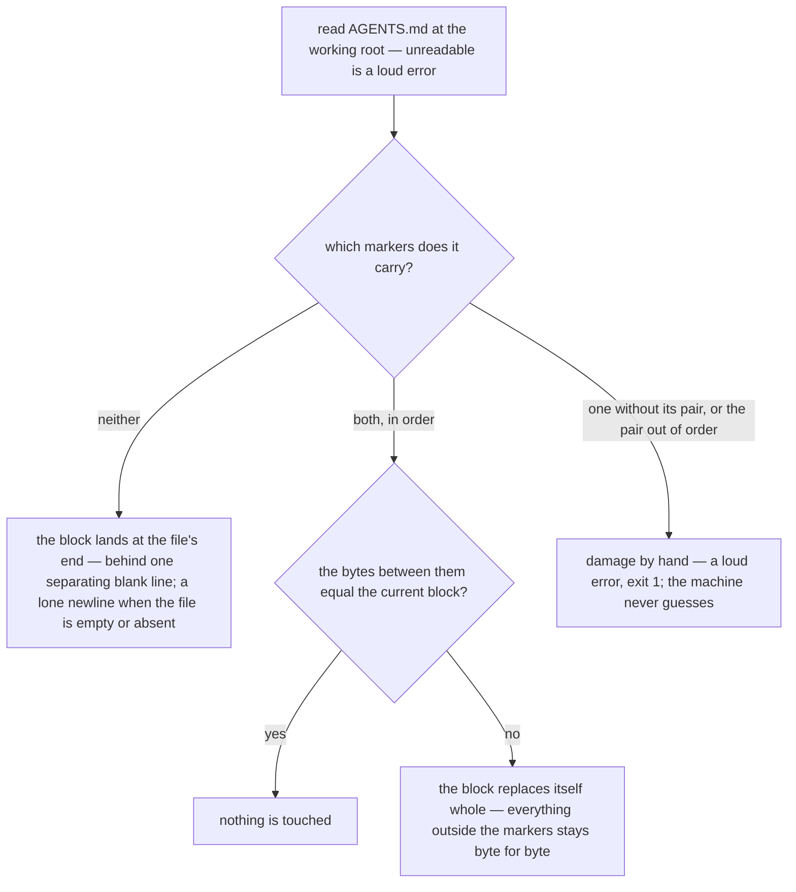
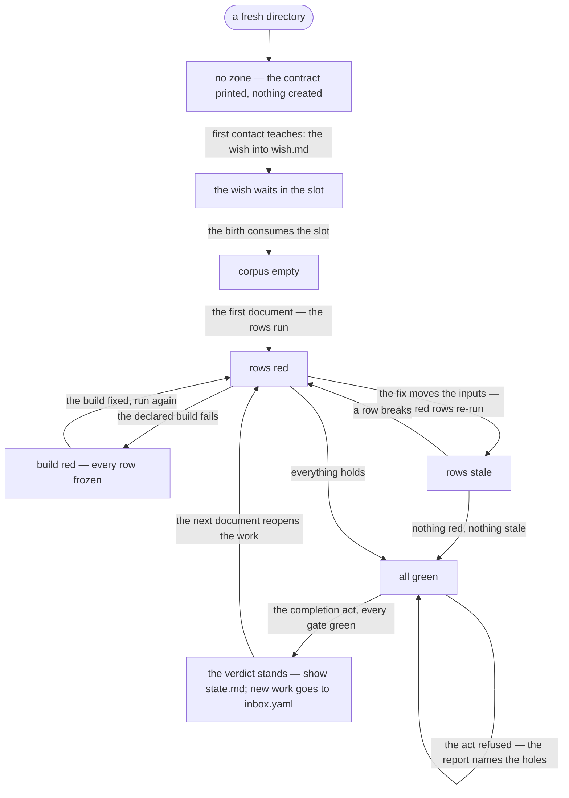

# Architecture
**English** · [Русский](ARCHITECTURE.ru.md) · [中文](ARCHITECTURE.zh.md)

## Contents

- [What the machine is](#what-the-machine-is)
- [The surfaces](#the-surfaces)
- [The call, from launch to exit](#the-call-from-launch-to-exit)
- [Opening the instance](#opening-the-instance)
- [The run](#the-run)
- [The submission slot](#the-submission-slot)
- [The build](#the-build)
- [The fingerprints](#the-fingerprints)
- [Staleness and execution](#staleness-and-execution)
- [The run record and the lessons](#the-run-record-and-the-lessons)
- [The verdict](#the-verdict)
- [The report](#the-report)
- [The render pass](#the-render-pass)
- [The next instruction — the instance's state machine](#the-next-instruction--the-instances-state-machine)
- [The document — the one input format](#the-document--the-one-input-format)
- [The registry — the wish's account](#the-registry--the-wishs-account)
- [The journal — the one source of truth](#the-journal--the-one-source-of-truth)
- [The object store](#the-object-store)
- [The execution environment](#the-execution-environment)
- [The code map](#the-code-map)
- [The canon](#the-canon)
- [Determinism and integrity](#determinism-and-integrity)
- [The build-time gates](#the-build-time-gates)

punchtape is an external state machine that stands beside an agent
working in a tree and owns the task's truth for good. The agent never
talks to a protocol, an API or a socket: the machine is ONE CALL with
no arguments, and the whole conversation — the human's wish, the
agent's documents, the machine's answers — rides files of one hidden
directory, the zone. This document describes the machine exactly as
the code implements it: every process, every structure, every logical
branch. It stands on itself; nothing outside it is needed to
understand the machine.

## What the machine is

A single Go binary. Launched anywhere at or below a working root, it
finds its zone, reads the journal, acts on the current state — a
birth, a submission, a completion act, or nothing but measurement —
runs what went stale, records the facts, regenerates the views that
moved, and answers the terminal with exactly one line: the next
action, naming the file to touch. Red results are data, not errors:
the machine's job is to measure and record, never to negotiate. The
state outlives every session and every model, because every fact that
matters lives in an append-only journal of records that carry no wall
clock: order is a record's place in the stream, identity is its
bytes.

Two laws hold the whole construction up. **Freshness**: nothing
observes anything — no watcher of files or processes exists anywhere;
instead every green row carries a proof fingerprint over its own
bytes, its behavior's scope files and the execution environment, and
a proof that still stands is never re-executed. **Verdict**: the
machine pronounces a task done only on measured grounds — every row
green on the current fingerprints, the wish accounted whole, every
requirement covered, no uncovered source file — and the pronouncement
is a journaled, signed fact that survives as long as the journal
does.

## The surfaces

Everything an agent or a human can ever meet:

- **The call.** `punchtape`, no arguments, anywhere at or below the
  working root. Exit 0 — the machine worked. Exit 1 — the call did
  not happen (a zone damaged, a write that could not land, a journal
  that could not load).
- **The version flag.** `punchtape --version` — exactly this spelling,
  alone on the line — prints `punchtape <version>` and exits 0 before
  any state is touched. It is a human affordance; the contract never
  mentions it and no machine path reads it.
- **The argument refusal.** Any other arguments produce one line —
  punchtape: the call takes no arguments — run `punchtape` alone;
  this refusal is the whole action of this launch — and exit 1,
  before any state is touched.
- **The terminal line.** Exactly one line per successful run:
  `punchtape: run <N> — <instruction>`. The instruction is the same
  text the state page's `next:` line carries — never two truths.
- **The zone** — `.punchtape/`, the only directory the machine owns:

  | file | meaning |
  |------|---------|
  | `wish.md` | the human's wish, verbatim; exists only before the birth, consumed by it |
  | `contract.md` | the contract: the machine's whole law, generated from the canon |
  | `contract-ru.md`, `contract-zh.md` | the contract's Russian and Chinese mirrors |
  | `template.yaml` | the document template, generated from the canon |
  | `env` | optional pin file: extra environment lines for every command |
  | `inbox.yaml` | the submission slot: a document, or the standing corpus bytes as the completion act |
  | `corpus.yaml` | the standing corpus as a document — a generated image, healed every run |
  | `state.md` | the standing: goal, brief map, counters, verdict with its moved-marks and history, per-behavior rows, uncovered files, `next:` |
  | `report.md` | the last fact-changing run's picture, or a refusal's list |
  | `knowledge.md` | the notes by tag and the lessons by reason |
  | `spec/` | one small page per behavior; retired behaviors' pages are removed |
  | `journal/` | the record stream: epoch files, one submission's records per epoch |
  | `journal/objects/` | the content-addressed object store |
  | `cache/` | the digest cache — an accelerator, deletable, never truth |
  | `tmp/` | scratch, cleared at the end of every run |

- **The AGENTS block** — the one record outside the zone: a marked
  block in the working root's `AGENTS.md`, ensured idempotently on
  every run. Bytes outside the markers are never touched.
- **The working tree** — everything else in the working root: the
  agent's free territory. The machine never reads its content as
  code; it walks it for file digests, executes the corpus's commands
  in it, and reads the files a row's expectations name.

## The call, from launch to exit

The composition root (`cmd/punchtape`) mounts the production ports —
the filesystem binding and the process binding — takes the current
working directory, and hands both to the machine's one entry point.
Everything below is that entry point's algorithm.



### First contact

No `.punchtape` at or above the starting directory means no channel
exists yet: the machine prints the whole contract — the embedded
English text, the same bytes the birth later writes to
`contract.md` — and exits 0. Nothing is created; the contract itself
teaches the first move (put the wish into `wish.md`).

### The empty-slot line

A zone without a journal is a zone whose instance was never born. If
`wish.md` is absent, the machine prints
`punchtape: no instance yet — put the human's wish verbatim into
.punchtape/wish.md and run again` and exits 0 — still nothing is
created. Any other stat error on the journal directory is zone
damage: one line, exit 1.

### The birth



The mkdir is the birth's atomicity: among parallel runs exactly one
wins, the losers see a living journal and run as ordinary passes. The
birth record is the journal's first record; it fixes the goal — the
wish's bytes as a content-addressed object — forever, and carries the
machine version that created the instance (the instance's own origin
fact, shown on the state page).

## Opening the instance

Every run past the birth opens the instance the same way:

1. **The stream.** The journal directory is listed for epoch files
   named `epoch-NNNNN.yaml` (five digits), loaded in number order.
2. **The fold.** All records, oldest to newest, fold into the
   standing — the present rebuilt from the past (the full fold laws
   are given with the journal below). A behavior object the journal
   names but the store cannot answer is an honest error: the call
   exits 1.
3. **The pins.** The zone's optional `env` file is parsed once; a
   line of any shape other than `KEY=VALUE` (with the key law and the
   value law below) is a loud refusal naming the file, the line
   number, the line and the law — exit 1, before any state moves.
4. **The cache.** The digest cache opens lazily; a corrupt or missing
   cache file reads as empty and every digest recomputes.

## The run

One open instance, one run. The steps below are the machine's whole
algorithm past the birth; the sections after this one give each step's
laws in full.



Every machine-owned write that cannot land (a journal append, a view,
the corpus heal, the AGENTS block, the tmp clear) is a loud failure:
the run prints the error and exits 1 — the machine does not keep a
stale face in silence.

## The submission slot

The slot is one file: `.punchtape/inbox.yaml`. Its absence is an
ordinary state — the run proceeds to the build. Its presence is read
once, and the read itself failing on I/O is damage (exit 1, not a
refusal — the machine does not judge bytes it never saw).



The refusal is the machine's own journaled fact: the record lands in
the journal before the report view is written, so a screen that
cannot land never eats the fact. The submission's bytes write nothing
— the document stays in the slot, the author fixes the named place in
the same file and runs again; a refusal costs one run and nothing
else.

### The completion act

An `inbox.yaml` whose canonical bytes equal the standing corpus's
canonical bytes is not a document — it is the completion act: the
slot sending the corpus back, byte for byte, as the sign-off. The
slot is consumed and the run continues through its ordinary steps
(the build still runs, stale rows still execute); the verdict step
at the end decides whether the act closes a verdict or names the
holes. The act is counted as its own journaled fact, separate from
submissions: one counter counts documents the slot took, another
counts the acts that finished the work.

### The document's decode and canonical bytes

The decode is strict, and an armor pass walks the parsed tree before
the model ever sees it: exactly one YAML document, no anchors, no
aliases, no tags, no merge keys, no tab in indentation, no duplicate
or unknown fields. Anything the machine does not itself write or mean
is refused at the slot — a trap cannot ride in through the format.
The marshal is canonical: two-space indent, map keys sorted, struct
fields in declaration order, the command's author's spelling (shell
line or argv list) preserved verbatim. Comparison happens after
normalization (decode → canonical bytes), so reformatting a document
changes nothing: two spellings of one content are one content.

### Validation — the whole rule set

Every refusal is `{where, law, fact}`: the exact field, the law id
the contract prints, the measured fact. No advice, no interpretation.

| # | rule | law |
|---|------|-----|
| 1 | the build command, when present, is non-empty | law:document |
| 2 | artifact globs are legal root-relative globs | law:paths |
| 3 | requirement ids are `R` + letters/digits/dots, unique in the submission | law:document |
| 4 | every brief range parses in the W grammar and names an existing wish line | law:document |
| 5 | marker reasons are non-empty | law:document |
| 6 | marker quotes are the marked wish lines' own text, verbatim, joined by newlines | law:document |
| 7 | behavior ids are `[a-z0-9-]` segments joined by `/`, unique in the submission | law:document |
| 8 | behavior names are non-empty | law:document |
| 9 | scope globs are legal root-relative globs | law:paths |
| 10 | covers name requirements that stand after this submission's merge | law:document |
| 11 | every behavior carries at least one row | law:document |
| 12 | every row's run is non-empty (a shell line or a non-empty argv) | law:document |
| 13 | every row's expect names rc, out or files | law:document |
| 14 | a run appears at most once in one behavior (the run is the row's key) | law:document |
| 15 | expect file paths are legal root-relative paths | law:paths |
| 16 | remove names only ids that stand in the corpus (behaviors or requirements) | law:document |

On top of the table, the machine checks the **dangling covers**: a
behavior that survives the submission without being listed in it must
not cover a requirement the submission retired — retiring a
requirement demands the same submission clear every cover of it.

### Acceptance — the merge pipeline



The merge laws in one place:

- **Behaviors merge by id.** A listed id that stands has its head
  replaced whole (name, prose, scope, covers) and its rows merged by
  run key; a new id is added; an id in `remove` is retired (a
  remove-and-re-add in one submission starts fresh).
- **Rows merge by run key** — the command's canonical bytes. A run
  that stands replaces its whole row in place; a new run is appended
  after the standing rows; unlisted rows stand untouched. A re-spelled
  command is a new row — the standing one stands.
- **Requirements merge by id** the same way (a repeated id replaces
  its brief spans whole).
- **The marker list and the artifact list replace whole** when the
  submission carries them; absent lists leave the standing ones.
- **Build** replaces the standing command only when declared — an
  absent field changes nothing.

The economy is the point: the number of submissions never affects the
price — the listed bytes travel once, unchanged rows are not re-sent,
a subset of behaviors is a normal submission.

## The build

The corpus's declared build command (a shell line) runs FIRST in
every run that declares one, before any row — in the working root,
in the clean environment, as one process group under the same
discipline as a row. The fact journaled is the exit code, the
timeout mark, or the launch failure's own words. A build that exits
non-zero, hangs past the deadline, or never starts is red for this
run: **every row is frozen** — nothing executes, no row fact moves,
the run's record carries the build's fact alone, and the terminal
line says `build red — read .punchtape/report.md, fix the build,
run again`.

## The fingerprints



The tree is walked once per run before execution and once again after
it: the second walk's fingerprints are what the state page shows, so
the page describes the tree as the run left it, not as the run found
it. The verdict's own record keeps the launch-state pointers — the
fingerprints the proofs were measured against.

The hash cache (`cache/hashes.yaml`) maps `(path, size, mtime)` to a
digest and carries an algorithm tag; entries of a foreign tag drop
out and recompute rather than lie. It flushes to disk once, at the
run's end. Delete the cache and the next run recomputes the same
numbers — it is an accelerator, never a source of truth.

## Staleness and execution



The staleness law in one sentence: a row re-runs when its bytes
changed, its behavior's scope files changed, the environment
changed, it never ran — or its behavior declares no scope at all (a
behavior with rows and no scope stands on nothing it names, so its
rows are honestly always stale). Unchanged scope and environment —
the row never runs again. The skip law is color-blind: a standing
red whose proof still stands is not re-executed either — it re-runs
exactly when its inputs move. A standing red never passes for green:
the verdict reads the fact's status, never the proofs alone. Broken
facts quote both sides — the wanted spelling and the measured one; a
measured side longer than eighty characters is clipped with an
ellipsis.

## The run record and the lessons

A run that changed facts — the build ran, or at least one row
executed — appends one run record: the number (previous + 1), the
build's fact, the executed rows' facts (`key`, the row bytes'
digest, green/red, exit, the broken facts, the proof it stands on),
and the lessons. The counter starts at zero: before the first
fact-changing run the terminal line and the page headers all say
run 0.

A **lesson** is a red→green transition of this run, fixed as pure
data: the previous fact's first broken reason, all its broken facts,
the row's bytes before and after (the before-bytes recovered from the
behavior objects the journal's submissions carry, by digest), and the
two run numbers. Zero tokens of any model — the machine measured the
fix itself. A red row whose reason class has a lesson gets the lesson
named on the state page.

## The verdict



The **signature** is the sha256 over the corpus's canonical bytes
followed, per behavior in sorted id order, by `\0 id \0 scope
fingerprint` — the corpus and the exact tree state it was pronounced
on, in one digest. The **registry digest** is the sha256 over the
canonical bytes of the requirements and markers together — the wish's
whole account attested with the same seal. Verdicts are append-only:
a new one never rewrites an old one; the standing keeps the latest.

### Drift and healing

Nothing watches the tree. Two derived marks tell the story after a
verdict:

- **Scopes moved** — on the state page: a living behavior whose
  current scope fingerprint differs from the verdict's recorded
  pointer. The verdict stays a fact of the tree it was pronounced on;
  the mark says that tree grew.
- **Drift and heal** — in the verdict history, derived purely from
  the journal: a run whose rows stand red while a verdict stands is a
  drift event (named by run and row keys); the first later run with
  no red row heals it (named by run). A closing report that finds an
  open drift adds its own line: which run caught it, which run went
  green again.

## The report

`report.md` is the last fact-changing event's whole picture, written
whole when it moves (a run that changed nothing and closed nothing
leaves the previous report standing — no old word outlives its event
unnecessarily, and no word of a new event is hidden). For a run: the
header with the run number; the build's line when one ran (`build:
RED — <reason>` for a launch failure or timeout, `build: RED — exit
<N>` for a bad code, `build: exit <N>` for a good one); `no stale
rows` when nothing executed and the verdict did not speak; the green
count; every red row grouped by its broken reason — each reason once,
the row keys under it; the verdict's notes when the completion act
spoke. For a refusal: one line per refusal — `where: fact (law)` —
and the pointer: the submission stays in `inbox.yaml`, fix it there
and run again.

## The render pass

After the facts, the views — generated images of the journal,
rewritten whole when their content changes, never touched when it
does not (byte-compare first, atomic write only on difference).

**`state.md`** — the standing on one page, in order: the header with
the run number; the goal digest and the wish's object address; the
brief map — `brief: <claimed>/<lines> lines; requirements <n>
standing, <k> covered; not-a-requirement: <m>` — every marker spelled
out (`not-a-requirement W…: "<quote>" — <reason>`), the uncovered
brief lines when any; `corpus: v<n>, <b> behaviors`; `submissions:
<a> accepted, <r> refused, <c> completed`; `machine at birth:
<version>`; the verdict line — `verdict: #<n> on v<c>, run <r>,
signature <12 hex>` — with `- scopes moved: <ids>` or `— standing`;
the verdict history (every recorded verdict, every drift with its red
keys, every heal); one line per behavior — `- <id>: <n> rows — <g>
green, <s> stale, <r> RED (scope <12 hex>)`; the declared artifacts
and the uncovered sources as two lists; `knowledge: <n> notes, <l>
lessons` with a pointer per red reason that has a lesson; and
`next:` — the one instruction, the same text as the terminal line.

**`knowledge.md`** — the notes and the lessons. The vocabulary is the
instance's own bytes: every word (lowercase run of ASCII letters and
digits, two characters or longer) of the wish and of the standing
corpus's canonical bytes. Each note of every accepted submission
appears exactly once, in arrival order, numbered `n1…` — its text
with its tags on the same line (the mechanical intersection of the
note's words with the vocabulary; `(untagged)` when empty); then the
index mapping every tag to its note numbers; then the lessons grouped
by reason, each with the row key, the two run numbers, and the row's
bytes before and after as one-line clippings (clipped at a hundred
characters). Tags are grouping only — never a check; the machine
interprets no note, ever.

**`spec/`** — one small page per living behavior at `spec/<id>.md`
(nested ids create their directories): the header `# <id> — <name>`,
the run number, the prose verbatim, the scope globs, then per row:
its zero-based index — the same index the row's journal key carries —
the command as a human reads it, the expectation in
human lines (`exit:`, `stdout:`, `file <path>:`), and the proof line
— the row's standing (green / stale / red) with the recorded proof's
short digest (`none` for a row that never ran). `spec/index.md`
lists every behavior with its one-word status (`green`, `not green`,
`no rows`). The pages of retired behaviors are removed — the tree is
an image of the standing corpus, nothing else; a page that cannot
land or leave is a loud failure.

**The corpus heal** — `corpus.yaml` is rewritten whenever its bytes
differ from the standing corpus's canonical bytes: the standing
document, ready to be copied back as the completion act.

**The AGENTS block** — the working root's `AGENTS.md`:



The block's fixed content, between `<!-- punchtape -->` and
`<!-- /punchtape -->`: run `punchtape` (no arguments) and read
`.punchtape/state.md` for the standing and the next step; the laws in
`.punchtape/contract.md`; the document's shape in
`.punchtape/template.yaml`; submissions to `.punchtape/inbox.yaml`;
the last run's facts in `.punchtape/report.md`. Outside the markers
not one byte belongs to the machine and not one byte is ever touched.

**The finish** — the scratch directory `tmp/` is removed whole, and
the terminal receives its one line: `punchtape: run <N> —
<instruction>`. Exit 0.

## The next instruction — the instance's state machine

The instruction is a pure function of the standing; the states and
their answers:

| state | the one instruction |
|-------|---------------------|
| build red this run | `build red — read .punchtape/report.md, fix the build, run again` |
| corpus empty | `corpus empty — submit the first document as .punchtape/inbox.yaml (copy .punchtape/template.yaml)` |
| any row red | `<N> row(s) red — read .punchtape/report.md, fix, run again` |
| any row stale (and none red) | `<N> row(s) stale — run again to execute them` |
| a verdict stands on the current corpus version | `verdict #<N> standing — show .punchtape/state.md to the human; new work goes to .punchtape/inbox.yaml as a document` |
| all green, no standing verdict on this version | `all green — copy .punchtape/corpus.yaml to .punchtape/inbox.yaml and run to record the verdict` |



A red build lands the machine in `BuildRed` from any working state
whenever the corpus declares a build — the table's first row outranks
the rest. The instance's life in words: a directory gains an instance
when a wish lands in the slot and the next run births it; the corpus
is built by documents; rows go red and stale and green by
measurement; the completion act closes a verdict when every gate
stands; after a verdict the work reopens the same way it began — the
next document — and the verdict remains a recorded fact with its
moved-marks and its drift history on the state page. An instance
never dies; a genuinely new task is a new wish in a fresh directory.

## The document — the one input format

One YAML document, strictly decoded:

```
notes:            free text, one entry {text}; never interpreted
build:            one shell-line command; absent = keep the standing one
remove:           ids to retire — standing behaviors or requirements
requirements:     [{id: R…, brief: [W ranges]}]
not-a-requirement:[{lines: [W ranges], quote: the lines verbatim,
                    reason: non-empty}]
artifacts:        root-relative globs — the work's declared outputs
behaviors:        [{id, name, prose, scope: [globs], covers: [R ids],
                    rows: [{run, expect}]}]
run:              one command — a shell line (string) or an argv
                  (list of strings, non-empty)
expect:           at least one of —
                    rc:    the exact exit code (absent = 0)
                    out:   stdout — exact bytes, or a substring
                           behind the "contains: " prefix
                    files: {path: text} — read after the run,
                           the same two match spellings per file
```

The grammars everything rides:

- **Behavior id**: `[a-z0-9-]+` segments joined by single `/` — no
  leading or trailing slash, no empty segment.
- **Requirement id**: `R` followed by letters, digits and dots (the
  tail may be empty — `R` alone stands).
- **Root-relative path**: slash-separated, no drive, no scheme, no
  leading slash, no backslash, no NUL, no empty/`.`/`..` segment —
  what cannot be spelled cannot point outside the tree.
- **Scope/artifact glob**: a root-relative slash pattern whose
  segments carry `[A-Za-z0-9-._*?[]`; a `**` segment swallows zero or
  more directories; `*`, `?` and `[...]` match inside one segment.
- **W range**: `W<n>` or `W<a>..W<b>` ascending, comma-joined — the
  wish's numbered non-empty lines in file order, numbered `W1…Wm` at
  the birth and fixed forever.

## The registry — the wish's account

The registry is the corpus's account of the wish: the requirements
(each with the wish lines its demand occupies), the not-a-requirement
markers (each with the marked lines' own words quoted verbatim beside
a reason — dismissing a demand demands copying its exact text into
the signed corpus), and the declared artifacts (the work's outputs —
files no scope needs to cover). The **brief map** is derived once per
render and once per verdict: how many wish lines stand claimed
(inside some requirement's span or some marker's span), which stand
uncovered, how many requirements stand and how many of them a
behavior's covers name. A range spelling that does not parse, or a
number outside the universe, claims nothing — the lines it names
stay honest holes.

## The journal — the one source of truth

Every fact the machine holds dear is an append-only record. Six kinds
exist, exactly one payload each:

| kind | payload | the fact |
|------|---------|----------|
| birth | addr, digest, machine version | the instance's goal, fixed once |
| submission | corpus version, build, the registry parts listed, per-behavior object addresses, removed ids, the document's own address | one accepted document |
| run | number, build fact, row facts, lessons | one run that changed facts |
| verdict | number, corpus version, signature, registry digest, scope pointers, run | one pronouncement of done |
| refusal | the refusal list | one refused submission — the machine's own fact |
| completion | the run number | one completion act |

The record codec is strict both ways: a record decodes only if it
marshals back byte-exact — a hand edit or a torn write is refused by
name, never silently absorbed. Records carry no wall clock.

**Epochs.** The stream lives as numbered files `epoch-NNNNN.yaml`;
each record is one YAML document behind a line-start `---`
separator. A submission rotates the stream before its record lands —
every submission's records live in an epoch of their own; rotation
never stacks empty files. Appends are single actions with an fsync.

**The torn tail.** A record cut mid-write does not blind the machine:
the complete records load, the torn bytes quarantine to a sidecar
(`<epoch>.torn`, with a header line), and the epoch file is rebuilt
byte-for-byte from its intact records. A chunk that does not parse
outside the final position is damage by hand — an honest error, the
call exits 1.

**The fold.** The standing is rebuilt from the records, oldest to
newest:

| record | the fold's move |
|--------|-----------------|
| birth | born; the goal's address, digest and the birth version |
| submission | corpus version; build when declared; the submission remembered (its document object feeds the notes); the registry merged by the merge laws; removed behaviors deleted; every listed behavior decoded from its object and stored; the order keeps the living, each once, first-seen |
| run | the run number is the maximum seen; every row fact replaces its key's standing; the lessons accumulate |
| verdict | the standing verdict is the record (the latest wins) |
| refusal | the refused count +1 |
| completion | the completions count +1 |

The standing's whole shape: born flag; goal address and digest; the
machine version at birth; the corpus version; the declared build;
the registry (requirements by id, their first-seen order, markers,
artifacts); the behaviors by id and their order; the row facts by
key; the run number; the verdict; the submissions; the refused and
completed counts; the lessons.

## The object store

`journal/objects/` — the content-addressed store. An object's name is
the sha256 of its bytes in hex; its file is `<first two hex>/<other
sixty-two>` under the store root. Identical bytes are stored once —
dedup and idempotence by construction; a repeated put touches
nothing. Every write lands through a temp file and a rename and is
re-read and re-verified before it answers; every read verifies the
digest against the address and refuses loudly on mismatch. No
compression — the objects are kilobyte-sized, stable raw bytes are
worth more than the bytes saved. The wish's bytes, every accepted
document's canonical bytes and every merged behavior's canonical
bytes live here — immutable, named by their own content.

## The execution environment

Every command of the machine — the build and every row — launches
the same way: the argv exactly as spelled (an argv list runs as is; a
shell line runs through `sh -c`), the working directory is the
working root, the environment is the **clean base plus the pins**,
and the process runs in its own process group. The clean base is
exactly the names the canon declares — `PATH` and `HOME` — taken
from the shell that runs the machine, nothing else. The pins are the
zone's `env` file: one `KEY=VALUE` a line, the key
`[A-Za-z_][A-Za-z0-9_]*`, no `export`, no quotes, no absolute paths
(a pin travels with the tree, so nothing in it may point at one
machine's disk); comments and blank lines pass, a trailing carriage
return is tolerated; a line of any other shape is a loud refusal
naming the file, the line and the law. A pin wins on a name over
the base. The environment's identity — the
machine version, `GOOS/GOARCH`, the kernel release, and the sorted
`NAME=value` set actually passed — is the environment hash inside
every proof: a session that changes what the commands see moves the
proofs, and rows go stale, never falsely green.

The process discipline: whatever a command leaves alive dies with its
group — a kill signal to the group and the process, then a bounded
wait for actual death (a dying member still holds what it held). A
wait that cannot be answered is an error the machine records, never a
clean exit. The standing deadline of one command is 300 seconds — a
hang-killer, never a judge of slow work.

## The code map

- `cmd/punchtape` — the composition root: mount the production
  ports, one call, the version flag, the argument refusal.
- `internal/ports` — the port contracts (`FS`, `Exec`) and the
  bindings' slots: the application rides the ports, the
  infrastructure implements them, the battery substitutes fakes
  through them. An unwired port call is a named panic — never a
  silent default.
- `internal/domain` — the pure laws: `digest` (sha256, the one
  digest law of everything); `zone` (the layout constants and the
  path law); `doc` (the document: model, strict codec, canonical
  bytes, validation, merge, the W-range grammar, the expectation
  comparison); `journal` (the record kinds, the strict record codec,
  the fold); `fprint` (the scope fingerprint, the environment hash,
  the proof, the glob matcher).
- `internal/application` — the machine itself: the call's algorithm,
  the birth, the execution, the environment law, the tree walk and
  the digest cache, the wish's line universe, the views, the AGENTS
  block, and `canon` — the embedded source of everything printed.
- `internal/infrastructure` — `fsys` (the OS filesystem, atomic
  writes with fsync), `process` (the OS launches, process groups),
  `store` (the epoch naming, the append/rotate/quarantine stream) and
  `store/cas` (the object store).

## The canon

One embedded source holds everything the machine prints as law: the
English contract (the base and the ruler), the Russian and Chinese
mirrors (data, structurally complete — every law and every zone file
of the base appears in each mirror), the document template, the
example, the map of validation rules to contract laws, and the
environment rule (`PATH`, `HOME`). The zone's contract files and the
template are generated from it at the birth. The canon cannot lie
about the machine: the example must decode, validate, run green
against the real machine in a fresh fixture and close its verdict
whole — checked in the build's test battery, so a lying canon fails
the build. The law map binds every enforced rule to a law the
contract prints and every cited law to one the contract prints —
what is enforced is printed, what is printed is enforced.

## Determinism and integrity

Canonical YAML bytes everywhere (the same document marshals to the
same bytes in every session); sha256 over sorted structures as every
fingerprint; one walk order of the tree; views written only on byte
change; every whole-file write atomic (temp file, fsync, rename — a
reader at any moment sees the whole old or the whole new content);
every append an fsynced single action; records that must round-trip
byte-exact; objects verified on write and on read; no wall clock in
any record. The same zone and the same tree produce the same bytes on
every machine — the journal of one history is byte-identical
everywhere.

## The build-time gates

Three laws hold the code itself, all enforced by the build's test
battery and check target:

- **The agnosticity gate.** The machine carries no knowledge of any
  world outside its own contract — no tasks, stacks, domains, roles,
  campaigns or experiments may live in its code, canon or error
  lines. A word-boundary scan over the machine's own sources fails
  the build the moment a witness word lands; the scanner's own
  vocabulary is the one named exception, so nowhere else has to carry
  it.
- **The canon's honesty.** The example's full round trip (above) and
  the mirrors' structural parity — every law of the base and every
  zone file named by the base appears in each mirror.
- **The battery.** gofmt, vet, staticcheck, golint, unparam, gopls
  and duplicate-code checks over the sources; the full test suite
  under a speed ceiling; and complete function coverage — the test
  binaries' profile merged with the profile of the instrumented
  binary launched itself (the entry points a unit test cannot reach),
  every function at 100% or the build fails.
