# punchtape ARCHITECTURE

punchtape is an **external transactional state machine** (shorter — the
external state machine, shorter still — the machine). This document is
the full design in plain human language: from the reason it exists to
every capability, format, and integrity rule of the current model —
**the behavior corpus, canon schema-version 9**. It is
self-supporting: it reads without the rest of the repository's
documents. **Freshness rule:** every change to the system — code, canon
texts, thresholds, surfaces, formats, directory layout — updates this
document in the same step; a divergence between this document and the
code or canon data is a defect of that step. Terminology is defined in
docs/GLOSSARY.md — this document uses exactly those terms. The
machine's own shipped topical docs (the same texts the instance
regenerates into `.punchtape/reference/`) are quoted as
`reference/<topic>.md`.

The one-line picture of the model:

> An agent writes the code **and one spec document**;
> the machine stores the spec — behaviors: id, name, prose, rows —
> re-runs the rows that went stale **in the agent's own work tree**,
> and renders the verdict. The code is written directly in the working
> directory, never through the machine, and is never read by it. One
> door, one document grammar, two kinds (spec / run); every
> ratification freezes an immutable versioned verdict — the case
> lives on. **Not one byte of code passes through the machine.**

## Contents

1. [Reason for existing](#1-reason-for-existing)
2. [The name and the inversion](#2-the-name-and-the-inversion)
3. [Overall concept](#3-overall-concept)
4. [The verbs, the door, and the loop](#4-the-verbs-the-door-and-the-loop)
5. [The document](#5-the-document)
6. [The corpus: behaviors](#6-the-corpus-behaviors)
7. [The run world](#7-the-run-world)
8. [Stages](#8-stages)
9. [The verdict and acceptance](#9-the-verdict-and-acceptance)
10. [Renders](#10-renders)
11. [Zones and integrity](#11-zones-and-integrity)
12. [Canon data, language, and agnosticism](#12-canon-data-language-and-agnosticism)
13. [Identity and idempotency](#13-identity-and-idempotency)
14. [Code packages](#14-code-packages)
15. [Data formats](#15-data-formats)

## 1. Reason for existing

Vibe coding takes a wish and prints code — fast, but without
guarantees: behavior is unverified, edits break what sits next to
them, product knowledge lives in the session's head and dies with it.

punchtape is a deterministic core that stands next to the executor and
turns the brief into a verified delivery with machine guarantees:

- **knowledge lives as data**, not in session memory: the brief, the
  behavior corpus, the journal, the checkpoints, the meters — instance
  files that outlive every session;
- **readiness is measured by runs**, not by opinion: the rows run in
  the live tree around a digest pair that must name the same surface,
  and the verdict is signed with the digest of the exact tree it was
  pronounced on;
- **the code stays free**: the agent writes it directly in the working
  directory, as it sees fit — the machine never reads it, only its
  behavior;
- **one document, minimum ritual**: the spec is the agent's own single
  YAML document — the first one carries the whole table, every later
  one rides a sparse patch by row address; a ratification freezes an
  immutable versioned verdict, and the case lives on for the next
  version.

The earlier models' anti-entropy frame survives: cheap measurable heat
(tokens, measured runs) pumps unmeasurable uncertainty out of the
loop, the forks land in an explicit auditable shape (expectations,
measured reds, the journal), and the corpus plus a green verdict is a
battery of order — re-verification after an edit costs one
submission. The field numbers that measured the effect belong to
docs/RESEARCH.md and are not restated here.

## 2. The name and the inversion

**An external transactional state machine.** The machine stands
OUTSIDE the agent's application and owns the task's state for good:
the corpus, the transaction journal, the checkpoints, the ledger. An
inversion of the familiar picture: with state-machine libraries the
agent's application embeds the machine (inside, it dies with the
session); here the machine stands outside, it owns the state, and the
agent is a peripheral. Analogy: a bank versus a wallet — the bank
owns the account state, the wallet is only a carrier.

**Transactionality.** Every submission is an atomic proposal of a
state change: either accepted whole (form validation, the corpus
change — for a run, the execution of every stale row, the checkpoint,
the stage advance, all inside one writer monopoly) or refused with one
line of reason and no state change. The state is always derivable
from the journal; a crash inside the commit window is completed by
re-applying the idempotent effects (section 11).

**The boundary of the inversion.** The machine's zone is
`.punchtape/` (the instance) plus one working-root file, AGENTS.md.
Everything else in the working root — the product's code included —
is the agent's free territory: the machine never writes project code,
never prescribes structure, layout or files, and never reads the
code's meaning — it hashes the tree's bytes (checkpoints) and
observes commands' argv, streams, exit codes and files. The only
things that enter the machine are the brief (with the first `next`)
and, through the door, the one submission document plus the staged
byte files it names (a bytes sample, a witness probe); the journal
proves the separation — its effects name instance files only, a
product file appears in no record and no effect.

What died with the model change (a negative definition, the legacy
shape): the passport, the trace manifests, the amend holds and the
change-request channel, the question batches, the numbered inbox
set kinds (wish/checks/spec and their content files), the
checks-table view as a separate surface, the draft-review channel,
the trust ladder and boundaries, the composition freeze, the exit
codes 3 and 4. The machine is smaller now: one door, one grammar,
one corpus collection.

## 3. Overall concept

**The spec is data — the corpus.** The brief is pinned verbatim at
birth; the agent authors the corpus (behaviors with prose and rows) in
one document; the canon — one atom record per behavior — is the single
source of truth. Everything else (spec.md, the summary, the slot) is
a computable view of the canon. No second memory.

**Total and clean agnosticism about everything.** The machine knows
and assumes NOTHING external: neither product, nor stack, nor
language, nor structure, nor tools — nor anything about tasks,
domains, studies or roles (the law, section 12). The observables
are argv/stdout/stderr/exit code/files; the operations are running
commands and moving bytes. Analogy: a deaf notary — records only
what is seen, without guessing what the client
came FOR. Any mechanic that prescribes the product's form, the
environment, or the agent's way of working is a defect.

**Black box.** The machine sees the product only through its commands
and files; it never sees the code at all, only the behavior of the
tree's commands in the live tree it digests around the run.

**Determinism.** Same input — same output: canonical YAML rendering,
SHA-256 digests, a deterministic walk for snapshots (sorted
`path\0hash` lines), stable ordering everywhere. The same canon
renders the same slot bit for bit; the same spec against the same
tree yields the same verdict.

**Zero garbage in the working root.** In the working directory live:
the product (the agent's territory), the AGENTS.md working contract,
and the hidden instance data `.punchtape`. All human-readable render
(spec.md, SUMMARY.md) is inside `.punchtape` and machine-written —
read, do not edit.

### The process registry

Every process of the machine has a diagram in this document. The
registry is the coverage contract: a mechanism is either drawn under
its own name below, or consciously folded into a wider diagram (the
folded decisions follow the table). The diagrams stand beside the
prose that carries the same law — the prose is the definition, the
diagram is the same machine seen as a flow.

| process | covered by |
|---------|------------|
| verb dispatch, the exit-code stop contract | the verb surface (section 4) |
| birth: skeleton, contract, brief | the birth pipeline (section 4) |
| the agent–machine loop | the working loop (section 4) |
| the door: prefill, path law, template, reset | the door (section 4) |
| the submission pipeline | the submission pipeline (section 4) |
| the slot render: bodies, CHANGED, context | the slot render (section 4) |
| the slot cache and the digest cache | the slot cache (section 4) |
| reply surfaces: quiet, delta, run-after | the reply modes (section 4) |
| the document form rules | the form rules (section 5) |
| the form gate, FORM DECISIONS UNRESOLVED | the form gate (section 5) |
| typed heads decode: the four families | the typed heads (section 5) |
| the patch expansion by row address | the patch expansion (section 5) |
| spec-as-state: apply and retirements | the spec-as-state apply (section 6) |
| the run transaction: build, rows, control | the run transaction (section 7) |
| one row's life: seeds, launch, observations | one row's life (section 7) |
| typed heads in execution, the modes | typed heads in execution (section 7) |
| the content-addressed freshness memo | the freshness key (section 7) |
| checkpoint snapshots of the surface | the checkpoint snapshot (section 7) |
| environment failure classification | the env classification (section 7) |
| the data-driven stage runner | the stage runner (section 8) |
| the stage graph itself | the standing stage diagram (section 8) |
| the ratification predicate | the ratification predicate (section 8) |
| the verdict render and signature | the verdict render (section 9) |
| the acceptance moment | the acceptance moment (section 9) |
| drift and re-verification | the drift check (section 9) |
| the snapshot freeze, the retired guard | the snapshot freeze (section 9) |
| AGENTS.md: combine and contract law | the working contract (section 10) |
| reference/, spec.md, SUMMARY.md | the render regenerations (section 10) |
| the report: door view, full, since vN | the report (section 10) |
| the dry validator | the dry validator (section 10) |
| the writer transaction, effect discipline | the writer transaction (section 11) |
| the open discipline: manifest, replay | the open discipline (section 11) |
| the self-damage cure of broken atoms | the self-damage cure (section 11) |
| torn-tail quarantine | the torn tail (section 11) |
| the ceremony meter and ledger facts | the ceremony meter (section 11) |
| the canon data load and invariants | the canon data load (section 12) |
| the yamlio armor: decode and marshal | the yamlio armor (section 12) |
| the machine key and the replay gate | the machine key (section 13) |
| the economy law: full table, full-replace | the economy law (section 13) |
| the pure re-run driver | the pure re-run driver (section 13) |

Consciously folded: the build and the whole-run tree control — the
run transaction (section 7); the row-scoped tree control — typed
heads in execution (section 7); the language detector — a step of
the birth pipeline (section 4); the deliver reopen — the standing
stage diagram (section 8) and the submission pipeline (section 4);
the atom as the verdict's unit — the verdict render (section 9); the
zone model, the effect whitelist and the canon name charset — the
writer transaction and the open discipline (section 11); the legacy
adoption of a manifest-less instance — the open discipline
(section 11); the digest cache — the slot cache (section 4);
PT_SUBMITTER — the ledger facts of the ceremony meter (section 11);
the submission decode — the yamlio armor (section 12) inside the
submission pipeline (section 4). The test seams — the clock and the
filesystem and process ports — are not machine processes.

## 4. The verbs, the door, and the loop

**Verbs** — the command surface, exactly four:
`punchtape next ["<brief>"]`, `punchtape submit <path>`,
`punchtape spec --check <file>` and `punchtape report`. The working
loop lives on the first two: `next` (the slot; with a phrase, the
birth) and `submit` (the door — the path the slot's INBOX line
names). `spec --check` is the dry validator: the door's own form
rules over a draft file, every finding on its own line, nothing
opened or written (section 10).
`report` is the read-only table of the stored runs — the operator's
render, never a submission (section 10). Unknown `--flags` are an
honest refusal, never a file name; an unknown verb answers with the
verb list. A bare `punchtape` is not part of the surface: it prints
one version line and exits 0 — a terminal affordance for the person;
the agent-facing texts never mention it.

**The verb surface.**

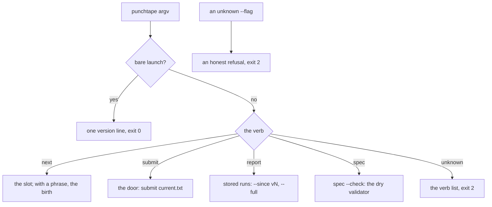

**Birth.** `punchtape next "<brief>"` in a fresh directory creates the
instance, writes AGENTS.md beside it, records the contract's own
bytes (their sha256 in the state — the anti-tamper ground of the
contract law, section 10), injects the full contract into the reply's
head (the executor receives it into its context without a "read the
file" step), and fixes the brief in the state in the same
transaction — the brief is NOT a submission. A repeated birth phrase
is an honest refusal (the brief is not edited through rebirth); the
language detector records the brief's language (section 12). A bare
`next` answers with the current slot.

**The birth pipeline.**

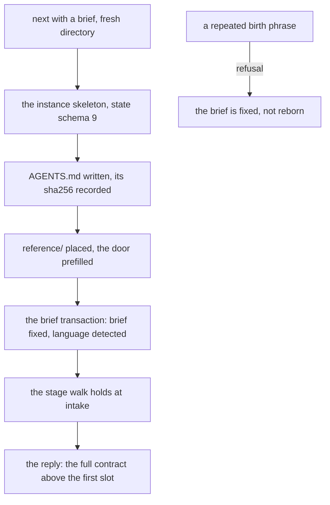

**The door.** ONE submission file: `.punchtape/inbox/current.txt`.
The machine prefills it from the embedded template when missing (a
file that exists is never touched — it is the agent's draft); the agent
overwrites the file and submits exactly that path. Any other path is
refused with the wanted one named — the door is impermeable (the
round-trip battery asserts it). The door never reads its own blank
template: a file that still carries the machine's template bytes (or
nothing at all) is refused with one line, not read. After an
accepted, non-replayed submission the machine rewrites the door back
to the blank template; a rejection leaves the draft for the rework.
Byte-sample files of rows (`bytes: file://name`) and witness probes
(`witness: probe: file://name`) lie next to the door; they are the
agent's own staged bytes and stay as they are.

**The door.**

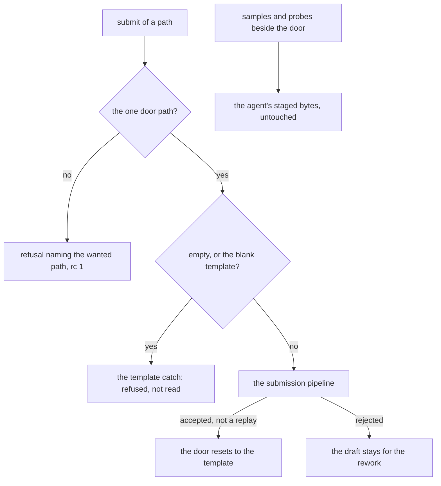

**The loop** (the working contract AGENTS.md teaches, in essence):

1. `punchtape next` — read the ONE slot (the first next with a brief
   also births the instance and prints the contract).
2. Do what the slot asks: write the spec document into the door, or
   write code in the work tree, or repair.
3. `punchtape submit .punchtape/inbox/current.txt`. Accepted — the
   reply is the **thin ack**: the ACCEPTED line with the transaction
   id, BYTES the content sha, GATES the gate names, the DOOR reset
   note, and the measured one-liners (the spec's version-counts line;
   a run's suite line with its red rows; a ratification's signature
   line and verdict line). No slot body — the slot rides the next
   `punchtape next`, and the slot cache makes that follow-up free.
   Refused — one diagnosis line plus the pointer that the draft stays
   in the door: fix the named spot, submit the same path again.
4. Repeat until a reply prints a line starting with `VERDICT`: show
   it to the human and stop — **before it do not stop, after it do
   not continue**. The ratification freezes the verdict as an
   immutable snapshot and the case lives on: at deliver a run is
   refused, and the next spec version through the same door reopens
   the work (section 8).

**The working loop.**

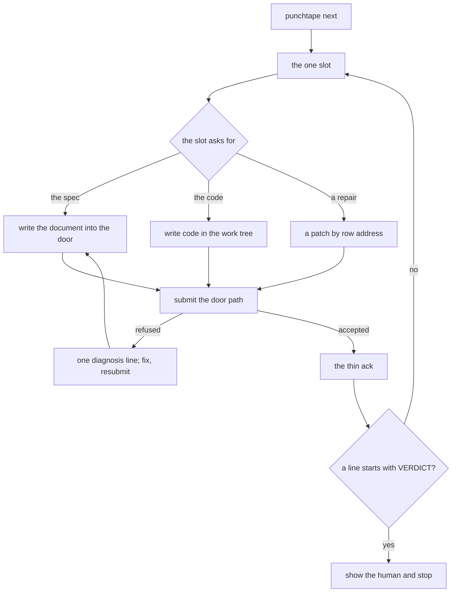

**The submission pipeline** — one transaction under the writer
monopoly, from the door bytes to the thin ack; the stages it names
carry their own diagrams in the sections that define them:

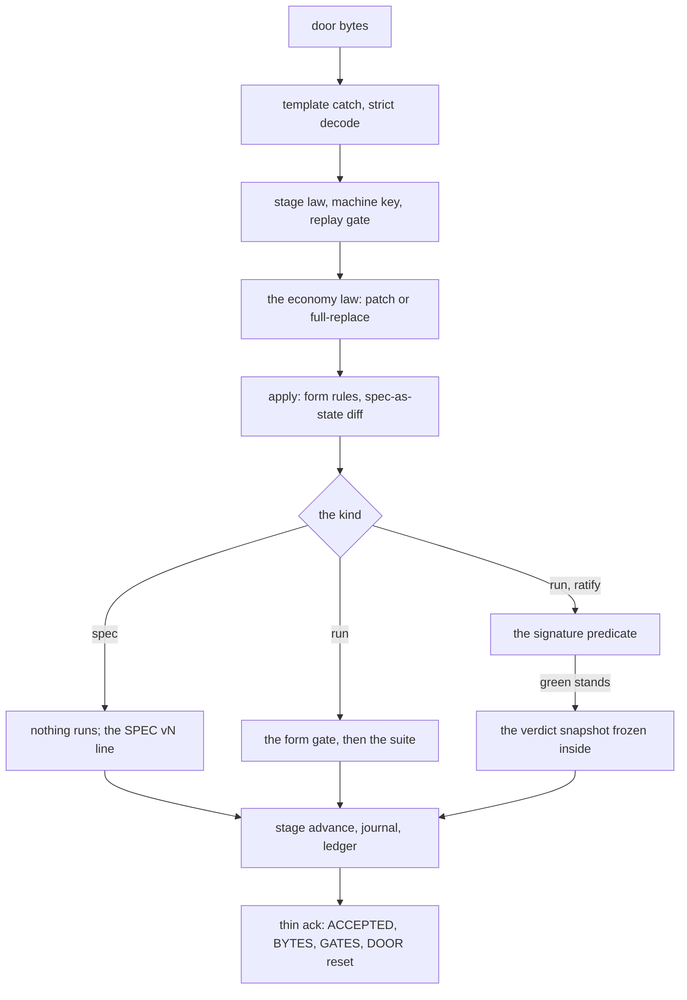

**Reply modes.** `next` and `submit` take `--quiet` (the same slot
without the CONTEXT body — except the verdict at deliver: the
closing's answer is not boilerplate) and `--delta` (only what changed
since the LAST SLOT — the anchor is the last `next` reply in any
mode; a submit ack is not a slot and never moves it). `submit` also
takes `--run-after`: a just-accepted spec's suite runs in the same
door call — two ordinary transactions, one reply. The journal and the
canon are byte-identical across the modes.

**The reply modes.**

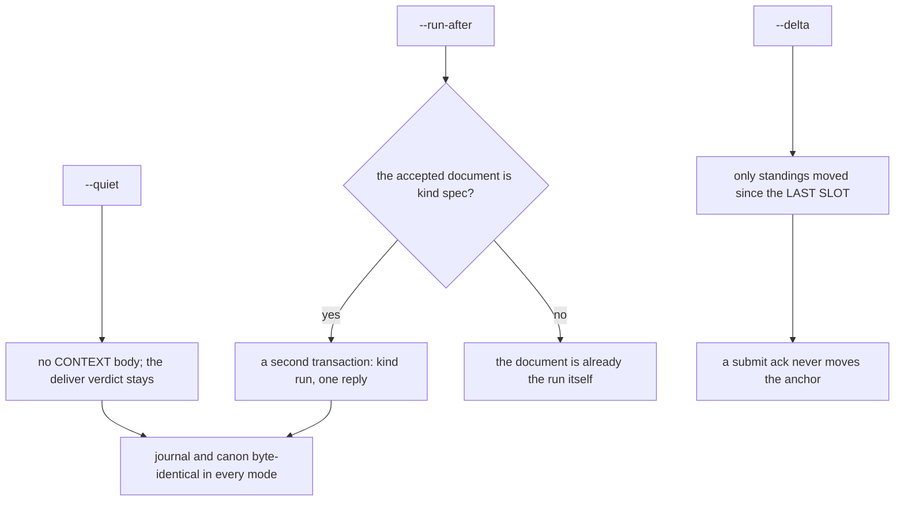

**Exit codes — the stop contract** (never touched by stage data):
**0** — ok; **1** — submission rejected: a one-line reason; fix,
resubmit; **2** — machine failure: safe to resubmit the same
document; a persistent 2 goes to the human. Never stuck: a rejection
names the entity and the reason (fix and submit the same path), the
door's template and `reference/grammar.md` carry the full grammar,
the dry validator names every form finding before the door, and a
repeated submission is an IDEMPOTENT REPLAY (section 13).

**One slot** — one step of work. Anatomy, in order: `STAGE: <stage>`;
the **INBOX line** (the door's path); the **contract line** (the
one-line reference on the birth sha — the full contract bytes again
the moment the tree's AGENTS.md is gone or does not digest to the
birth record); the stage body — at intake the pinned `BRIEF`, at
implement the `STATE` counts (atoms, rows, open — the not-green
atoms) and the **CHANGED list** of rows whose standing moved since
the last slot, retirements included (the door law: only what moved,
never the whole corpus; the full table is the report's,
`punchtape report --full`), and — before the first run — the
await-code line ("the rows have not run yet — the machine waits for
the code first"); at deliver the verdict itself; a `SESSION HANDOFF`
line once the journal passes 40 entries
(a recommendation, not a blocker); `ACTION:` — exactly one; the
**CONTEXT** slice (at implement: the focus atom's card — the prose,
one status line, the RED rows in full with their measured reasons,
the green rows a counter — and ZERO words about structure, layout or
files); `GATES ON SUBMIT:` (at intake `suite`, at implement
`suite, tree`, at deliver none).

The slot is deterministic: the same canon and journal — bit-for-bit
the same text. The slot cache is keyed by the journal head plus the
canon and state digests (on deliver, plus the live tree digest) — a
served slot can never be stale. One agent per task carries it from
birth to verdict.

**The slot render.**

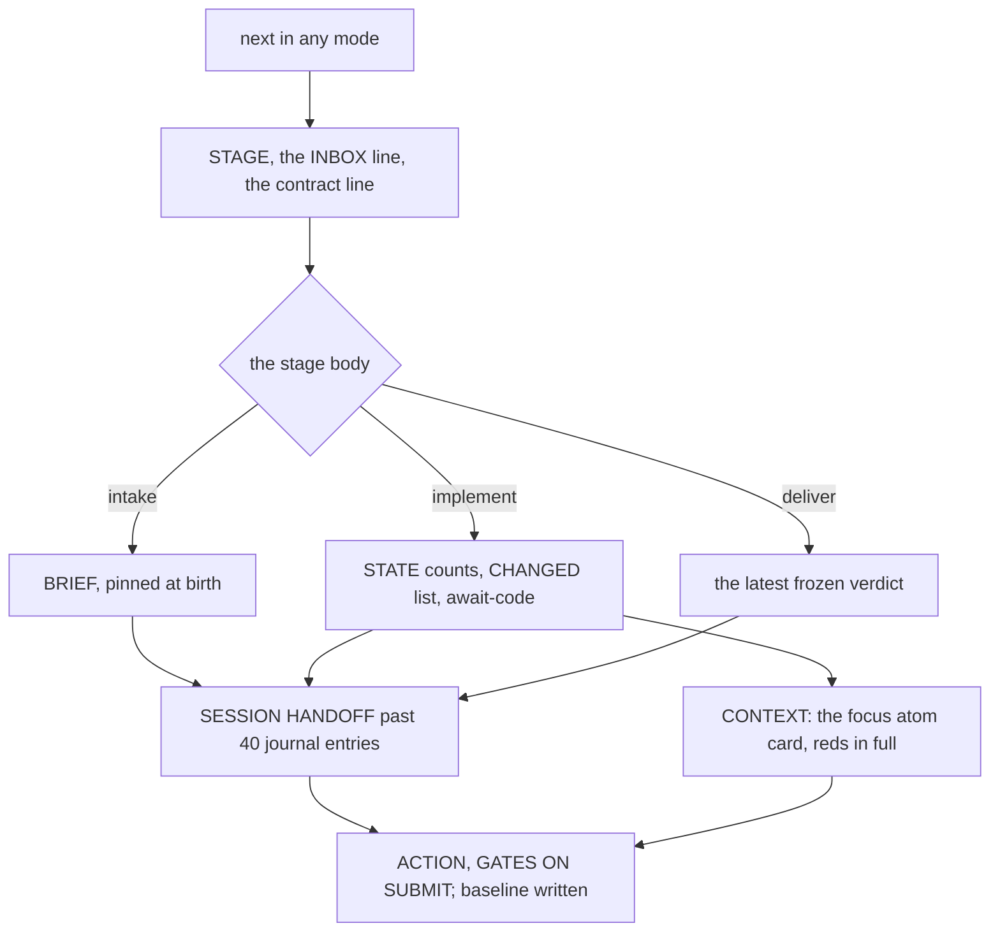

**The slot cache.**

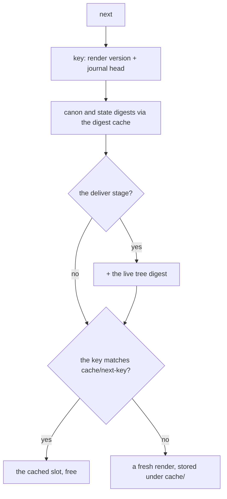

## 5. The document

The submission is ONE text file, YAML-shaped: two-space indents, dash
lists, literal block scalars (`prose: |`). Two kinds, one grammar —
the kind decides what the machine does with the document, not which
fields it has. `reference/grammar.md` is the machine's own doc; the
door's template is the same grammar with comments.

```yaml
kind: spec                  # spec | run — exactly two kinds
build: [make, build]        # optional build argv
build-ignore: [__pycache__, "*.pyc"]  # globs outside the digested tree
behaviors:                  # spec: 1+ required; run: optional
  - id: B1                  # the agent's short id; THE repair identity
    name: chain-passthrough # a living name (non-empty)
    prose: |                # MANDATORY human-readable prose
      Bytes flow through the chain as read, without message assembly…
    rows:                   # 1+ rows per behavior; ONE head per row
      - run: ["app", "relay", "a", "b"]   # argv list OR a quoted string
        seeds:              # optional files written before the row
          - path: in.txt
            text: |
              first
              second
          - path: big.bin
            from-input: big.bin       # a copy of a file of input/
        out: "pervaya"      # exact | "(contains) frag" | "" (empty)
        err: "(contains) usage:"   # optional, the same two forms
        rc: 0               # expected exit code, default 0
        state:              # optional file checks after the row
          - path: out.txt
            text: pervaya   # exact (EOL-tolerant) | contains
          - path: result.bin
            from-run: cmd-artifact.bin      # byte-equal with a run file
        bytes: file://big-ref.bin  # sample next to the door; stdout byte-equal
        timeout: 60         # optional row ceiling, 1..300 s
        form: "the brief phrase this pin quotes"  # the source line of
                             # the formal pins (see the form law)
        launch: nonet       # optional: launch in a network-less namespace
        tree: unchanged     # optional: row-scoped tree identity control
ratify: true                # ONLY in kind: run — sign the recorded green
```

**The two kinds.** **spec** — the state of the case: the machine
validates the form and applies the document's behaviors as the whole
corpus; nothing runs; one or more behaviors required. The FIRST spec
is the one FULL document — every later spec rides the patch body
(the economy law: the full table never rides twice). **run** —
the same grammar, plus execution: after the apply the machine runs
every STALE row of every behavior of the resulting corpus (in atom id
order, the atom's row order inside — a row whose green stands at
unchanged inputs does not re-run, section 7). In kind run the
behaviors upsert by id (repairs never retire); behaviors absent from
the document = a pure re-run of the stale rows as is (section 13);
`ratify: true` asks the machine to sign the recorded green (section
8). A run needs the work open (implement); at deliver only the next
spec version enters.

**The patch body** — the sparse later submission, addressed by the
row labels the machine itself prints (`BEHAVIOR-ID/N`, one-based, the
corpus as it stands at arrival):

```yaml
kind: run                   # or spec: the change without the run
patch:
  replace:                  # full new row bytes, edited IN PLACE
    B1/2:
      run: ["./tool", "arg"]
      out: "new expected stdout"
      form: "the brief phrase this pin quotes"
  add:                      # rows to the END of their table
    - atom: B9              # a NEW id opens the behavior (name+prose)
      name: new-capability
      prose: |
        One paragraph of human-readable prose.
      row:
        run: "./tool new"
  remove: ["B2/1"]          # rows retired by address
  run:                      # rows to execute NOW, fresh or not
    B1/1:
      launch: nonet         # optional mode replacement (or tree:)
  prose:                    # the behavior prose replacement
    B1: |
      The verdict-gate prose rides the patch body, once per behavior.
```

The patch is EXPANDED into the full document a full re-submission of
the same change would have been — one apply law, the canon bytes
identical by construction; row order is insertion-stable (a
replacement edits in place, adds go to the end). One address, one
operation: a label may ride at most one of replace/remove/run. A run
patch never empties a behavior. The deliberate FULL rewrite hatch: a
full behaviors document with `full-replace: true` is accepted as an
explicit act — the ack counts "old N rows -> new M rows" and the
event rides the ledger; a repeated FULL document without the mark is
refused.

**The patch expansion.**

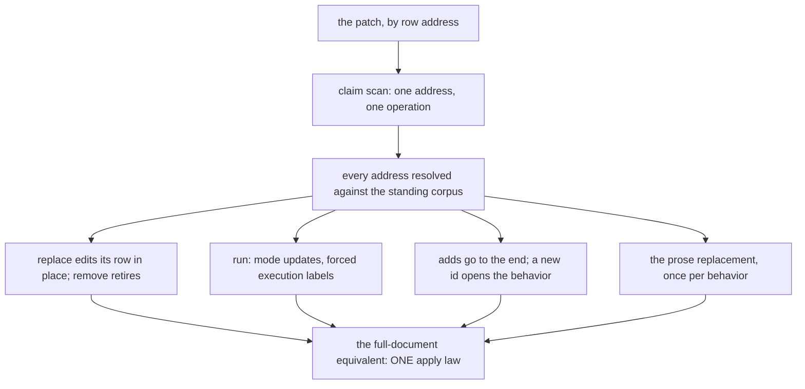

**Field rules** (the strict decode refuses everything else):

- `run` — ONE command per row, in one of two equal forms: the argv
  array `["cmd", "arg with, comma"]` (one element per argument,
  nothing re-parsed) or the string `"cmd args"` (spaces separate
  words, quotes group; NOT a shell line). Orchestration inside the
  command (`sh -c '…'`) is the row's own business.
- `out`/`err` — exact text (ONE trailing newline tolerated), the
  fragment form `"(contains) X"`, or `""` (the explicitly empty
  stream); absent = unchecked. `rc` defaults to 0 (0 or greater).
  The expectation laws: an expectation that only echoes a checking
  harness's self-report (every line a PASS/OK/fail-class token) is
  refused — expect the product's observable text, never a report
  about the checks; a contains fragment shorter than 4 runes is
  refused unless it carries the executor's explicit honest mark
  `(contains-loose)`.
- `seeds[]` — files written before the row, self-removed after it
  (section 7); one source form each: `text` (inline) or `from-input`
  (a copy of a file of the instance's input directory — the sibling
  `input/` of the work root — checked at intake).
- `state[]` — file checks after the row: `text` (the same
  EOL-tolerant / contains forms) or `from-run` (byte equality with a
  file the run itself produced — for expectations that ARE run
  artifacts).
- `bytes: file://NAME` — the only binary form: a sample lying next
  to the door in `.punchtape/inbox/`; stdout must equal its bytes.
- `timeout` — the row's own ceiling, 1..300 s (default 60); the
  build gets 300. Mechanism parameters, not user budgets.
- `build` / `build-ignore` — the declared build argv and the ignore
  globs; a present declaration replaces the previous one, `[]`
  clears a build, absence keeps the stored one.
- `form` — the one-line source of the row's formal choices. A row
  that pins formal surface — a nonzero `rc`, or an exact
  (non-contains) out/err/state text — without a citation is a FORM
  DECISION UNRESOLVED: the spec lands, the ack names the rows, and
  the run door stays closed until each pin carries its source line
  (the brief/prereg phrase it quotes, or the operator's one-line
  decision as `form: "op(<date>): <decision>"`). The machine never
  judges the citation's content — presence is the whole mechanism.
- `answers` — parsed and honestly refused: no question batch can be
  open in this machine generation. `ratify` — only legal in
  `kind: run`.
- The surface law: no run argument may name an existing work-tree
  FILE outside the accounted surface (a build-ignore pattern covers
  it) unless the row itself carries the bytes as its seed — a green
  measured on unsigned files travels nowhere. The FIRST field is
  exempt (the executed program is the product under test); a path
  that does not exist is exempt (refusal shapes name missing paths
  on purpose).

**The form rules** — one law, two readers:

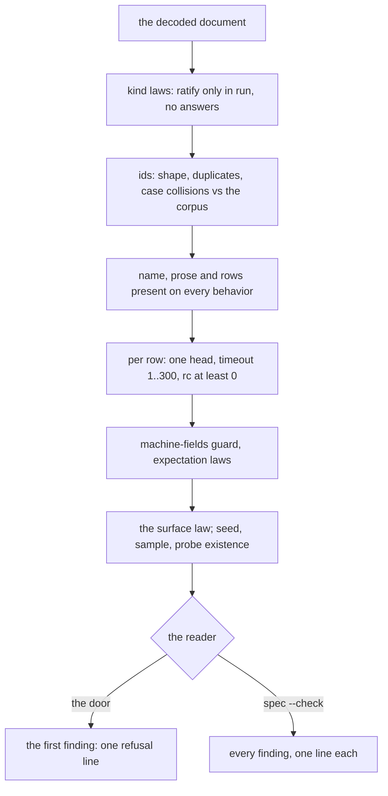

**The form gate.**

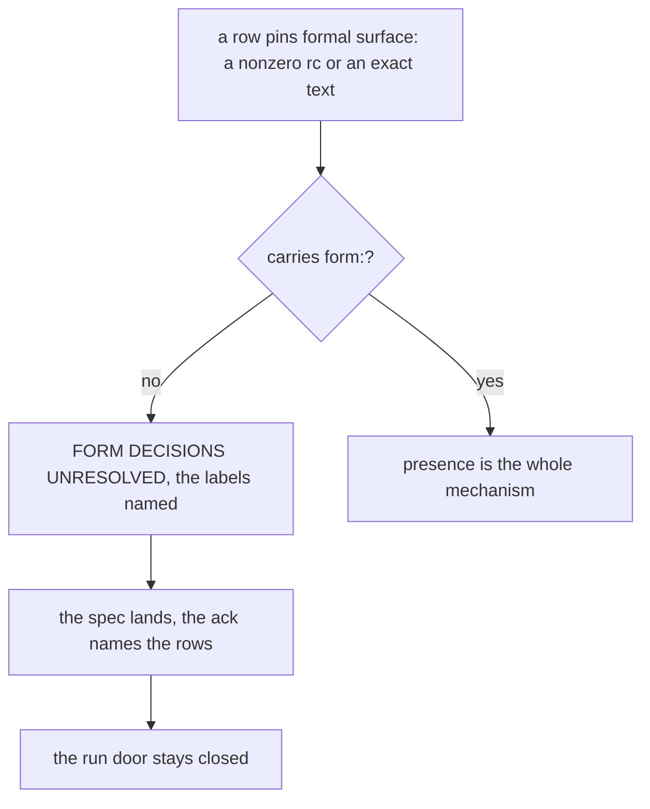

**Typed heads.** A row carries exactly ONE head — the general `run`
command or one of the mechanical families, strictly checked, no
shorthand, no bundle:

- `refuse: {args, says, rc}` — one refusal: the invocation, the one
  trouble line it must print on the error stream, the exit code. A
  DECODE-ONLY notation: it maps onto the general fields it names —
  `refuse` IS the row `{run: args, out: "", err: says, rc: rc}`, one
  row, one canon.
- `det: {run, same}` — the determinism pin: the recorded expectation
  is the witness. Decode-only too: it IS `{run: run, out: same}`.
- `witness: {probe}` — the staged-bytes probe head: the probe's
  bytes (a checker program) ride THE DOOR — `probe: file://NAME`
  names a file next to the submission in the inbox. The machine
  stages the bytes into the tree for the row's duration, runs them
  under the row's procedural modes and compares rc/stdout with the
  row's want. What the probe checks is not the machine's knowledge:
  probes arrive as staged bytes through the door, never from the
  machine itself.
- `repeat-run: <command>` — the idempotency witness: the command
  runs TWICE in immediate succession over what it leaves (the seeds
  stand for both). Green is agreement: both runs exit 0 and print
  byte-identical stdout; divergence is a red quoting both answers.

**The typed heads.**

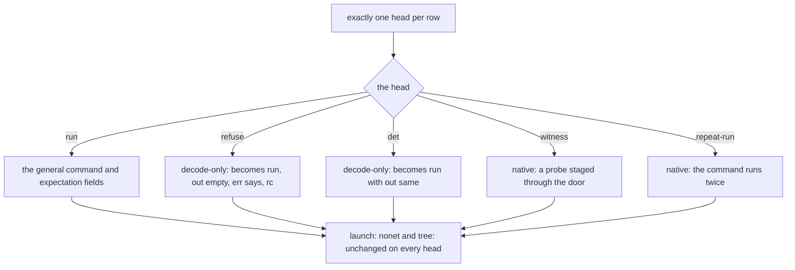

**Procedural modes.** Two modes compose with EVERY head:
`launch: nonet` — the launch happens inside a fresh network-less
namespace (nothing is wrapped around the command, the network simply
is not there; a host that cannot raise the namespace answers an
honest environment red); `tree: unchanged` — the row-scoped tree
identity control (outside `.punchtape/`, build-ignore and the row's
own seeds, nothing the row leaves behind survives it). A mode is
mechanics; whatever a mode is FOR lives in the probe or the row's
own expectations.

**The machine's own records are never submission content.** The
outcome, the reason, the env-fail mark and the run memo (section 6)
are written by runs only; a document that tries to forge them is
refused naming the row.

**Upsert and identity.** In kind run a repeated behavior id replaces
that behavior's name, prose and rows; a new id adds a behavior; a
run never retires. The id is the repair identity:
`[A-Za-z0-9][A-Za-z0-9._-]*`, at most 32 runes, unique in the
document and against the corpus (two ids differing only in case
would share one canon file — the collision is refused). Every
behavior carries a non-empty name, mandatory prose and one or more
rows — whatever the kind.

**Form errors are loud.** No auto-repair: a decode failure or a
validation refusal is answered with one diagnosis line naming the
entity (`behaviors[1]`, `B1/2`, `delta`, `patch`) and the reason;
the draft stays in the door. The only surviving hint is the kind
head: an unknown kind within an edit distance of two of exactly one
known kind gets that kind named in the refusal. The dry validator
(`spec --check`) runs the door's own predicates over a draft and
names every finding — the same law, no second opinion (section 10).

## 6. The corpus: behaviors

The corpus is the product's specification as data — one entity kind,
the behavior, stored as the canon's atoms: one file per behavior,
`.punchtape/canon/atoms/<id-lowercase>.yaml`, with

- `id` — the agent's short identifier (the repair identity);
- `name` — a living name in the agent's language (non-empty is a form
  rule);
- `prose` — the author's description in living words: what the
  behavior is, how it is invoked, what is visible, boundaries and
  errors. MANDATORY at the form level. The prose is the human spec's
  source: the verdict's reader reads it in spec.md;
- `rows` — the behavior's check rows verbatim as submitted, plus the
  machine's record of the last run: `outcome` (green/red/unknown),
  `reason` (the measured reason of the last red), `env-fail` (the red
  is an environment or launch failure, not behavior) and the run
  memo — `ran-at`, `ran-tree`, `inputs`, `ran-rc`, `ran-out` (the
  content-addressed freshness key and the measured answer, section
  7);
- `digest` — the record's own digest, computed by the machine at
  every write over the record without the digest itself: the atom's
  identity as stored, for renders and audits.

**The atom is the unit of the verdict.** An atom is green when it
owns rows and all of them are green; the corpus is green when every
atom is green; the ratification gate and the verdict stand on that.
There are no corpus-wide rules beyond the form — the rows live inside
their atom, so exclusive ownership is true by construction; no
cross-entity references exist.

**The repair model.** No holds, no change requests, no draft channel:
a repair is a patch by row address (a replacement edits its row in
place, an added row lands at the end of its table, a removal retires
its row to a visible journal frame the next verdict explains) or a
cheap partial upsert by behavior id; a new capability is a new id. A
re-declared unchanged row is NOT new work — the machine carries the
recorded outcome and memo of the same-definition row across versions
(the content-addressed carry); a changed definition is new work until
a run proves it. A red row's repair is either the code (the
expectation was right) or the row (the expectation was wrong) — the
machine never guesses which; the red's measured reason carries the
values to decide by (section 7).

**The spec-as-state apply.**

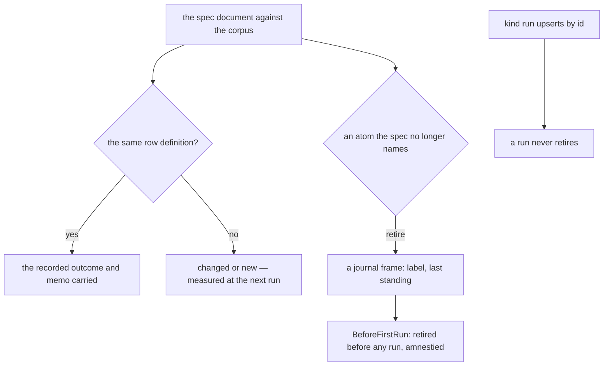

## 7. The run world

The machine knows nothing about the product or environment: it runs
commands and reads bytes. `reference/environment.md` is the machine's
own doc on this world.

**Direct execution.** The rows and the declared build run DIRECTLY in
the agent's work tree — no wrappers, no containers, no copies: cwd is
the work dir, PATH is the system PATH. The machine adds nothing to
the environment and hides nothing from it; toolchains are whatever
the host provides. Inside a shell (`sh -c …`) the tree is the working
directory but not on PATH — call tree files as `./name`.

**One row's life.** The seeds are written; a seed over an existing
tree file honestly replaces it for the row's duration, and when the
row ends the original bytes return, a fresh seed path is removed —
between rows seeds do not live (a leftover is an honest env red). The
command runs in its own process group under its timeout; whatever it
leaves running is killed before observations; a tree file launched
by name is granted the execute right for the row's duration and
returns to its owner's mode (mode bits are outside the digest
identity). `argv[0]` resolution, zero product knowledge: a name with
a slash is a path into the tree as is; a bare name that exists as a
tree file is launched through its tree path; anything else goes to
the environment as is (a PATH launch). The observations — stdout,
stderr, exit code, files — are matched against the expectations. One
row — one run in one tree: the row's identity is its recorded
expectations, not a comparison of repeats. The two exceptions by
head: the repeat-run witness (its meaning IS the second run over the
leftovers) and the staged-bytes probe (its bytes arrive through the
door, are staged into the tree for the row's duration and leave it
again — a leftover is an honest env red, the same law as the seeds').

**One row's life.**

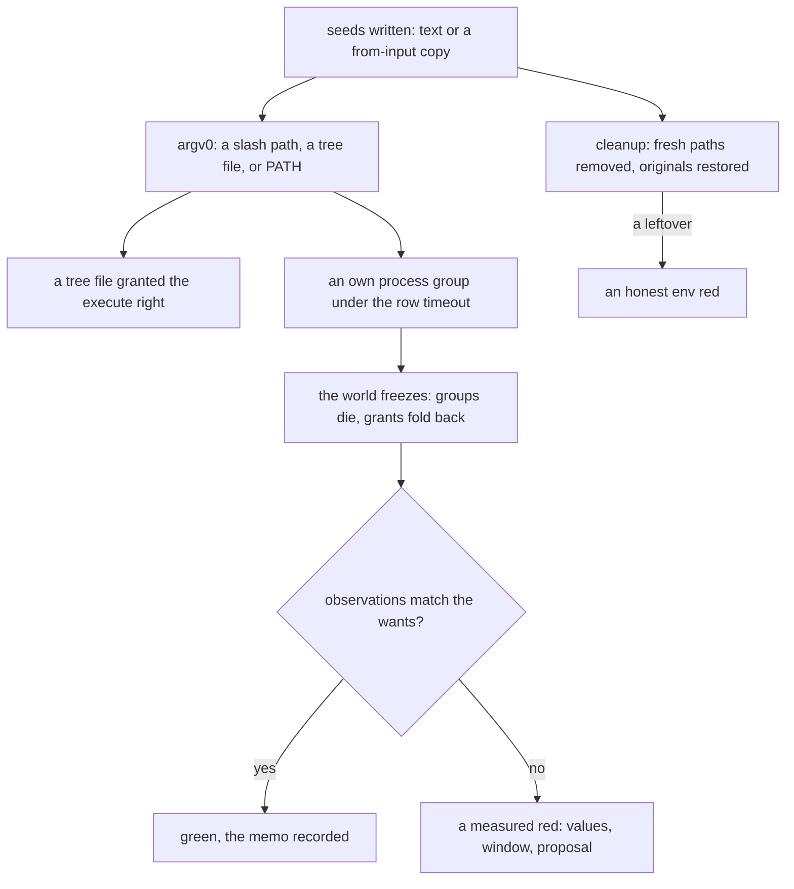

**The typed heads in execution.**

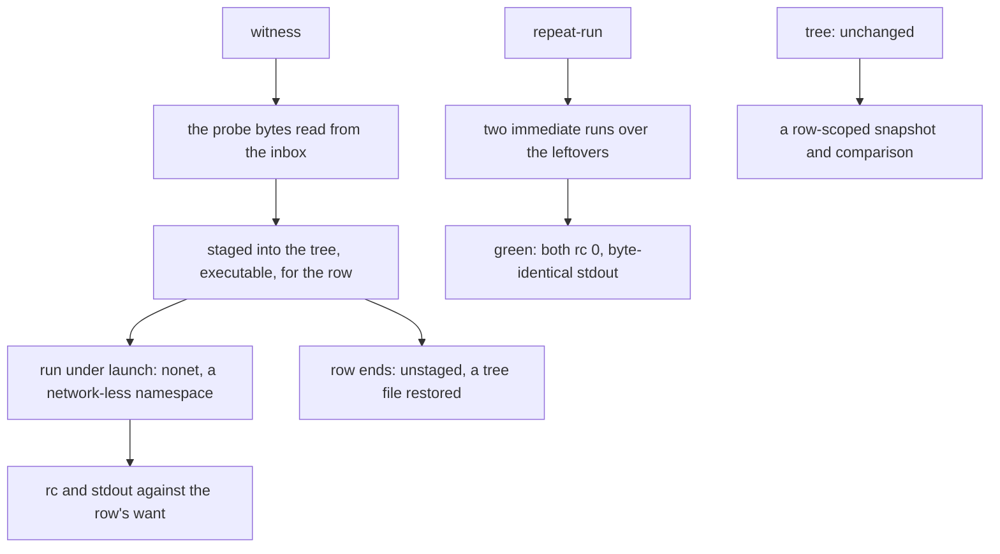

**The build.** When the spec declares one, it runs once in the live
tree before the rows of every run submission; rc must be 0 within
300 s. A failed or timed-out build reddens the run as "rows not run"
— every row an env-class red, the surface unproven. What the build
leaves outside `build-ignore` reddens the run as a tree that moved
(below) — build artifacts are the ignores' business.

**The run transaction.**

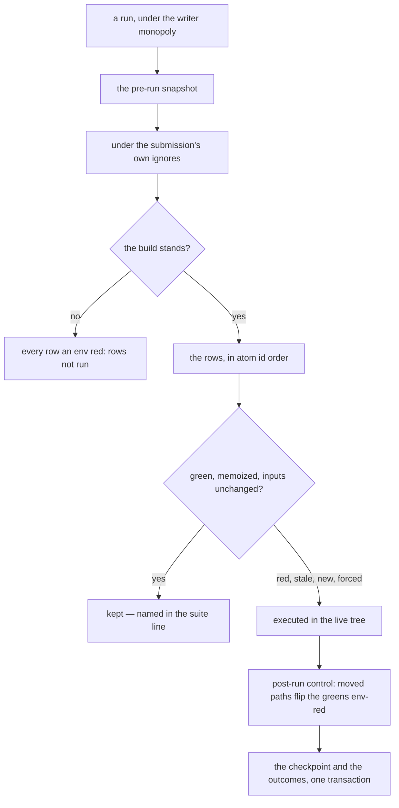

**The content-addressed memo.** A row keeps its green while its
DEFINITION and the digests of the files its command names in the work
tree — plus its from-input seeds' sources, its byte sample, its
witness probe and the declared build — are unchanged. A run executes
only stale, new and changed rows; the kept greens are named in the
suite line ("N rows: R ran, K kept green at unchanged inputs"); a red
row always re-runs; touch a named input and its row goes stale. A row
the patch's run section names executes WHATEVER its freshness — the
explicit request is a measurement, not a repair.

**The freshness key.**

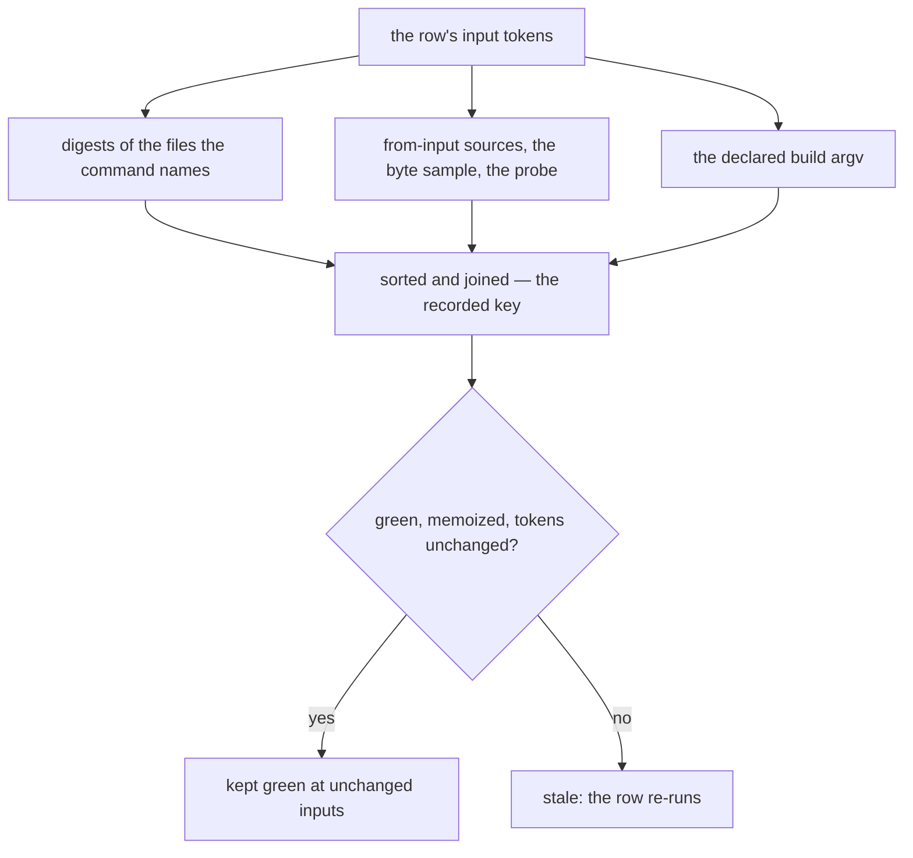

**The digested surface.** The accounted product is the work tree
minus `.punchtape/` (excluded unconditionally) minus the
`build-ignore` globs (a pattern ending in `/` excludes a directory
prefix; a plain pattern matches the relative path or any file name —
the gitignore habit). The instance's input directory (the sibling
`input/` of the work root) lies outside the work dir and is never
digested.

**Checkpoints** — digest snapshots of the surface, the machine's only
view of the project tree: the file set plus a per-file sha256 (a
symlink is recorded by its target — a swapped link changes the
digest), one digest over sorted `path\0hash` lines — raw bytes, no
newline normalization: the digest is the tree's exact identity.
Written as `.punchtape/checkpoints/ckp-<seq>.yaml` (a monotonic
counter), committed in the SAME transaction as the run's outcomes —
the tree the outcomes stand on is fixed with them.

**The checkpoint snapshot.**

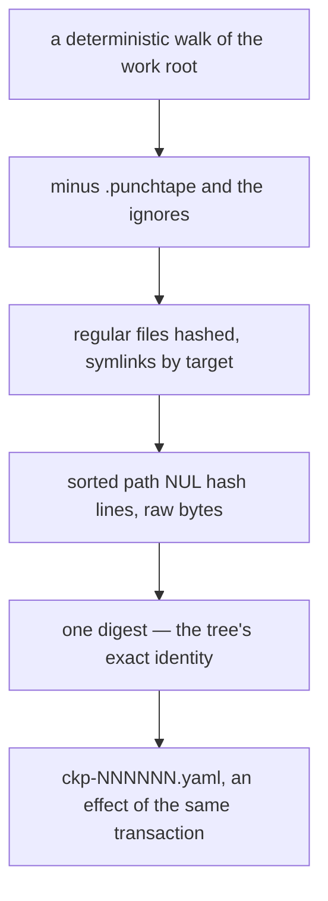

**Tree identity control.** Each run takes a pre-run snapshot (under
the submission's own build-ignore declaration — the ignore that
arrives with the repair covers the repair's own control), executes
the build and every stale row, then re-reads the surface: files
outside the ignores that diverged redden the transaction — the red
line "tree moved during the run" names the paths, and the run's
greens flip to env-red (a tree that moved under its own measurement
proves nothing). A row with `tree: unchanged` gets its own
row-scoped snapshot and comparison — an identity the whole-run
control cannot see (a write-then-delete pair inside one suite
reconciles at the end, but not per row). Rows clean up after
themselves: seeds are removed, outputs belong in `build-ignore` or
die inside the row.

**Measured reds.** A red row's reason carries the measured values:
the exit code got versus wanted, the expectation and the measured
stream with an excerpt, a window of bytes around a divergence — and,
for a terminator-shaped divergence (a trailing newline, a missing
line break), a copy-ready repair value: the measured bytes as a
PROPOSAL the agent pastes into the row when the code is the truth.
The red stays red until the agent's own submission changes it.

**env-fail.** A red of an environment or launch failure (a tool
missing, a start failure, a launch timeout) is classified by the
diagnostics registry (canon data) and marked env-fail — not behavior.
The verdict does not distinguish: a red row is a red row, the release
is not proven until the substrate holds.

**The env classification.**

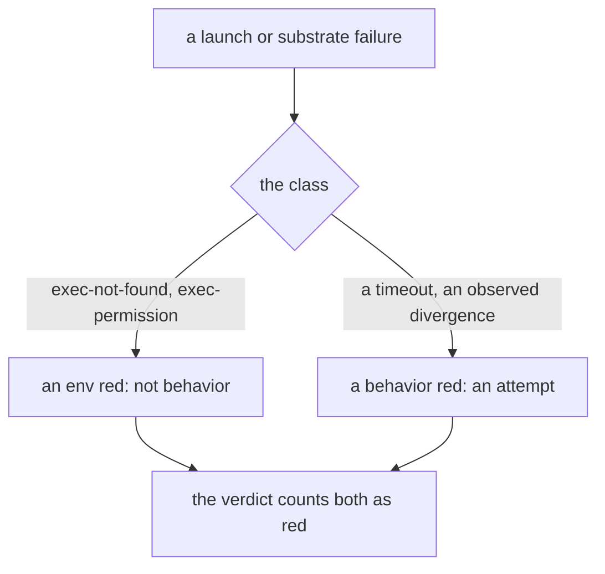

**The run's gates.** The thin ack names the gates the submission
passed: `form` for a spec, `suite, tree` for a run,
`freshness, digest, verdict` for a ratification.

## 8. Stages

The process is a data-driven state machine `brief-to-verdict`: the
stages and their exits live in canon data (`stages.yaml`); the runner
walks the exits while the named machine checks pass. Gates are named
checks (the name→mechanic dictionary lives in code; an unknown name
is canon/code drift — an honest refusal, not a panic). A transition
is always a consequence of a machine check, never an agent's decision.

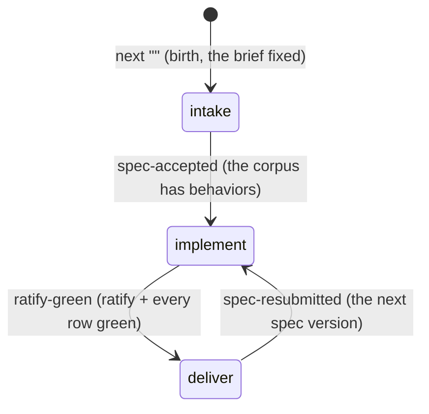

- **intake** — the brief is fixed (at birth); the agent writes the one
  spec document into the door. Exit gate `spec-accepted` (the first
  accepted spec gave the corpus behaviors) → implement.
- **implement** — the work stage, and the only stage with run
  traffic: the agent writes code directly in the work tree; run
  submissions execute the stale rows; repairs ride patches by row
  address or partial upserts by behavior id; new behaviors may still
  arrive (a spec is accepted at implement too). Exit gate
  `ratify-green` — THIS submission carries `ratify: true` AND every
  atom stands green (the second lock; the signature law below owns
  the proof) → deliver.
- **deliver** — the accepted state's rest: the slot renders the
  latest frozen verdict snapshot and the door refuses a run (only
  the next spec version reopens the work — the exit gate
  `spec-resubmitted` walks the case back to implement). A new TASK
  still means a new instance; a new VERSION of the same case enters
  through the same door.

**The stage runner.**

```mermaid
flowchart TD
    A["stages.yaml, the canon data"] --> B["the stage and its exit gate, by name"]
    B --> C{"the mechanic known?"}
    C -->|"no"| D["an honest refusal: canon or code drift"]
    C -->|"yes"| E{"the gate passes?"}
    E -->|"yes"| F["goto — the walk continues"]
    E -->|"no"| G["the stage holds"]
    F --> B
```

**Ratification is a signature, not a run** (the signature law): it
executes nothing — no row, no build. It signs exactly when the
recorded green still stands: every row fresh at unchanged inputs,
and the surface digest equal to the digest of the last green run
(the acceptance moment). Anything stale — a red row, a row that never
ran, a named input that moved, a tree that drifted — is a REFUSAL
naming the rows or the paths (exit 1, nothing applied); the honest
route back is a plain run, then ratify again. A successful
ratification freezes the verdict snapshot inside the same
transaction (section 9) and its one-line verdict rides the ack.

**The ratification predicate.**

```mermaid
flowchart TD
    A["ratify: true — executes nothing"] --> B{"every row green, memoized, fresh?"}
    B -->|"no"| C["refusal naming the rows"]
    B -->|"yes"| D{"an acceptance moment exists?"}
    D -->|"no"| E["refusal: no green run to sign"]
    D -->|"yes"| F{"the surface equals the acceptance digest?"}
    F -->|"no"| G["refusal: the tree moved, the paths named"]
    F -->|"yes"| H["signed: rows kept green, the tree digest"]
```

## 9. The verdict and acceptance

**The verdict** is the machine's final word on a task's readiness:
READY / NOT-READY — two statuses, no third. NOT-READY is a named red
list with the measured facts, never a silent "almost done". Analogy:
accepting a car by checklist, not by "seems fine". The machine renders
it in canonical fixed format; an agent's retelling is not the verdict.

**Verdict lines**, in order: the head (`VERDICT: …`); the digest
signature; the version line (a snapshot: `version: vN`); atoms
(total, green; rows); stages (spec submissions, runs); origin (the
brief's first line, or "(no brief)" honestly); the bill (machine
wall, verb calls); the acceptance line; the retired-rows section —
every row that disappeared since the previous verdict, each named
with its last recorded standing (greening by deletion without a
trace is impossible); and, when NOT-READY, the RED LIST — one line
per red row (label `B1/2`, measured reason), capped by the list
budget.

**The verdict render.**

```mermaid
flowchart TD
    A["atoms, journal, ledger facts"] --> B{"every atom green, no red rows?"}
    B -->|"yes"| C["READY"]
    B -->|"no"| D["NOT-READY, the RED LIST within its budget"]
    C --> E["the fixed lines, in order, to the retired section"]
    D --> E
    E --> F["normalized, without the digest and the bill"]
    F --> G["the signature: sha256, 16 characters"]
```

**The stop condition is computed, not judged:** every atom owns only
green rows, there are red rows nowhere, and the tree has not drifted
from the acceptance moment. Digest values exist only in machine
replies — never compute one yourself. SHA-256; the short forms are 12
characters (transactions, tree digests), the verdict signature is 16 —
a digest over the verdict's normalized text without the live meters
(the bill): the signature is the identity of the verdict's STATE, not
of environment counters.

**The acceptance moment** — the transaction in which every atom of
the corpus stands green on this tree: it lands in the ledger as a
gate record (suite, scope acceptance) with the green/total counts and
the pre-run tree digest, one moment per tree digest (a full-fresh
ratification signs the tree the last green run already accepted —
the moment is recorded once, not twice). The verdict's acceptance
line names it: `acceptance: PASS on tree <digest> (N/N rows green)`.

**The acceptance moment.**

```mermaid
flowchart TD
    A["a transaction with its checkpoint"] --> B{"all atoms green, the build stood?"}
    B -->|"no"| C["no moment recorded"]
    B -->|"yes"| D{"rows ran, or the run ratifies?"}
    D -->|"no"| C
    D -->|"yes"| E{"this tree digest already accepted?"}
    E -->|"yes"| F["recorded once — the snapshot carries it"]
    E -->|"no"| G["a ledger gate: suite, acceptance, digest, N of N"]
```

**Drift.** The verdict re-snapshots the CURRENT tree — an observation,
not a journal record — and D' ≠ D is the machine-visible red line:
the acceptance line names the drift, a READY is downgraded to
NOT-READY, and re-verification needs a run on the current tree (the
pure re-run driver exists exactly for this). A drift claim needs TWO
signatures: an acceptance that could not see the surface or an
unmeasurable one says nothing — a false drift does not reach the
verdict.

**The drift check.**

```mermaid
flowchart TD
    A["the verdict render"] --> B["a fresh snapshot of the CURRENT tree"]
    B --> C{"equal to the acceptance digest?"}
    C -->|"yes"| D["the snapshot stands"]
    C -->|"no"| E["the acceptance line names the drift"]
    E --> F["READY downgraded to NOT-READY"]
    F --> G["the frozen vN is never touched"]
    G --> H["re-verify: a run on this tree, then ratify"]
```

**The versioned freeze.** Every successful ratification freezes an
IMMUTABLE VERSIONED SNAPSHOT — `.punchtape/verdicts/vN.txt`, a
journaled effect written once inside the ratifying transaction: v1 is
pinned to its digest forever, v2 to its own — the model of git
commits; the case lives on, the snapshots never move. At deliver the
slot renders the LATEST snapshot (a live re-render is not the
snapshot); a tree that drifted after the acceptance appends the
honest drift line without touching the snapshot. The ratify
accounting guard refuses a verdict that cannot explain a retired row
by name, and refuses rows retired after runs without ever running
(deleting a check before it measured anything is hiding it; a row
dropped before the case's first run never had a chance to measure —
that is an edit of the hand's own first table, amnestied). The same
step regenerates the knowledge renders (SUMMARY.md, spec.md —
section 10) after every committed transaction at deliver.

**The snapshot freeze.**

```mermaid
flowchart TD
    A["a successful ratification"] --> B["version = the previous + 1"]
    B --> C["the retired frames since the last verdict"]
    C --> D{"every retirement named? none hidden?"}
    D -->|"a guard trips"| E["no verdict ships — the refusal names them"]
    D -->|"clean"| F["the effect: verdicts/vN.txt, written once"]
    F --> G["the VERDICT counter, one line in the ack"]
```

**The round-trip battery** (the model's own acceptance evidence; the
field-study numbers belong to docs/RESEARCH.md): real cycles of the
real binary — birth with the contract injection, the spec stored by
id (the ack's version counts; the thin-ack law: no slot body), the
door's impermeability (stray copies refused with rc 1), code written
directly, a wrong-expectation run red through a patch by row
address, the repair green, the bare-run ratification ("nothing
re-ran"), the deliver slot with the one-line contract reference, a
real toolchain build through the door (a crate compiled by the
declared build under build-ignore), the living case (the next spec
version accepted at deliver, the work reopened), the quiet surfaces
(the `--run-after` batch, `--delta`, `--quiet`), the frozen
snapshots byte-identical through a refused run at deliver, the
report (door view, `--full`, `--since vN`, an unknown verdict
refused with rc 1), the form gate (an unresolved pin named in the
ack, the run door closed, the sourced row opening it), the typed
rows and the dry validator (refuse/det/witness/repeat-run through
the same door; a vanished probe an honest red, its return through
the door green again), and the ceremony meter's render families in
the ledger — plus the unit battery green with the coverage gate at
100.0% by exact block counts, behind the agnostic scan (section 12).
No code byte ever enters the machine: no write path touches the
product's files (the door is the only input, and it is the agent's
document, not code).

## 10. Renders

**AGENTS.md** — the only machine file in the working root: the agent's
full input contract, written by the machine at birth (a root without
it has no instance yet) and injected in full into the first next's
reply. Interface and role only: the verbs, the door, the condensed
grammar, the cycle, the rules. The contract law: the hand pays for
the whole contract exactly once, at birth — the birth records the
contract's own sha256, every later slot carries the one-line
reference on it, and the FULL contract renders again the moment the
tree's copy is gone or changed (anti-tamper, not an option). If the
repository carried its own AGENTS.md, the file is COMBINED: the
machine contract first and always prevailing, a precedence line
marks the tail boundary, the repository's rules preserved verbatim
below it, and the machine regenerates only its own head.

**The working contract.**

```mermaid
flowchart TD
    A["AGENTS.md at birth"] --> B["its sha256 recorded in the state"]
    B --> C{"a later slot: the tree copy digests to it?"}
    C -->|"yes"| D["the one-line contract reference"]
    C -->|"gone or changed"| E["the FULL contract renders again"]
    F{"the work root carries its own AGENTS.md?"}
    F -->|"yes"| G["combined: machine head first, repo tail verbatim"]
    F -->|"no"| H["the machine contract alone"]
```

**The reference library** — `.punchtape/reference/`: three topical
docs (`environment.md`, `grammar.md`, `model.md` — the machine's own
shipped texts), maintained at every open (regenerated whenever the
canon head changed); hand edits there are lost.

**spec.md** — the machine's render of the current spec,
`.punchtape/spec.md`, refreshed after EVERY accepted submission (and
at open): one section per behavior — the id and name, the prose
verbatim in the agent's language, a rows table (run, expectations,
last outcome) and the first standing red's reason. The template lives
in the machine's code; the file is a regenerated render, not a journal
effect.

**SUMMARY.md** — the one-page human summary (done / checked / price)
in the language of the brief, written inside the instance and
regenerated after every committed transaction at deliver; its price
block carries the ceremony meter — the reply bytes the hand paid, by
render family (contract, spec, report, door-echo). A file a human
wrote in its place is left untouched — the machine never overwrites a
human text.

**The render regenerations.**

```mermaid
flowchart TD
    A["reference/, the three docs"] --> B["regenerated when the canon head changed"]
    C["spec.md"] --> D["after every accepted submission, and at open"]
    E["SUMMARY.md"] --> F["at deliver, in the language of the brief"]
    F --> G{"a human wrote the file?"}
    G -->|"yes"| H["left untouched"]
    G -->|"no"| I["regenerated, the ceremony in the price block"]
    B --> J["renders, not journal effects — always derivable"]
    D --> J
```

**The report** — `punchtape report`: the operator's read-only table
of the observed behavior, rendered from the stored canon runs
(nothing re-runs, no ledger entry, no baseline write): every row's
exact command, its demand, the measured answer (the exit code and
output digest of the last run), the run's time and the freshness
mark (green fresh / green stale — a named input moved / red / never).
The DEFAULT surface is the door view (per-atom counters, the red rows
in full — the hand pays for what is red and what moved); `--full`
prints the whole table; `--since vN` aims the same facts at the
delta after a frozen verdict — the changed, new, re-measured and
retired rows by name (the corpus at vN is folded from the journal:
the two stored versions are the diff's ground, never a second
language). The report lifts the cost of aiming a review; the duty of
eyes-on verification stays with the reader.

**The report.**

```mermaid
flowchart TD
    A["report, read-only"] --> B{"the surface"}
    B -->|"the default"| C["door view: atom counters, the reds in full"]
    B -->|"--full"| D["every row, in table order"]
    B -->|"--since vN"| E["the corpus at vN, folded from the journal"]
    E --> F["changed, new, re-measured, retired — by name"]
    C --> G["no run, no ledger entry, no baseline write"]
    D --> G
```

**The dry validator** — `punchtape spec --check <file>`: the door's
document-level form rules as a deterministic function BEFORE the
door — grammar, typed heads, the expectation laws, the surface law,
the existence of from-input seeds and staged samples, every finding
on its own line (rc 1), nothing opened, nothing written. The
predicates are the door's own (one law, no second opinion); a
document that passes is taken by the door's form gate on the first
try — a rejection cycle never costs a submission.

**The dry validator.**

```mermaid
flowchart TD
    A["spec --check over a draft"] --> B["read, strict decode: findings, not failures"]
    B --> C{"a patch?"}
    C -->|"yes"| D["expansion over plain corpus reads"]
    C -->|"no"| E["the door's own form rules"]
    D --> E
    E --> F["every finding on its own line, rc 1"]
    F --> G["nothing opened, nothing locked, nothing written"]
```

## 11. Zones and integrity

Never edit anything inside `.punchtape` — it is the machine's zone
(the instance). Hand edits of machine data files are detected and
refused: opening reconciles the journaled files against the
lastgood manifest's digests (YAML carries no comment headers, so
the manifest,
not a header line, is the proof of a machine write; the render files
carry the machine marker). The write rules (the zone model is the
single structural source — the writer, the effect whitelist and the
integrity walk all ask it):

- **journaled** (written by writer transactions under the manifest):
  the canon collection (`canon/atoms/`), `state.yaml`, the
  checkpoints, the verdict snapshots (`verdicts/`);
- **append-only**: `journal.yamll`, `ledger.yamll`;
- **rebuilt** (not a source of truth, safe to delete): `cache/`.

**The open discipline.**

```mermaid
flowchart TD
    A["open, under the writer lock"] --> B{"a marker present?"}
    B -->|"yes"| C["complete: re-apply the idempotent effects"]
    B -->|"no"| D{"the files match the manifest?"}
    D -->|"no"| E["the integrity refusal, with the list"]
    D -->|"yes"| F{"the journal head ahead?"}
    F -->|"yes"| G["replay the tail, rewrite the manifest"]
    F -->|"no"| H["consistent — the work begins"]
    C --> I["then the self-damage cure"]
    H --> I
```

**The journal** — an append-only stream of the applied transactions
with their effects (the birth's brief transaction included); all
state is always derivable from it; files damaged by hand are restored
from it. A frame cut mid-write (a crash inside an append) does not
blind the machine: the intact records load, the torn tail is
quarantined to a `.torn` sidecar by the next write under the lock.
The entries carry the retired-row frames of every spec version and
the version numbers of the spec they created and the verdict they
froze. No code ever enters the journal — the agent's code lives in
the working root. **The ledger** — the journal of the machine's meter
facts: events (verb, apply, gate, heal), wall time, calls, reply
bytes with the reply's render family (the ceremony meter's ground),
the rejection reason, PT_SUBMITTER as reported. Analogy: a counter at
a machine tool — it does not do the work itself, but without it you
will not see where the downtime is.

**The torn tail.**

```mermaid
flowchart TD
    A["the append-only stream, frame by frame"] --> B{"complete, strict, byte-exact?"}
    B -->|"no"| C["a torn tail diagnosed; the intact records load"]
    C --> D["the next write, under the lock"]
    D --> E["quarantined to a .torn sidecar, rebuilt verbatim"]
    B -->|"yes"| F["the record stands"]
```

**The ceremony meter.**

```mermaid
flowchart TD
    A["a verb reply"] --> B{"the render family"}
    B -->|"submit"| C["ack — the door-echo family"]
    B -->|"next with the contract bytes"| D["the contract family"]
    B -->|"next otherwise"| E{"the stage"}
    E -->|intake| F["the spec family"]
    E -->|"implement, deliver"| G["the report family"]
    C --> H["the ledger entry: reply bytes"]
    D --> H
    F --> H
    G --> H
    H --> I["the SUMMARY price block: four families"]
```

**Writer monopoly.** One write lock (a non-blocking flock on
`cache/writer.lock`) is taken for a whole submission — read,
validate, apply, run the rows, commit: a single transaction; a second
writer gets an honest refusal after short retries.

**Commit order** — journal → marker (`cache/pending-transaction`) →
effects → lastgood manifest (`cache/lastgood.yaml`) → marker removal.
Any failure inside the window is completed by re-applying the effects
(they are idempotent); the marker names the transaction to complete;
a crash in the "journal → marker" window is completed by replay from
the manifest's head.

**The writer transaction.**

```mermaid
flowchart TD
    A["flock cache/writer.lock, non-blocking"] --> B["the journal append"]
    B --> C["the marker: pending-transaction"]
    C --> D["effects: the zone whitelist, the name charset"]
    D --> E["an atomic write, read back by digest"]
    E --> F["the lastgood manifest at the new head"]
    F --> G["the marker removed"]
```

**Effect discipline.** An effect's path must belong to a zone with
the journaled rule (the whitelist) and, under `canon/`, to the
regular language of names (`^[a-z0-9][a-z0-9._-]*\.yaml$`); a write
is atomic with a re-read (the written digest must match — storage is
not honest otherwise, nothing commits past that point).

**The self-damage cure.** An atom file the machine itself wrote that
its own reader refuses (bytes that still digest to the journal's
record) is tool damage: quarantined to a `.torn` sidecar and deleted
by a journaled transaction at open — never a dead instance; bytes off
the journal's record are someone else's edit, and the honest
integrity refusal stands (healing never launders manual edits). The
write side is guarded by the round-trip gate: an atom record's bytes
must decode and re-marshal byte-exactly before they may enter the
journal.

**The self-damage cure.**

```mermaid
flowchart TD
    A["an atom fails the machine's own decode"] --> B{"digests to the journal's record?"}
    B -->|"yes — tool damage"| C["quarantined to a .torn sidecar"]
    C --> D["a journaled deletion, a ledger heal event"]
    B -->|"no — someone else's edit"| E["the integrity refusal stands"]
```

**The slot cache** is keyed by the journal head plus the canon and
state digests (on deliver, plus the live tree digest) — a served slot
can never be stale: an external tree edit breaks the key on the only
stage whose truth depends on the tree.

## 12. Canon data, language, and agnosticism

**Canon data.** The texts of all surfaces and the numeric thresholds
live as DATA inside the binary (`//go:embed data` in
internal/canondata): the console vocabulary as key→text YAML files
(`data/texts/*.yaml`), the AGENTS.md contract and the three topical
reference docs, the door's template (`data/templates/spec.txt`), the
stage process (`stages.yaml`), the limits (check timeout 60 s / max
300 s, build timeout 300 s, list budget 10, session threshold 40
journal entries, language shares 30, contains-fragment minimum 4
runes, digest cache 4096), the environment diagnostics registry, the
healer phrases, the lint dictionary. The code holds only keys and
render mechanics; an unknown key is a programming error caught before
a release. The canon is immutable by construction: editing a text
means releasing a new version; the loader checks the cross-registry
invariants (the stage graph closes, ids unique) before any work. No
JSON anywhere: the whole machine — canon, journals, state, templates
— is YAML.

**The canon data load.**

```mermaid
flowchart TD
    A["the embedded data tree"] --> B["text dictionaries, reference documents"]
    A --> C["templates, limits, stages, lint, envdiag, heal"]
    B --> D["cross-registry invariants: the graph closes, ids unique"]
    C --> D
    D --> E["the code holds keys only; unknown key — fail-fast"]
    E --> F["editing a text means releasing a new version"]
```

**Byte-exact YAML (the yamlio armor).** One strict layer over
github.com/goccy/go-yaml: exactly one document per file; no anchors,
aliases, tags or tabs; duplicate and unknown keys refused; nil and []
canonicalized to one empty form; the Norway-trap words safe by
schema. Two dialects ride the same armor: the texts dialect (no
booleans — a trap word rides only in quotes) and the document
dialect of every structured surface (the grammar's real booleans are
legal and plain). On the write side, yamlio.Marshal is byte-exact:
strings that need it render through the exactScalar double-quoted
form (control bytes as escapes, the mnemonics `\n\t\r`), bytes that
do not decode as text sanitize deterministically to U+FFFD at that
boundary, and the canon-files == journal-effects identity holds byte
for byte (the roundtrip guarantee; a foreign library bug becomes a
red refusal of the strict decoder, never a silent corruption).

**The yamlio armor.**

```mermaid
flowchart TD
    A["incoming YAML"] --> B["one document; no anchors, aliases, tags; no tabs"]
    B --> C["strict decode: duplicate and unknown keys refused"]
    C --> D{"the dialect"}
    D -->|"texts"| E["the trap words only in quotes"]
    D -->|"documents"| F["the real booleans legal"]
    G["marshal: the exactness walk"] --> H["unsafe strings: the exact escapes; U+FFFD"]
    H --> I["the same data, the same bytes — the roundtrip law"]
```

**Schema-version.** The canon schema (current: **9**) is the
data-format version of an instance: a binary older than the data means
an honest refusal; instances are not versioned by machine releases.
Version 9 is the wholly procedural row grammar (the witness head
stages its probe bytes through the door, the launch and tree modes
compose with every head, the run memo's tree field spells
`ran-tree`); version 8 was the behavior shape (behaviors with rows
inside the atom, the one-document grammar, the door); a schema-8
instance honestly refuses to open (strict decode): the schema break
leaves no legacy instances.

**Language.** The brief's language is detected once at birth by the
deterministic script detector (≥30% Han → zh, else ≥30% Cyrillic →
ru, else en) and recorded on the instance; it steers the HUMAN render
(SUMMARY.md; the prose is the agent's own language by construction).
The machine protocol itself is canonical English in every instance,
never localized — the structural frame of every reply.

**The agnosticism law.** Nothing in the machine's code, canon or
texts may encode knowledge of tasks, domains, stacks or any
external study, measurement or role; no special modes, hooks,
fields or branches for any experiment. Measurement and roles
work ONLY through the public interface (the door, the slot, the
verdict), as any external user. Checked on every machine commit by
the repository's own gates: the agnostic scan greps the sources and
the canon data for the subject-matter witness vocabulary — probes
arrive only as staged bytes through the door.

**Healer phrases** — the machine's ready answers to predictable agent
failures (a resubmitted document is the classic: IDEMPOTENT REPLAY
plus the advice line, from data).

## 13. Identity and idempotency

**The machine's own key.** The key ritual died with the numbered
sets: the machine derives the submission key itself, from the content
digest of the decoded document (the canonical bytes — two spellings
of one content are one content). A spec's key also carries the corpus
the document IMPLIES (its behavior ids): the same document against
the corpus it already describes is a repeat; against a different
corpus it is a new version — it retires what the document no longer
names. A patch is its own content: the same patch bytes are the same
fact whatever the corpus. The agent invents no keys, counts no
counters.

**The machine key.**

```mermaid
flowchart TD
    A["the canonical bytes of the document"] --> B["the content digest — the key"]
    B --> C{"kind spec, no patch?"}
    C -->|"yes"| D["the key carries the ids the document implies"]
    D --> E{"the arrival corpus is the same?"}
    E -->|"yes"| F["a repeat: IDEMPOTENT REPLAY"]
    E -->|"no"| G["a new version: it retires what it no longer names"]
    C -->|"no — a patch"| H["the patch bytes are the fact themselves"]
```

**Idempotency (the deja-vu defense).** The same document content is
not applied twice: the answer IDEMPOTENT REPLAY with the original
transaction id (plus a healer phrase — after a lost reply exactly
what the agent needs); the corpus does not change, the counters do
not grow. A replay applies nothing; it is not a conversation turn.

**The economy law.**

```mermaid
flowchart TD
    A["after the first spec: a full behaviors table"] --> B{"full-replace: true?"}
    B -->|"no"| C["refusal: the full table rode the first spec once"]
    B -->|"yes"| D["accepted as a deliberate act"]
    D --> E["the ack: old N rows, new M rows"]
    E --> F["the event rides the ledger"]
    G["patch and full-replace together"] --> H["refused: they do not compose"]
```

**The pure re-run driver never dedupes.** A document of `kind: run`
that carries no behaviors, no patch and no build declaration exists
to execute — its whole content is "run again": the same bytes after
a fix of the tree are a NEW application, not a replay (each
application takes a fresh key from its journal position).
Re-verification after a repair or a drift is the driver's purpose; a
pure re-run of an all-fresh corpus executes nothing — every row keeps
its recorded green — and the acceptance moment stands (one moment per
tree digest, section 9).

**The pure re-run driver.**

```mermaid
flowchart TD
    A["kind run, no behaviors, patch, or build"] --> B["the whole content: run again"]
    B --> C["a fresh key per journal position — never a replay"]
    C --> D{"the rows fresh?"}
    D -->|"all fresh"| E["nothing executes; the acceptance stands"]
    D -->|"stale after a fix or a drift"| F["the stale rows re-measure"]
```

**Id shapes.** Behavior ids are the agent's short identifiers
(`B1`, `note-add`); a row's address in replies and renders is
`<id>/<n>` (the one-based index inside the behavior: `B1/2`) — the
address the patches ride too.

**PT_SUBMITTER** — a voluntary self-declaration of the calling side
via the environment; journaled "as reported", without trust.

## 14. Code packages

- **cmd/punchtape** — entry point: parsing the verb, handing off to
  the cli.
- **internal/cli** — the verb surface: `next ["<brief>"]`,
  `submit <path>`, `report [--since vN] [--full]`,
  `spec --check <file>`; the reply-mode flags (`--quiet`,
  `--delta`, `--run-after`); the
  exit-code mapping 0/1/2; the bare launch's version line; the
  contract injection of the first next.
- **internal/engine** — the heart: the slot, its surface modes and
  cache (`next.go`, `quiet.go`), birth and the open discipline
  (`engine.go`), the document apply — validation, the spec-as-state
  diff, idempotency, the transaction (`apply.go`), the sparse patch
  core (`patch.go`), the living case's versions — the
  content-addressed memo, the retirement frames, the verdict
  snapshots (`version.go`), row execution — the run, the build, the
  tree identity control, the ratification predicate, the acceptance
  note (`verify.go`), the stage runner (`stages.go`, `advance.go`),
  the verdict render (`verdict.go`), checkpoints (`checkpoint.go`),
  the writer, the integrity walk and the self-damage cure
  (`writer.go`, `heal.go`), the door (`inbox.go`), the renders
  (`specrender.go`, `summaryrender.go`, `agentsref.go`,
  `reference.go`), the report (`report.go`), the dry validator
  (`speccheck.go`), the ceremony meter (`ceremony.go`), the digest
  cache (`digestcache.go`), the clock seam (`clock.go`).
- **internal/canon** — the entities and the store: the behavior atom
  with strict decoding (`types.go`), the zone model (`zones.go`), the
  store (`store.go`).
- **internal/checks** — row execution: seeds, argv resolution,
  execute grants, process groups, timeouts, the typed heads (the
  staged probe, the repeat), the launch disciplines, observations, the
  expectation comparison with measured-value reasons, the
  environment classification.
- **internal/delta** — the submission document: the one shape of both
  kinds, the patch types, strict decoding, the kind suggestion.
- **internal/journal** — the transaction journal: append-only,
  effects, retired-row frames, lookup by key, the torn-tail cure.
- **internal/ledger** — the journal of machine facts: events, wall,
  calls, reply bytes.
- **internal/yamlio** — the byte-exact YAML armor over goccy/go-yaml:
  strict decoding, deterministic marshal (exactScalar escapes, U+FFFD
  sanitization, nil≠[]), atomic writes, digests, the `.yamll` frame
  stream.
- **internal/canondata** — the delivery's canon data (embedded), the
  loader and the cross-registry invariants.
- **internal/fsport, internal/execport** — the filesystem and process
  ports (test seams; determinism of the run world; the network-less
  launch discipline of the `nonet` mode).

## 15. Data formats

One data format everywhere: every document, every canon file, every
machine stream is YAML. Whitespace between tokens is insignificant —
the machine re-emits its own canonical pretty form (two-space indent,
sorted map keys, one empty form). Duplicate keys in one mapping are
rejected loudly; unknown fields are rejected loudly (strict decode);
one document per file. The `.yamll` streams (journal, ledger) are
`---`-separated YAML document frames, one per record, appended at the
end.

The instance directory is `.punchtape/` (everything below is relative
to it); next to it in the working directory are only the product (the
agent's territory) and AGENTS.md:

```text
<work dir>/
  AGENTS.md                     the working contract (machine-written,
                                combined with the repo's own if present)
  <the product>                 the agent's free territory — code, files,
                                anything; never read by the machine
  .punchtape/                   the instance (the machine's zone)
    state.yaml                  stage, the brief, language, build,
                                build-ignore, the contract sha, counters
                                (schema 9)
    journal.yamll               the applied transactions with effects
    ledger.yamll                the meter facts
    canon/atoms/<id>.yaml       the corpus: one atom per behavior
                                (id, name, prose, rows + run records,
                                digest)
    checkpoints/ckp-NNNNNN.yaml digest snapshots of the surface
    verdicts/vN.txt             the frozen verdict snapshots (immutable,
                                one per ratification)
    inbox/current.txt           THE door (+ the agent's byte samples
                                and witness probes)
    cache/                      slot cache, standings baseline, digest
                                cache, writer lock, pending marker,
                                lastgood manifest
    reference/                  environment.md, grammar.md, model.md
    spec.md                     the machine's render of the spec
    SUMMARY.md                  the verdict summary
```

- `state.yaml`, `canon/atoms/`, `checkpoints/`, `verdicts/` —
  journaled zones: writer transactions under the manifest,
  reconciled at open.
- `journal.yamll`, `ledger.yamll` — append-only streams; the journal
  is the truth the state and the canon are derived from.
- `inbox/current.txt` — the agent writes it, the machine prefills and
  resets it; the byte samples and witness probes beside it are the
  agent's files.
- `reference/`, `spec.md`, `SUMMARY.md` — regenerable renders; `cache/`
  — rebuilt, safe to delete.
- **Digests** — SHA-256 over raw bytes; the short form in replies is
  12 characters, the verdict signature 16. The tree digest is over
  sorted `path\0hash` lines of the accounted surface; a symlink is
  recorded by its target.

## Colophon

This document describes the model (schema-version 9). Terminology:
docs/GLOSSARY.md. The machine's own topical docs (shipped as
`.punchtape/reference/`): environment, grammar, model. The
field-study methodology and the field results: docs/RESEARCH.md.
