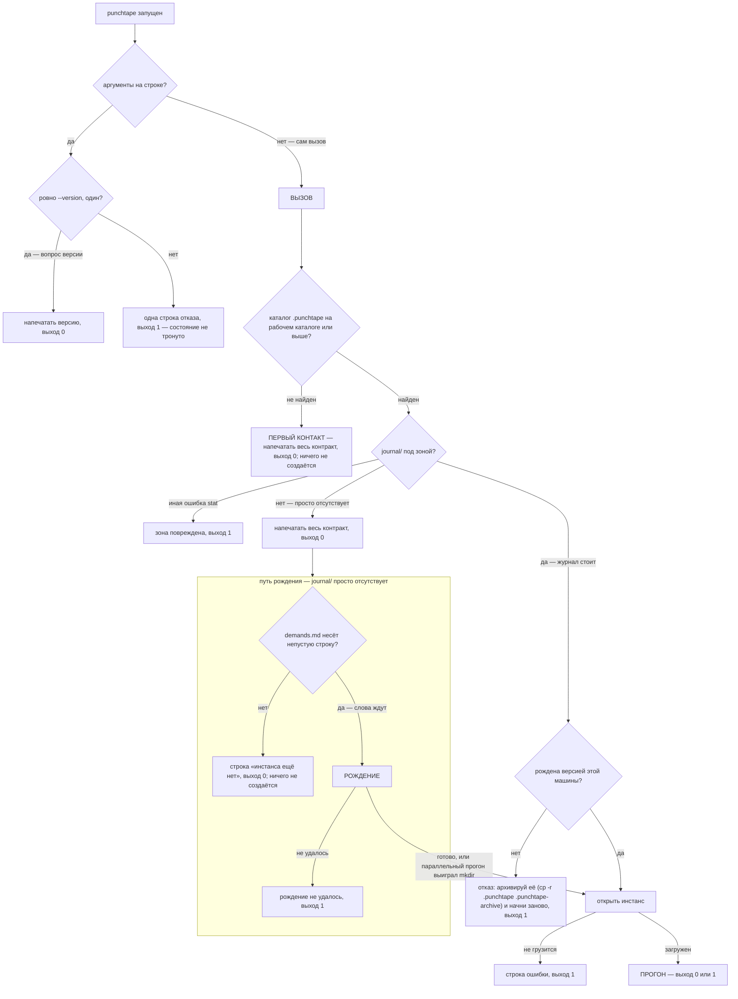
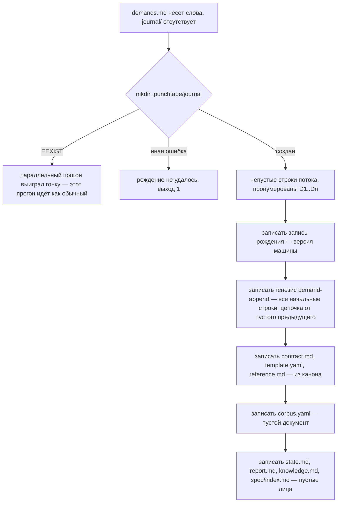
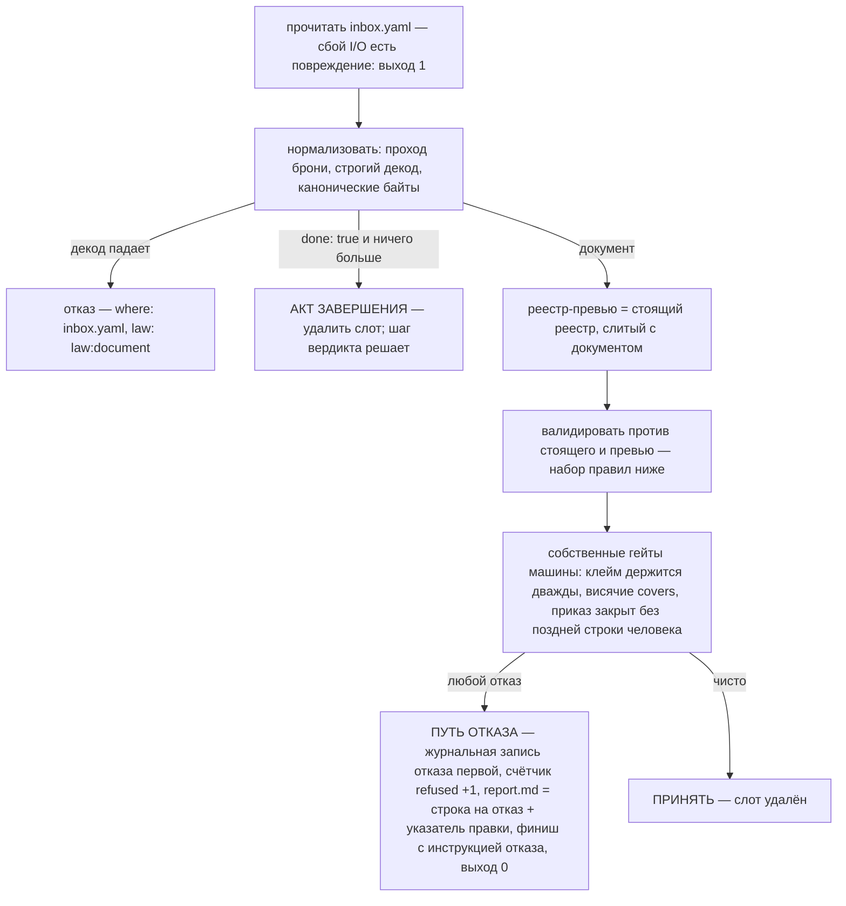
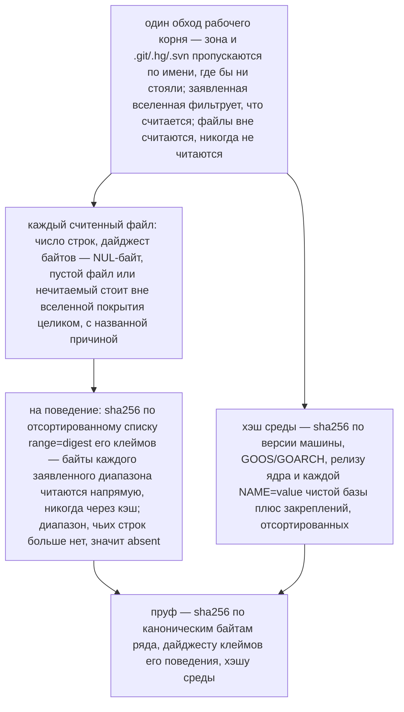
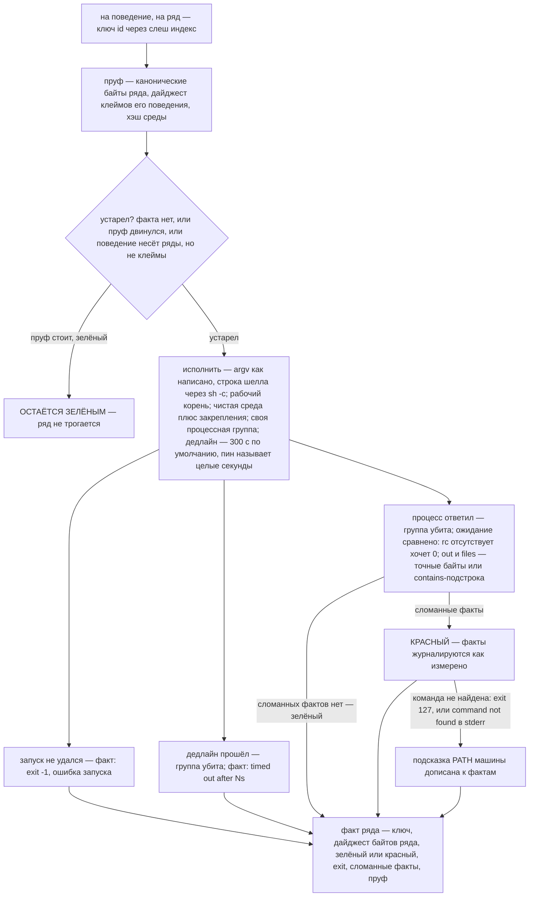
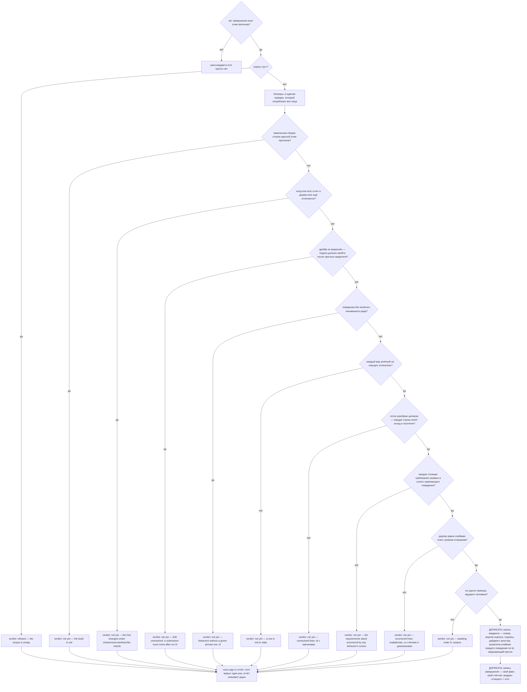
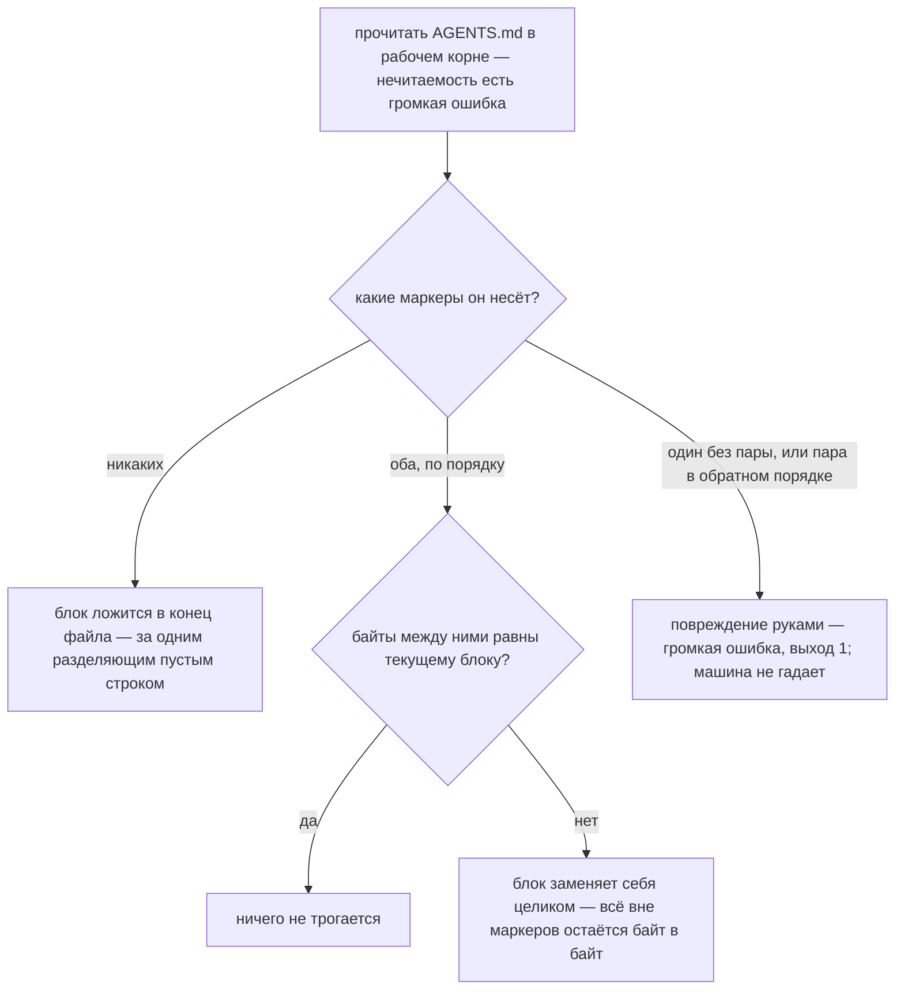
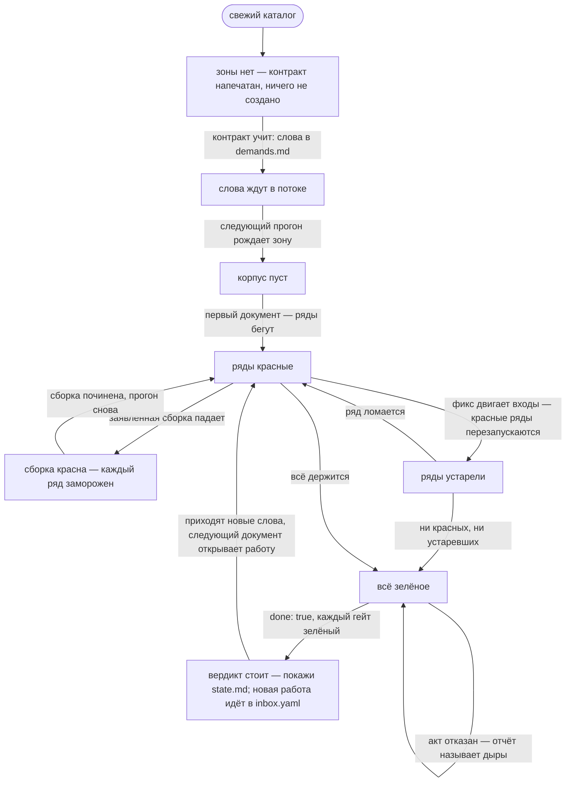

# Архитектура
[English](ARCHITECTURE.md) · **Русский** · [中文](ARCHITECTURE.zh.md)

## Содержание

- [Что такое машина](#что-такое-машина)
- [Поверхности](#поверхности)
- [Вызов: от запуска до выхода](#вызов-от-запуска-до-выхода)
- [Открытие инстанса](#открытие-инстанса)
- [Прогон](#прогон)
- [Поток требований](#поток-требований)
- [Слот подачи](#слот-подачи)
- [Документ — единый входной формат](#документ--единый-входной-формат)
- [Валидация — весь набор правил](#валидация--весь-набор-правил)
- [Законы слияния](#законы-слияния)
- [Замок дерева](#замок-дерева)
- [Исполнения](#исполнения)
- [Сборка](#сборка)
- [Отпечатки](#отпечатки)
- [Устарелость и исполнение](#устарелость-и-исполнение)
- [Запись прогона и уроки](#запись-прогона-и-уроки)
- [Вердикт](#вердикт)
- [Отчёт](#отчёт)
- [Проход рендера](#проход-рендера)
- [Следующая инструкция — машина состояний инстанса](#следующая-инструкция--машина-состояний-инстанса)
- [Журнал — единственный источник истины](#журнал--единственный-источник-истины)
- [Хранилище объектов](#хранилище-объектов)
- [Среда исполнения](#среда-исполнения)
- [Карта кода](#карта-кода)
- [Канон](#канон)
- [Детерминизм и целостность](#детерминизм-и-целостность)
- [Гейты времени сборки](#гейты-времени-сборки)

punchtape — внешняя машина состояний, стоящая рядом с агентом,
работающим в дереве, и владеющая правдой задачи навсегда. Агент никогда
не говорит с протоколом, API или сокетом: машина — ОДИН ВЫЗОВ без
аргументов, а весь разговор — слова человека, документы агента, ответы
машины — едет файлами одного скрытого каталога, зоны. Этот документ
описывает машину ровно так, как её реализует код: каждый процесс, каждая
структура, каждая логическая ветка. Он стоит на себе сам; ничего вне его
не нужно, чтобы понять машину.

## Что такое машина

Один бинарник на Go. Запущенный где угодно на рабочем корне или ниже,
он находит свою зону, сворачивает журнал в стоящее, действует по
текущему состоянию — рождение, подача, акт завершения или только
измерение — запускает сборку и устаревшие ряды, записывает факты,
регенерирует сдвинувшиеся лица и отвечает терминалу ровно одной строкой:
следующее действие с именем файла. Красные результаты — данные, а не
ошибки: работа машины — измерять и записывать, никогда не торговаться.
Состояние переживает любую сессию и любую модель, потому что каждый
значимый факт живёт в журнале только-допись с записями без стеночных
часов: порядок — место записи в потоке, идентичность — её байты.

Всё построение держат два закона. **Пруф**: ничто ничего не наблюдает —
ни одного наблюдателя файлов или процессов нигде не существует; вместо
этого каждый зелёный ряд несёт отпечаток пруфа по своим каноническим
байтам, заявленным строкам своего поведения и среде исполнения, и пруф,
который стоит, никогда не исполняется повторно. **Вердикт**: машина
записывает задачу сделанной только по измеренным основаниям — каждый ряд
зелёный на текущих отпечатках, слова разобраны целиком, каждое требование
покрыто, дерево равно своим клеймам плюс громким оговоркам, ни один
приказ не ждёт человека, — и запись есть журнальный, подписанный факт,
живущий столько же, сколько журнал.

## Поверхности

Всё, что агент или человек может встретить:

- **Вызов.** `punchtape`, без аргументов, где угодно на рабочем корне
  или ниже. Выход 0 — машина отработала. Выход 1 — вызова не было
  (повреждение зоны, запись, не сумевшая встать, журнал, не
  сумевший загрузиться).
- **Флаг версии.** `punchtape --version` — ровно это написание, одно на
  строке — печатает `punchtape <version>` и выходит 0 до всякого
  состояния. Это уступка человеку; контракт её никогда не упоминает, и
  ни один машинный путь её не читает.
- **Отказ от аргументов.** Любые другие аргументы дают одну строку —
  `punchtape: the call takes no arguments — run `punchtape` alone;
  this refusal is the whole action of this launch` — и выход 1 до
  всякого состояния.
- **Строка терминала.** Ровно одна строка на успешный прогон:
  `punchtape: run <N> — <instruction>`. Инструкция — тот же текст, что
  несёт строка `next:` страницы состояния, — никогда две правды;
  пути, которые она называет, пишутся от рабочего каталога вызывающего.
- **Зона** — `.punchtape/`, единственный каталог, которым владеет
  машина:

  | файл | смысл |
  |------|---------|
  | `contract.md` | контракт: весь закон машины (восемь законов), генерируется из канона |
  | `template.yaml` | форма документа с обучающими комментариями, генерируется из канона |
  | `reference.md` | все двери машины на одной странице, генерируется из канона |
  | `demands.md` | слова человека, дословно, по одной непустой строке — открыт вечно |
  | `inbox.yaml` | слот подачи: документ или голый акт завершения |
  | `env` | необязательный файл закреплений: строки KEY=VALUE для каждой команды |
  | `universe` | необязательное объявление: какие корни дерева считаются |
  | `corpus.yaml` | стоящий корпус как документ — сгенерированный образ, лечится каждый прогон |
  | `state.md` | стоящее: учёт слов, счётчики, вердикт с метками дрейфа и историей, ряды поведений, незакрытые и исключённые строки, `next:` |
  | `report.md` | картина последнего факт меняющего прогона или список отказа |
  | `knowledge.md` | заметки и машинно-измеренные уроки |
  | `trace.md` | витрина потока: каждая строка с исходом и носителями |
  | `holes.md` | весь нескрываемый реестр незакрытых строк |
  | `exclusions-proposal.yaml` | черновик списка оговорок машины по стоящим дырам |
  | `spec/` | маленькая страница на поведение; страницы снятых уходят |
  | `journal/` | поток записей: файлы эпох, записи одной принятой подачи на эпоху |
  | `journal/objects/` | хранилище объектов по содержимому |
  | `cache/` | верифицированный кэш обхода — ускоритель, удаляемый, никогда истина |
  | `tmp/` | черновик, стирается в конце каждого прогона |
  | `run.lock` | зонный лок прогонов — один прогон единовременно, снимается ядром |

- **Блок AGENTS** — единственная запись вне зоны: помеченный блок в
  `AGENTS.md` рабочего корня, обеспечиваемый идемпотентно на каждом
  прогоне. Байты вне маркеров никогда не трогаются.
- **Рабочее дерево** — всё остальное в рабочем корне: свободная
  территория агента. Машина никогда не читает его содержимое как код;
  она обходит его для подсчёта строк и дайджестов, исполняет команды
  корпуса в нём и читает файлы, названные ожиданиями ряда.

## Вызов: от запуска до выхода

Корень композиции (`cmd/punchtape`) монтирует производственные порты —
привязку файловой системы и привязку процессов, — берёт текущий рабочий
каталог и передаёт обоих единой точке входа машины. Всё ниже — алгоритм
этой точки входа.



### Первый контакт

Отсутствие `.punchtape` на стартовом каталоге или выше значит, что канал
ещё не существует: машина печатает весь контракт — встроенный
английский текст, те же байты, что рождение позже запишет в
`contract.md`, — и выходит 0. Ничего не создаётся; сам контракт учит
первому шагу (положить слова человека в `demands.md`). Та же страница
контракта печатается всякий раз, когда каталог зоны стоит без журнала —
что бы ещё зона ни несла, — так что закон доходит до агента раньше
всего остального.

### Строка «инстанса ещё нет»

Зона без журнала — зона, чей инстанс никогда не рождался. Если
`demands.md` не несёт непустой строки, машина печатает `punchtape: no
instance yet — put the human's words verbatim into .punchtape/demands.md
and run again` и выходит 0 — по-прежнему ничего не создаётся. Иная
ошибка stat каталога журнала — повреждение зоны: одна строка, выход 1.

### Рождение



mkdir и есть атомарность рождения: среди параллельных прогонов ровно
один побеждает, проигравшие видят живой журнал и идут обычными
прогонами. Запись рождения несёт версию создающей машины — факт
происхождения инстанса, видный на странице состояния; зона, рождённая
любой другой версией, отвергается до сворачивания единой записи.
`demands.md` переживает рождение, открытый навсегда: слова человека
продолжают входить в него в любой момент жизни инстанса.

## Открытие инстанса

Каждый прогон после рождения открывает инстанс одинаково:

1. **Поток.** Каталог журнала перечисляется на файлы эпох с именами
   `epoch-NNNNN.yaml` (пять цифр), загружаемые в порядке номеров.
   Первая запись читается ещё раз отдельно до сворачивания: зона,
   рождённая другой версией машины, отвергается по имени, прежде чем
   какая-либо позднейшая запись будет разбираться.
2. **Свёртка.** Все записи, от старых к новым, сворачиваются в стоящее
   — настоящее, перестроенное из прошлого (полные законы свёртки —
   ниже, с журналом). Объект поведения, названный журналом, на который
   хранилище не может ответить, — честная ошибка: вызов выходит 1.
3. **Закрепления.** Необязательный файл `env` зоны парсится один раз;
   строка любой формы, кроме `KEY=VALUE` (с законом ключа и законом
   значения ниже), — громкий отказ, называющий файл, номер строки,
   саму строку и закон, — выход 1 до всякого движения состояния. Пин
   дедлайна ряда (`PUNCHTAPE_ROW_TIMEOUT`) парсится тем же дыханием:
   целые положительные секунды или громкий отказ.
4. **Вселенная.** Необязательный файл `universe` зоны читается — один
   относительный корню путь в строку, комментарии и пустые строки
   проходят, — и каждый объявленный корень доказывается нести хотя бы
   один файл дерева; корень-фантом — громкий отказ, называющий свою
   строку.
5. **Кэш.** Верифицированный кэш обхода (`cache/tree`) грузится вместе
   с охватом прогона; запись, не парсящаяся, — промах по своему пути:
   обход пересчитает и перепишет его.

## Прогон

Один открытый инстанс — один прогон. Шаги ниже — весь алгоритм машины
после рождения; следующие разделы дают законы каждого шага целиком.

```mermaid
flowchart TD
    CH["0 — проверка цепочки: прошлое потока пересчитывается по текущим байтам, иначе зона повреждена"] --> IN["1 — слот подачи: inbox.yaml стоит?"]
    IN -- "отсутствует" --> EXE
    IN -- "стоит" --> N["прочитать и нормализовать один раз: броня, строгий декод, канонические байты"]
    N -- "декод падает или валидация отказывает" --> RREF["ОТКАЗ — журнальная запись отказа первой, report.md = строка на отказ, state.md = факт очереди, финиш с инструкцией отказа, выход 0"]
    N -- "done: true, ровно" --> ACT["АКТ ЗАВЕРШЕНИЯ — поглотить слот, прогон продолжается"]
    N -- "валидный документ" --> LOCK{"подача вооружает замок дерева — интенты стоят, ни один не work, сборки нет и не заявлено?"}
    LOCK -- "да" --> DIG["обойти дерево, хранить дайджест как treeBefore"]
    LOCK -- "нет" --> ACC["ПРИНЯТЬ — объекты, ротация эпох, запись подачи, стоящее движется, слова берёт сама машина, слот поглощён"]
    DIG --> ACC
    ACC --> EXE["2 — execute-интенты исполняются между подачей и рядами"]
    ACT --> EXE
    EXE --> B["3 — сборка, когда заявлена: идёт первой"]
    B -- "красная или виснет" --> FRZ["каждый ряд заморожен этот прогон"]
    B -- "зелёная или не заявлено" --> F["4 — отпечатки: дайджесты клеймов каждого поведения по заявленным строкам, хэш среды"]
    FRZ --> TL
    F --> ST["5 — устарелость по пруфу; устаревшие ряды исполняются; стоящие пруфы остаются зелёными"]
    ST --> TL{"замок был вооружён? обойти снова"}
    TL -- "дайджест двинулся" --> TLF["журнальный факт tree-lock — холд вооружается"]
    TL --> REC{"факты двинулись? сборка шла, ряд исполнялся, исполнение легло"}
    REC -- "да" --> JR["6 — запись прогона: номер, факт сборки, факты рядов, уроки"]
    REC -- "нет" --> V
    JR --> V{"7 — акт завершения ехал этим прогоном?"}
    V -- "да" --> VER["гейты вердикта — запись вердикта плюс запись завершения, либо ноты not-yet"]
    V -- "нет" --> REP{"факты двинулись, вердикт говорил, предупреждения стоят?"}
    VER --> REP
    REP -- "да" --> RW["8 — report.md, вся картина прогона, переписан целиком"]
    REP -- "нет" --> REN
    RW --> REN["9 — рендер: отпечатки перемерены по дереву, каким прогон его оставил; state, trace, holes, proposal, knowledge, spec — каждый только при смене байтов"]
    REN --> FIN["10 — финиш: corpus.yaml лечится, кэш обхода пишется, блок AGENTS обеспечивается, обучающие страницы обновляются, tmp/ стирается, строка терминала, выход 0"]
    RREF --> FINX["финиш с инструкцией отказа, выход 0"]
```



Каждая машинная запись, не сумевшая встать (дописать журнал, лицо,
вылечить корпус, блок AGENTS, вычистить tmp), — громкий отказ: прогон
печатает ошибку и выходит 1 — машина не держит устаревшее лицо в
тишине.

## Поток требований

Поток — один файл: `.punchtape/demands.md`. Его байты — единственный
источник слов человека у машины; каждая непустая триммированная строка
нумеруется D1..Dn по порядку файла, выводясь заново из байтов на каждом
прогоне. Пустые строки не несут ничего.

**Цепочка.** Журнал держит прошлое как звенья: каждая запись
demand-append несёт, сколько строк она потребила, и sha256 по байтам
предыдущего звена, соединённым с теми строками. Каждый прогон
пересчитывает всю цепочку от генезиса по текущим байтам: отсутствующий
файл потока у рождённого инстанса, урезанное прошлое или звено, не
воспроизводящееся, — одно и то же повреждение — `punchtape: zone
damaged: the demand stream's past changed`, выход 1, прогон не
начинается. Прошлое неизменно; хвост открыт.

**Хвост.** Строки за журналируемым прошлым цепочки — незажурналированный
хвост. Только принятая подача цепляет их: сама машина дописывает запись
demand-append рядом со своей подачей — подающий агент никогда не
переписывает слова. Подача без хвоста подписывает `no-new-demands`
(число строк и номер прогона) — подпись над словами, которые всё же
пришли, стоит в журнале навсегда: единственная точка, где защита —
видимость, а не гейт.

## Слот подачи

Слот — один файл: `.punchtape/inbox.yaml`. Его отсутствие — обычное
состояние: прогон идёт к сборке. Его присутствие читается один раз, и
сама нечитаемость по I/O — повреждение (выход 1, не отказ: машина не
судит байты, которых не видела).



Отказ — собственный журнальный факт машины: запись ложится в журнал
раньше, чем пишется лицо отчёта, так что экран, не сумевший встать,
никогда не съедает факт. Байты подачи ничего не пишут — документ стоит
в слоте, автор правит названное место в том же файле и запускает снова;
отказ стоит один прогон и ничего больше.

### Акт завершения

`inbox.yaml`, несущий ровно `done: true` — голый флаг и ни одного
другого поля, — есть акт завершения: осознанная дверь к вердикту,
нечего переписывать и нечего подделать. Слот поглощается, прогон
продолжает обычные шаги (сборка всё ещё идёт, устаревшие ряды всё ещё
исполняются); шаг вердикта в конце решает, закрывает ли акт вердикт
или называет дыры. Акт считается собственным журнальным фактом, отдельно
от подач: один счётчик считает документы, взятые слотом, другой — акты,
завершившие работу.

### Декод документа и канонические байты

Декод строг, и проход брони обходит разобранное дерево раньше, чем
модель его увидит: ровно один YAML-документ, без якорей, алиасов,
тегов, merge-ключей, табов в отступе, дублей и неизвестных полей. Всё,
чего машина сама не пишет и не имеет в виду, отвергается у слота —
ловушка не может въехать через формат. Маршал каноничен: отступ в два
пробела, ключи отображений отсортированы, поля структур в порядке
объявления, написание команды автором (строка шелла или список argv)
сохранено дословно. Сравнение происходит после нормализации (декод →
канонические байты), поэтому переформатирование документа ничего не
меняет: два написания одного содержания — одно содержание.

## Документ — единый входной формат

Один YAML-документ, строго декодированный:

```
work:            the narrative of this submission — what broke,
                 what was fixed, what was decided
intents:         [{lines: [D ranges], outcome, prose, text?, run?}] —
                 every new demand line declares its outcome here
build:           one command; absent = keep the standing one
mandate:         [{line, target}] — the permission to replace
                 standing work, replaced by this same submission
remove:          standing keys to retire (five spellings)
requirements:    [{id: R…, lines: [D ranges], prose, refines?}]
not-a-requirement: [{lines: [D ranges], reason}] — the markers
uncovered-lines: [{range: "path:first-last", reason, refs}] —
                 the loud exclusions
open:            [{demand, question, state, reason?}] — the orders
behaviors:       [{id, name, prose, claims: [ranges],
                 covers: [R ids], rows: [{run, expect}]}]
notes:           [{kind, text, refs}] — five kinds, refs resolve
done: true       the completion act, alone
run:             one command — a shell line (string) or an argv
                 (list of strings, non-empty)
expect:          at least one of —
                    rc:    the exact exit code (absent = 0)
                    out:   stdout — exact bytes, or a substring
                           behind the "contains: " prefix
                    files: {path: text} — read after the run,
                           the same two match spellings per file
```

Шесть исходов — собственный словарь протокола: `answer` (несёт свой
отвечающий текст), `execute` (несёт свою команду), `work` и `describe`
(носится требованием на своих строках), `mark` (носится маркером
not-a-requirement), `ask` (носится ждущим приказом). Носитель обязан
стоять в той же подаче, что объявляет исход; text ездит только на
answer-интенте, run — только на execute-интенте.

Грамматики, на которых всё едет:

- **Id поведения**: сегменты `[a-z0-9-]`, соединённые одиночными `/` —
  без ведущего и хвостового слеша, без пустых сегментов.
- **Id требования**: `R` плюс буквы, цифры и точки.
- **D-диапазон**: `D<n>` или `D<a>..D<b>` по возрастанию, через запятую
  — пронумерованные строки потока. Без ведущих нулей, без знака.
- **Относительный корню путь**: через слеш, без диска, без схемы, без
  ведущего слеша, без обратного слеша, без NUL, без пустых/`.`/`..`
  сегментов — что нельзя написать, то не может указать вне дерева.
- **Диапазон строк** (клейм и оговорка): `path:first-last`,
  first ≤ last, в строках самого файла.
- **YAML, четыре правила кулинарии**: скаляр с «: » или запятой берётся
  в кавычки; элемент списка-потока с «:» берётся в кавычки; длинная
  проза продолжается на следующей строке, с отступом глубже ключа;
  многострочный пин остаётся одной строкой (`out: "first\nlast\n"`).

## Валидация — весь набор правил

Каждый отказ — `{where, law, fact}`: точное поле, id закона, который
печатает контракт, измеренный факт. Никаких советов, никаких толкований.
Принуждаемые правила, каждое привязано к своему закону:

| правило | закон |
|------|-----|
| документ декодируется по форме шаблона — неизвестные поля отвергаются | law:document |
| подача сливается по id — требования и поведения по id, маркеры по своим строкам, исключения по диапазону, приказы по требованию и вопросу; ряды — по run | law:document |
| id поведений — сегменты `[a-z0-9-]` через /, id требований — R плюс буквы, цифры и точки — каждый уникален в подаче | law:document |
| D-диапазоны парсятся в D-грамматике и называют собственные пронумерованные строки потока | law:document |
| клеймы — диапазоны строк, которые несёт дерево — path:first-last, от корня | law:claims |
| один диапазон именует одно поведение — клейм уже держащийся отвергается у второго держателя | law:claims |
| каждый новый интент несёт один из шести исходов с непустой прозой и своим носителем в том же документе — answer свой text, execute свой run, work и describe — span требования, mark — маркер, ask — ждущий приказ | law:demand |
| каждая новая строка потока объявляется ровно одним интентом подаче, которая её встретила, — объявленная строка не переобъявляется | law:demand |
| проза требования непуста | law:demand |
| refines именует стоящее требование | law:candor |
| маркер никогда не стоит на строке требования — строка либо требование, либо нет | law:demand |
| оговорки именуют реальные дыры, причину, цитирующую строку потока или закон, ссылки, которые разрешаются | law:candor |
| поведения несут имя, covers, стоящие после слияния, хотя бы один ряд с expect из rc/out/files и runs, уникальные в своих рядах | law:document |
| каждое поведение несёт хотя бы один пинованный ряд — out или files с точными байтами; rc один не пинит ничего | law:proof |
| один run доказывает одно поведение — run, держащийся другим поведением, отвергается как его пруф | law:proof |
| мандат называет строку, приказавшую изменение, и стоящее, что он разрешает заменить | law:candor |
| заметки несут один из пяти видов, текст и ссылки, которые разрешаются | law:candor |
| документ done — это ровно done: true | law:document |
| нарратив work и проза каждого поведения непусты | law:candor |
| команда сборки непуста, когда присутствует | law:document |
| открытые приказы едут на стоящих строках потока с реальным состоянием | law:candor |
| ждущий приказ закрывается только поздней строкой человека, процитированной заметкой-решением | law:candor |
| ключи remove четырёх написаний именуют стоящее | law:document |
| маркер несёт свою причину | law:document |
| пути expect-файлов относительны корню | law:paths |
| дерево не движется под интентами answer, execute и describe — дайджесты держат вердикт | law:demand |
| вселенная именует считаемые корни; строка, которую не назвал ни один клейм и ни одна громкая оговорка, держит вердикт | law:claims |
| вердикту нужны целый поток, взаимные клеймы, зелёные пинованные пруфы, ни одного ждущего приказа — и он ждёт неразрешённые строки, неименованный дрейф, двинутое дерево | law:done |

Поверх таблицы машина добавляет три собственных гейта: **висячие
covers** — поведение, переживающее подачу неподанным, не имеет права
покрывать требование, снятое этой подачей; снятие требования требует
той же подачей разобрать каждый его cover. **Дубль клейма** — диапазон,
который держит стоящее поведение или более раннее поведение той же
подачи, отвергается у второго держателя, держатель назван. **Закон
закрытия ask** — ждущий приказ, покидающий своё состояние awaiting,
может сделать это только поверх поздней строки человека, занятой
носителем, процитированной заметкой-решением; иначе отказ называет
закон и рецепт.

## Законы слияния

Экономика подач: чего документ не перечисляет, то он не меняет — и
число подач никогда не влияет на цену.

- **Поведения сливаются по id.** Перечисленный стоящий id имеет голову,
  заменяемую целиком (name, prose, claims, covers), и ряды,
  сливающиеся по run; новый id добавляется; id в `remove` снимается.
  Снять-и-пере-добавить одной подачей — свежее.
- **Ряды сливаются по run** — каноническим байтам команды. Стоящий run
  заменяет свой ряд целиком на месте; новый run дописывается после
  стоящих; неподанные ряды стоят нетронутыми. Пере-написанная команда —
  новый ряд: стоящий стоит. Ряд уходит только со всем поведением:
  снять id под мандатом и пересобрать одним документом.
- **Требования сливаются по id** так же. **Маркеры сливаются по фолду
  своих строк, исключения — по диапазону, приказы — по паре
  требование-вопрос**: повторённый ключ заменяет стоящую часть целиком,
  новый ключ дописывается, неподанная часть стоит.
- **Снятия уходят первыми**: ключ D-грамматики снимает маркер на строке
  (или приказ на ней), ключ диапазона снимает оговорку, id снимают
  свои части.
- **Build** заменяет стоящую команду только когда заявлен —
  отсутствующее поле ничего не меняет.

## Замок дерева

Подача, несущая интенты, ни один из которых не `work`, без стоящей или
заявленной сборки, запирает дерево на свой прогон: перед обработкой
машина обходит дерево и хранит дайджест. Тот же обход происходит снова
после исполнений — двинувшийся дайджест есть журнальный факт tree-lock,
и холд вооружается: вердикт держится (`the tree moved under
answer/execute/describe intents`), пока байты не вернутся или изменение
не будет подано как заявленная работа. Work-интент снимает стоящий
холд и не вооружает новый — работа и есть легальный способ двигать
дерево. Артефакты заявленной сборки — тоже работа: первая заявленная
сборка ровно как стоящая.

## Исполнения

Execute-интенты исполняются между подачей и рядами: каждая объявленная
команда исполняется самой машиной, под всем законом ряда — рабочий
корень, чистая среда плюс закрепления, своя процессная группа, дедлайн
ряда. Факт едет в журнал: строки, которые он отвечает, команда, код
выхода, дайджест stdout — stdout целиком до 4096 байт, адрес в
хранилище объектов свыше. Последнее исполнение показывается на
странице состояния и в отчёте; дерево обязано вернуться неизменным
(замок выше).

## Сборка

Заявленная команда сборки корпуса (строка шелла или argv) идёт ПЕРВОЙ
на каждом запуске, который её заявляет, раньше любого ряда — в рабочем
корне, в чистой среде, одной процессной группой под дисциплиной ряда.
Журналируемый факт — код выхода, отметка таймаута или собственные слова
ошибки запуска. Сборка, выходящая не нулём, виснущая за дедлайном или
не стартующая, красна для этого прогона: **каждый ряд заморожен** —
ничего не исполняется, ни один факт ряда не движется, запись прогона
несёт только факт сборки, и строка терминала говорит `build red — read
.punchtape/report.md, fix the build, run again`. Подача, ехавшая тем же
прогоном, всё равно принимается: корпус движется, ряды ждут.

## Отпечатки



Клеймы меряются один раз до исполнения и ещё раз после: вторая карта —
то, что показывает страница состояния, так что страница описывает
дерево, каким прогон его оставил, а не каким нашёл. Своя запись вердикта
хранит указатели, против которых мерились пруфы. Кэш обхода
(`cache/tree`) отображает size-и-mtime каждого пути в его число строк и
дайджест; файл, чьи размер и mtime стоят, как кэш их видел, использует
кэшированные факты вместо своих байтов. Пруфы никогда не спрашивают
кэш — заявленные строки читаются напрямую, всегда. Кэш пишется один
раз, в конце прогона, только когда обход его двинул; удалите его — и
следующий прогон пересчитает те же числа: это ускоритель, никогда
источник истины.

## Устарелость и исполнение



Закон устарелости одним предложением: ряд перезапускается, когда его
байты сменились, заявленные строки его поведения сменились, среда
сменилась, он никогда не бегал — или его поведение не заявляет клеймов
вовсе (поведение с рядами без клеймов стоит на ничём именованном, и его
ряды честно всегда устаревшие). Неизменные клеймы и среда — ряд больше
никогда не бегает. Закон пропуска дальтоник: стоящий красный, чей пруф
стоит, тоже не исполняется повторно — он перезапускается ровно тогда,
когда его входы движутся. Стоящий красный никогда не проходит за
зелёный: вердикт читает статус факта, никогда одни пруфы. Сломанные
факты цитируют обе стороны — хотимое написание и измеренное; измеренная
сторона длиннее восьмидесяти знаков обрезается с многоточием.

## Запись прогона и уроки

Прогон, сменивший факты, — сборка шла, или исполнился хотя бы один ряд,
или легло исполнение, — дописывает одну запись прогона: номер
(предыдущий + 1), факт сборки, факты исполненных рядов (`key`, дайджест
байтов ряда, зелёный/красный, exit, сломанные факты, пруф, на котором
он стоит), и уроки. Счётчик стартует с нуля: до первого факт меняющего
прогона строка терминала и шапки страниц говорят run 0.

**Урок** — переход красного в зелёный этого прогона, закреплённый как
чистые данные: первая сломанная причина предыдущего факта, все его
сломанные факты, байты ряда до и после (отвечает собственный
журнальный индекс байтов рядов, по дайджесту) и два номера прогонов.
Ноль токенов любой модели — машина измерила фикс сама. Уроки ложатся
на страницу знания, сгруппированные по причине.

## Вердикт



Блокеры говорят в едином порядке приоритета, и все лица потребляют ту
же таблицу: отчёт перечисляет ноты целиком; терминал и строка `next:`
страницы состояния говорят инструкцию первого блокера. Арифметика пруфов
ездит на карте «до» (дайджесты, против которых мерились пруфы); вопрос
дрейфа — на карте «после» (дерево, каким прогон его оставил): две
правды нарочно — ряд законно может править свой собственный заявленный
файл, и тогда карты расходятся.

**Подпись** — sha256 по каноническим байтам корпуса, а затем на каждое
поведение в порядке корпуса `\0 id \0 claims digest` — корпус и
точное состояние дерева, на котором он вынесен, одним дайджестом.
**Дайджест реестра** — sha256 по каноническим байтам требований,
маркеров, исключений и приказов вместе — весь счёт слов, заверенный той
же печатью. Вердикты только-допись: новый никогда не переписывает
старый; стоящее держит последний.

### Дрейф и исцеление

Ничто не наблюдает дерево. Запись вердикта несёт указатель клеймов
каждого сертифицированного поведения; прогон сравнивает его с дайджестом
клеймов дерева, как оно стоит. Двинувшийся указатель значит дрейф:
строка вердикта на странице состояния говорит `open (drift since run
N)` — первый прогон после вердикта, увидевший сдвиг, названный
собственными фактами рядов журнала, — и дрейф разрешается только
подачей, приземлившейся после того прогона-свидетеля. История вердиктов
рассказывает всё: каждый записанный вердикт, каждый прогон, поймавший
дрейф (красные ряды под стоящим вердиктом, с ключами рядов), каждое
исцеление (первый позднейший прогон без красных рядов) — и закрывающий
отчёт, исцеляющий дрейф, дописывает свою строку: какой прогон поймал,
какой снова стал зелёным.

## Отчёт

`report.md` — вся картина последнего факт меняющего события, переписан
целиком, когда движется (прогон, ничего не сменивший и ничего не
закрывший, оставляет предыдущий отчёт стоять — ни одно старое слово не
переживает своё событие без нужды, и ни одно слово нового события не
скрыто). Для прогона: шапка с номером; строка сборки, когда она шла
(`build: RED — <reason>` для ошибки запуска или таймаута, `build:
RED — exit <N>` для плохого кода, `build: exit <N>` для хорошего);
строки исполнений, когда любые шли (отвеченные строки, команда, exit,
stdout — целиком или адрес объекта за пределом); `no stale rows`, когда
ничего не исполнялось и вердикт не говорил; счёт зелёных; каждый
красный ряд, сгруппированный по сломанной причине — каждая причина один
раз, ключи рядов под ней; ноты вердикта и предупреждения машины, когда
стоят. Для отказа: строка на отказ — `where: fact (law)` — и указатель:
подача стоит в `inbox.yaml`, правьте её там и запустите снова.

## Проход рендера

После фактов — лица, сгенерированные образы журнала, переписываемые
целиком при смене содержания, не трогаемые при её отсутствии
(сравнение байтов сначала, атомарная запись только при разнице).

**`state.md`** — стоящее на одной странице, по порядку: шапка с номером
прогона; учёт слов — `demands: X/Y lines; requirements N standing, K
covered; markers: M` — и неразрешённые строки с причинами, когда есть;
очередь как факт файлов (`queue: submission waiting` / `queue: empty`);
последняя подпись no-new-demands, пока стоит; `corpus: v<n>, <b>
behaviors`; последнее исполнение; `submissions: <a> accepted, <r>
refused, <c> completed`; `machine at birth: <version>`; строка вердикта
— `verdict: #<n> on v<c>, run <r>, signature <12 hex>` с `— open
(drift since run N)`, `— standing over N uncovered lines` или `—
standing`; история вердиктов (последние десять, элизия считает
остальное); отложенные приказы с вопросами и причинами; строка на
поведение — `- <id>: <n> rows (claims F files / L lines; proof <12
hex>) — <g> green, <s> stale[, <r> RED]`; незакрытые строки (первые
десять файлов, элизия указывает на реестр дыр); исключённые файлы с
причинами; `excluded lines: N ranges (P % of tree)`; счёты вне и внутри,
когда вселенная заявлена; счётчики знания; и `next:` — единственная
инструкция, тот же текст, что строка терминала.

**`holes.md`** — весь реестр дыр дерева, без предела: каждый открытый
диапазон пофайлово, список, на который указывает страница состояния,
когда ей не хватает места.

**`exclusions-proposal.yaml`** — дыры как готовый черновик: каждый
открытый диапазон в форме самой подачи, причины и ссылки — авторские,
дописать. Без стоящих дыр устаревший черновик уходит — предложение
никогда не переживает собственную арифметику.

**`trace.md`** — витрина потока: каждая строка D1..Dn со своим текстом,
заявленным исходом и пересказом агента рядом, затем носители под ней —
требования со своими спанами, поведения с клеймами и рядами-пруфами,
маркеры, ответы, последние исполнения, приказы со своими состояниями.
Здесь ничего не судится; всё положено для глаза — одна страница,
построенная для аудитного взгляда человека.

**`knowledge.md`** — заметки и уроки. Каждая заметка каждой принятой
подачи появляется ровно один раз, пронумерованная `n1…`, со своим видом
и ссылками; уроки сгруппированы по причине, каждый с ключом ряда, двумя
номерами прогонов и байтами ряда до и после как однострочными вырезками
(обрезка в сто знаков).

**`spec/`** — маленькая страница на каждое живое поведение в
`spec/<id>.md` (вложенные id создают свои каталоги): шапка `# <id> —
<name>`, номер прогона, Story (проза дословно), Demands (каждое покрытое
требование со своими строками и прозой), Claims (каждый диапазон со
своим 12-hex дайджестом, токен поведения ниже), Rows (индекс каждого
ряда — ряды PROOF помечены — команда, как её читает человек, ожидание
человеческими строками, стояние пруфа с записанным коротким дайджестом,
`none` для ряда, никогда не бегавшего) и список Verify (команды,
которые их перезапускают). `spec/index.md` перечисляет каждое поведение
с его однословным статусом (`green`, `not green`, `no rows`). Страницы
снятых поведений уходят — дерево есть образ стоящего корпуса, ничего
больше; страница, не сумевшая встать или уйти, — громкий отказ.

**Лечение корпуса** — `corpus.yaml` переписывается всякий раз, когда его
байты отличаются от канонических байтов стоящего корпуса: стоящий
документ, как его видит машина, готовый к чтению агентом.

**Блок AGENTS** — `AGENTS.md` рабочего корня:



Фиксированное содержание блока, между `<!-- punchtape -->` и
`<!-- /punchtape -->`: запусти `punchtape` (без аргументов) и читай
`.punchtape/state.md` о стоящем и следующем шаге; законы — в
`.punchtape/contract.md`; форма документа — в
`.punchtape/template.yaml`; подачи — в `.punchtape/inbox.yaml`; факты
последнего прогона — в `.punchtape/report.md`. Вне маркеров ни один
байт не принадлежит машине и ни один байт никогда не трогается.

**Обновление обучения** — `contract.md`, `template.yaml` и
`reference.md` переписываются только когда меняются собственные байты
канона: зона никогда не учит закону, который её машина покинула.

**Финиш** — каталог черновика `tmp/` удаляется целиком, и терминал
получает свою одну строку: `punchtape: run <N> — <instruction>`. Выход 0.

## Следующая инструкция — машина состояний инстанса

Инструкция — чистая функция стоящего; у каждого состояния, в котором
может стоять машина, ровно одна инструкция, и она называет файл,
которого коснуться:

| состояние | единственная инструкция |
|-------|---------------------|
| подача отказана этим прогоном | `submission refused — read .punchtape/report.md, fix inbox.yaml in place, run again` |
| сборка красна этим прогоном | `build red — read .punchtape/report.md, fix the build, run again` |
| корпус пуст (ни одной части реестра, ни сборки) | `corpus empty — submit the first document as .punchtape/inbox.yaml (copy .punchtape/template.yaml)` |
| реестр стоит, поведений нет | `no behaviors stand — submit to .punchtape/inbox.yaml a behavior with a pinned row` |
| любой блокер вердикта | инструкция первого блокера, в порядке выше |
| вердикт стоит на текущей версии корпуса | `verdict #<N> standing — show .punchtape/state.md to the human; new work goes to .punchtape/inbox.yaml as a document` |
| всё зелёное, нет стоящего вердикта на этой версии | `all green — write done: true to .punchtape/inbox.yaml and run to record the verdict` |



Жизнь инстанса словами: каталог получает инстанс, когда первая непустая
строка ложится в поток и следующий прогон рождает его; корпус строится
документами; ряды краснеют, устаревают и зеленеют по измерению; акт
завершения закрывает вердикт, когда каждый гейт стоит; после вердикта
работа открывается тем же путём, каким началась, — новые слова,
следующий документ, — и вердикт остаётся записанным фактом со своей
историей дрейфа на странице состояния. Инстанс никогда не умирает;
действительно новая задача — новый поток в свежем каталоге.

## Журнал — единственный источник истины

Каждый дорогой машине факт — запись только-допись. Десять родов, ровно
одна нагрузка у каждого:

| род | нагрузка | факт |
|------|---------|----------|
| birth | версия машины | происхождение инстанса, зафиксировано один раз |
| submission | версия корпуса, сборка, интенты, заметки, перечисленные части реестра, адреса объектов поведений, снятые id, адрес самого документа | одна принятая подача |
| demand-append | число строк, значение цепочки | слова, взятые самой машиной |
| no-new-demands | число строк, прогон | подписанное заявление, что слов не было |
| run | номер, факт сборки, факты рядов, уроки | один прогон, сменивший факты |
| execution-fact | прогон, строки, команда, exit, дайджест stdout — stdout целиком до 4096 байт, свыше адрес объекта | одно исполнение, сделанное машиной |
| tree-lock | дайджест дерева до и после | дерево двинулось под запертой подачей |
| verdict | номер, версия корпуса, подпись, дайджест реестра, указатели клеймов, прогон | один вынесенный вердикт |
| refusal | список отказов | одна отказанная подача — собственный факт машины |
| completion | номер прогона | один акт завершения |

Кодек записей строг в обе стороны: запись декодируется, только если она
маршаллится обратно байт-в-байт — правка руками или оборванная запись
отвергаются по имени, никогда не поглощаются молча. Записи не несут
стеночных часов.

**Эпохи.** Поток живёт нумерованными файлами `epoch-NNNNN.yaml`; каждая
запись — один YAML-документ за сепаратором `---` в начале строки.
Принятая подача ротирует поток до того, как её записи лягут, — записи
каждой подачи живут в своей эпохе; ротация никогда не складывает пустых
файлов. Дописи — одиночные действия с fsync.

**Оборванный хвост.** Запись, обрезанная посреди записи, не ослепляет
машину: целые записи грузятся, оборванные байты уходят в карантин
(`<epoch>.torn`, со строкой шапки), и файл эпохи перестраивается
байт-в-байт из целых записей. Кусок, не парсящийся вне конечной
позиции, — повреждение руками: честная ошибка, вызов выходит 1.

**Свёртка.** Стоящее перестраивается из записей, от старых к новым:

| запись | ход свёртки |
|--------|-----------------|
| birth | рождён; версия рождения |
| demand-append | цепочка растёт; журналируемое прошлое растёт; стоящая подпись no-new-demands снимается |
| no-new-demands | прогон подписи запоминается для страницы состояния |
| submission | версия корпуса; сборка, когда заявлена; реестр сливается по законам слияния; носители применяются — исходы строк, ответы, исполнения, снятие замка work-интентом; снятые поведения удаляются; каждое перечисленное поведение декодируется из своего объекта и встаёт; индекс байтов рядов растёт; порядок держит живых, каждого по разу, по первому появлению |
| run | номер прогона — максимум виденного; каждый факт ряда заменяет стоящий своего ключа; уроки копятся |
| execution-fact | последнее исполнение |
| tree-lock | стоящий холд |
| verdict | стоящий вердикт — запись (последняя побеждает) |
| refusal | счётчик отказов +1 |
| completion | счётчик завершений +1 |

Всё стоящее: флаг и версия рождения; звенья цепочки и журналируемое
прошлое; последняя подпись; версия корпуса и сборка; реестр (требования
по id со своим порядком, маркеры, исключения, приказы); поведения по id
и их порядок; факты рядов по ключу; индекс байтов рядов; исходы строк,
ответы и исполнения потока; спрошенные строки; номер прогона; вердикт;
счёты принятых, отказанных и завершённых; уроки; стоящий холд замка;
место последней принятой подачи. Всё, что машина решает, она решает по
стоящему — а стоящее всегда выводимо из одних записей.

## Хранилище объектов

`journal/objects/` — хранилище по содержимому. Имя объекта — sha256 его
байтов в hex; файл — `<first two hex>/<other sixty-two>` под
корнем хранилища. Одинаковые байты хранятся один раз — дедупликация и
идемпотентность по построению; повторная put ничего не трогает. Каждая
запись ложится через временный файл и переименование и перечитывается с
пересверкой, прежде чем ответить; каждое чтение сверяет дайджест с
адресом и отказывается громко при расхождении. Без сжатия — объекты
килобайтные, стабильные сырые байты дороже сэкономленного. Канонические
байты каждой принятой подачи и каждого слитого поведения живут здесь —
неизменные, поименованные собственным содержимым.

## Среда исполнения

Каждая команда машины — сборка, каждый ряд, каждый execute-интент —
стартует одинаково: argv ровно как написано (список argv идёт как есть;
строка шелла — через `sh -c`), рабочий каталог — рабочий корень, среда —
**чистая база плюс закрепления**, процесс — в своей процессной группе.
Чистая база — ровно имена, объявленные каноном: `PATH` и `HOME`, —
взятые из шелла, запускающего машину, ничего больше. Закрепления — файл
`env` зоны: одна строка `KEY=VALUE`, ключ `[A-Za-z_][A-Za-z0-9_]*`, имя
пинится однажды, без `export`, без кавычек, без абсолютных путей
(закрепление путешествует с деревом, и ничто в нём не может указывать
на диск одной машины); комментарии и пустые строки проходят,
терпится хвостовой перевод каретки; строка любой другой формы — громкий
отказ, называющий файл, строку и закон. Закрепление побеждает по имени
над базой. Один особый пин, `PUNCHTAPE_ROW_TIMEOUT`, называет
собственный потолок машины — целые положительные секунды, дедлайн
каждой команды, которую машина исполняет; он входит в хэш пруфов и
никогда не доходит до самих команд. Идентичность среды — версия машины,
`GOOS/GOARCH`, релиз ядра и отсортированный набор `NAME=value`,
реально переданный, закрепления включены, — есть хэш среды внутри
каждого пруфа: сессия, сменившая то, что видят команды, двигает пруфы,
и ряды устаревают, никогда не зеленея ложно.

Дисциплина процессов: всё, что команда оставила живым, умирает с её
группой — сигнал смерти группе и процессу, затем ограниченное ожидание
фактической смерти (умирающий участник всё ещё держит то, что держал).
Ожидание, на которое нельзя ответить, — ошибка, записываемая машиной,
никогда не чистый выход. Дефолтный дедлайн одной команды — 300 секунд:
убийца зависаний, никогда не судья медленной работы.

Закон черновика: временные файлы идут в `.punchtape/tmp` — стирается в
конце каждого прогона, так что пишущий создаёт каталог сам; учёт систем
контроля версий остаётся вне дерева; всё остающееся в дереве хочет
клейма или громкой оговорки.

## Карта кода

- `cmd/punchtape` — корень композиции: монтировать производственные
  порты, один вызов, флаг версии, отказ от аргументов.
- `internal/ports` — контракты портов (`FS`, `Exec`) и слоты привязок:
  приложение ездит по портам, инфраструктура их реализует, батарея
  подставляет фейки через них. Вызов непривязанного порта —
  поименованная паника, никогда молчаливый дефолт.
- `internal/domain` — чистые законы: `digest` (sha256, единый закон
  дайджеста всего); `zone` (константы раскладки и закон путей); `doc`
  (документ: модель, строгий кодек, канонические байты, валидация,
  слияние, D-грамматика диапазонов, сравнение ожиданий); `journal`
  (рода записей, строгий кодек записей, свёртка); `fprint` (дайджесты
  диапазонов строк, арифметика покрытия, пруф, хэш среды, дайджест
  дерева).
- `internal/application` — сама машина: алгоритм вызова, рождение,
  поток требований с его цепочкой, обход дерева со вселенной и кэшем,
  закон среды, исполнение, лица, блок AGENTS, версия и `canon` —
  встроенный источник всего печатаемого.
- `internal/infrastructure` — `fsys` (файловая система ОС, атомарные
  записи с fsync), `process` (запуски ОС, процессные группы; честный
  отказ там, где платформа не имеет реализации), `store` (именование
  эпох, поток допись/ротация/карантин) и `store/cas` (хранилище
  объектов).

Одна стоящая зависимость вне стандартной библиотеки: YAML-кодек —
единственный сторонний импорт машины, используемый каноном, кодеком
документа и кодеком журнала.

## Канон

Один встроенный источник держит всё, что машина печатает как закон:
английский контракт (база и линейка) с русским и китайским зеркалами
(данные для людей, читающих эти языки), шаблон документа, страницу
справочника с её зеркалами, пример, карту правил валидации на законы
контракта и правило среды (`PATH`, `HOME`). `contract.md`,
`template.yaml` и `reference.md` зоны генерируются из него при рождении
и обновляются при его смене. Канон не может лгать о машине: пример
обязан декодироваться, валидироваться, бежать зелёным против настоящей
машины в свежей фикстуре и закрыть свой вердикт целиком — это проверяет
тестовая батарея сборки, и лгущий канон роняет сборку. Карта законов
связывает каждое принуждаемое правило с законом, который печатает
контракт, и каждый цитируемый закон — с напечатанным контрактом: что
принуждается, то печатается; что печатается, то принуждается.

## Детерминизм и целостность

Канонические байты YAML повсюду (один документ маршаллится в одни байты
в каждой сессии); sha256 по отсортированным структурам как каждый
отпечаток; один порядок обхода дерева; лица пишутся только при смене
байтов; каждая запись целого файла атомарна (временный файл, fsync,
переименование — читатель в любой момент видит целое старое или целое
новое); каждая допись — одно действие с fsync; записи, обязанные
возвращаться байт-в-байт; объекты сверяются при записи и чтении; ни
одного стеночного часа в записях. Поставляемые бинарники собираются
`-trimpath -buildvcs=false` — байт-идентичные независимо от путей и
git-состояния машины сборки, на четыре цели: linux и darwin, amd64 и
arm64. Одна и та же зона и одно и то же дерево дают одни и те же байты
на каждой машине — журнал одной истории байт-идентичен везде.

## Гейты времени сборки

Три закона держат сам код, все — принуждением тестовой батареи и цели
check:

- **Гейт агностичности.** Машина не несёт знаний ни о каком мире вне
  собственного контракта — ни задач, стеков, доменов, ролей, кампаний
  или экспериментов в её коде, каноне или строках ошибок. Сканирование
  по границам слов по собственным исходникам машины роняет сборку в
  момент, когда слово-свидетель приземляется; собственный словарь
  сканера — единственное именованное исключение, чтобы никому больше не
  пришлось его нести. Та же батарея запрещает ссылки на планы в
  комментариях и именах.
- **Честность канона.** Полный круговой проход примера (выше) и
  структурный паритет зеркал — каждый закон базы и каждый файл зоны,
  названный базой, присутствует в каждом зеркале.
- **Батарея.** gofmt, vet, staticcheck, golint, unparam, gopls и
  проверки дублей кода по исходникам; закон питон-инструментария (ruff
  и mypy, строгие, из локального venv репозитория); гейт паритета
  зеркал документации; полный тестовый набор под потолком скорости; и
  полное покрытие функций — профиль тестовых бинарников, слитый с
  профилем инструментированного бинарника, запущенного самим собой
  (точки входа, которых юнит-тест не может достичь), каждая функция на
  100%, иначе сборка падает.
