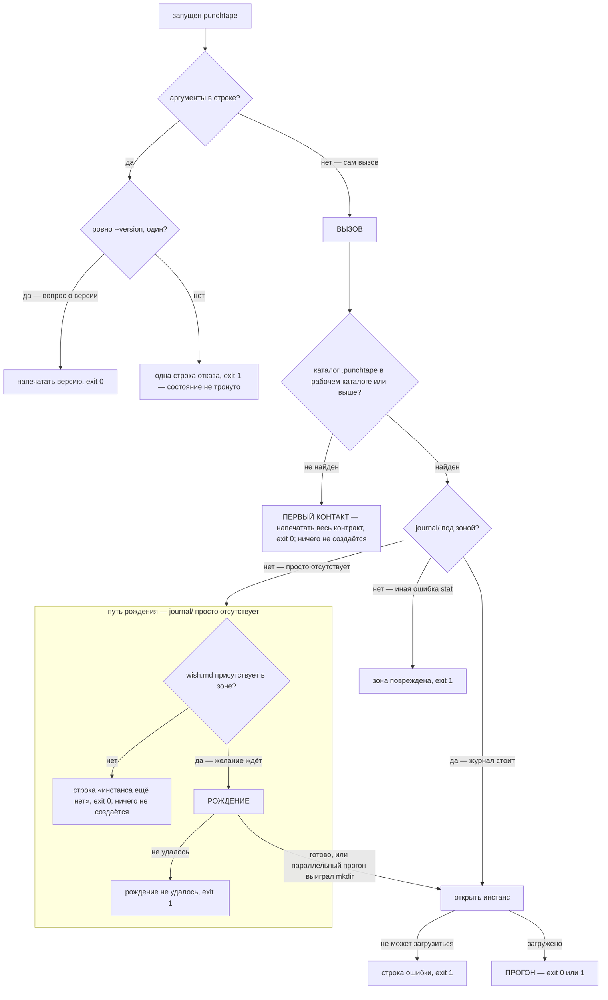
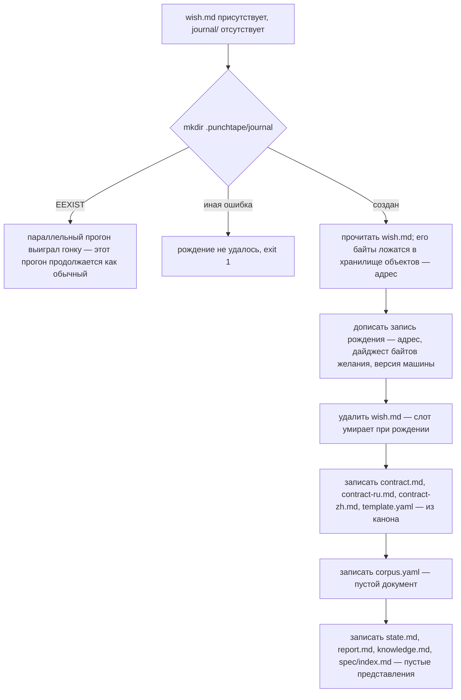
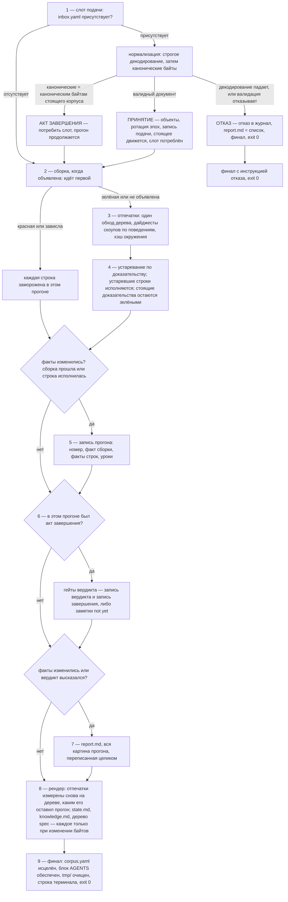
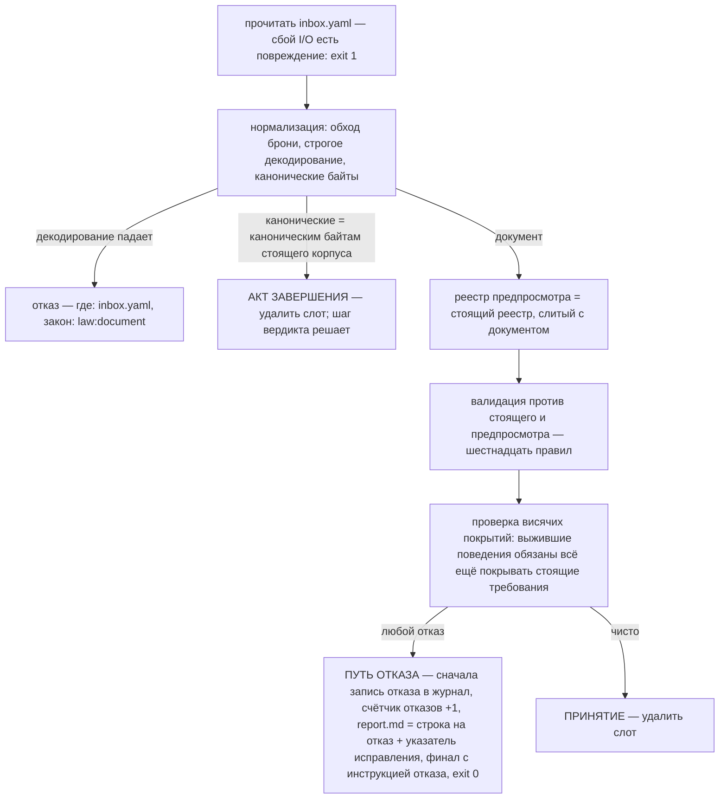
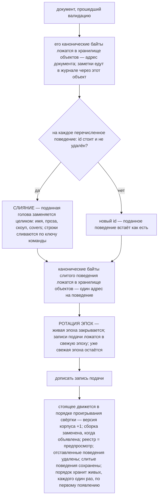
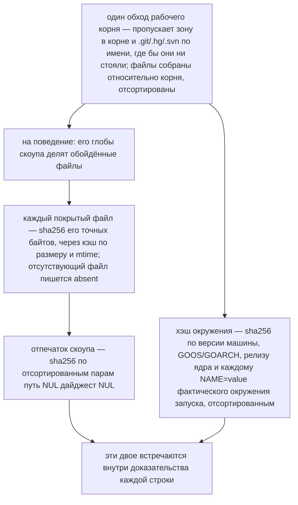
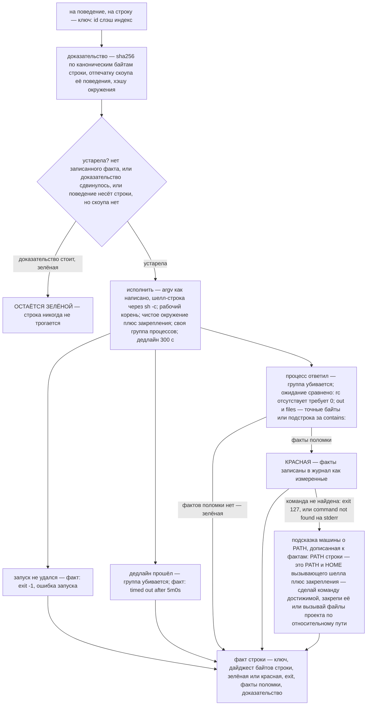
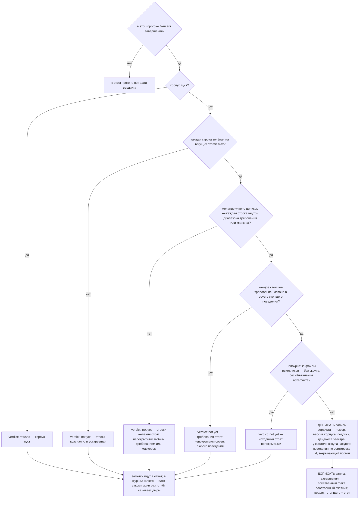
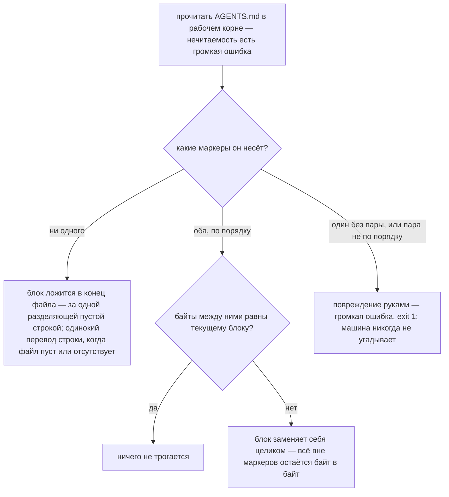
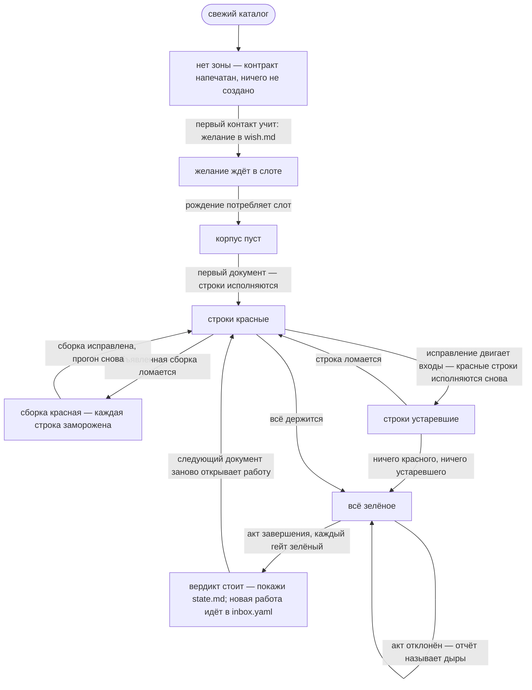

# Архитектура
[English](ARCHITECTURE.md) · **Русский** · [中文](ARCHITECTURE.zh.md)

## Содержание

- [Что такое машина](#что-такое-машина)
- [Поверхности](#поверхности)
- [Вызов: от запуска до выхода](#вызов-от-запуска-до-выхода)
- [Открытие инстанса](#открытие-инстанса)
- [Прогон](#прогон)
- [Слот подачи](#слот-подачи)
- [Сборка](#сборка)
- [Отпечатки](#отпечатки)
- [Устаревание и исполнение](#устаревание-и-исполнение)
- [Запись прогона и уроки](#запись-прогона-и-уроки)
- [Вердикт](#вердикт)
- [Отчёт](#отчёт)
- [Проход рендера](#проход-рендера)
- [Следующая инструкция — конечный автомат инстанса](#следующая-инструкция--конечный-автомат-инстанса)
- [Документ — единый формат ввода](#документ--единый-формат-ввода)
- [Реестр — учёт желания](#реестр--учёт-желания)
- [Журнал — единственный источник истины](#журнал--единственный-источник-истины)
- [Хранилище объектов](#хранилище-объектов)
- [Среда исполнения](#среда-исполнения)
- [Карта кода](#карта-кода)
- [Канон](#канон)
- [Детерминизм и целостность](#детерминизм-и-целостность)
- [Гейты сборки](#гейты-сборки)

punchtape — внешний конечный автомат, который стоит рядом с агентом,
работающим в дереве, и навсегда владеет истиной задачи. Агент никогда
не говорит с протоколом, API или сокетом: машина — ОДИН ВЫЗОВ без
аргументов, и весь разговор — желание человека, документы агента,
ответы машины — едет на файлах одного скрытого каталога, зоны. Этот
документ описывает машину в точности так, как её реализует код: каждый
процесс, каждая структура, каждая логическая ветка. Он стоит сам на
себе; чтобы понять машину, ничего вне его не нужно.

## Что такое машина

Один бинарный файл на Go. Запущенный где угодно в рабочем корне или
ниже, он находит свою зону, читает журнал, действует по текущему
состоянию — рождение, подача, акт завершения или ничего, кроме
измерения, — исполняет то, что устарело, записывает факты,
регенерирует сдвинувшиеся представления и отвечает терминалу ровно
одной строкой: следующее действие, называющее файл, который тронуть.
Красные результаты — данные, не ошибки: работа машины — измерять и
записывать, никогда не договариваться. Состояние переживает каждую
сессию и каждую модель, потому что каждый важный факт живёт в журнале
только дописываемых записей, которые не несут настенного времени:
порядок — место записи в потоке, идентичность — её байты.

Два закона держат всю конструкцию. **Свежесть**: ничто не наблюдает
ничего — нигде нет ни наблюдателя файлов, ни наблюдателя процессов;
вместо этого каждая зелёная строка несёт отпечаток доказательства по
её собственным байтам, файлам скоупа её поведения и среде исполнения,
и доказательство, которое всё ещё стоит, никогда не исполняется
повторно. **Вердикт**: машина провозглашает задачу завершённой только
на измеренных основаниях — каждая строка зелёная на текущих
отпечатках, желание учтено целиком, каждое требование покрыто, ни
одного непокрытого исходника — и провозглашение есть записанный в
журнал, подписанный факт, живущий столько же, сколько живёт журнал.

## Поверхности

Всё, что агент или человек когда-либо может встретить:

- **Вызов.** `punchtape`, без аргументов, где угодно в рабочем корне
  или ниже. Exit 0 — машина сработала. Exit 1 — вызова не произошло
  (зона повреждена, запись, которая не смогла лечь, журнал, который не
  смог загрузиться).
- **Флаг версии.** `punchtape --version` — ровно это написание, одно в
  строке — печатает `punchtape <version>` и выходит 0, прежде чем
  тронуто какое-либо состояние. Это удобство для человека; контракт
  никогда его не упоминает, и ни один машинный путь его не читает.
- **Отказ от аргументов.** Любые другие аргументы дают одну строку —
  punchtape: the call takes no arguments — run `punchtape` alone;
  этот отказ есть всё действие этого запуска — и выход 1, прежде чем
  тронуто какое-либо состояние.
- **Строка терминала.** Ровно одна строка на успешный прогон:
  `punchtape: run <N> — <instruction>`. Инструкция — тот же текст,
  который несёт строка `next:` страницы состояния, — двух истин не
  бывает.
- **Зона** — `.punchtape/`, единственный каталог, которым владеет
  машина:

  | файл | значение |
  |------|---------|
  | `wish.md` | желание человека, дословно; существует только до рождения, потребляется им |
  | `contract.md` | контракт: весь закон машины, генерируется из канона |
  | `contract-ru.md`, `contract-zh.md` | русское и китайское зеркала контракта |
  | `template.yaml` | шаблон документа, генерируется из канона |
  | `env` | необязательный файл закреплений: дополнительные строки окружения для каждой команды |
  | `inbox.yaml` | слот подачи: документ или байты стоящего корпуса как акт завершения |
  | `corpus.yaml` | стоящий корпус как документ — генерируемый образ, исцеляется при каждом прогоне |
  | `state.md` | стоящее: цель, карта брифа, счётчики, вердикт с его отметками сдвигов и историей, строки по поведениям, непокрытые файлы, `next:` |
  | `report.md` | картина последнего прогона, менявшего факты, или список отказа |
  | `knowledge.md` | заметки по тегам и уроки по причинам |
  | `spec/` | одна маленькая страница на поведение; страницы отставленных поведений удаляются |
  | `journal/` | поток записей: файлы эпох, записи одной подачи на эпоху |
  | `journal/objects/` | хранилище объектов с адресацией по содержимому |
  | `cache/` | кэш дайджестов — ускоритель, удаляемый, никогда не истина |
  | `tmp/` | черновик, очищается в конце каждого прогона |

- **Блок AGENTS** — единственная запись вне зоны: отмеченный маркерами
  блок в `AGENTS.md` рабочего корня, обеспечиваемый идемпотентно на
  каждом прогоне. Байты вне маркеров никогда не трогаются.
- **Рабочее дерево** — всё остальное в рабочем корне: свободная
  территория агента. Машина никогда не читает его содержимое как код;
  она обходит его ради дайджестов файлов, исполняет команды корпуса в
  нём и читает файлы, которые называют ожидания строки.

## Вызов: от запуска до выхода

Корень композиции (`cmd/punchtape`) монтирует продакшен-порты —
привязку файловой системы и привязку процессов — берёт текущий
рабочий каталог и передаёт обе единственной точке входа машины. Всё
ниже — алгоритм этой точки входа.



### Первый контакт

Отсутствие `.punchtape` в стартовом каталоге или выше означает, что
канала ещё нет: машина печатает весь контракт — встроенный
английский текст, те же байты, которые рождение позже записывает в
`contract.md` — и выходит 0. Ничего не создаётся; сам контракт учит
первому ходу (положить желание в `wish.md`).

### Строка пустого слота

Зона без журнала — зона, чей инстанс никогда не рождался. Если
`wish.md` отсутствует, машина печатает
`punchtape: no instance yet — put the human's wish verbatim into
.punchtape/wish.md and run again` и выходит 0 — по-прежнему ничего не
создаётся. Любая иная ошибка stat на каталоге журнала есть
повреждение зоны: одна строка, выход 1.

### Рождение



mkdir — атомарность рождения: среди параллельных прогонов ровно один
побеждает, проигравшие видят живой журнал и работают как обычные
прогоны. Запись рождения — первая запись журнала; она фиксирует цель —
байты желания как объект с адресацией по содержимому — навсегда и
несёт версию машины, создавшей инстанс (собственный факт происхождения
инстанса, показанный на странице состояния).

## Открытие инстанса

Каждый прогон после рождения открывает инстанс одинаково:

1. **Поток.** Каталог журнала перечисляется на файлы эпох с именами
   `epoch-NNNNN.yaml` (пять цифр), загружаемые в порядке номеров.
2. **Свёртка.** Все записи, от старых к новым, сворачиваются в
   стоящее — настоящее, перестроенное из прошлого (полные законы
   свёртки даны ниже, вместе с журналом). Объект поведения, который
   журнал называет, а хранилище не может ответить, — честная ошибка:
   вызов выходит 1.
3. **Закрепления.** Необязательный файл `env` зоны разбирается один
   раз; строка любой формы, кроме `KEY=VALUE` (с законом ключа и
   законом значения ниже), — громкий отказ, называющий файл, номер
   строки, строку и закон, — выход 1, прежде чем какое-либо состояние
   сдвинется.
4. **Кэш.** Кэш дайджестов открывается лениво; испорченный или
   отсутствующий файл кэша читается как пустой, и каждый дайджест
   перевычисляется.

## Прогон

Один открытый инстанс — один прогон. Шаги ниже — весь алгоритм машины
после рождения; разделы после этого дают законы каждого шага
полностью.



Каждая принадлежащая машине запись, которая не может лечь (допись в
журнал, представление, исцеление корпуса, блок AGENTS, очистка tmp), —
громкая ошибка: прогон печатает ошибку и выходит 1 — машина молча не
держит устаревшего лица.

## Слот подачи

Слот — один файл: `.punchtape/inbox.yaml`. Его отсутствие — обычное
состояние: прогон идёт к сборке. Его присутствие читается один раз, и
само чтение, падающее по I/O, есть повреждение (выход 1, не отказ —
машина не судит байты, которых не видела).



Отказ — собственный записанный в журнал факт машины: запись ложится в
журнал прежде, чем пишется представление отчёта, так что экран,
который не может лечь, никогда не съедает факт. Байты подачи ничего не
пишут — документ остаётся в слоте, автор исправляет названное место в
том же файле и запускает снова; отказ стоит один прогон и ничего
больше.

### Акт завершения

`inbox.yaml`, чьи канонические байты равны каноническим байтам
стоящего корпуса, — не документ; это акт завершения: слот возвращает
корпус, байт в байт, как знак завершения. Слот потребляется, и прогон
продолжается через свои обычные шаги (сборка всё ещё идёт, устаревшие
строки всё ещё исполняются); шаг вердикта в конце решает, закрывает
ли акт вердикт или называет дыры. Акт считается собственным
записанным в журнал фактом, отдельно от подач: один счётчик считает
документы, взятые слотом, другой — акты, завершившие работу.

### Декодирование документа и канонические байты

Декодирование строгое, и проход брони обходит разобранное дерево
прежде, чем модель его увидит: ровно один YAML-документ, без якорей,
без алиасов, без тегов, без ключей слияния, без табуляции в отступах,
без дубликатов или неизвестных полей. Всё, что машина сама не пишет и
не имеет в виду, отклоняется в слоте — ловушка не может въехать через
формат. Маршалинг канонический: отступ в два пробела, ключи
отображения отсортированы, поля структур в порядке объявления,
написание автора команды (шелл-строка или список argv) сохранено
дословно. Сравнение происходит после нормализации (декодирование →
канонические байты), поэтому переформатирование документа ничего не
меняет: два написания одного содержимого — одно содержимое.

### Валидация — полный набор правил

Каждый отказ — `{where, law, fact}`: точное поле, id закона, который
печатает контракт, измеренный факт. Никаких советов, никакого
толкования.

| # | правило | закон |
|---|---------|-------|
| 1 | команда сборки, когда присутствует, непуста | law:document |
| 2 | глобы артефактов — законные глобы относительно корня | law:paths |
| 3 | id требований — `R` + буквы/цифры/точки, уникальны в подаче | law:document |
| 4 | каждый диапазон брифа разбирается грамматикой W и называет существующую строку желания | law:document |
| 5 | причины маркеров непусты | law:document |
| 6 | цитаты маркеров — собственный текст отмеченных строк желания, дословно, соединённый переводами строк | law:document |
| 7 | id поведений — сегменты `[a-z0-9-]`, соединённые `/`, уникальны в подаче | law:document |
| 8 | имена поведений непусты | law:document |
| 9 | глобы скоупов — законные глобы относительно корня | law:paths |
| 10 | covers называют требования, стоящие после слияния этой подачи | law:document |
| 11 | каждое поведение несёт хотя бы одну строку | law:document |
| 12 | команда каждой строки непуста (шелл-строка или непустой argv) | law:document |
| 13 | expect каждой строки называет rc, out или files | law:document |
| 14 | команда встречается в одном поведении максимум один раз (команда — ключ строки) | law:document |
| 15 | пути файлов expect — законные пути относительно корня | law:paths |
| 16 | remove называет только id, стоящие в корпусе (поведения или требования) | law:document |

Поверх таблицы машина проверяет **висячие покрытия**: поведение,
переживающее подачу, не будучи в ней перечисленным, не должно
покрывать требование, которое подача отставила, — отставка требования
требует, чтобы та же подача сняла каждое его покрытие.

### Принятие — конвейер слияния



Законы слияния в одном месте:

- **Поведения сливаются по id.** Перечисленный id, который стоит,
  получает голову, заменённую целиком (имя, проза, скоуп, covers), и
  его строки сливаются по ключу команды; новый id добавляется; id в
  `remove` отставляется (удаление и повторное добавление в одной
  подаче начинает с чистого листа).
- **Строки сливаются по ключу команды** — каноническим байтам
  команды. Стоящая команда заменяет всю свою строку на месте; новая
  команда дописывается после стоящих строк; неперечисленные строки
  стоят нетронутыми. Переписанная заново команда — новая строка;
  стоящая стоит.
- **Требования сливаются по id** так же (повторённый id заменяет свои
  диапазоны брифа целиком).
- **Список маркеров и список артефактов заменяются целиком**, когда
  подача их несёт; отсутствующие списки оставляют стоящие.
- **Сборка** заменяет стоящую команду, только когда объявлена, —
  отсутствующее поле ничего не меняет.

Экономия — суть: число подач никогда не влияет на цену —
перечисленные байты едут один раз, неизменённые строки не
пересылаются, подмножество поведений — нормальная подача.

## Сборка

Объявленная команда сборки корпуса (шелл-строка) идёт ПЕРВОЙ в каждом
прогоне, который её объявляет, прежде любой строки — в рабочем корне,
в чистом окружении, одной группой процессов под той же дисциплиной,
что и строка. В журнал записывается факт: код выхода, отметка
дедлайна или собственные слова ошибки запуска. Сборка, выходящая не
нулём, зависающая за дедлайном или не стартующая вовсе, красная для
этого прогона: **каждая строка заморожена** — ничего не исполняется,
ни один факт строки не движется, запись прогона несёт только факт
сборки, а строка терминала говорит `build red — read .punchtape/report.md, fix the build,
run again`.

## Отпечатки



Дерево обходится один раз за прогон перед исполнением и ещё раз после
него: отпечатки второго обхода — то, что показывает страница
состояния, поэтому страница описывает дерево таким, каким его оставил
прогон, а не каким он его нашёл. Собственная запись вердикта хранит
указатели состояния запуска — отпечатки, против которых измерялись
доказательства.

Кэш хэшей (`cache/hashes.yaml`) отображает `(path, size, mtime)` в
дайджест и несёт тег алгоритма; записи с чужим тегом выпадают и
перевычисляются, вместо того чтобы лгать. На диск он сбрасывается один
раз, в конце прогона. Удали кэш — следующий прогон перевычислит те же
числа: это ускоритель, никогда не источник истины.

## Устаревание и исполнение



Закон устаревания одним предложением: строка перезапускается, когда
изменились её байты, файлы скоупа её поведения, окружение — или она
никогда не исполнялась — или её поведение не объявляет скоуп вовсе
(поведение со строками и без скоупа не стоит ни на чём названном,
поэтому его строки честно всегда устаревшие). Неизменные скоуп и
окружение — строка больше никогда не исполняется. Закон пропуска не различает
цвета: стоящая красная, чьё доказательство всё ещё стоит, тоже не
исполняется повторно — она перезапускается ровно тогда, когда движутся
её входы. Стоящая красная никогда не проходит за зелёную: вердикт
читает статус факта, никогда не одни доказательства. Факты поломки
цитируют обе стороны — требуемое написание и измеренное; сторона
длиннее восьмидесяти символов обрезается с многоточием.

## Запись прогона и уроки

Прогон, изменивший факты — сборка прошла или исполнилась хотя бы одна
строка, — дописывает одну запись прогона: номер (предыдущий + 1), факт
сборки, факты исполненных строк (`key`, дайджест байтов строки,
зелёная/красная, exit, факты поломки, доказательство, на котором она
стоит) и уроки. Счётчик начинается с нуля: до первого прогона,
менявшего факты, строка терминала и заголовки страниц говорят run 0.

**Урок** — переход красная→зелёная этого прогона, зафиксированный как
чистые данные: первая причина поломки предыдущего факта, все его факты
поломки, байты строки до и после (байты «до» восстанавливаются из
объектов поведений, которые несут подачи журнала, по дайджесту) и два
номера прогона. Ноль токенов любой модели — машина измерила
исправление сама. Красная строка, чей класс причины имеет урок,
получает урок названным на странице состояния.

## Вердикт



**Подпись** — sha256 по каноническим байтам корпуса, за которыми, на
каждое поведение в порядке сортировки id, идёт `\0 id \0 scope
fingerprint` — корпус и точное состояние дерева, на котором он был
провозглашён, одним дайджестом. **Дайджест реестра** — sha256 по
каноническим байтам требований и маркеров вместе — весь учёт желания,
удостоверенный той же печатью. Вердикты только дописываются: новый
никогда не переписывает старый; стоящее держит позднейший.

### Дрейф и исцеление

Ничто не наблюдает дерево. Два производных знака рассказывают историю
после вердикта:

- **Скоупы сдвинулись** — на странице состояния: живое поведение, чей
  текущий отпечаток скоупа отличается от записанного указателя
  вердикта. Вердикт остаётся фактом дерева, на котором он был
  провозглашён; знак говорит, что дерево выросло.
- **Дрейф и исцеление** — в истории вердиктов, производной чисто из
  журнала: прогон, чьи строки стоят красными, пока стоит вердикт, —
  событие дрейфа (названное номером прогона и ключами строк); первый
  позднейший прогон без красной строки исцеляет его (названный номером
  прогона). Закрывающий отчёт, находящий открытый дрейф, добавляет
  свою строку: какой прогон его поймал, какой прогон снова стал
  зелёным.

## Отчёт

`report.md` — вся картина последнего события, менявшего факты,
записываемая целиком, когда она движется (прогон, ничего не изменивший
и ничего не закрывший, оставляет предыдущий отчёт стоять — ни одно
старое слово не переживает своё событие без нужды, и ни одно слово
нового события не скрыто). Для прогона: заголовок с номером прогона;
строка сборки, когда сборка была (`build:
RED — <reason>` для ошибки
запуска или дедлайна, `build: RED — exit
<N>` для плохого кода,
`build: exit <N>` для хорошего); `no stale
rows`, когда ничего не
исполнялось и вердикт не говорил; число зелёных; каждая красная
строка, сгруппированная по причине поломки — каждая причина один раз,
ключи строк под ней; заметки вердикта, когда говорил акт завершения.
Для отказа: строка на отказ — `where: fact (law)` — и указатель:
подача остаётся в `inbox.yaml`, исправь её там и запусти снова.

## Проход рендера

После фактов — представления: генерируемые образы журнала,
переписываемые целиком при изменении содержимого и не трогаемые без
изменения (сначала сравнение байтов, атомарная запись только при
разнице).

**`state.md`** — стоящее на одной странице, по порядку: заголовок с
номером прогона; дайджест цели и адрес объекта желания; карта брифа —
`brief: <claimed>/<lines> lines; requirements <n>
standing, <k> covered; not-a-requirement: <m>` — каждый маркер прописан
(`not-a-requirement W…: "<quote>" — <reason>`), непокрытые строки
брифа, когда есть; `corpus: v<n>, <b> behaviors`; `submissions:
<a> accepted, <r> refused, <c> completed`; `machine at birth:
<version>`; строка вердикта — `verdict: #<n> on v<c>, run <r>,
signature <12 hex>` — с `- scopes moved: <ids>` или `— standing`;
история вердиктов (каждый записанный вердикт, каждый дрейф с его
красными ключами, каждое исцеление); строка на поведение — `- <id>: <n> rows — <g>
green, <s> stale, <r> RED (scope <12 hex>)`;
объявленные артефакты и непокрытые исходники двумя списками;
`knowledge: <n> notes, <l>
lessons` с указателем на каждую красную
причину, у которой есть урок; и `next:` — единственная инструкция, тот
же текст, что строка терминала.

**`knowledge.md`** — заметки и уроки. Словарь — собственные байты
инстанса: каждое слово (строчная последовательность ASCII-букв и цифр
длиной два символа и более) желания и канонических байтов стоящего
корпуса. Каждая заметка каждой принятой подачи появляется ровно один
раз, в порядке поступления, пронумерованная `n1…` — её текст с её
тегами в той же строке (механическое пересечение слов заметки со
словарём; `(untagged)`, когда пусто); затем индекс, отображающий
каждый тег в номера его заметок; затем уроки, сгруппированные по
причине, каждый с ключом строки, двумя номерами прогона и байтами
строки до и после как однострочными вырезками (обрезанными на ста
символах). Теги — только группировка, никогда проверка; машина не
толкует ни одну заметку, никогда.

**`spec/`** — одна маленькая страница на каждое живое поведение в
`spec/<id>.md` (вложенные id создают свои каталоги): заголовок
`# <id> — <name>`, номер прогона, проза дословно, глобы скоупа, затем
на строку: её индекс с нуля — тот же индекс, который несёт ключ
журнала строки — команда, как её читает человек, ожидание в
человеческих строках (`exit:`, `stdout:`, `file <path>:`), и строка
доказательства — стояние строки (зелёная / устаревшая / красная) с
коротким дайджестом записанного доказательства (`none` для строки,
которая никогда не исполнялась). `spec/index.md` перечисляет каждое
поведение с его статусом в одно
слово (`green`, `not green`, `no rows`). Страницы отставленных
поведений удаляются — дерево есть образ
стоящего корпуса, ничего больше; страница, которая не может лечь или
уйти, — громкая ошибка.

**Исцеление корпуса** — `corpus.yaml` переписывается всякий раз, когда
его байты отличаются от канонических байтов стоящего корпуса: стоящий
документ, готовый быть скопированным обратно как акт завершения.

**Блок AGENTS** — `AGENTS.md` рабочего корня:



Фиксированное содержание блока, между `<!-- punchtape -->` и
`<!-- /punchtape -->`: запусти `punchtape` (без аргументов) и прочитай
`.punchtape/state.md` о стоящем и следующем шаге; законы — в
`.punchtape/contract.md`; форма документа — в
`.punchtape/template.yaml`; подачи — в `.punchtape/inbox.yaml`; факты
последнего прогона — в `.punchtape/report.md`. Вне маркеров ни один
байт не принадлежит машине и ни один байт никогда не трогается.

**Финал** — черновой каталог `tmp/` удаляется целиком, и терминал
получает свою одну строку: `punchtape: run <N> —
<instruction>`. Выход 0.

## Следующая инструкция — конечный автомат инстанса

Инструкция — чистая функция от стоящего; состояния и их ответы:

| состояние | единственная инструкция |
|-------|---------------------|
| сборка красная в этом прогоне | `build red — read .punchtape/report.md, fix the build, run again` |
| корпус пуст | `corpus empty — submit the first document as .punchtape/inbox.yaml (copy .punchtape/template.yaml)` |
| любая строка красная | `<N> row(s) red — read .punchtape/report.md, fix, run again` |
| любая строка устаревшая (и ни одной красной) | `<N> row(s) stale — run again to execute them` |
| вердикт стоит на текущей версии корпуса | `verdict #<N> standing — show .punchtape/state.md to the human; new work goes to .punchtape/inbox.yaml as a document` |
| всё зелёное, нет стоящего вердикта на этой версии | `all green — copy .punchtape/corpus.yaml to .punchtape/inbox.yaml and run to record the verdict` |



Красная сборка опускает машину в `BuildRed` из любого рабочего
состояния, когда корпус объявляет сборку, — первая строка таблицы
главнее остальных. Жизнь инстанса словами: каталог получает инстанс,
когда желание ложится в слот и следующий прогон рождает его; корпус
строится документами; строки становятся красными, устаревшими и
зелёными по измерению; акт завершения закрывает вердикт, когда каждый
гейт стоит; после вердикта работа открывается заново тем же способом,
каким началась, — следующий документ, — а вердикт остаётся записанным
фактом со своими отметками сдвигов и историей дрейфа на странице
состояния. Инстанс никогда не умирает; по-настоящему новая задача —
новое желание в свежем каталоге.

## Документ — единый формат ввода

Один YAML-документ, строго декодируемый:

```
notes:            free text, one entry {text}; never interpreted
build:            one shell-line command; absent = keep the standing one
remove:           ids to retire — standing behaviors or requirements
requirements:     [{id: R…, brief: [W ranges]}]
not-a-requirement:[{lines: [W ranges], quote: the lines verbatim,
                    reason: non-empty}]
artifacts:        root-relative globs — the work's declared outputs
behaviors:        [{id, name, prose, scope: [globs], covers: [R ids],
                    rows: [{run, expect}]}]
run:              one command — a shell line (string) or an argv
                  (list of strings, non-empty)
expect:           at least one of —
                    rc:    the exact exit code (absent = 0)
                    out:   stdout — exact bytes, or a substring
                           behind the "contains: " prefix
                    files: {path: text} — read after the run,
                           the same two match spellings per file
```

Грамматики, на которых всё едет:

- **id поведения**: сегменты `[a-z0-9-]+`, соединённые одиночным `/`,
  — без ведущего и замыкающего слэша, без пустых сегментов.
- **id требования**: `R`, за которым буквы, цифры и точки (хвост может
  быть пустым — `R` один стоит).
- **Путь относительно корня**: сегменты через слэш, без диска, без
  схемы, без ведущего слэша, без обратного слэша, без NUL, без пустых
  сегментов и сегментов `.`/`..` — то, что нельзя так написать, не
  может указать вне дерева.
- **Глоб скоупа/артефакта**: шаблон через слэш относительно корня,
  сегменты которого несут `[A-Za-z0-9-._*?[]`; сегмент `**` поглощает
  ноль и более каталогов; `*`, `?` и `[...]` матчатся внутри одного
  сегмента.
- **W-диапазон**: `W<n>` или `W<a>..W<b>` по возрастанию,
  соединённые запятыми, — пронумерованные непустые строки желания в
  порядке файла, получившие номера `W1…Wm` при рождении и
  зафиксированные навсегда.

## Реестр — учёт желания

Реестр — учёт желания корпусом: требования (каждое со строками
желания, которые занимает его спрос), маркеры not-a-requirement
(каждый с собственными словами отмеченных строк, процитированными
дословно рядом с причиной, — отставка спроса требует копирования его
точного текста в подписанный корпус) и объявленные артефакты (выходы
работы — файлы, которые ни один скоуп не обязан покрывать).
**Карта брифа** выводится один раз на рендер и один раз на вердикт: сколько
строк желания стоит заявленными (внутри диапазона какого-либо
требования или диапазона какого-либо маркера), какие стоят
непокрытыми, сколько требований стоит и сколько из них названы в
covers поведений. Написание диапазона, которое не разбирается, или
число вне вселенной не заявляет ничего — строки, которые оно называет,
остаются честными дырами.

## Журнал — единственный источник истины

Каждый факт, который машине дорог, — только дописываемая запись.
Существует шесть видов, каждый ровно со своим полезным грузом:

| вид | полезный груз | факт |
|------|---------|----------|
| рождение | адрес, дайджест, версия машины | цель инстанса, зафиксирована один раз |
| подача | версия корпуса, сборка, перечисленные части реестра, адреса объектов по поведениям, отставленные id, собственный адрес документа | один принятый документ |
| прогон | номер, факт сборки, факты строк, уроки | один прогон, изменивший факты |
| вердикт | номер, версия корпуса, подпись, дайджест реестра, указатели скоупов, прогон | одно провозглашение завершённости |
| отказ | список отказов | одна отклонённая подача — собственный факт машины |
| завершение | номер прогона | один акт завершения |

Кодек записей строг в обе стороны: запись декодируется, только если
она маршалится обратно байт-в-байт — ручная правка или рваная запись
отклоняется по имени, никогда молча не поглощается. Записи не несут
настенного времени.

**Эпохи.** Поток живёт пронумерованными файлами `epoch-NNNNN.yaml`;
каждая запись — один YAML-документ за разделителем `---` в начале
строки. Подача ротирует поток прежде, чем её запись ляжет, — записи
каждой подачи живут в своей эпохе; ротация никогда не наслаивает
пустые файлы. Дописи — одиночные действия с fsync.

**Рваный хвост.** Оборванная посреди записи на диск запись не ослепляет
машину: целые записи грузятся, рваные байты уходят в карантин, в
сайдкар (`<epoch>.torn`, со строкой заголовка), и файл эпохи
перестраивается байт-в-байт из целых записей. Кусок, который не
разбирается вне конечной позиции, — повреждение руками — честная
ошибка, вызов выходит 1.

**Свёртка.** Стоящее перестраивается из записей, от старых к новым:

| запись | ход свёртки |
|--------|-----------------|
| рождение | рождён; адрес цели, дайджест и версия рождения |
| подача | версия корпуса; сборка, когда объявлена; подача запомнена (объект её документа питает заметки); реестр слит по законам слияния; отставленные поведения удалены; каждое перечисленное поведение декодировано из своего объекта и сохранено; порядок хранит живых, каждого один раз, по первому появлению |
| прогон | номер прогона — максимум виденного; каждый факт строки заменяет стоящее её ключа; уроки накапливаются |
| вердикт | стоящий вердикт — запись (побеждает позднейший) |
| отказ | счётчик отказов +1 |
| завершение | счётчик завершений +1 |

Вся форма стоящего: флаг рождения; адрес и дайджест цели; версия
машины при рождении; версия корпуса; объявленная сборка; реестр
(требования по id, их порядок первого появления, маркеры,
артефакты); поведения по id и их порядок; факты строк по ключам; номер
прогона; вердикт; подачи; счётчики отказов и завершений; уроки.

## Хранилище объектов

`journal/objects/` — хранилище с адресацией по содержимому. Имя
объекта — sha256 его байтов в hex; его файл — `<first two hex>/<other
sixty-two>` под корнем хранилища. Одинаковые байты хранятся один раз —
дедупликация и идемпотентность по построению; повторный put ничего не
трогает. Каждая запись ложится через временный файл и переименование и
перечитывается и перепроверяется, прежде чем ответить; каждое чтение
проверяет дайджест против адреса и громко отказывает при несовпадении.
Без сжатия — объекты размером в килобайты, стабильные сырые байты
дороже сэкономленных байтов. Байты желания, канонические байты каждого
принятого документа и канонические байты каждого слитого поведения
живут здесь — неизменные, названные собственным содержимым.

## Среда исполнения

Каждая команда машины — сборка и каждая строка — запускается
одинаково: argv в точности как написано (список argv исполняется как
есть; шелл-строка — через `sh -c`), рабочий каталог — рабочий корень,
окружение — **чистая база плюс закрепления**, и процесс работает в
своей собственной группе процессов. Чистая база — ровно имена, которые
объявляет канон, — `PATH` и `HOME`, — взятые из шелла, который
запускает машину, и ничего больше. Закрепления — файл `env` зоны:
один `KEY=VALUE` на строку, ключ `[A-Za-z_][A-Za-z0-9_]*`, без
`export`, без кавычек, без абсолютных путей (закрепление ездит с
деревом, поэтому ничто в нём не может указывать на диск одной машины);
комментарии и пустые строки проходят, замыкающий перевод каретки
терпится; строка любой другой формы — громкий отказ, называющий файл,
строку и закон. Закрепление побеждает базу по имени. Идентичность
окружения — версия машины, `GOOS/GOARCH`, релиз ядра и
отсортированный набор `NAME=value`, фактически переданный, — есть хэш
окружения внутри каждого доказательства: сессия, изменившая то, что
видят команды, сдвигает доказательства, и строки устаревают — никогда
не зеленеют ложно.

Дисциплина процессов: всё, что команда оставила живым, умирает с её
группой — сигнал убийства группе и процессу, затем ограниченное
ожидание фактической смерти (умирающий участник всё ещё держит то, что
держал). Ожидание, на которое нельзя ответить, — ошибка, которую
машина записывает, никогда не чистый выход. Стоящий дедлайн одной
команды — 300 секунд — убийца зависаний, никогда не судья медленной
работы.

## Карта кода

- `cmd/punchtape` — корень композиции: монтирует продакшен-порты, один
  вызов, флаг версии, отказ от аргументов.
- `internal/ports` — контракты портов (`FS`, `Exec`) и слоты
  привязок: приложение едет на портах, инфраструктура реализует их,
  батарея подставляет фейки через них. Вызов неподключённого порта —
  именованная паника, никогда не молчаливое умолчание.
- `internal/domain` — чистые законы: `digest` (sha256, единый закон
  дайджеста всего); `zone` (константы раскладки и закон пути); `doc`
  (документ: модель, строгий кодек, канонические байты, валидация,
  слияние, грамматика W-диапазонов, сравнение ожиданий); `journal`
  (виды записей, строгий кодек записей, свёртка); `fprint` (отпечаток
  скоупа, хэш окружения, доказательство, матчер глобов).
- `internal/application` — сама машина: алгоритм вызова, рождение,
  исполнение, закон окружения, обход дерева и кэш дайджестов,
  вселенная строк желания, представления, блок AGENTS и `canon` —
  встроенный источник всего печатаемого.
- `internal/infrastructure` — `fsys` (файловая система ОС, атомарные
  записи с fsync), `process` (запуски ОС, группы процессов), `store`
  (именование эпох, поток дописи/ротации/карантина) и `store/cas`
  (хранилище объектов).

## Канон

Один встроенный источник держит всё, что машина печатает как закон:
английский контракт (база и линейка), русское и китайское зеркала
(данные, структурно полные — каждый закон и каждый файл зоны базы
появляется в каждом зеркале), шаблон документа, пример, карту правил
валидации на законы контракта и правило окружения (`PATH`, `HOME`).
Файлы контракта зоны и шаблон генерируются из него при рождении. Канон
не может лгать о машине: пример обязан декодироваться, валидироваться,
проходить зелёным против настоящей машины в свежей фикстуре и закрывать
свой вердикт целиком — проверяется в тестовой батарее сборки, поэтому
лгущий канон ломает сборку. Карта законов привязывает каждое
применяемое правило к закону, который печатает контракт, и каждый
цитируемый закон — к печатаемому контрактом: что применяется, то
печатается; что печатается, то применяется.

## Детерминизм и целостность

Канонические YAML-байты везде (один и тот же документ маршалится в одни
и те же байты в каждой сессии); sha256 по отсортированным структурам
как каждый отпечаток; один порядок обхода дерева; представления
записываются только при изменении байтов; каждая запись целого файла
атомарна (временный файл, fsync, переименование — читатель в любой
момент видит либо всё старое, либо всё новое содержимое); каждая
допись — одиночное действие с fsync; записи, обязанные возвращаться
байт-в-байт; объекты, проверяемые при записи и при чтении; никаких
настенных часов ни в одной записи. Одна и та же зона и одно и то же
дерево дают одни и те же байты на каждой машине — журнал одной истории
байт-в-байт одинаков везде.

## Гейты сборки

Три закона держат сам код, все — силой тестовой батареи сборки и цели
check:

- **Гейт агностичности.** Машина не несёт знания ни о каком мире вне
  собственного контракта — ни задачи, ни стеки, ни домены, ни роли, ни
  кампании, ни эксперименты не могут жить в её коде, каноне или
  строках ошибок. Сканирование по границам слов по собственным
  исходникам машины ломает сборку в момент, когда приземляется
  слово-свидетель; словарь самого сканера — единственное именованное
  исключение, поэтому больше нигде не надо его нести.
- **Честность канона.** Полный круг примера (выше) и структурная
  чётность зеркал — каждый закон базы и каждый файл зоны, названный
  базой, появляется в каждом зеркале.
- **Батарея.** gofmt, vet, staticcheck, golint, unparam, gopls и
  проверки дубликатов кода по исходникам; полный набор тестов под
  потолком скорости; и полное покрытие функций — профиль тестовых
  бинарников, слитый с профилем отдельно запущенного инструментированного
  бинарника (точки входа, куда юнит-тесту не добраться), каждая функция
  на 100%, иначе сборка ломается.
