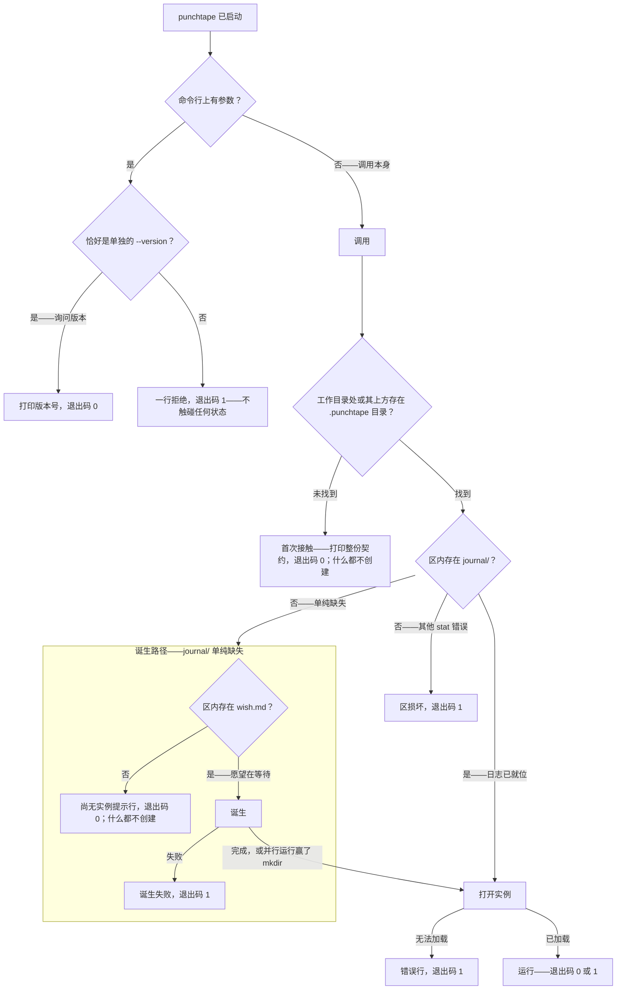
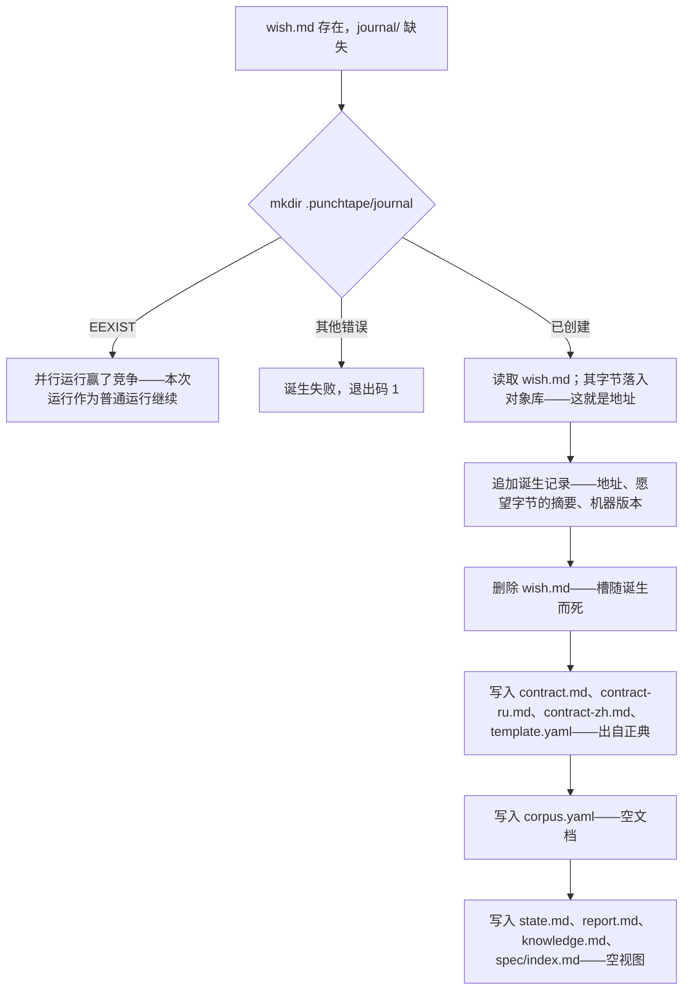
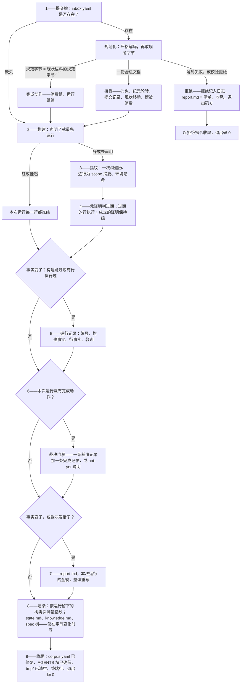
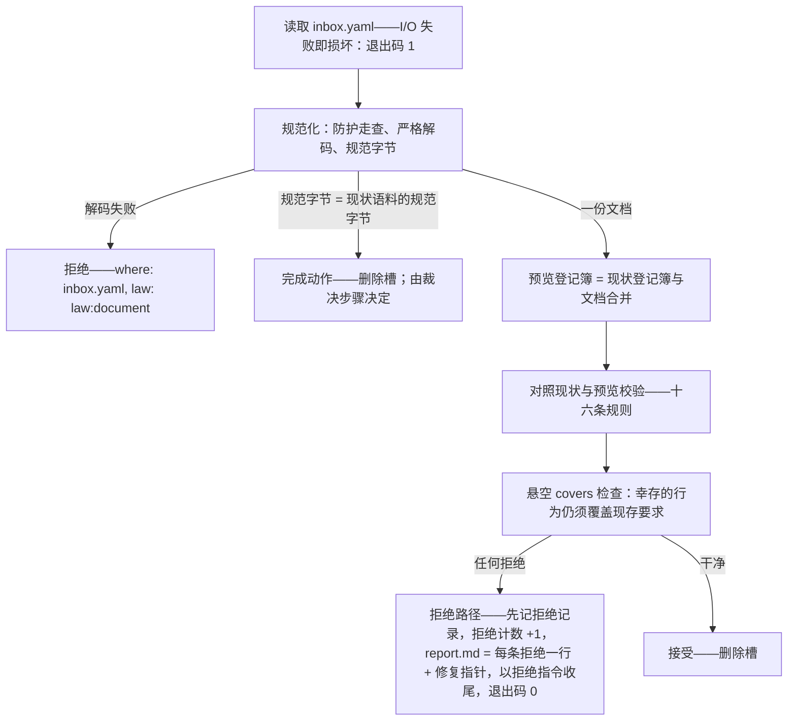
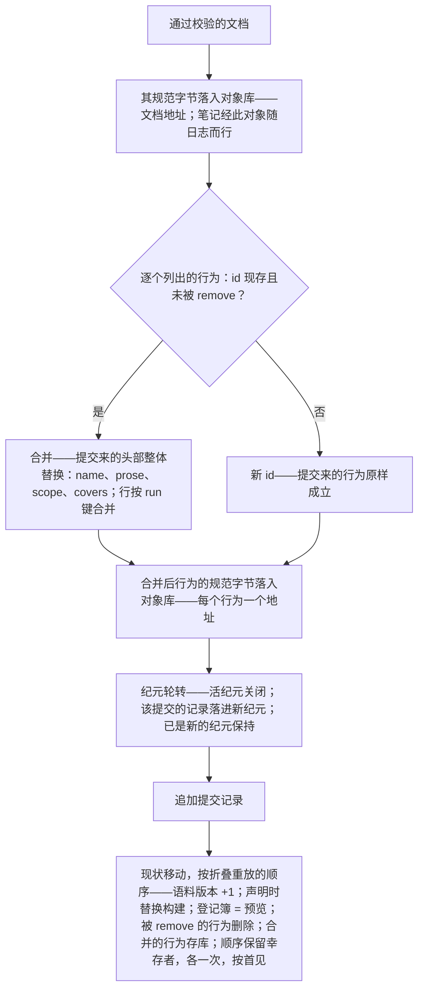
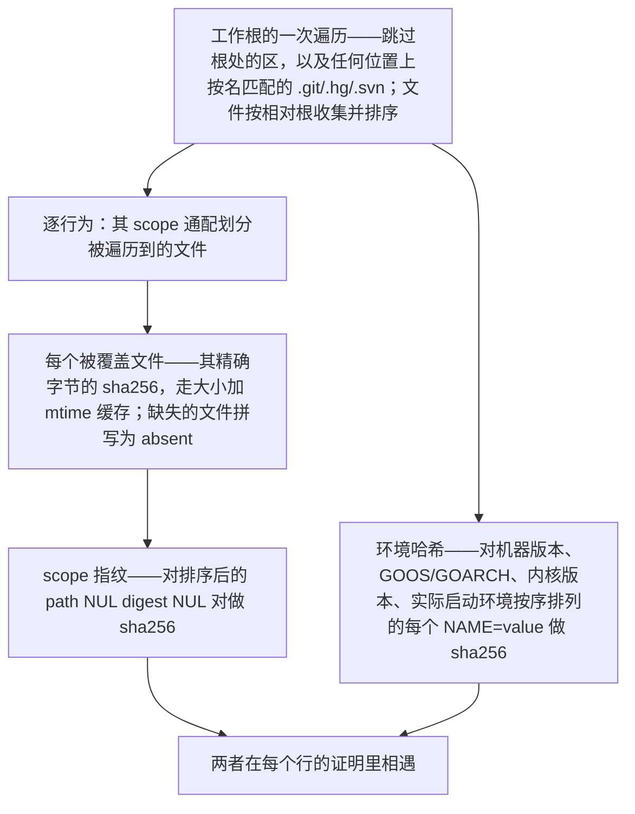
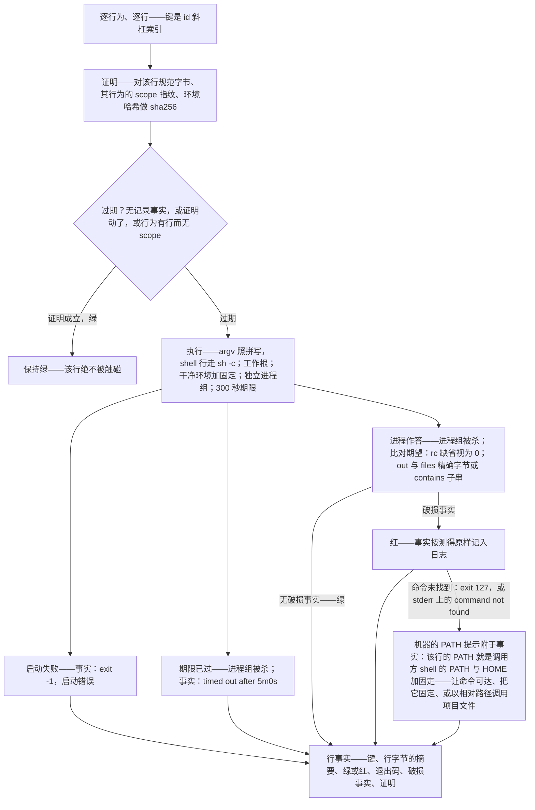
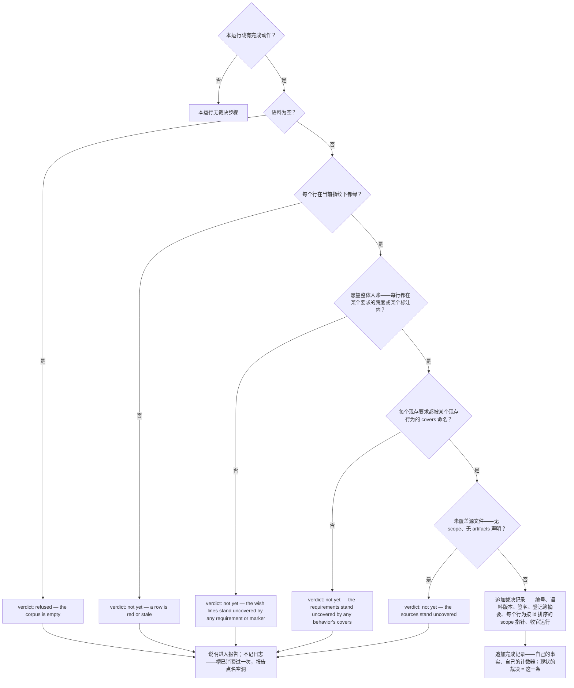
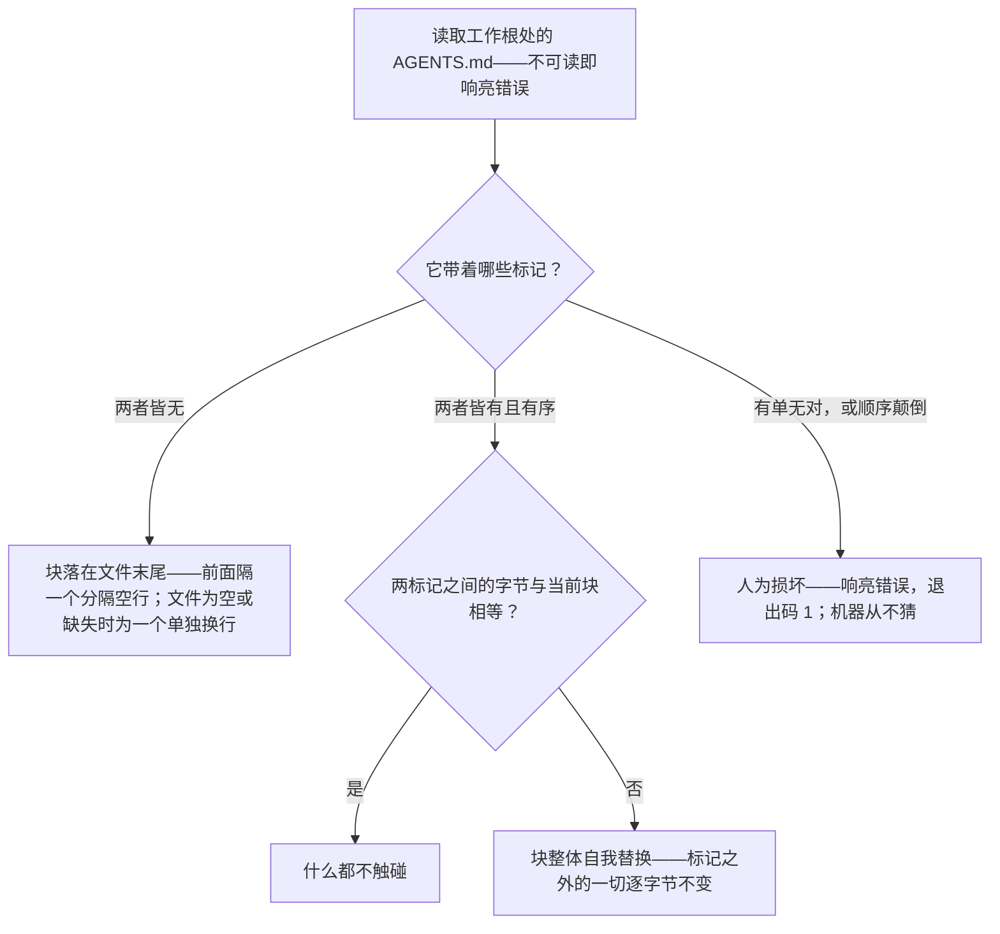
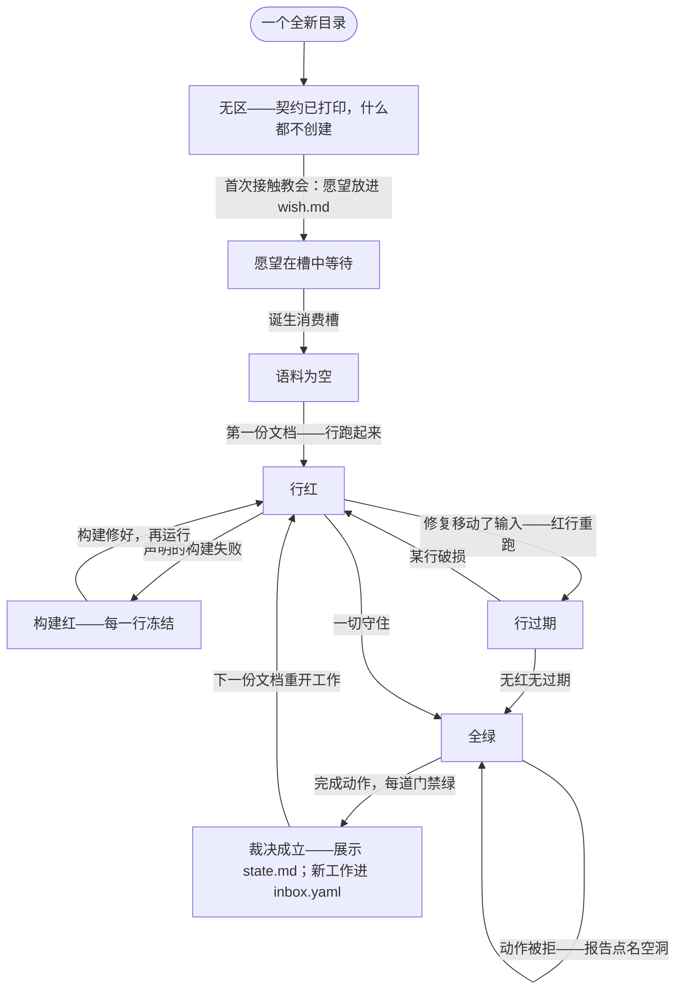

# 架构
[English](ARCHITECTURE.md) · [Русский](ARCHITECTURE.ru.md) · **中文**

## 目录

- [这台机器是什么](#这台机器是什么)
- [表面](#表面)
- [调用，从启动到退出](#调用从启动到退出)
- [打开实例](#打开实例)
- [运行](#运行)
- [提交槽](#提交槽)
- [构建](#构建)
- [指纹](#指纹)
- [过期与执行](#过期与执行)
- [运行记录与教训](#运行记录与教训)
- [裁决](#裁决)
- [报告](#报告)
- [渲染遍](#渲染遍)
- [下一条指令——实例的状态机](#下一条指令实例的状态机)
- [文档——唯一的输入格式](#文档唯一的输入格式)
- [登记簿——愿望的账目](#登记簿愿望的账目)
- [日志——唯一的真相源](#日志唯一的真相源)
- [对象库](#对象库)
- [执行环境](#执行环境)
- [代码地图](#代码地图)
- [正典](#正典)
- [确定性与完整性](#确定性与完整性)
- [构建期门禁](#构建期门禁)

punchtape 是一台外部状态机，站在树中工作的代理身旁，把任务的真相永远握在手里。代理从不与协议、API 或套接字对话：机器仅仅是一次不带参数的调用，整场对话——人的愿望、代理的文档、机器的回答——都搭载在一个隐藏目录的文件上：区。本文档按代码实现的原样描述这台机器：每个过程、每个结构、每个逻辑分支。它自立于自身；理解这台机器不需要它之外的任何东西。

## 这台机器是什么

一个单独的 Go 二进制。在工作根或其下方任意位置启动，它找到自己的区，读取日志，按当前状态行事——一次诞生、一次提交、一个完成动作，或只是测量——运行已过期的东西，记录事实，重新生成已变动的视图，并以恰好一行回答终端：下一个动作，点名要触碰的文件。红结果是数据，不是错误：机器的职责是测量与记录，绝不讨价还价。状态比任何会话、任何模型都活得久，因为每一件要紧的事实都活在一条只追加的日志里，其中的记录不携带墙上时钟：次序是记录在流中的位置，身份是它的字节。

两根梁撑起整座构造。**新鲜**：没有任何东西观察任何东西——任何地方都不存在文件或进程的监视者；取而代之，每个绿行都携带一枚证明指纹，覆盖它自己的字节、它所在行为的 scope 文件与执行环境，而仍然成立的证明绝不被重新执行。**裁决**：机器只在测量出的依据上宣告任务完成——每个行在当前指纹下为绿、愿望整体入账、每个要求都被覆盖、没有未覆盖的源文件——而这一宣告是一条写入日志的、带签名的事实，日志活多久它就活多久。

## 表面

代理或人可能遇见的一切：

- **调用。**`punchtape`，无参数，工作根或其下任意位置。退出码 0——机器干成了活。退出码 1——调用没有发生（区损坏、一次无法落地的写入、一份无法加载的日志）。
- **版本标志。**`punchtape --version`——恰好这个拼写，且单独成行——打印 `punchtape <version>`，并在触碰任何状态之前以 0 退出。它是给人的便利；契约从不提及它，机器路径也从不读它。
- **参数拒绝。**任何其他参数都产出一行——punchtape: the call takes no arguments — run `punchtape` alone; this refusal is the whole action of this launch——并以 1 退出，先于任何状态被触碰。
- **终端行。**每次成功运行恰好一行：`punchtape: run <N> — <instruction>`。指令与状态页 `next:` 行所载文字相同——绝无两个真相。
- **区**——`.punchtape/`，机器拥有的唯一目录：

  | 文件 | 含义 |
  |------|---------|
  | `wish.md` | 人的愿望，一字不差；只在诞生之前存在，被诞生消费 |
  | `contract.md` | 契约：机器的全部法则，由正典生成 |
  | `contract-ru.md`、`contract-zh.md` | 契约的俄文与中文镜像 |
  | `template.yaml` | 文档模板，由正典生成 |
  | `env` | 可选的固定文件：给每条命令的额外环境行 |
  | `inbox.yaml` | 提交槽：一份文档，或作为完成动作的现状语料字节 |
  | `corpus.yaml` | 现状语料的文档形态——一个生成的映像，每次运行都修复 |
  | `state.md` | 现状：目标、概要映射、计数器、带移动标记与历史的裁决、逐行为的行、未覆盖文件、`next:` |
  | `report.md` | 最近一次改变事实的运行的图景，或一份拒绝的清单 |
  | `knowledge.md` | 按标签的笔记与按原因的教训 |
  | `spec/` | 每个行为一小页；退役行为的页面被删除 |
  | `journal/` | 记录流：纪元文件，每个纪元存放一次提交的记录 |
  | `journal/objects/` | 内容寻址的对象库 |
  | `cache/` | 摘要缓存——加速器，可删除，绝不是真相 |
  | `tmp/` | 草稿区，每次运行结束时清空 |

- **AGENTS 块**——区外唯一的记录：工作根 `AGENTS.md` 中一个带标记的块，每次运行幂等地确保。标记之外的字节从不被触碰。
- **工作树**——工作根里除区之外的一切：代理的自由领地。机器从不把它的内容当作代码读；它遍历它取文件摘要、在其中执行语料的命令、并读取行的期望所点名的文件。

## 调用，从启动到退出

组合根（`cmd/punchtape`）挂载生产端口——文件系统绑定与进程绑定——取当前工作目录，并把两者交给机器唯一的入口。以下的一切都是那个入口的算法。



### 首次接触

起始目录处或其上方没有 `.punchtape`，意味着通道尚不存在：机器打印整份契约——内嵌的英文文本，与诞生后来写入 `contract.md` 的字节相同——并以 0 退出。什么都不创建；契约自己教出第一步（把愿望放进 `wish.md`）。

### 空槽行

有区而无日志，是实例从未诞生的区。若 `wish.md` 缺失，机器打印 `punchtape: no instance yet — put the human's wish verbatim into
.punchtape/wish.md and run again` 并以 0 退出——仍然什么都不创建。日志目录的任何其他 stat 错误都是区损坏：一行，退出码 1。

### 诞生



这次 mkdir 就是诞生的原子性：并行运行中恰好一个赢，输家看到一份活着的日志，作为普通运行继续。诞生记录是日志的第一条记录；它把目标——愿望的字节作为内容寻址对象——永远定死，并携带创建实例的机器版本（实例自己的起源事实，显示在状态页上）。

## 打开实例

诞生之后的每一次运行都以同一方式打开实例：

1. **记录流。**日志目录被列出以寻找名为 `epoch-NNNNN.yaml`（五位数字）的纪元文件，按编号顺序加载。
2. **折叠。**全部记录从最老到最新折叠成现状——由过去重建的现在（完整的折叠法则随下方日志一并给出）。日志点名、而对象库答不出的行为对象是一个诚实的错误：调用以 1 退出。
3. **固定。**区里可选的 `env` 文件被解析一次；任何非 `KEY=VALUE` 形状的行（键与值服从下文的法则）都是一次响亮的拒绝，点名文件、行号、该行与法则——退出码 1，先于任何状态移动。
4. **缓存。**摘要缓存懒打开；损坏或缺失的缓存文件读作空，每个摘要重算。

## 运行

一个打开的实例，一次运行。下面的步骤是机器在诞生之后的全部算法；后续各节给出每一步的完整法则。



任何无法落地的机器所属写入（一次日志追加、一个视图、语料修复、AGENTS 块、tmp 清理）都是响亮的失败：运行打印错误并以 1 退出——机器不会默默维持一张过期的脸。

## 提交槽

槽就是一个文件：`.punchtape/inbox.yaml`。它缺失是寻常状态——运行径直走向构建。它在时被读取一次，而读取本身在 I/O 上的失败是损坏（退出码 1，不是拒绝——机器不评判它从未见过的字节）。



拒绝是机器自己写入日志的事实：记录先于报告视图落进日志，因此一块落不了地的屏幕绝不会吞掉这个事实。提交的字节什么也不写——文档留在槽里，作者在同一文件里修好被点名的位置再运行一次；一次拒绝的代价是一次运行，别无其他。

### 完成动作

规范字节等于现状语料规范字节的 `inbox.yaml` 不是文档——它是完成动作：槽把语料逐字节送回，作为签收。槽被消费，运行继续走它的寻常步骤（构建照跑，过期的行照执行）；结尾的裁决步骤决定这个动作是合上一份裁决，还是点名空洞。这个动作作为独立于提交的、自己的日志化事实计数：一个计数器数槽收下的文档，另一个数完成了工作的动作。

### 文档的解码与规范字节

解码是严格的，且在模型见到解析树之前，一道防护走查先走一遍：恰好一个 YAML 文档、无锚点、无别名、无标签、无合并键、缩进中无制表符、无重复或未知字段。机器自己不写、也不指的任何东西都在槽口被拒——陷阱无法借格式搭车。编组是规范的：两空格缩进、map 键排序、struct 字段按声明顺序、命令作者的拼写（shell 行或 argv 列表）原样保留。比较发生在规范化之后（解码 → 规范字节），因此重排一份文档什么也不改变：同一内容的两种拼写是同一个内容。

### 校验——整套规则

每次拒绝都是 `{where, law, fact}`：确切的字段、契约印出的法则 id、测得的事实。没有建议，没有解读。

| # | 规则 | 法则 |
|---|------|-----|
| 1 | 构建命令出现时非空 | law:document |
| 2 | artifacts 通配是合法的相对根通配 | law:paths |
| 3 | 要求 id 为 `R` + 字母/数字/点，在提交内唯一 | law:document |
| 4 | 每个 brief 范围按 W 语法解析并命名一条现存愿望行 | law:document |
| 5 | 标注原因非空 | law:document |
| 6 | 标注引文是被标注愿望行自身的文本，一字不差，以换行相连 | law:document |
| 7 | 行为 id 是以 `/` 相连的 `[a-z0-9-]` 段，在提交内唯一 | law:document |
| 8 | 行为名字非空 | law:document |
| 9 | scope 通配是合法的相对根通配 | law:paths |
| 10 | covers 命名本次提交合并之后仍然现存的要求 | law:document |
| 11 | 每个行为至少带一行 | law:document |
| 12 | 每行的 run 非空（shell 行或非空 argv） | law:document |
| 13 | 每行的 expect 命名 rc、out 或 files | law:document |
| 14 | 一个 run 在一个行为中至多出现一次（run 是行的键） | law:document |
| 15 | expect 的文件路径是合法的相对根路径 | law:paths |
| 16 | remove 只命名语料中现存的 id（行为或要求） | law:document |

在表格之外，机器还检查**悬空 covers**：未在提交中列出而幸存的行为，不得覆盖该提交退役的要求——退役一个要求，就要求同一次提交清掉它的每一处覆盖。

### 接受——合并管线



合并法则集中一处：

- **行为按 id 合并。**列出的现存 id，其头部被整体替换（name、prose、scope、covers），其行按 run 键合并；新 id 被加入；`remove` 中的 id 被退役（同一次提交里删除再加同一 id，则从头开始）。
- **行按 run 键合并**——即命令的规范字节。现存的 run 原地替换其整行；新 run 追加在现有行之后；未列出的行原样不动。重新拼写的命令是新的一行——原有那行继续成立。
- **要求按 id 合并**，方式相同（重复的 id 整体替换其 brief 跨度）。
- **标注清单与 artifacts 清单整体替换**——提交携带它们时；缺失的清单保留现有者。
- **构建**只在声明时替换现有命令——缺失的字段什么也不改变。

经济性正是要害：提交的次数从不影响代价——列出的字节只走一趟，未变的行不被重发，只提交一部分行为是正常提交。

## 构建

语料声明的构建命令（一条 shell 行）在每一个声明了它的运行中最先执行，先于任何行——在工作根里、在干净环境中、作为一个进程组、服从与行相同的纪律。写入日志的事实是退出码、超时标记，或启动失败自己的话。非零退出、挂过期限、或从未启动的构建在本运行中为红：**每一行都被冻结**——什么都不执行，没有行事实移动，运行的记录只携带构建的事实，终端行说 `build red — read .punchtape/report.md, fix the build,
run again`。

## 指纹



每次运行在执行前遍历一次树、执行后再遍历一次：状态页展示的是第二次遍历的指纹，因此页面描述的是运行离开时的树，不是运行找到时的树。裁决自己的记录保存着启动态指针——证明据以测量的那组指纹。

哈希缓存（`cache/hashes.yaml`）把 `(path, size, mtime)` 映射到摘要，并携带算法标签；异种标签的条目退出重算，绝不撒谎。它在运行结束时落盘一次。删掉缓存，下一次运行会重算出同样的数字——它是加速器，从来不是真相源。

## 过期与执行



过期法则一句话：当行自己的字节变了、其行为的 scope 文件变了、环境变了、它从未跑过——或其行为根本未声明 scope（有行而无 scope 的行为不站在它点名的任何东西上，所以它的行诚实地永远过期）——行就重跑。scope 与环境未变——该行绝不再跑。跳过法则不分颜色：证明仍然成立的现存红行同样不被重新执行——它恰好在输入移动时重跑。一条现存的红永远冒充不了绿：裁决读事实的状态，绝不只读证明。破损事实引用两边——期望的拼写与实测的拼写；实测一边超过八十字符时以省略号截断。

## 运行记录与教训

改变了事实的运行——构建跑过，或至少一行执行过——追加一条运行记录：编号（前值 +1）、构建的事实、被执行各行的事实（`key`、行字节的摘要、绿/红、退出码、破损事实、它所立足的证明）、以及教训。计数器从零开始：第一次改变事实的运行之前，终端行与各页头都写着 run 0。

一条**教训**是本运行的一次红→绿转变，以纯数据固定：上一事实的首个破损原因、其全部破损事实、该行之前与之后的字节（之前的字节凭摘要从日志各提交所载的行为对象中找回）、以及两个运行编号。任何模型的 token 一个不花——修复由机器自己测得。原因类别已有教训的红行，其教训之名见诸状态页。

## 裁决



**签名**是对语料规范字节的 sha256，其后按 id 排序逐个行为附上 `\0 id \0 scope
fingerprint`——语料与宣告它时的精确树状态，收进一枚摘要。**登记簿摘要**是对要求与标注合计规范字节的 sha256——愿望的全部账目以同一枚封印作证。裁决只追加：新的从不改写旧的；现状保留最新一条。

### 漂移与治愈

没有任何东西监视树。裁决之后，两个派生标记讲述后续：

- **scope 已移动**——在状态页上：一个活行为的当前 scope 指纹不同于裁决记录的指针。裁决仍是对宣告时那棵树的事实；标记说的是那棵树长过了。
- **漂移与治愈**——在裁决历史里，纯粹由日志派生：裁决成立时有行站红的运行是一次漂移事件（以运行键与行键点名）；之后第一个没有红行的运行将它治愈（以运行点名）。收官报告发现未闭合的漂移时会加上自己的一行：哪个运行染上它，哪个运行重新变绿。

## 报告

`report.md` 是最近一次改变事实的事件的全貌，移动时整体重写（一次什么也没改、什么也没闭合的运行让上一份报告原样站着——旧文字不会无故活过其事件，新事件的文字也不会被藏起）。对一次运行：带运行编号的页头；跑过构建时构建的行（启动失败或超时为 `build:
RED — <reason>`，坏退出码为 `build: RED — exit
<N>`，好退出码为 `build: exit <N>`）；什么都没执行且裁决没说话时为 `no stale
rows`；绿行计数；每个红行按其破损原因分组——每个原因一次，行键列于其下；完成动作说话时裁决的说明。对一次拒绝：每条拒绝一行——`where: fact (law)`——以及指针：提交留在 `inbox.yaml`，在那里修好再运行。

## 渲染遍

事实之后是视图——日志生成的映像，内容变化时整体重写，不变化时绝不触碰（先比字节，仅在有差异时原子写入）。

**`state.md`**——一页之上的现状，顺序为：带运行编号的页头；目标摘要与愿望的对象地址；概要映射——`brief: <claimed>/<lines> lines; requirements <n>
standing, <k> covered; not-a-requirement: <m>`——每个标注逐一拼写（`not-a-requirement W…: "<quote>" — <reason>`），有则附未覆盖的概要行；`corpus: v<n>, <b> behaviors`；`submissions:
<a> accepted, <r> refused, <c> completed`；`machine at birth:
<version>`；裁决行——`verdict: #<n> on v<c>, run <r>,
signature <12 hex>`——带 `- scopes moved: <ids>` 或 `— standing`；裁决历史（每条记录在案的裁决、每次带红键的漂移、每次治愈）；每个行为一行——`- <id>: <n> rows — <g>
green, <s> stale, <r> RED (scope <12 hex>)`；声明的 artifacts 与未覆盖源文件各成一个清单；`knowledge: <n> notes, <l>
lessons`，每个已有教训的红原因各带一个指针；以及 `next:`——那条唯一的指令，与终端行同文。

**`knowledge.md`**——笔记与教训。词汇表是实例自己的字节：愿望的字节与现状语料规范字节之中的每一个词（ASCII 字母与数字的小写连串，两个字符及以上）。每个被接受提交的每条笔记恰好出现一次，按到达顺序，编号 `n1…`——其文字与其标签同行（笔记的词与词汇表的机械交集；为空时 `(untagged)`）；随后是把每个标签映射到其笔记编号的索引；再后是按原因分组的教训，各带行键、两个运行编号、以及该行之前与之后的字节作为单行摘录（一百字符处截断）。标签只作分组——绝不是检查；机器从不解读任何笔记。

**`spec/`**——每个活行为在 `spec/<id>.md` 的一小页（嵌套 id 自建目录）：页头 `# <id> — <name>`、运行编号、prose 原文照录、scope 通配，随后逐行：其从零计数的索引——与该行日志键所载索引相同——人类可读的命令、人类行文式的期望（`exit:`、`stdout:`、`file <path>:`）、以及证明行——该行的现状（绿 / 过期 / 红）与所录证明的短摘要（从未跑过的行 `none`）。`spec/index.md` 列出每个行为及其一词状态（`green`、`not green`、`no rows`）。退役行为的页面被删除——这棵树是现状语料的映像，别无其他；落不了地或离不了场的页面是一次响亮的失败。

**语料修复**——每当 `corpus.yaml` 的字节异于现状语料的规范字节，它即被重写：现状文档，随时可作为完成动作复制回去。

**AGENTS 块**——工作根的 `AGENTS.md`：



块的固定内容，位于 `<!-- punchtape -->` 与 `<!-- /punchtape -->` 之间：运行 `punchtape`（无参数）并读 `.punchtape/state.md` 看现状与下一步；法则在 `.punchtape/contract.md`；文档的形状在 `.punchtape/template.yaml`；提交到 `.punchtape/inbox.yaml`；上次运行的事实见 `.punchtape/report.md`。标记之外没有一个字节属于机器，也没有一个字节曾被触碰。

**收尾**——草稿目录 `tmp/` 被整体删除，终端收到它的那一行：`punchtape: run <N> —
<instruction>`。退出码 0。

## 下一条指令——实例的状态机

指令是现状的纯函数；各状态及其回答：

| 状态 | 那条唯一的指令 |
|-------|---------------------|
| 本次运行构建红 | `build red — read .punchtape/report.md, fix the build, run again` |
| 语料为空 | `corpus empty — submit the first document as .punchtape/inbox.yaml (copy .punchtape/template.yaml)` |
| 任一行红 | `<N> row(s) red — read .punchtape/report.md, fix, run again` |
| 任一行过期（且无红） | `<N> row(s) stale — run again to execute them` |
| 一份裁决立于当前语料版本 | `verdict #<N> standing — show .punchtape/state.md to the human; new work goes to .punchtape/inbox.yaml as a document` |
| 全绿，此版本上无现存裁决 | `all green — copy .punchtape/corpus.yaml to .punchtape/inbox.yaml and run to record the verdict` |



只要语料声明了构建，红构建就把机器从任何工作状态送进 `BuildRed`——表格第一行压过其余。实例的一生用话说：愿望落进槽里、下一次运行将其诞生时，目录获得实例；语料由文档建成；行凭测量变红、变过期、变绿；每道门禁成立时，完成动作合上一份裁决；裁决之后，工作以它开始的方式重开——下一份文档——而裁决仍是状态页上一条带移动标记与漂移历史的既录事实。实例永不死亡；真正的新任务是全新目录里的新愿望。

## 文档——唯一的输入格式

一份 YAML 文档，严格解码：

```
notes:            free text, one entry {text}; never interpreted
build:            one shell-line command; absent = keep the standing one
remove:           ids to retire — standing behaviors or requirements
requirements:     [{id: R…, brief: [W ranges]}]
not-a-requirement:[{lines: [W ranges], quote: the lines verbatim,
                    reason: non-empty}]
artifacts:        root-relative globs — the work's declared outputs
behaviors:        [{id, name, prose, scope: [globs], covers: [R ids],
                    rows: [{run, expect}]}]
run:              one command — a shell line (string) or an argv
                  (list of strings, non-empty)
expect:           at least one of —
                    rc:    the exact exit code (absent = 0)
                    out:   stdout — exact bytes, or a substring
                           behind the "contains: " prefix
                    files: {path: text} — read after the run,
                           the same two match spellings per file
```

一切所依赖的语法：

- **行为 id**：`[a-z0-9-]+` 段以单个 `/` 相连——无前导或尾随斜杠，无空段。
- **要求 id**：`R` 后跟字母、数字与点（尾可空——`R` 单独即成立）。
- **相对根路径**：斜杠分隔，无盘符、无 scheme、无前导斜杠、无反斜杠、无 NUL、无空段或 `.`/`..` 段——拼不出来的就指不到树外。
- **scope/artifacts 通配**：一种相对根的斜杠模式，各段可含 `[A-Za-z0-9-._*?[]`；`**` 段吞下零个或多个目录；`*`、`?` 与 `[...]` 在一个段内匹配。
- **W 范围**：`W<n>` 或升序的 `W<a>..W<b>`，逗号相连——愿望按文件顺序编号的非空行，诞生时编为 `W1…Wm` 并永远定死。

## 登记簿——愿望的账目

登记簿是语料对愿望的账目：要求（各含其需求占据的愿望行）、not-a-requirement 标注（各将被标注行自己的话逐字引用在一旁，附一个原因——驳回一个需求，就要求把它的确切文本抄进签名的语料）、以及声明的 artifacts（工作的产出——无需任何 scope 覆盖的文件）。**概要映射**每次渲染派生一次、每次裁决派生一次：多少愿望行已被认领（落在某个要求的跨度或某个标注的跨度内）、哪些未覆盖、多少要求现存、其中多少被行为的 covers 命名。解析不了的范围拼写，或愿望宇宙之外的编号，一概不认领——它点名的行仍是诚实的空洞。

## 日志——唯一的真相源

机器珍视的每一件事实都是一条只追加的记录。六种记录，各恰一份载荷：

| kind | 载荷 | 事实 |
|------|---------|----------|
| birth | addr、digest、机器版本 | 实例的目标，一次定死 |
| submission | 语料版本、构建、列出的登记簿部分、逐行为的对象地址、被 remove 的 id、文档自身的地址 | 一份被接受的文档 |
| run | 编号、构建事实、行事实、教训 | 一次改变了事实的运行 |
| verdict | 编号、语料版本、签名、登记簿摘要、scope 指针、运行 | 一次完成宣告 |
| refusal | 拒绝清单 | 一次被拒绝的提交——机器自己的事实 |
| completion | 运行编号 | 一次完成动作 |

记录编解码双向严格：一条记录只有在重新编组后字节精确一致时才可解码——手工编辑或撕裂写入都会被点名拒绝，绝不默默吸收。记录不携带墙上时钟。

**纪元。**记录流以编号文件 `epoch-NNNNN.yaml` 存活；每条记录是行首 `---` 分隔符之后的一个 YAML 文档。提交在其记录落地之前轮转记录流——每个提交的记录活在属于自己的纪元里；轮转从不堆叠空文件。追加是带 fsync 的单一动作。

**撕裂尾部。**写入中途被截断的记录不会弄瞎机器：完整的记录照常加载，撕裂字节隔离进旁路文件（`<epoch>.torn`，带一行头），纪元文件从其完好记录逐字节重建。末位之外解析不过的块是人为损坏——一个诚实的错误，调用以 1 退出。

**折叠。**现状从记录重建，从最老到最新：

| 记录 | 折叠的一步 |
|--------|-----------------|
| birth | 已诞生；目标的地址、摘要与诞生版本 |
| submission | 语料版本；声明时的构建；提交被记住（其文档对象喂养笔记）；登记簿按合并法则合并；被 remove 的行为删除；每个列出的行为从其对象解码并存库；顺序保留幸存者，各一次，按首见 |
| run | 运行编号取所见最大值；每个行事实替换其键名下的现状；教训累积 |
| verdict | 现存裁决即该记录（最新者胜） |
| refusal | 拒绝计数 +1 |
| completion | 完成计数 +1 |

现状的全貌：诞生标志；目标地址与摘要；诞生时的机器版本；语料版本；声明的构建；登记簿（按 id 的要求、其首见顺序、标注、artifacts）；按 id 的行为及其顺序；按键的行事实；运行编号；裁决；各次提交；拒绝与完成计数；教训。

## 对象库

`journal/objects/`——内容寻址库。对象的名字是其字节的十六进制 sha256；其文件在库根下为 `<first two hex>/<other
sixty-two>`。相同字节只存一次——去重与幂等由构造保证；重复写入不触碰任何东西。每次写入经临时文件与重命名落地，并在应答之前重读重验；每次读取都对照地址校验摘要，不匹配即响亮拒绝。不压缩——对象是千字节级的，稳定的原始字节比省下的字节更值钱。愿望的字节、每份被接受文档的规范字节、每个合并后行为的规范字节都活在这里——不可变，以自身内容命名。

## 执行环境

机器的每一条命令——构建与每一行——以同一方式启动：argv 照拼写原样（argv 列表照跑；shell 行走 `sh -c`），工作目录是工作根，环境是**干净基底加固定**，进程运行在自己的进程组里。干净基底恰是正典声明的名字——`PATH` 与 `HOME`——取自运行机器的 shell，别无其他。固定是区的 `env` 文件：一行一个 `KEY=VALUE`，键为 `[A-Za-z_][A-Za-z0-9_]*`，无 `export`、无引号、无绝对路径（固定随树而行，故其中不得有任何指向某台机器磁盘的东西）；注释与空行放行，末尾回车被容忍；任何其他形状的行都是一次响亮的拒绝，点名文件、该行与法则。同名时固定胜过基底。环境的身份——机器版本、`GOOS/GOARCH`、内核版本、以及实际传递的有序 `NAME=value` 集——就是每枚证明之内的环境哈希：一个会话改变了命令所见，就移动了证明，行随之过期，绝不假绿。

进程纪律：命令留下的任何活物随其进程组同死——向进程组与进程发 kill 信号，再有界等待真正死亡（垂死的成员仍持有它持有的东西）。等不到应答的等待是机器记录在案的错误，绝不是干净退出。一条命令的既定期限是 300 秒——它是挂起的终结者，绝不是慢工作的裁判。

## 代码地图

- `cmd/punchtape`——组合根：挂载生产端口、一次调用、版本标志、参数拒绝。
- `internal/ports`——端口契约（`FS`、`Exec`）与绑定的插槽：应用骑在端口上，基础设施实现它们，测试组合借它们换入假件。未接线的端口调用是一次点名 panic——绝不是静默默认。
- `internal/domain`——纯法则：`digest`（sha256，万物唯一的摘要法则）；`zone`（布局常量与路径法则）；`doc`（文档：模型、严格编解码、规范字节、校验、合并、W 范围语法、期望比对）；`journal`（记录种类、严格记录编解码、折叠）；`fprint`（scope 指纹、环境哈希、证明、通配匹配器）。
- `internal/application`——机器本身：调用的算法、诞生、执行、环境法则、树遍历与摘要缓存、愿望的行宇宙、视图、AGENTS 块，以及 `canon`——一切印出之物的内嵌源。
- `internal/infrastructure`——`fsys`（操作系统文件系统，带 fsync 的原子写入）、`process`（操作系统启动、进程组）、`store`（纪元命名、追加/轮转/隔离流）与 `store/cas`（对象库）。

## 正典

一个内嵌源持有机器作为法则印出的一切：英文契约（基底与标尺）、俄文与中文镜像（数据，结构完整——基底的每条法则与每个区文件都出现在每面镜子里）、文档模板、示例、校验规则到契约法则的映射表、以及环境规则（`PATH`、`HOME`）。区的契约文件与模板在诞生时由它生成。正典无法对机器撒谎：示例必须在一个全新夹具里对真机器解码、校验、跑绿并完整合上它的裁决——由构建的测试组合检查，于是撒谎的正典会让构建失败。法则映射把每条被执行的规则绑到契约印出的一条法则，把每条被引用的法则绑到契约印出的一条——凡被执行的皆有印出，凡被印出的皆被执行。

## 确定性与完整性

处处规范 YAML 字节（同一文档在每个会话编组为相同字节）；每个指纹都是对排序结构的 sha256；树只有一种遍历顺序；视图仅在字节变化时写入；每次整文件写入都是原子的（临时文件、fsync、重命名——读者在任何时刻看到的都是完整的旧内容或完整的新内容）；每次追加都是一次 fsync 过的单一动作；记录必须字节精确往返；对象写入与读取都校验；任何记录都没有墙上时钟。同一个区与同一棵树在每台机器上产出相同的字节——同一段历史的日志在处处字节相同。

## 构建期门禁

三条法则约束代码本身，全部由构建的测试组合与 check 目标执行：

- **不可知性门禁。**机器不携带任何自身契约之外世界的知识——任何任务、技术栈、领域、角色、活动或实验都不得活在它的代码、正典或错误行里。对机器自身源码的词边界扫描，在见证词落下的那一刻就让构建失败；扫描器自己的词表是唯一点名的例外，于是别处都不必携带它。
- **正典的诚实。**示例的完整往返（见上）与镜像的结构对等——基底的每条法则与基底点名的每个区文件都出现在每面镜子里。
- **测试组合。**对源码的 gofmt、vet、staticcheck、golint、unparam、gopls 与重复代码检查；速度上限之下的全量测试套件；以及完整的函数覆盖——测试二进制的 profile 与自行启动的插桩二进制的 profile 合并（单元测试够不到的入口），每个函数 100%，否则构建失败。
