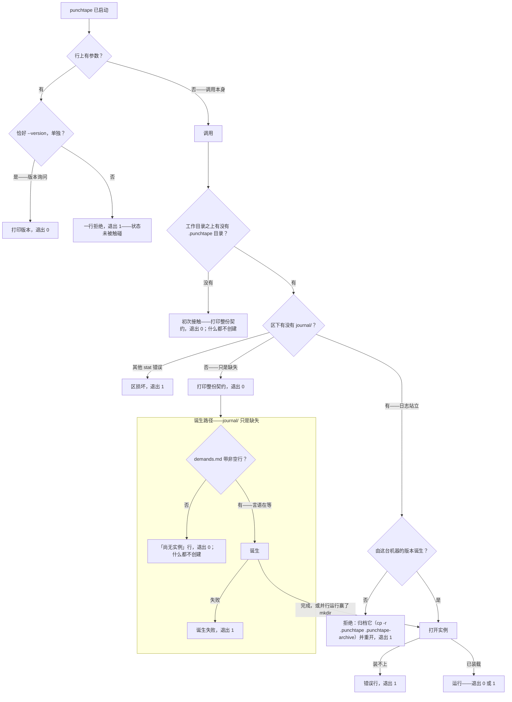
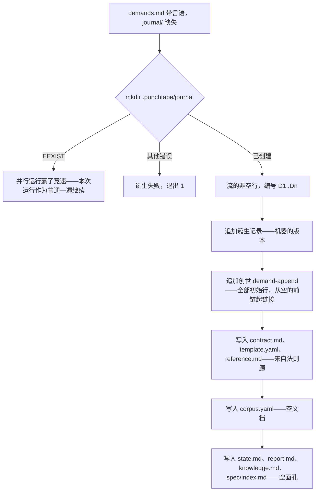
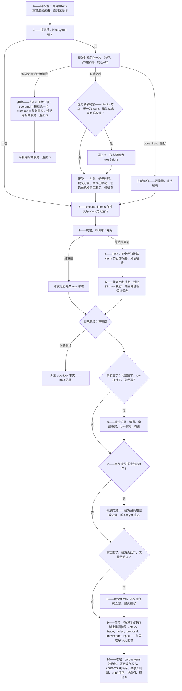
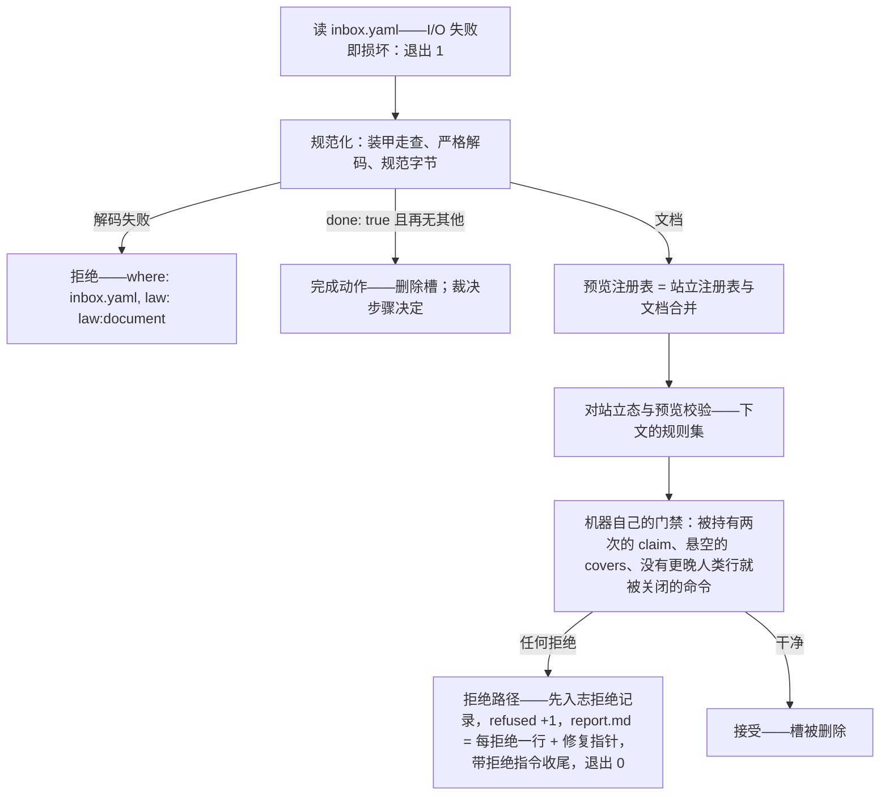
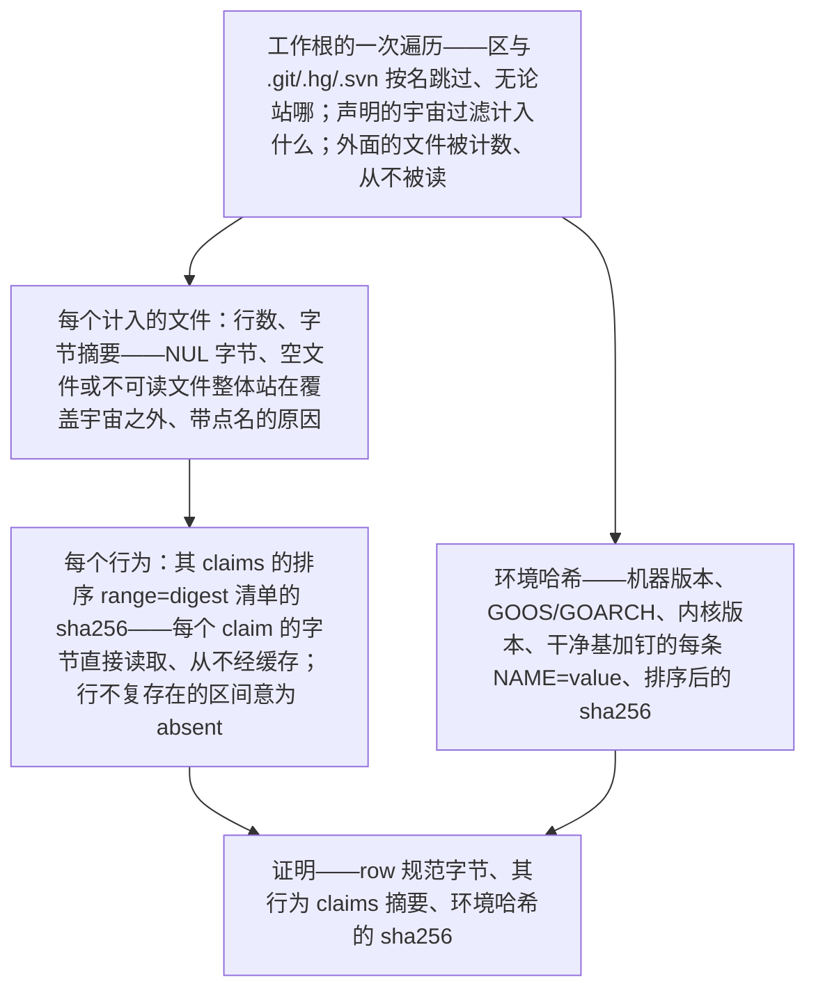
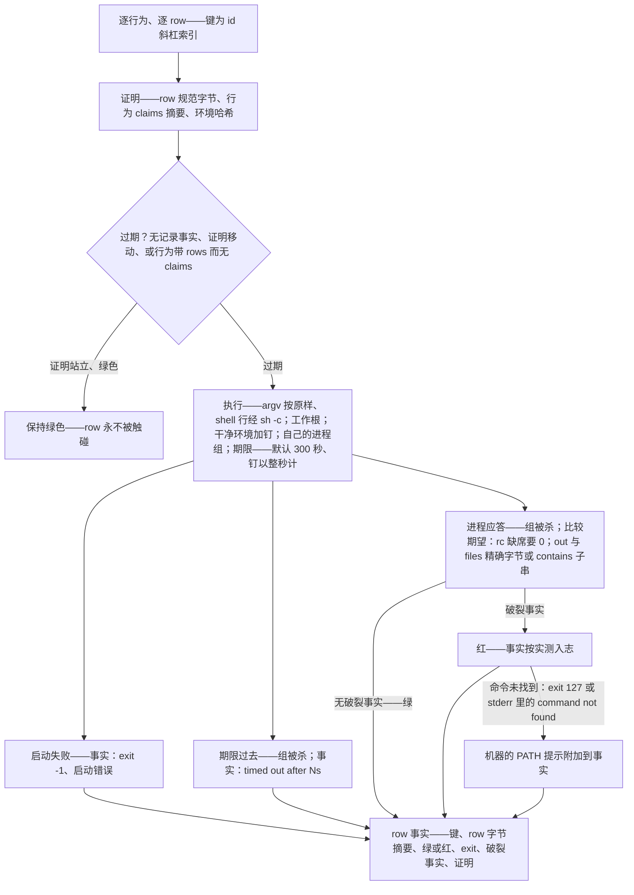
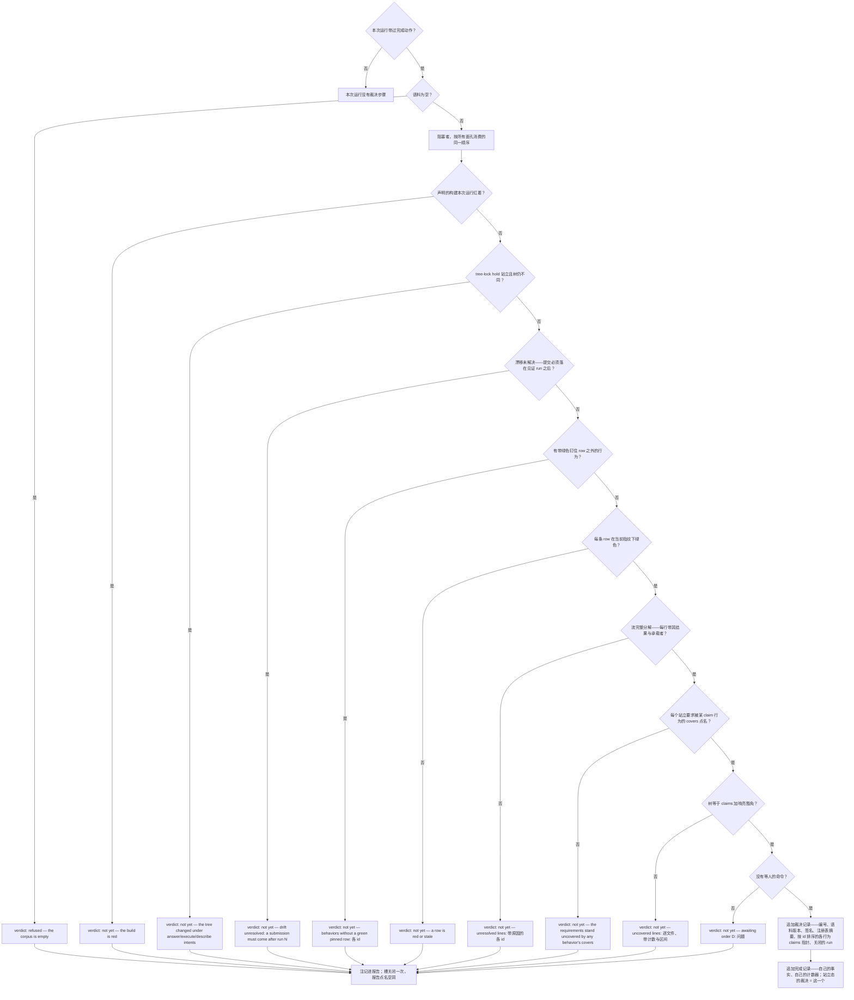
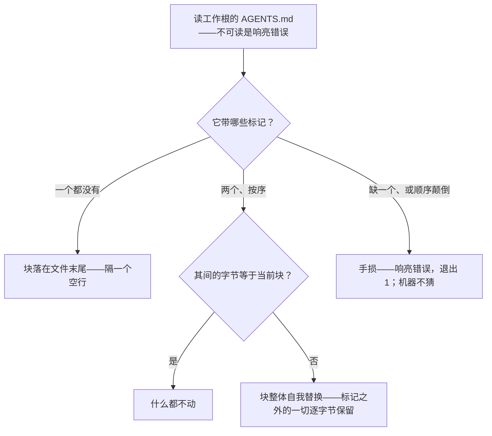
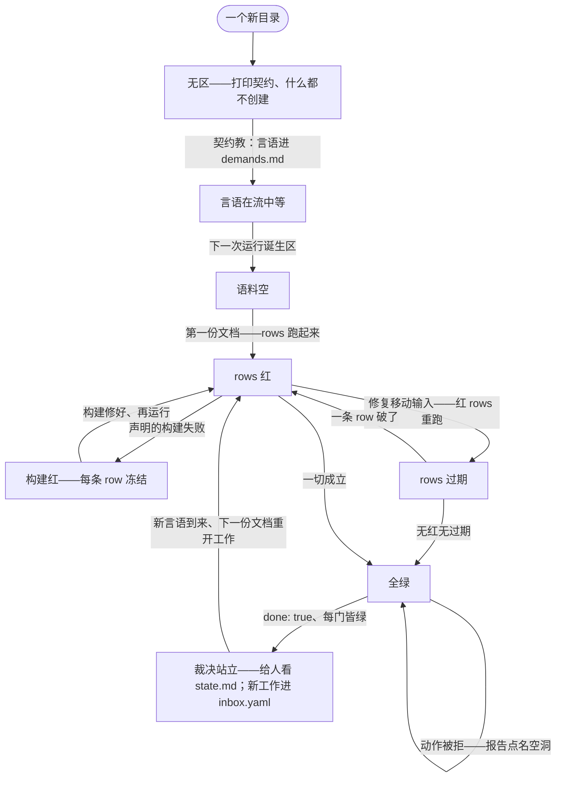

# 架构
[English](ARCHITECTURE.md) · [Русский](ARCHITECTURE.ru.md) · **中文**

## 目录

- [这台机器是什么](#这台机器是什么)
- [表面](#表面)
- [调用，从启动到退出](#调用从启动到退出)
- [打开实例](#打开实例)
- [运行](#运行)
- [需求流](#需求流)
- [提交槽](#提交槽)
- [文档——唯一的输入格式](#文档唯一的输入格式)
- [校验——完整的规则集](#校验完整的规则集)
- [合并法则](#合并法则)
- [树锁](#树锁)
- [执行](#执行)
- [构建](#构建)
- [指纹](#指纹)
- [过期与执行](#过期与执行)
- [运行记录与教训](#运行记录与教训)
- [裁决](#裁决)
- [报告](#报告)
- [渲染遍](#渲染遍)
- [下一条指令——实例的状态机](#下一条指令实例的状态机)
- [日志——唯一的真相源](#日志唯一的真相源)
- [对象存储](#对象存储)
- [执行环境](#执行环境)
- [代码地图](#代码地图)
- [法则源](#法则源)
- [确定性与完整性](#确定性与完整性)
- [构建期门禁](#构建期门禁)

punchtape 是一台外部状态机，站在树中工作的 agent 旁边，永久持有
任务的真相。agent 从不与协议、API 或套接字对话：机器是带零参数的
一次调用，而整个对话——人类的言语、agent 的文档、机器的回答——
都经由一个隐藏目录（区）的文件进行。本文档完全按代码的实际实现
描述这台机器：每个过程、每个结构、每条逻辑分支。它自足；理解
这台机器不需要它之外的任何东西。

## 这台机器是什么

一个单独的 Go 二进制。在工作根或其下任何位置启动，它找到自己的
区，把日志折叠成站立态，按当前状态行动——诞生、提交、完成动作，
或只是度量——运行构建与过期的 rows，记录事实，重新生成移动过的
面孔，并以恰好一行回答终端：下一步行动，点名要动的文件。红色
结果是数据，不是错误：机器的工作是度量与记录，从不讨价还价。
状态比任何会话、任何模型都活得久，因为每个要紧的事实都住在一条
只增日志里，其记录不带壁钟：顺序是记录在流中的位置，身份是它的
字节。

两条法则撑起整个构造。**证明**：没有任何东西在观察任何东西——
任何地方都不存在文件或进程的监视者；取而代之，每条绿色 row 都
带着一个证明指纹，覆盖它自己的规范字节、其行为 claim 的行、以及
执行环境，而仍然成立的证明永不被重新执行。**裁决**：机器只在
度量的基础上把任务记为完成——每条 row 在当前指纹下绿色、言语被
完整分解、每个要求被覆盖、树等于它的 claims 加响亮豁免、没有
命令在等人——而记录是一条入志的、带签名的事实，与日志同寿。

## 表面

agent 或人类可能遇到的一切：

- **调用。** `punchtape`，零参数，在工作根或其下任何位置。
  退出 0——机器干活了。退出 1——调用没有发生（区损坏、写不进去、
  日志装不上）。
- **版本旗标。** `punchtape --version`——恰好这个写法、单独一行
  ——打印 `punchtape <version>` 并在任何状态之前以 0 退出。这是给
  人的便利；契约从不提它，机器的任何路径也不读它。
- **参数拒绝。** 任何其他参数产生一行——`punchtape: the call
  takes no arguments — run `punchtape` alone; this refusal is
  the whole action of this launch`——并在任何状态被触碰之前以
  1 退出。
- **终端行。** 每次成功运行恰好一行：
  `punchtape: run <N> — <instruction>`。指令与状态页 `next:` 行
  携带的是同一段文字——绝无两种真相；指令所命的路径以调用者的工作目录拼写。
- **区**——`.punchtape/`，机器唯一拥有的目录：

  | 文件 | 含义 |
  |------|---------|
  | `contract.md` | 契约：机器的全部法则（八条法则），由法则源生成 |
  | `template.yaml` | 带教学注释的文档形状，由法则源生成 |
  | `reference.md` | 一页上机器的每一扇门，由法则源生成 |
  | `demands.md` | 人类的言语，逐字，每行一条非空——永远开放 |
  | `inbox.yaml` | 提交槽：一份文档，或光秃秃的完成动作 |
  | `env` | 可选的钉文件：给每条命令的 KEY=VALUE 行 |
  | `universe` | 可选声明：树的哪些根算数 |
  | `corpus.yaml` | 站立语料作为文档——生成的镜像，每次运行被治愈 |
  | `state.md` | 站立态：言语账目、计数器、带漂移标记与历史的裁决、各行为的 rows、未覆盖与豁免行、`next:` |
  | `report.md` | 最近一次改变事实的运行的画面，或拒绝清单 |
  | `knowledge.md` | 笔记与机器度量的教训 |
  | `trace.md` | 流的橱窗：每条言语及其结果与承载者 |
  | `holes.md` | 未覆盖行的完整无封顶账本 |
  | `exclusions-proposal.yaml` | 机器按站立空洞起草的豁免清单 |
  | `spec/` | 每个行为一小页；退役行为的页面被删除 |
  | `journal/` | 记录流：纪元文件，每个被接受提交的记录一个纪元 |
  | `journal/objects/` | 按内容寻址的对象存储 |
  | `cache/` | 已验证的遍历缓存——加速器，可删，永非真相 |
  | `tmp/` | 暂存，每次运行结束时清空 |
  | `run.lock` | 区的运行锁——同一时刻只有一遍运行，由内核释放 |

- **AGENTS 块**——区外的唯一记录：工作根 `AGENTS.md` 里的一个
  标记块，每次运行幂等地确保。标记之外的字节永不被触碰。
- **工作树**——工作根里其余的一切：agent 的自由领地。机器从不
  把它的内容当代码读；它为行数与摘要而遍历它，在其中执行语料的
  命令，并读取 row 期望点名的文件。

## 调用，从启动到退出

组装根（`cmd/punchtape`）挂载生产端口——文件系统绑定与进程绑定
——取当前工作目录，把两者交给机器的唯一入口。下面的一切都是该
入口的算法。



### 初次接触

起点之上没有 `.punchtape`，意味着通道尚不存在：机器打印整份契约
——内嵌的英文文本，与诞生随后写进 `contract.md` 的相同字节
——并以 0 退出。什么都不创建；契约自己教第一步（把人类的言语
放进 `demands.md`）。同一页契约也会在区目录存在而无日志时打印
——无论区里还有什么——让法则先于一切到达 agent。

### 「尚无实例」行

没有日志的区是从未诞生的实例的区。若 `demands.md` 不带非空行，
机器打印 `punchtape: no instance yet — put the human's words
verbatim into .punchtape/demands.md and run again` 并以 0 退出
——依然什么都不创建。日志目录上的其他 stat 错误是区损坏：一行，
退出 1。

### 诞生



mkdir 就是诞生的原子性：并行运行中恰好一个赢，输家看到活的日志、
作为普通一遍继续。诞生记录携带创建机器的版本——实例自身的出身
事实，显示在状态页上；由任何其他版本诞生的区在任何记录折叠之前
被拒绝。`demands.md` 在诞生之后仍然开放：人类的言语在实例生命
的任何时刻继续进入它。

## 打开实例

诞生之后的每次运行都一样地打开实例：

1. **流。** 日志目录被列出 `epoch-NNNNN.yaml`（五位数字）的纪元
   文件，按编号顺序装载。第一条记录在折叠前被单独再读一次：由
   其他机器版本诞生的区被点名拒绝，先于任何更晚的记录被解析。
2. **折叠。** 全部记录从旧到新折叠进站立态——由过去重建的现在
   （完整折叠法则见下文日志一节）。日志点名而存储答不出的行为
   对象是诚实的错误：调用以 1 退出。
3. **钉。** 区的可选 `env` 文件被解析一次；任何不是 `KEY=VALUE`
   形状的行（键法与值法见下）都是响亮的拒绝，点名文件、行号、
   行本身与法则——在任何状态移动之前退出 1。行期限钉
   （`PUNCHTAPE_ROW_TIMEOUT`）以同一口气解析：正的整秒或响亮
   拒绝。
4. **宇宙。** 区的可选 `universe` 文件被读——一行一条相对根的
   路径，注释与空行通行——并且每个声明的根被证明携带树的至少
   一个文件；幽灵根是点名其行的响亮拒绝。
5. **缓存。** 已验证的遍历缓存（`cache/tree`）随运行的辖域一同
   加载；解析不出的记录对其路径是一次 miss——遍历会重算并重写它。

## 运行

一个打开的实例，一次运行。下面的步骤是诞生之后机器的全部算法；
随后的各节给出每一步的完整法则。



每一次落不了地的机器自有写入（日志追加、面孔、语料治愈、AGENTS
块、tmp 清理）都是响亮的失败：运行打印错误并以 1 退出——机器
不在沉默里保留一张过期的脸。

## 需求流

流是一个文件：`.punchtape/demands.md`。它的字节是机器关于人类
言语的唯一来源；每条非空的去空白行按文件顺序编号 D1..Dn，在每次
运行中由字节重新推导。空行不载任何东西。

**链。** 日志把过去持为链环：每条 demand-append 记录携带它消费了
多少行、以及前链字节与那些行相接后的 sha256。每次运行由创世
起按当前字节重算整条链：已诞生实例上流文件缺失、过去被截短、
或一个不复现的链环是同一种损坏——`punchtape: zone damaged:
the demand stream's past changed`，退出 1，运行永不开始。过去
不可变；尾巴开放。

**尾巴。** 链的已入志过去之后的行是未入志尾巴。只有被接受的
提交把它们链接：机器自己在自己的提交旁追加 demand-append 记录
——提交的 agent 从不转写言语。不带来尾巴的提交签署
`no-new-demands`（行数与运行号）——对确实到来的言语签下的签名
永远留在日志里：这是防护为可见性而非门禁的唯一一点。

## 提交槽

槽是一个文件：`.punchtape/inbox.yaml`。它不在是普通状态——运行
走向构建。它在时被读取一次，而读取本身在 I/O 上失败是损坏
（退出 1，不是拒绝——机器不评判它没见过的字节）。



拒绝是机器自己的入志事实：记录在报告视图写入之前先落进日志，
于是落不了地的屏幕永远吃不掉事实。提交的字节什么也不写——文档
留在槽里，作者在同一个文件里修掉点名处再运行；一次拒绝只花一次
运行，再无其他。

### 完成动作

携带恰好 `done: true`——光秃旗标、别无一物——的 `inbox.yaml`
是完成动作：通往裁决的刻意之门，无可重打、无可伪造。槽被吞掉，
运行继续它的普通步骤（构建照样跑、过期 rows 照样执行）；结尾的
裁决步骤决定这个动作关闭一份裁决还是点名空洞。该动作按自己的
入志事实计数，与提交分开：一个计数器数槽收下的文档，另一个数
完成工作的动作。

### 文档的解码与规范字节

解码是严格的，一道装甲走查在模型见到之前先巡视解析树：恰好一个
YAML 文档，无锚点、无别名、无标签、无 merge 键、无缩进制表符、
无重复或未知字段。机器自己不写、也无意承载的任何东西都在槽口被
拒绝——陷阱无法借格式进来。 Marshal 是规范的：两空格缩进、映射
键排序、结构字段按声明序、命令的作者写法（shell 行或 argv 表）
逐字保留。比较发生在规范化之后（解码 → 规范字节），因此重排版
一份文档什么也不改变：同一内容的两种写法是同一内容。

## 文档——唯一的输入格式

一个 YAML 文档，严格解码：

```
work:            the narrative of this submission — what broke,
                 what was fixed, what was decided
intents:         [{lines: [D ranges], outcome, prose, text?, run?}] —
                 every new demand line declares its outcome here
build:           one command; absent = keep the standing one
mandate:         [{line, target}] — the permission to replace
                 standing work, replaced by this same submission
remove:          standing keys to retire (five spellings)
requirements:    [{id: R…, lines: [D ranges], prose, refines?}]
not-a-requirement: [{lines: [D ranges], reason}] — the markers
uncovered-lines: [{range: "path:first-last", reason, refs}] —
                 the loud exclusions
open:            [{demand, question, state, reason?}] — the orders
behaviors:       [{id, name, prose, claims: [ranges],
                 covers: [R ids], rows: [{run, expect}]}]
notes:           [{kind, text, refs}] — five kinds, refs resolve
done: true       the completion act, alone
run:             one command — a shell line (string) or an argv
                 (list of strings, non-empty)
expect:          at least one of —
                    rc:    the exact exit code (absent = 0)
                    out:   stdout — exact bytes, or a substring
                           behind the "contains: " prefix
                    files: {path: text} — read after the run,
                           the same two match spellings per file
```

六种结果——协议自己的词汇：`answer`（携带其回答文本）、
`execute`（携带其命令）、`work` 与 `describe`（由某要求占其行
承载）、`mark`（由 not-a-requirement 标记承载）、`ask`（由一条
awaiting 命令承载）。承载者必须站在申报该结果的同一提交里；
text 只乘 answer intent，run 只乘 execute intent。

一切所骑的语法：

- **行为 id**：`[a-z0-9-]` 段以单 `/` 相连——无首尾斜杠、无空段。
- **要求 id**：`R` 后跟字母、数字与点。
- **D 区间**：`D<n>` 或 `D<a>..D<b>` 升序，逗号相连——流的编号
  行。无前导零、无符号。
- **相对根路径**：以斜杠相隔，无盘符、无 scheme、无前导斜杠、
  无反斜杠、无 NUL、无空/`.`/`..` 段——写不出来的就指不到树外。
- **行区间**（claim 与豁免）：`path:first-last`，first ≤ last，
  文件自己的行。
- **YAML 烹饪四规则**：含「: 」或逗号的标量加引号；流列表中含
  「:」的元素加引号；较长的散文在下一行继续、缩进深于其键；
  多行钉保持一行（`out: "first\nlast\n"`）。

## 校验——完整的规则集

每次拒绝都是 `{where, law, fact}`：确切的字段、契约打印的法则
id、度量的 fact。没有建议、没有解释。被强制的规则，各绑其法：

| 规则 | 法 |
|------|-----|
| 文档按模板的形状解码——未知字段被拒绝 | law:document |
| 提交按 id 合并——要求与行为按 id、标记按其行、豁免按区间、命令按要求与问题；rows 按 run 合并 | law:document |
| 行为 id 为 / 相连的 `[a-z0-9-]` 段，要求 id 为 R 加字母数字点——各在提交内唯一 | law:document |
| D 区间按 D 语法解析并点名流自己的编号行 | law:document |
| claims 是树承载的行区间——path:first-last，相对根 | law:claims |
| 一个区间点名一个行为——已被持有的 claim 在其第二持有者处被拒 | law:claims |
| 每个新 intent 带六种结果之一、非空散文、及其承载者在同一文档——answer 其 text、execute 其 run、work 与 describe 一个要求的区间、mark 一个标记、ask 一个 awaiting 命令 | law:demand |
| 流的每条新行由迎接它的提交恰好一个 intent 申报——已申报的行不重复申报 | law:demand |
| 要求散文非空 | law:demand |
| refines 点名一个站立的要求 | law:candor |
| 标记绝不站在要求的行上——行要么是要求要么不是 | law:demand |
| 豁免点名真实的洞、引用需求行或法则的原因、可解析的引用 | law:candor |
| 行为携带名字、合并后站立的 covers、至少一条 expect 命名 rc/out/files 的 row、rows 内唯一的 runs | law:document |
| 每个行为至少携带一条钉住的 row——带精确字节的 out 或 files；仅 rc 钉不住任何东西 | law:proof |
| 一个 run 证明一个行为——被别的行为持有的 run 被拒为其证明 | law:proof |
| mandate 点名下令变更的行与它许可替换的站立之物 | law:candor |
| 笔记带五种 kind 之一、text、可解析的引用 | law:candor |
| done 文档恰是 done: true | law:document |
| work 叙述与每个行为的散文非空 | law:candor |
| 构建命令存在时非空 | law:document |
| 开放命令骑在站立的流行上、带真实状态 | law:candor |
| awaiting 命令只凭一条更晚的人类行关闭、由决定性笔记点名 | law:candor |
| remove 的四种写法键点名站立之物 | law:document |
| 标记携带其 reason | law:document |
| expect 文件路径相对根 | law:paths |
| 树在 answer、execute、describe intents 之下不动——摘要挡住裁决 | law:demand |
| 宇宙点名计入的根；无 claim 与无响亮豁免点名的行挡住裁决 | law:claims |
| 裁决需要完整的流、相互的 claims、绿色的钉住证明、无 awaiting——并等待未分解的行、未点名的漂移、移动的树 | law:done |

在表格之上，机器加上自己的三道门：**悬空 covers**——未经列出
而幸存的提交后行为不得覆盖该提交退役的要求；退役一个要求要求
同一提交清掉它的每一个 cover。**claim 重复**——被站立行为或
同一提交更早行为持有的区间在其第二持有者处被拒、持有者被点名。
**ask 关闭法**——离开 awaiting 状态的命令只能凭一条更晚的、被
承载者占据的、由决定性笔记引用的人类行；否则拒绝点名法则与
配方。

## 合并法则

提交的经济：文档不列的，它就不改——且提交的次数永远不影响
价格。

- **行为按 id 合并。** 列出的站立 id 其头整体替换（name、prose、
  claims、covers）、其 rows 按 run 合并；新 id 加入；`remove`
  里的 id 退役。一次提交里的移除再加回是全新的。
- **rows 按 run 合并**——命令的规范字节。站立的 run 整体原位替换
  其 row；新 run 追加在站立 rows 之后；未列出的 rows 原样站立。
  重写的命令是一条新 row——站立的那条站着。row 只随其行为整体
  退役：在 mandate 之下移除 id 并在同一文档里重建。
- **要求按 id 同样合并。****标记按其行的折叠合并、豁免按区间、
  命令按需求-问题对**——重复的键整体替换站立的部分、新键追加、
  未列的部分站立。
- **退役先行**：D 语法的键退役行上的标记（或骑它的命令）、区间
  键退役豁免、id 退役各自的部分。
- **Build** 只在声明时替换站立命令——缺席字段什么也不改。

## 树锁

一份携带 intents、无一为 `work`、且无站立或声明构建的提交，为其
运行锁住树：在处理之前机器遍历树并保存摘要。执行之后同一遍历
再次发生——移动了的摘要是一条入志 tree-lock 事实，hold 武装：
裁决被扣住（`the tree moved under answer/execute/describe
intents`），直到字节复原或该改动作为申报的工作被提交。work
intent 解除站立的 hold 且不武装新的——工作就是移动树的合法
方式。已声明构建的产物同样是工作：首次声明的构建与站立的构建
一样。

## 执行

execute intents 在提交与 rows 之间运行：每条声明的命令由机器
亲自执行，处于完整的 row 法之下——工作根、干净环境加钉、自己的
进程组、行期限。事实入志：它应答的行、命令、退出码、stdout 的
摘要——stdout 整体至 4096 字节，超出则是对象存储的地址。最后
一次执行显示在状态页与报告里；树必须原样归来（上面的锁）。

## 构建

语料声明的构建命令（shell 行或 argv）在每一个声明它的启动上
第一运行，先于任何 row——在工作根、干净环境里、按 row 的同一
纪律作为一个进程组。入志的事实是退出码、超时标记或启动失败的
原话。非零退出、超期挂死或从未启动的构建对本次运行为红：
**每条 row 冻结**——什么都不执行、没有 row 事实移动、运行记录
只携带构建的事实，终端行说 `build red — read
.punchtape/report.md, fix the build, run again`。同一次运行
携带的提交仍然落地：语料移动、rows 等待。

## 指纹



claims 在执行前测一次、执行后再测一次：第二张地图是状态页显示
的，于是页面描述运行留下的树、而非运行找到的树。裁决自己的记录
保存证明被度量时所对的指针。遍历缓存（`cache/tree`）把每个路径
的 size-和-mtime 映射到其行数与摘要；大小与 mtime 与缓存所见
一致的文件复用缓存的事实而非其字节。证明从不问缓存——claim 的
行总是直接读取。缓存在运行结束时写一次、只在遍历动过它时；删掉
它，下一次运行重算同样的数——它是加速器，永非真相源。

## 过期与执行



过期法一句话：row 在其字节变了、其行为 claim 的行变了、环境变了、
它从未跑过、或其行为根本不声明 claims（带 rows 而无 claims 的
行为立于它未命名之物上、其 rows 诚实永过期）时重跑。claims 与
环境不变——row 永不再跑。跳过法则色盲：证明仍站立的站立红同样
不重跑——它恰在其输入移动时重跑。站立的红绝不为绿：裁决读事实
的状态、从不只读证明。破裂事实引用两面——要的写法与实测的写法；
实测面长于八十个字符时以省略号截断。

## 运行记录与教训

改变了事实的运行——构建跑了、或至少一条 row 执行了、或一次执行
落地——追加一条运行记录：编号（前值 +1）、构建事实、被执行 rows
的事实（`key`、row 字节摘要、绿/红、exit、破裂事实、其所立的
证明）、以及教训。计数器从零开始：第一次改变事实的运行之前，
终端行与各页眉都说 run 0。

**教训**是本次运行的一次红转绿、作为纯数据固定：前一事实的第一
条破裂原因、其全部破裂事实、该 row 前后与两次运行号（由日志自己
的 row 字节索引按摘要应答）。任何模型的 token 为零——机器自己
量出了修复。教训按原因分组落在知识页上。

## 裁决



阻塞者按唯一的优先顺序说话，所有面孔消费同一张表：报告整列注记；
终端与状态页的 `next:` 说第一个阻塞者的指令。证明算术骑「前」图
（证明被度量所对的摘要）；漂移问题骑「后」图（运行留下的树）
——两份真相是有意的：一条 row 可以合法地编辑自己 claim 的文件，
两张图于是不同。

**签名**是语料规范字节、随后按语料自身的顺序每个行为 `\0 id \0
claims digest` 的 sha256——语料与它被宣告其上的确切树态、在一个
摘要里。**注册表摘要**是要求、标记、豁免与命令一起的规范字节的
sha256——言语的全部账目、以同一枚印封存。裁决只增：新的从不
改写旧的；站立态持最新的。

### 漂移与痊愈

没有任何东西观察树。裁决记录携带每个已认证行为的 claims 指针；
运行把它与树所站立的 claims 摘要比较。移动了的指针意味着漂移：
状态页的裁决行说 `open (drift since run N)`—— verdict 之后第一个
看到移动的 run、由日志自己的 row 事实点名——而漂移只被落在那个
见证 run 之后的提交解决。裁决历史讲述全程：每条记录的裁决、每次
抓住漂移的 run（站立裁决下的红色 rows、带 row 键）、每次痊愈
（其后第一条无红 row 的 run）——而治愈漂移的收尾报告加上自己的
一行：哪个 run 抓住、哪个 run 重新转绿。

## 报告

`report.md` 是最近一次改变事实事件的全景，移动时整页重写（什么
都没改也没关闭的运行让前一份报告站着——没有旧字无谓地活过它的
事件，也没有新事件的字被藏起）。一次运行：带运行号的页眉；跑了
构建时的构建行（启动失败或超时 `build: RED — <reason>`、坏退出码
`build: RED — exit <N>`、好的 `build: exit <N>`）；跑了执行时的
执行行（应答的行、命令、exit、stdout——整体、或超限后的对象
地址）；什么都没执行且裁决没说话时 `no stale rows`；绿色计数；
每条红 row 按其破裂原因分组——每个原因一次、其下 row 键；裁决
注记与机器警告站立时的一并列出。一次拒绝：每拒绝一行——
`where: fact (law)`——加指针：提交留在 `inbox.yaml`，在那儿修、
再运行。

## 渲染遍

事实之后是面孔——日志的生成镜像，内容变化时整页重写、不变时
绝不动（先比字节、仅在有差时原子写）。

**`state.md`**——一页上的站立态，按序：带运行号的页眉；言语
账目——`demands: X/Y lines; requirements N standing, K covered;
markers: M`——及有则带原因的未分解行；作为文件事实的队列
（`queue: submission waiting` / `queue: empty`）；站立期间的
最近一次 no-new-demands 签名；`corpus: v<n>, <b> behaviors`；
最近执行；`submissions: <a> accepted, <r> refused, <c>
completed`；`machine at birth: <version>`；裁决行——`verdict: #<n>
on v<c>, run <r>, signature <12 hex>`，带 `— open (drift since
run N)`、`— standing over N uncovered lines` 或 `— standing`；
裁决历史（最近十条、省略号数余）；带问题与原因的 deferred 命令；
每行为一行——`- <id>: <n> rows (claims F files / L lines; proof
<12 hex>) — <g> green, <s> stale[, <r> RED]`；未覆盖行（前十个
文件、省略号指向空洞账本）；带原因的豁免文件；`excluded lines:
N ranges (P % of tree)`；声明宇宙时的内外计数；知识计数；以及
`next:`——唯一的指令、与终端行相同的文字。

**`holes.md`**——树的完整空洞账本、无封顶：逐文件的每个开放
区间、状态页空间不够时指向的清单。

**`exclusions-proposal.yaml`**——作为现成草稿的空洞：以提交自身
的形式列每个开放区间、原因与引用由作者补。无空洞站立时旧草稿
离开——提案绝不超过它自己的算术。

**`trace.md`**——流的橱窗：D1..Dn 每行带自己的文本、申报的结果
与 agent 的复述并排，其下是承载者——带区间的要求、带 claims 与
证明 rows 的行为、标记、回答、最近的执行、带状态的命令。这里
什么都不判；一切都为眼睛摆好——为人类的审计一瞥而建的一页。

**`knowledge.md`**——笔记与教训。每个被接受提交的每条笔记恰好
出现一次、编号 `n1…`、带其 kind 与引用；教训按原因分组，各带
row 键、两次运行号、以及前后 row 字节作单行摘录（截于一百字符）。

**`spec/`**——每个活行为在 `spec/<id>.md` 的一小页（嵌套 id 创建
自己的目录）：页眉 `# <id> — <name>`、运行号、Story（散文逐字）、
Demands（每个被覆盖要求带其行与散文）、Claims（每个区间带自己的
12-hex 摘要、下方是行为 token）、Rows（每条 row 的索引——PROOF
rows 有标记——人类可读的命令、人类行的期望、带记录短摘要的证明
站立、从未跑过的 row 为 `none`）、以及 Verify 清单（重跑它们的
命令）。`spec/index.md` 按一词状态（`green`、`not green`、
`no rows`）列出每个行为。退役行为的页面被删除——该树是站立
语料的镜像、别无其他；落不了地或走不掉的页面是响亮的失败。

**语料治愈**——`corpus.yaml` 在其字节与站立语料的规范字节不同时
重写：机器所见的站立文档、供 agent 阅读。

**AGENTS 块**——工作根的 `AGENTS.md`：



块的固定内容，介于 `<!-- punchtape -->` 与 `<!-- /punchtape -->`
之间：运行 `punchtape`（无参数）并读 `.punchtape/state.md` 了解
站立态与下一步；法则在 `.punchtape/contract.md`；文档形状在
`.punchtape/template.yaml`；提交交给 `.punchtape/inbox.yaml`；
最近一次运行的事实 `.punchtape/report.md`。标记之外没有一个
字节属于机器、也没有一个字节被碰过。

**教学刷新**——`contract.md`、`template.yaml` 与 `reference.md`
只在法则源自己的字节变化时重写：区永远不会教一条它的机器已经
离开的法则。

**收尾**——暂存目录 `tmp/` 被整体删除，终端收到它的一行：
`punchtape: run <N> — <instruction>`。退出 0。

## 下一条指令——实例的状态机

指令是站立态的纯函数；机器可站的每个状态恰有一条指令、并点名
要动的文件：

| 状态 | 唯一指令 |
|-------|---------------------|
| 本次运行一份提交被拒 | `submission refused — read .punchtape/report.md, fix inbox.yaml in place, run again` |
| 本次运行构建红 | `build red — read .punchtape/report.md, fix the build, run again` |
| 语料空（注册表无件、无构建） | `corpus empty — submit the first document as .punchtape/inbox.yaml (copy .punchtape/template.yaml)` |
| 注册表站立、无行为 | `no behaviors stand — submit to .punchtape/inbox.yaml a behavior with a pinned row` |
| 任何裁决阻塞者 | 上方顺序中第一个阻塞者的指令 |
| 一份裁决站立于当前语料版本 | `verdict #<N> standing — show .punchtape/state.md to the human; new work goes to .punchtape/inbox.yaml as a document` |
| 全绿、此版本无站立裁决 | `all green — write done: true to .punchtape/inbox.yaml and run to record the verdict` |



实例的一生，用话说：当第一条非空行落进流、下一次运行诞生它时，
目录获得实例；语料由文档建成；rows 按度量变红、过期、变绿；当
每道门站立时完成动作关闭裁决；裁决之后工作以它开始的方式重开
——新言语、下一份文档——而裁决仍是记录在案的事实、带其漂移
历史在状态页上。实例永不死亡；真正的新任务是新鲜目录里的新流。

## 日志——唯一的真相源

机器珍视的每个事实都是一条只增记录。十种、每种恰一载荷：

| kind | 载荷 | 事实 |
|------|---------|----------|
| birth | 机器版本 | 实例的出身、固定一次 |
| submission | 语料版本、构建、intents、笔记、列出的注册表件、逐行为对象地址、退役 id、文档自身地址 | 一份被接受的文档 |
| demand-append | 行数、链值 | 机器亲自取走的言语 |
| no-new-demands | 行数、运行 | 没有言语来的签名声明 |
| run | 编号、构建事实、row 事实、教训 | 一次改变事实的运行 |
| execution-fact | 运行、行、命令、exit、stdout 摘要——stdout 整体至 4096 字节、超出为对象地址 | 机器执行的一次执行 |
| tree-lock | 树的前后摘要 | 树在锁住的提交下移动 |
| verdict | 编号、语料版本、签名、注册表摘要、claims 指针、运行 | 一次 done 的宣告 |
| refusal | 拒绝清单 | 一份被拒的提交——机器自己的事实 |
| completion | 运行号 | 一次完成动作 |

记录编解码双向严格：一条记录只有在 marshal 回去逐字节相同时才
解码——手改或撕裂写入被点名拒绝、从不被默默吸收。记录不带壁钟。

**纪元。** 流以编号文件 `epoch-NNNNN.yaml` 存在；每条记录是行首
`---` 分隔符后的一个 YAML 文档。被接受的提交在其记录落盘前轮转
流——每个提交的记录住在自己的纪元里；轮转绝不堆叠空文件。追加
是带 fsync 的单一动作。

**撕裂的尾部。** 写到一半被切断的记录不会弄瞎机器：完整的记录
装载、撕裂的字节隔离进旁车（`<epoch>.torn`、带一行页眉）、纪元
文件由完整记录逐字节重建。末位之外解析不出的块是手损——诚实的
错误、调用退出 1。

**折叠。** 站立态由记录从旧到新重建：

| 记录 | 折叠的动作 |
|--------|-----------------|
| birth | 诞生；诞生版本 |
| demand-append | 链生长；入志过去生长；站立的 no-new-demands 签名清除 |
| no-new-demands | 签名的运行被记住给状态页 |
| submission | 语料版本；声明时的构建；注册表按合并法则合并；承载者被应用——行结果、回答、执行、work intent 的锁解除；退役行为删除；每个列出的行为由其对象解码并入库；row 字节索引增长；顺序保留活者、各一次、首见 |
| run | 运行号为所见最大；每个 row 事实替换其键的站立；教训累积 |
| execution-fact | 最近执行 |
| tree-lock | 站立 hold |
| verdict | 站立裁决是那条记录（最新胜） |
| refusal | 拒绝计数 +1 |
| completion | 完成计数 +1 |

站立态的全部形状：诞生旗标与版本；链环与入志过去；最近签名；
语料版本与构建；注册表（要求按 id 及其顺序、标记、豁免、命令）；
行为按 id 及其顺序；row 事实按键；row 字节索引；流的行结果、
回答与执行；被问的行；运行号；裁决；接受、拒绝与完成计数；教训；
站立的树锁 hold；最近一次被接受提交的位置。机器的一切决定都按
站立态做——而站立态永远可仅由记录推导。

## 对象存储

`journal/objects/`——按内容寻址的存储。对象名是其字节的 sha256
十六进制；文件是存储根下 `<first two hex>/<other sixty-two>`。相同的
字节存一次——构造即去重与幂等；重复的 put 什么都不碰。每次写入
经临时文件与重命名落地、并在应答前重读复核；每次读取把摘要对
地址核验、不匹配即响亮拒绝。无压缩——对象是千字节级的、稳定的
原始字节比省下的更值钱。每份被接受文档的规范字节与每个合并后
行为的规范字节住在这里——不可变、以其自身内容命名。

## 执行环境

机器的每条命令——构建、每条 row、每个 execute intent——以同一
方式启动：argv 完全按原样（argv 表按原样跑；shell 行经 `sh -c`）、
工作目录是工作根、环境是**干净基加钉**、进程在自己的进程组里。
干净基恰是法则源声明的名字——`PATH` 与 `HOME`——取自运行机器的
shell、别无其他。钉是区的 `env` 文件：一行一条 `KEY=VALUE`、键
`[A-Za-z_][A-Za-z0-9_]*`、一名一钉、无 `export`、无引号、无绝对
路径（钉随树旅行、其中不得有指向某台机器磁盘的东西）；注释与空行
通行、容忍尾随回车；任何其他形状的行是点名文件、行与法则的响亮
拒绝。钉按名胜过基。那枚特殊的钉 `PUNCHTAPE_ROW_TIMEOUT` 命名
机器自己的天花板——正的整秒、机器所跑每条命令的期限；它进入
证明的哈希、绝不到达命令本身。环境的身份——机器版本、
`GOOS/GOARCH`、内核版本、以及实际传递的排序 `NAME=value` 集
（含钉）——是每个证明里的环境哈希：改变了命令所见之物的会话
移动证明、rows 过期、永不假绿。

进程纪律：命令留下的一切活物随其组而死——向组与进程发死亡信号、
然后等待实际死亡的有界等待（垂死的成员仍握着它握过的东西）。
无法应答的等待是机器记录的错误、绝非遗零退出。一条命令的默认
期限是 300 秒——挂起杀手、绝非慢工作的裁判。

暂存法：临时文件去 `.punchtape/tmp`——每次运行末清空、写入者须
先自建目录；版本控制簿记留在树外；留在树里的一切都想要 claim
或响亮豁免。

## 代码地图

- `cmd/punchtape`——组装根：挂载生产端口、一次调用、版本旗标、
  参数拒绝。
- `internal/ports`——端口契约（`FS`、`Exec`）与绑定的槽位：应用
  骑在端口上、基础设施实现它们、测试电池经它们替换假件。未接线
  的端口调用是点名的 panic——绝不是沉默的默认。
- `internal/domain`——纯法则：`digest`（sha256、万物的唯一摘要
  法则）；`zone`（布局常量与路径法）；`doc`（文档：模型、严格
  编解码、规范字节、校验、合并、D 区间语法、期望比较）；
  `journal`（记录 kind、严格记录编解码、折叠）；`fprint`（行区间
  摘要、覆盖算术、证明、环境哈希、树摘要）。
- `internal/application`——机器本身：调用的算法、诞生、带链的
  需求流、带宇宙与缓存的树遍历、环境法、执行、面孔、AGENTS 块、
  版本、以及 `canon`——一切印刷品的内嵌源。
- `internal/infrastructure`——`fsys`（OS 文件系统、带 fsync 的
  原子写）、`process`（OS 启动、进程组；平台无实现处的诚实
  拒绝）、`store`（纪元命名、追加/轮转/隔离流）与 `store/cas`
  （对象存储）。

标准库之外唯一的站立依赖：YAML 编解码器——机器唯一的第三方
导入、被法则源、文档编解码与日志编解码使用。

## 法则源

一个内嵌源持有机器作为法则印刷的一切：英文契约（基底与尺）
及其俄文、中文镜像（给读那些语言的人的数据）、文档模板、带
自己镜像的参考页、示例、校验规则到契约法则的映射、以及环境
规则（`PATH`、`HOME`）。区的 `contract.md`、`template.yaml` 与
`reference.md` 在诞生时由它生成、在它变化时刷新。法则源不能
对机器撒谎：示例必须在新鲜夹具里对着真机解码、校验、跑绿并
完整关闭其裁决——由构建的测试电池检查、撒谎的法则源让构建
失败。法则映射把每条被强制的规则绑到契约印刷的法则、把每条
被引用的法则绑到契约印刷的一条：被强制的皆被印刷、被印刷的
皆被强制。

## 确定性与完整性

处处规范 YAML 字节（同一文档在每次会话 marshal 出同样的字节）；
以排序结构的 sha256 作每个指纹；树的唯一遍历序；面孔只在字节
变化时写；每次整文件写入原子（临时文件、fsync、重命名——读者
任何时刻看到完整的旧或完整的新）；每次追加是带 fsync 的单一
动作；必须逐字节往返的记录；写入与读取都核验的对象；任何记录
里没有壁钟。发行的二进制以 `-trimpath -buildvcs=false` 构建——
无论构建机的路径与 git 状态如何都字节相同、四个目标：linux 与
darwin、amd64 与 arm64。同一个区与同一棵树在每台机器上产出同样
的字节——一段历史的日志处处字节相同。

## 构建期门禁

三条法则约束代码本身、皆由构建的测试电池与 check 目标强制：

- **不可知门。** 机器不携带对其契约之外任何世界的知识——任务、
  技术栈、领域、角色、campaign 或实验不得住在它的代码、法则源
  或错误行里。对机器自身源码的词边界扫描在见证词落地那一刻让
  构建失败；扫描器自己的词表是唯一被点名的例外、于是谁也不必
  再携带它。同一电池拒绝注释与名字里的计划引用。
- **法则源的诚实。** 示例的完整往返（上文）与镜像的结构平价
  ——基底的每条法则与基底点名的每个区文件出现在每个镜像里。
- **电池。** 对源码的 gofmt、vet、staticcheck、golint、unparam、
  gopls 与重复代码检查；Python 工具法则（严格 ruff 与 mypy、
  来自仓库本地 venv）；文档镜像的平价门禁；限速天花板下的完整
  测试套件；以及完整的函数覆盖——测试二进制的画像与自行启动的
  插桩二进制（单元测试够不到的入口点）的画像合并、每个函数
  100%、否则构建失败。
